# Handbuch für die Ausstellungsleitung

SchauFUCHS 1.21.4 · Stand 22. November 2026

Dieses Handbuch richtet sich an die Ausstellungsleitung, also an alle, die in SchauFUCHS die Rolle **Administrator** haben. Es führt Sie von der Anmeldung über die Einrichtung des Vereins bis durch eine komplette Schau – vom Anlegen bis zum Abschluss. Wörter in „Anführungszeichen“ stehen genau so auf dem Bildschirm. Was sich mit Version 1.2.1 geändert hat, steht in den Versionshinweisen.

**Inhalt**

1. Zugang und Sicherheit
2. Benutzer verwalten
3. Verein und Datenschutz
4. Rassen und Farbenschläge
5. Eine Schau von Anfang bis Ende
6. Checkliste für den Schautag
7. Häufige Fragen

Anhang: Wer darf was? · Was ist in welcher Phase möglich?

---

## 1. Zugang und Sicherheit

### 1.1 Anmelden

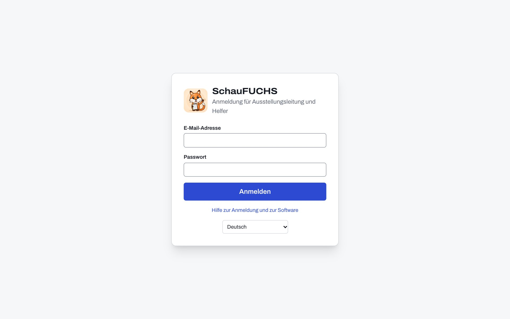

SchauFUCHS erreichen Sie im Browser unter:

`https://schau.ihr-verein.de/anmelden`

1. Geben Sie Ihre „E-Mail-Adresse“ und Ihr „Passwort“ ein.
2. Klicken Sie auf „Anmelden“.
3. Ist bei Ihnen die Zwei-Faktor-Anmeldung eingerichtet (für Administratoren Pflicht, siehe 1.2), erscheint die Seite „Bestätigungscode“. Geben Sie den 6-stelligen Code aus Ihrer Authenticator-App ein und klicken Sie erneut auf „Anmelden“.

Ohne Telefon geht im zweiten Schritt auch ein **Notfallcode** (siehe 1.3).

Nach der Anmeldung steht links die Seitenleiste: oben das Logo mit dem Namen und darunter klein die Versionsnummer (z. B. „Version 1.21.4“), dann „Alle Schauen“, der Gruppe „Verein“ („Aussteller“, „Spender“, „Import“, „Verein und Datenschutz“), der Gruppe „Einrichtung“ („Rassen und Farbenschläge“, „Benutzer“) und „Hilfe“; Gruppen klappen per Klick auf die Überschrift zu und auf (siehe 5.1). Ganz unten steht ein Knopf mit Ihren Initialen und Ihrem Namen; er klappt Name, Verein, Rolle mit der Versionsnummer („SchauFUCHS 1.21.4“), die Darstellung (siehe 1.5), „Mein Zugang“ und „Abmelden“ auf. Über dem Inhalt zeigt eine schmale Zeile, wo Sie gerade sind, zum Beispiel „Demo-Vereinsschau 2026 / Meldungen“. Auf schmalen Bildschirmen (Tablet hochkant, Handy) ist die Seitenleiste eingeklappt: Der Knopf mit den drei Strichen oben links öffnet sie.

> **Tipp:** Melden Sie sich an fremden oder gemeinsam genutzten Rechnern immer mit „Abmelden“ ab.

**Hilfe:** „Hilfe“ öffnet in einem eigenen Tab, Ihre Arbeit bleibt offen. Dort stehen die drei Handbücher mit den Reitern „Ausstellungsleitung“, „Helfer“ und „Preisrichter“. „Drucken“ druckt das geöffnete Handbuch, „Als PDF“ öffnet die gesetzte Druckfassung, und die Leiste „Handbücher zum Ausdrucken“ lädt mit „… (PDF)“ jedes der drei Handbücher als PDF herunter – etwa zum Austeilen an Helfer und Preisrichter. „Schließen“ schließt den Hilfe-Tab. Die Hilfe ist auch ohne Anmeldung erreichbar – über den Link „Hilfe zur Anmeldung und zur Software“ auf der Anmeldeseite, und Preisrichter öffnen sie am Tablet mit dem Knopf „Hilfe“ oben rechts. Ohne Netz öffnet sich die Hilfe nur, wenn die Anwendung auf diesem Gerät vorher einmal online geöffnet war.

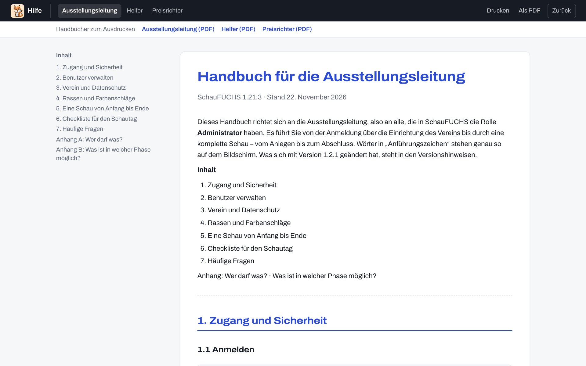

**Rückfragen:** Fragt die Software vor einem Schritt nach, öffnet sich ein eigenes Fenster in der Seite (kein Browser-Fenster mehr). Oben steht, worum es geht, unten „Abbrechen“ und ein Knopf, der die Aktion nennt, z. B. „Stornieren“ oder „Trotzdem weiter“. Verlangt die Rückfrage einen Grund, lässt sich der Knopf erst drücken, wenn mindestens 3 Zeichen eingetragen sind. Gründe stehen im Protokoll – bitte ohne Personennamen.

**Wenn die Anmeldung scheitert:**

| Meldung | Bedeutung |
|---|---|
| „E-Mail oder Passwort stimmt nicht.“ | Tippfehler oder falsches Passwort. Die Meldung sagt bewusst nicht, welches von beiden falsch ist. |
| „Zu viele Fehlversuche für dieses Konto. Bitte bis zu … Minuten warten oder die Ausstellungsleitung bitten, die Sperre aufzuheben.“ | Nach mehreren falschen Passwörtern wartet das Konto. Ein anderer Administrator kann die Wartezeit aufheben (siehe 2.4). |
| „Der Code stimmt nicht. Bitte den aktuellen Code aus der App eingeben.“ | Code abgelaufen oder vertippt. Den gerade angezeigten Code nehmen. |
| „Die Anmeldung ist abgelaufen. Bitte noch einmal mit Passwort anmelden.“ | Zwischen Passwort und Code verging zu viel Zeit. Von vorn beginnen. |

### 1.2 Zwei-Faktor-Anmeldung: Pflicht für Administratoren

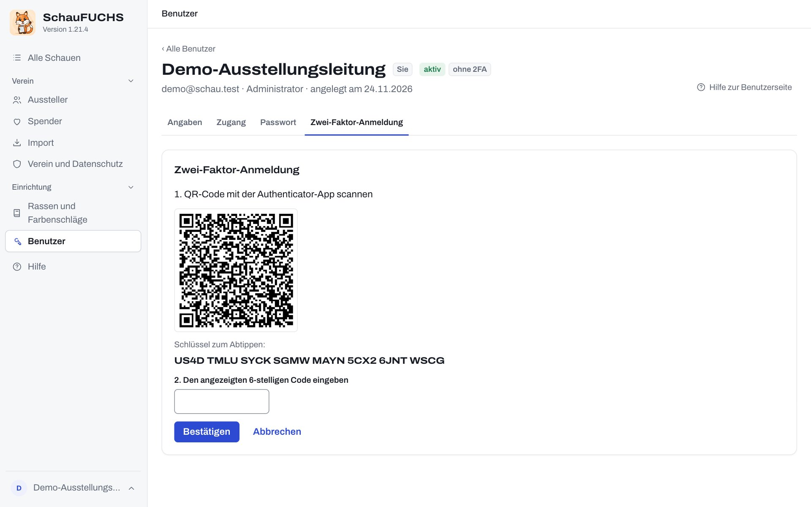

Für Administratoren ist die Zwei-Faktor-Anmeldung (kurz 2FA) Pflicht. Zusätzlich zum Passwort verlangt die Anmeldung dann einen Code, den eine App auf Ihrem Telefon alle 30 Sekunden neu anzeigt. Wer Ihr Passwort kennt, kommt ohne Ihr Telefon trotzdem nicht hinein.

**Solange Sie die Zwei-Faktor-Anmeldung nicht eingerichtet haben, gelten Sie überall als Helfer.** Einstellungen, Benutzer, Geldfunktionen, Bankdaten und Auskünfte stehen Ihnen dann nicht zur Verfügung. Die Oberfläche führt Sie nach der Anmeldung direkt zur Seite „Mein Zugang“ und lässt Sie bis zur Einrichtung auch nicht auf andere Seiten (nur „Hilfe“ geht). Dort steht der Hinweis:

„Für Administratoren ist die Zwei-Faktor-Anmeldung Pflicht. Bitte mit einer Authenticator-App einrichten und die Notfallcodes sichern – nach „Habe ich gesichert“ stehen alle Verwaltungsfunktionen zur Verfügung.“

**So richten Sie die Zwei-Faktor-Anmeldung ein:**

1. Installieren Sie auf Ihrem Telefon eine Authenticator-App, zum Beispiel Google Authenticator, Microsoft Authenticator oder 2FAS.
2. Öffnen Sie Ihre eigene Seite. Solange die Einrichtung fehlt, öffnet sie sich von selbst („Mein Zugang“); später erreichen Sie sie über „Benutzer“ → Ihr eigener Name.
3. Im Reiter „Zwei-Faktor-Anmeldung“ geben Sie unter „Passwort zur Bestätigung“ Ihr Passwort ein und klicken auf „Einrichten“.
4. Es erscheint ein QR-Code. Scannen Sie ihn mit der Authenticator-App. Hat das Telefon keine Kamera, wählen Sie in der App „Schlüssel eingeben“ und tippen den darunter angezeigten Schlüssel ab.
5. Geben Sie im Feld „2. Den angezeigten 6-stelligen Code eingeben“ den Code aus der App ein und klicken Sie auf „Bestätigen“.
6. Die Software zeigt jetzt **10 Notfallcodes** an (Form `XXXX-XXXX`). **Drucken Sie sie sofort aus** oder schreiben Sie sie ab. Sie werden nicht noch einmal angezeigt.
7. Klicken Sie auf „Habe ich gesichert“. Erst danach stehen alle Verwaltungsfunktionen zur Verfügung.

Sie erhalten eine Hinweismail „Zwei-Faktor-Anmeldung eingerichtet“.

> **Wichtig:** Meldet die App-Eingabe „Der Code stimmt nicht. Bitte prüfen, ob die Uhr des Telefons richtig geht, und den aktuellen Code eingeben.“, stellen Sie am Telefon die automatische Uhrzeit ein. Die Codes hängen an der genauen Uhrzeit.

**Abschalten:** Unter „Zwei-Faktor-Anmeldung“ → „Abschalten …“ mit „Passwort“ und „Code aus der App oder Notfallcode“, dann „Zwei-Faktor-Anmeldung abschalten“. Als Administrator verlieren Sie damit sofort wieder alle Verwaltungsrechte, bis Sie die Zwei-Faktor-Anmeldung neu einrichten.

### 1.3 Notfallcodes und verlorenes Telefon

Jeder Notfallcode gilt **genau einmal**. Sie geben ihn bei der Anmeldung statt des 6-stelligen App-Codes ein. Wie viele noch übrig sind, sehen Sie auf Ihrer eigenen Seite („Noch … Notfallcodes übrig.“).

**Empfehlung des Vereins:**

- Mindestens **zwei Administratoren** mit eingerichteter Zwei-Faktor-Anmeldung – spätestens vor dem Schautag.
- Die Notfallcodes beider Administratoren ausgedruckt im **Kassenordner**.

**Telefon verloren oder gewechselt:**

1. Mit einem Notfallcode kommen Sie auch ohne Telefon hinein.
2. Ein **anderer Administrator** setzt Ihre Zwei-Faktor-Anmeldung zurück: „Benutzer“ → Ihr Name → Reiter „Zwei-Faktor-Anmeldung“ → „Zwei-Faktor-Anmeldung zurücksetzen“ und die Rückfrage bestätigen.
3. Danach melden Sie sich nur mit Passwort an und richten die Zwei-Faktor-Anmeldung sofort neu ein (siehe 1.2). Bis dahin gelten Sie wieder als Helfer.

Die betroffene Person erhält eine Hinweismail „Ihre Zwei-Faktor-Anmeldung wurde zurückgesetzt“.

> **Wichtig:** Zurücksetzen kann nur ein Administrator, der selbst eine eingerichtete Zwei-Faktor-Anmeldung hat. Kommt **kein** Administrator mehr hinein (alle Telefone weg, keine Notfallcodes), hilft nur noch der Betreuer der Technik direkt auf dem Server. Das Verfahren steht in der Betriebsdokumentation (Abschnitt „Zwei-Faktor-Anmeldung: Pflicht und Notfall“). Genau deshalb die zwei Administratoren und die Codes im Kassenordner.

### 1.4 Eigenes Passwort ändern

Auf Ihrer eigenen Seite im Reiter „Passwort“ („Eigenes Passwort ändern“): „Bisheriges Passwort“, „Neues Passwort“ (mindestens 10 Zeichen), dann „Passwort ändern“.

### 1.5 Darstellung: hell oder dunkel

Unten in der Seitenleiste auf Ihren Namen klicken, dann unter „Darstellung“ wählen:

- **System** – folgt der Einstellung des Geräts (hell am Tag, dunkel am Abend, wenn das Gerät so eingestellt ist). Das ist die Vorgabe.
- **Hell** oder **Dunkel** – immer so, unabhängig vom Gerät.

Die Wahl gilt nur für dieses Gerät und diesen Browser. Gedruckt wird immer hell. Der Hallenplan bleibt auch im dunklen Modus ein helles Blatt, damit er aussieht wie gedruckt.

### 1.6 Sprache der Oberfläche

SchauFUCHS gibt es auf Deutsch, Deutsch (Schweiz), Englisch, Französisch, Niederländisch, Polnisch und Tschechisch. Jede Sprache steht in der Auswahl unter ihrem eigenen Namen (z. B. „Polski“).

- **Auf der Anmeldeseite** wählen Sie die Sprache unten unter „Hilfe zur Anmeldung und zur Software“. Die Wahl merkt sich dieser Browser; nach dem Anmelden wird sie für Ihren Zugang gespeichert.
- **Angemeldet:** unten in der Seitenleiste auf Ihren Namen klicken, dann unter „Sprache“ wählen. Die Sprache wird mit Ihrem Zugang gespeichert und gilt auf jedem Gerät, an dem Sie sich anmelden.
- Ohne eigene Wahl bleibt die Oberfläche deutsch – auch wenn der Browser auf eine andere Sprache eingestellt ist.
- Jeder Helfer stellt seine eigene Sprache ein; die Kollegen am Nachbarrechner sehen weiter ihre.

Übersetzt sind alle Seiten, Knöpfe, Hinweise und Fehlermeldungen. **Deutsch bleibt**, was Sie selbst schreiben (Schauname, Bestimmungen, Vorlagen), das Rassen- und Farbenschlagverzeichnis, Bewertungstexte und Textbausteine, alle Drucke und PDFs (Katalog, Bewertungskarten, Abrechnungen), Impressum und Datenschutzhinweise, das Protokoll, die Mails an Benutzer und dieses Handbuch. Die Seiten für Aussteller haben ihre eigene Sprachwahl (siehe „Online-Meldung in anderen Sprachen“).

### 1.7 Nur Lesen (Lesemodus) {#lesemodus}

Steht über jeder Seite die gelbe Leiste „Nur Lesen – Änderungen sind gerade nicht möglich.“, hat der Betreiber Ihrer Installation SchauFUCHS in den Lesemodus geschaltet, zum Beispiel für eine Wartung. Dahinter kann ein Hinweis des Betreibers stehen („Wartung bis 18 Uhr“).

- **Was geht:** alles ansehen, suchen, drucken und herunterladen (Katalog, Listen, Abrechnungen, Belege, PDF-Vorschauen), an- und abmelden, die Zwei-Faktor-Anmeldung einrichten, das eigene Passwort ändern und die Sprache wählen. Administratoren können einen Benutzer auf allen Geräten abmelden oder sperren (bei Verdacht auf fremden Zugriff) – entsperren erst danach.
- **Was nicht geht:** speichern, anlegen, löschen, buchen, Bestätigungen verschicken, Einladungen annehmen. Ein Versuch endet mit der Meldung „Nur Lesen: Änderungen sind gerade nicht möglich.“; nichts wird halb gespeichert. Ein Beleg, der beim Herunterladen erst entsteht, wird gezeigt, aber nicht im Belegarchiv abgelegt.
- **Aussteller** sehen auf den öffentlichen Seiten „Meldungen können zurzeit nicht abgegeben oder geändert werden.“ Den Widerruf der Online-Veröffentlichung nimmt SchauFUCHS trotzdem an, eine neue Einwilligung erst danach.
- **Preisrichter-Tablets** bewerten weiter; die Bewertungen bleiben im Gerät und gehen nach dem Lesemodus von selbst heraus.

Den Lesemodus schaltet der Betreiber ein und aus (Einstellung `NUR_LESEN`), nicht die Ausstellungsleitung. Fragen dazu also an ihn.

---

## 2. Benutzer verwalten

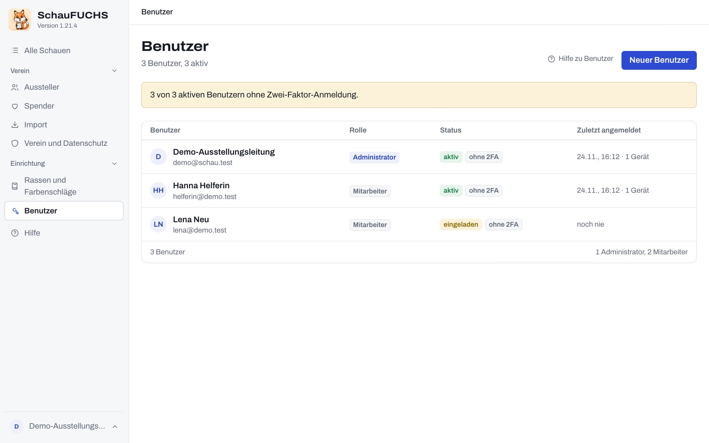

Unter „Benutzer“ sehen Sie alle Zugänge des Vereins mit Rolle, Status und letzter Anmeldung. Es gibt zwei Rollen:

| Rolle | Auswahltext beim Anlegen | Darf |
|---|---|---|
| Mitarbeiter (in den Handbüchern: Helfer) | „Mitarbeiter – Meldestelle, Kasse, Halle“ | Meldungen erfassen, Bargeld annehmen (auch bei der Einlieferung), Einlieferung, Verkauf gegen bar; **keine Noten und keine Preise** (Einzelheiten im Anhang) |
| Administrator | „Administrator – alles, auch Einstellungen und Benutzer“ | zusätzlich Einstellungen, Phasen, Freigaben, Überweisungen, Benutzer, Datenschutz |

In der Liste zeigt die Spalte „Status“ zum Beispiel „aktiv“, „eingeladen“, „Einladung abgelaufen“, „gesperrt“, dazu „2FA“ oder „ohne 2FA“ und gegebenenfalls „Wartezeit“. Oben weist ein Hinweis darauf hin, wie viele aktive Benutzer noch keine Zwei-Faktor-Anmeldung haben.

### 2.1 Neuen Benutzer anlegen

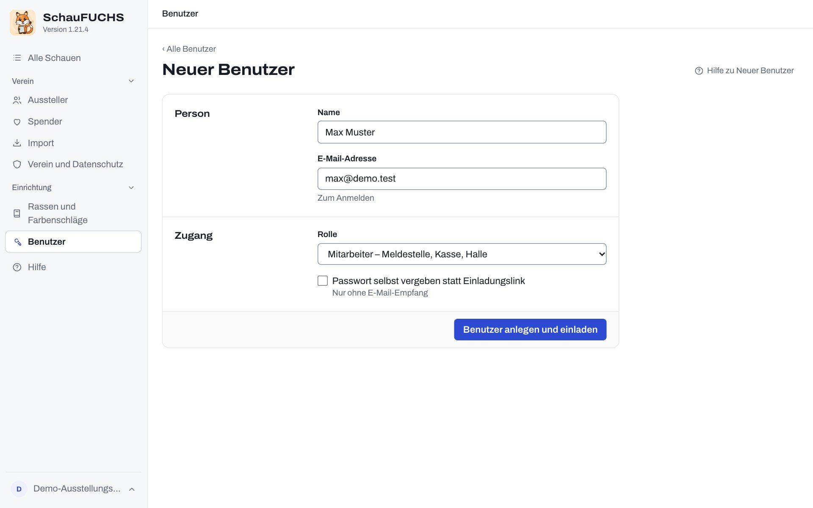

1. „Benutzer“ → „Neuer Benutzer“.
2. Im Abschnitt „Person“ „Name“ und „E-Mail-Adresse“ eintragen. Mit der E-Mail-Adresse meldet sich die Person später an.
3. Im Abschnitt „Zugang“ die „Rolle“ wählen.
4. „Benutzer anlegen und einladen“ klicken.

Die Person bekommt eine Willkommensmail mit einem **Einladungslink**. Darüber legt sie ihr Passwort selbst fest. Der Link gilt **7 Tage und nur einmal**. Administratoren werden in der Mail darauf hingewiesen, dass sie danach die Zwei-Faktor-Anmeldung einrichten müssen.

**Ohne E-Mail:** Kann die Person keine Mail bekommen, setzen Sie den Haken „Passwort selbst vergeben statt Einladungslink“, tragen ein „Erstes Passwort“ ein (mindestens 10 Zeichen) und klicken „Benutzer anlegen“. Das Passwort geben Sie persönlich weiter.

### 2.2 Die Seite eines Benutzers

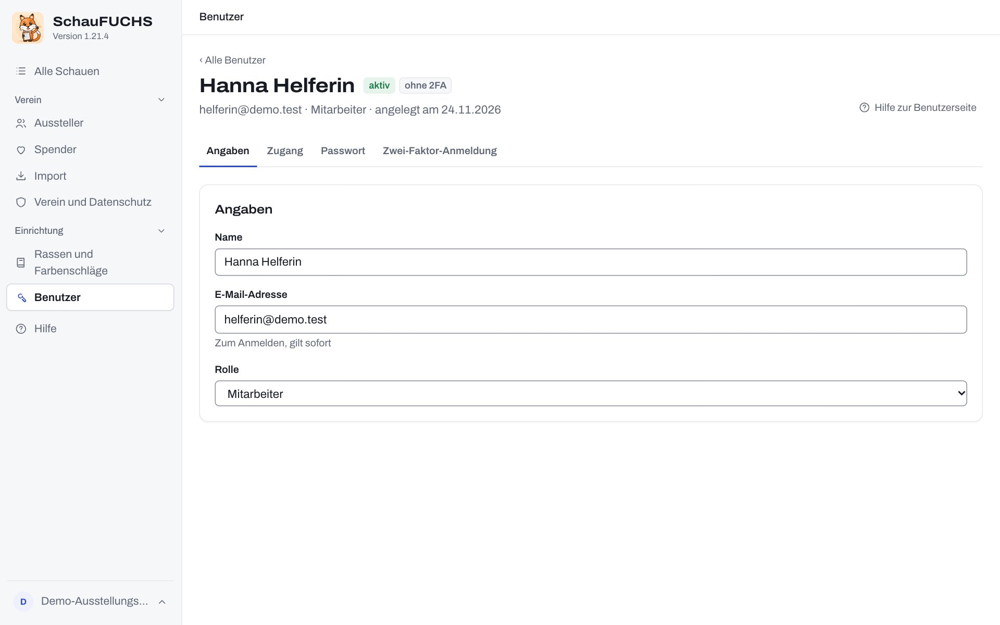

Ein Klick auf einen Namen öffnet seine eigene Seite. Sie hat vier Abschnitte.

**„Angaben“** – Name, E-Mail-Adresse und Rolle ändern, dann „Speichern“.

- Bei einer Änderung der Adresse gilt sofort die neue. An die alte Adresse geht eine Hinweismail.
- Der Haken „Willkommensmail neu schicken“ (bzw. „Neue Einladung schicken“ bei offener Einladung) schickt die Mail an die neue Adresse.
- Die eigene Rolle können Sie nicht ändern: „Die eigene Rolle ändert ein anderer Administrator.“

**„Zugang“** – Status, letzte Anmeldung, angemeldete Geräte und diese Knöpfe:

| Knopf | Wirkung |
|---|---|
| „Neue Einladung senden“ | Bei offener oder abgelaufener Einladung: neuer Link, der alte gilt nicht mehr. |
| „Willkommensmail erneut senden“ | Bei aktivem Zugang: Willkommensmail noch einmal, ohne Passwort. |
| „Sperre nach Fehlversuchen aufheben“ | Hebt die Wartezeit nach zu vielen falschen Passwörtern auf. |
| „Benutzer sperren“ / „Benutzer entsperren“ | Sperren meldet die Person auf allen Geräten ab; eine Anmeldung ist bis zum Entsperren nicht möglich. |
| „Auf allen Geräten abmelden“ | Beendet alle Sitzungen, z. B. wenn ein Gerät verloren ging. Auf Ihrer eigenen Seite heißt der Knopf „Andere Geräte abmelden“. |
| „Benutzer löschen“ | Siehe 2.3. |

**„Passwort“** – „Neues Passwort setzen“, wenn jemand sein Passwort vergessen hat. Die Person wird auf allen Geräten abgemeldet und bekommt eine Hinweismail **ohne** Passwort. Das neue Passwort geben Sie persönlich weiter; die Person sollte es danach unter „Mein Zugang“ selbst ändern.

**„Zwei-Faktor-Anmeldung“** – zeigt „eingerichtet“ mit Datum und Zahl der übrigen Notfallcodes oder „nicht eingerichtet“. Hier steht „Zwei-Faktor-Anmeldung zurücksetzen“ (siehe 1.3). Einrichten kann jede Person die 2FA nur selbst mit ihrem eigenen Telefon.

### 2.3 Löschen: was bleibt

„Benutzer löschen“ fragt vorher nach. Danach gibt es zwei mögliche Ergebnisse:

- **„… gelöscht.“** – Die Person hatte noch nichts erfasst. Der Zugang ist vollständig weg.
- **„… entfernt. Anmeldung, E-Mail, Passwort und 2FA sind gelöscht; der Name bleibt in Protokoll und Kasse sichtbar.“** – Die Person hat schon etwas erfasst (z. B. Zahlungen, Verkäufe, Protokolleinträge). Dann wird der Zugang nur entfernt; ihr Name bleibt an diesen Einträgen stehen, damit Protokoll und Kasse nachvollziehbar bleiben. Die E-Mail-Adresse ist danach wieder frei.

Das Löschen lässt sich nicht rückgängig machen.

### 2.4 Grenzen, die die Software einhält

- **Es bleibt immer mindestens ein aktiver Administrator.** Wer den letzten Administrator sperren, löschen oder zum Mitarbeiter machen will, bekommt: „Es muss mindestens ein aktiver Administrator bleiben.“
- Sich selbst können Sie weder sperren noch löschen („Sie können sich nicht selbst sperren.“ / „Sie können sich nicht selbst löschen.“).
- Das eigene Passwort ändern Sie nur über „Eigenes Passwort ändern“, nicht über „Neues Passwort setzen“.

---

## 3. Verein und Datenschutz

Den Menüpunkt „Verein und Datenschutz“ sehen nur Administratoren. Die Angaben gelten für alle Schauen des Vereins.

### 3.1 Vereinsangaben (Impressum)

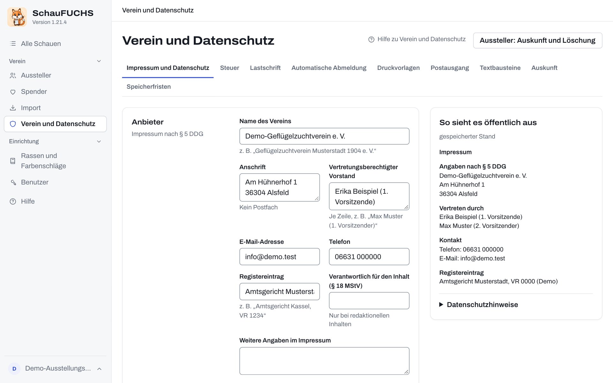

Im Abschnitt „Anbieter“ (Impressum nach § 5 DDG) tragen Sie ein:

- „Name des Vereins“ (wie im Vereinsregister),
- „Anschrift“ (kein Postfach),
- „E-Mail-Adresse“ und „Telefon“,
- „Vertretungsberechtigter Vorstand“ (je Zeile ein Name mit Funktion),
- „Registereintrag“ (z. B. Amtsgericht und VR-Nummer),
- bei Bedarf „Verantwortlich für den Inhalt (§ 18 MStV)“ und „Weitere Angaben im Impressum“.

Klicken Sie auf „Angaben speichern“. Rechts zeigt „So sieht es öffentlich aus“ den gespeicherten Stand.

Name und Anschrift des Vereins stehen auch im Impressum des gedruckten Katalogs (als Herausgeber). Die Druckerei tragen Sie beim Katalog ein (siehe 5.6).

Fehlen Pflichtangaben, steht oben: „Für Impressum und Datenschutzhinweise fehlt noch: …“. Pflicht sind Name, Anschrift, E-Mail-Adresse und Vertretungsberechtigter Vorstand. Impressum und Datenschutzhinweise sind unten auf jeder öffentlichen Schau-Seite verlinkt. Ab der Meldephase meldet die Übersicht jeder Schau fehlende Angaben als Fehler.

### 3.2 Datenschutzhinweise

Die Software erzeugt die Datenschutzhinweise aus Ihren Angaben und beschreibt, was sie tatsächlich verarbeitet. Verantwortlich für den Text ist der Verein.

- „Datenschutzbeauftragter (falls benannt)“ und „Ergänzungen“ hängen Sie an das Muster an.
- Unter „Eigener vollständiger Text (ersetzt das Muster)“ können Sie einen eigenen Text eintragen. „Muster als eigenen Text übernehmen und bearbeiten“ kopiert das Muster als Ausgangspunkt.

Das Muster nennt unter anderem: das Widerspruchsrecht gegen die Nennung im Katalog (Art. 21 DSGVO, siehe 5.4), dass die Anschrift der Preisrichter nur mit deren Einverständnis im gedruckten Katalog steht, dass Ergebnisse und Katalog 12 Monate nach der Schau aus dem Internet genommen werden, und die Speicherfristen aus 3.6. Haben Sie einen eigenen Text, gleichen Sie ihn mit dem aktuellen Muster ab.

> **Tipp:** Die Betriebsdokumentation enthält einen Vorschlag für einen Absatz zum Schutz des Servers (Protokollierung, automatische Sperren, nur Aufrufe aus Deutschland). Lassen Sie ihn vom Betreuer der Technik geben und tragen Sie ihn unter „Ergänzungen“ ein.

> **Wichtig:** Lassen Sie den Text prüfen, zum Beispiel vom Datenschutzbeauftragten oder vom Landesverband.

### 3.3 Postausgang

Der Reiter „Postausgang“ zeigt die letzten 100 Mails von SchauFUCHS – Eingangsbestätigungen an Aussteller ebenso wie Einladungen und Hinweismails an Benutzer –, die nicht versendeten zuerst. Der Stand ist „Wartet“, „Gesendet“ oder „Nicht versendet“.

- Der Server versucht eine nicht versendete Mail bis zu 2 Tage lang immer wieder.
- Danach prüfen Sie mit dem Betreuer der Technik die Mailserver-Einstellungen und klicken bei der Mail auf „Erneut senden“.
- Ist der Mailversand auf dem Server gar nicht eingerichtet, weist ein Hinweis darauf hin („Der Mailversand ist nicht eingerichtet …“). Die Mails bleiben dann hier liegen und lassen sich nicht versenden; das richtet der Betreuer der Technik ein.

### 3.4 Textbausteine für die Bewertung

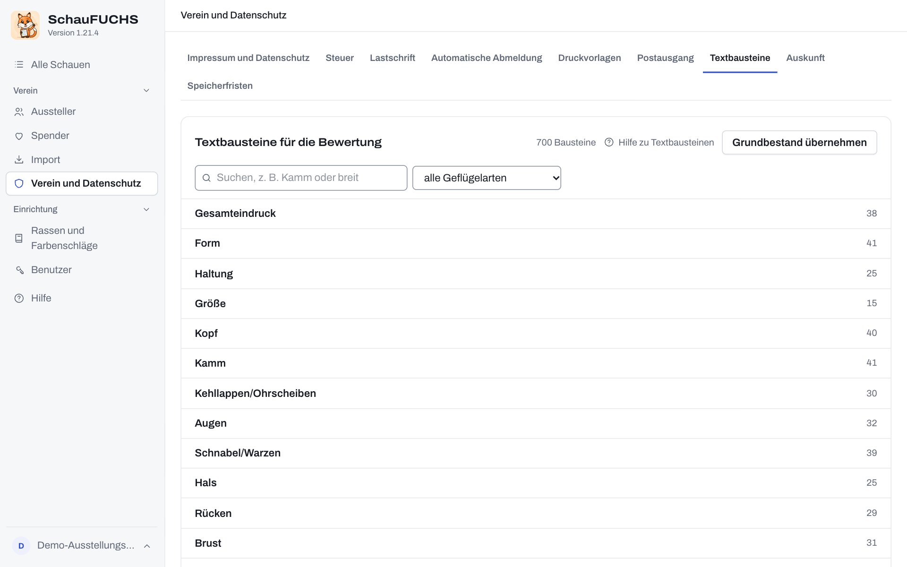

Textbausteine sind kurze Formulierungen, die Preisrichter am Tablet antippen statt tippen. Sie gelten für alle Schauen des Vereins und sind geordnet nach:

- **Kategorie:** „Vorzüge“, „Wünsche“, „Mängel“,
- **Merkmal:** z. B. Kamm, Rücken, Farbe,
- **Geflügelart:** „alle Arten“, „Hühner und Zwerghühner“, „Tauben“, „Enten und Gänse“, „Puten“, „Perlhühner“, „Wachteln“, „Ziergeflügel“,
- **Rasse (freiwillig):** Ein Baustein kann zusätzlich nur für eine Rasse gelten, z. B. „Kammzacken zu grob“ nur für Wyandotten. In der Liste steht dann „nur Wyandotten“.

Das Tablet zeigt je Tier die Bausteine seiner Geflügelart und – falls vorhanden – die seiner Rasse, jeweils zum gewählten Merkmal. Die Bausteine der Rasse stehen zuerst.

**Grundbestand übernehmen:** Der Knopf „Grundbestand übernehmen“ legt einen vorbereiteten Bestand an (rund 700 Bausteine). Er ergänzt nur, was fehlt; eigene Bausteine bleiben, nichts wird gelöscht. Ist schon alles da, meldet er: „Der Grundbestand ist schon vollständig vorhanden.“

**Eigenen Baustein hinzufügen:**

1. „Kategorie“ wählen.
2. „Merkmal“ eintragen (vorhandene werden vorgeschlagen).
3. „Geflügelart“ wählen.
4. Soll der Baustein nur für eine Rasse gelten, die Rasse unter „Rasse (optional)“ eintragen – die Rassen des Verzeichnisses werden vorgeschlagen, die Geflügelart wird dabei passend gesetzt. Leer lassen gilt für alle Rassen der Art. Wählen Sie einen Vorschlag: Der Baustein erscheint nur bei genau so benannten Rassen; ein Name, der so nicht im Verzeichnis steht, wird mit „Nicht im Verzeichnis – Vorschlag wählen“ markiert.
5. Unter „Neuer Textbaustein“ den „Text“ eintragen und „Hinzufügen“ klicken.

Einen Baustein entfernen Sie mit „löschen“ hinter dem Text. Mit dem Suchfeld und der Auswahl der Geflügelart („alle Geflügelarten“ zeigt alle) über der Liste filtern Sie die Anzeige.

> **Tipp:** Pflegen Sie die Bausteine vor der Bewertung. Das Tablet bekommt die Bausteine zusammen mit seinen Tieren; spätere Änderungen sieht der Preisrichter erst, wenn das Tablet seine Daten neu geladen hat (mit Verbindung).

### 3.5 Aussteller verwalten, Auskunft und Löschung

Den Menüpunkt „Aussteller“ sehen nur Administratoren. Dort stehen alle Aussteller des Vereins: Vereinsmitglieder und externe Aussteller aus anderen Vereinen. Unter „Verein und Datenschutz“ führt der Knopf „Aussteller: Auskunft und Löschung“ oben ebenfalls hierher.

**Wer ist Vereinsmitglied?** Die Software erkennt Mitglieder an der Vereinsangabe aus der Meldung. Klicken Sie einmal oben auf „Schreibweisen festlegen“ (neben „Aussteller anlegen“) und haken Sie an, welche Vereinsangaben Ihr Verein sind, zum Beispiel „GZV Musterdorf-Lindenau“ und „GZV Musterdorf Lindenau“. Fehlt eine Schreibweise in der Liste, tragen Sie sie unter „Weitere Schreibweise“ ein und klicken „Hinzufügen“. Groß- und Kleinschreibung, Bindestriche, Punkte und Leerzeichen zählen nicht. Alle Aussteller mit einer dieser Angaben gelten als Mitglied, auch künftige Meldungen. Bis die Schreibweisen festgelegt sind, gelten alle als extern, und die Seite startet mit „Alle“.

**Liste:** „Vereinsmitglieder“, „Externe Aussteller“ und „Alle“ über der Liste wählen die Gruppe. Das Suchfeld findet Name, Ort, Verein, E-Mail oder Registriernummer. Die Auswahl „alle Schauen“ bzw. „gemeldet in „…““ zeigt nur Aussteller mit einer Meldung in dieser Schau. Die Auswahl „Aktiv“, „Gesperrt“, „Gelöscht“ schränkt nach Stand ein. Jede Zeile zeigt „Mitglied“ oder „extern“, bei Hand-Einstellung mit dem Zusatz „(von Hand)“.

**Aussteller anlegen:** „Aussteller anlegen“ öffnet das Formular. Pflicht sind Vor- und Nachname. Gibt es schon jemanden mit gleichem Namen und gleicher PLZ, fragt die Software nach. Mit „Trotzdem neu anlegen“ legen Sie bewusst einen zweiten Eintrag an. Neu angelegte Aussteller findet die Meldungserfassung sofort.

**Bearbeiten:** „Bearbeiten“ oder ein Klick auf den Namen öffnet dasselbe Formular mit den gespeicherten Angaben. Der Haken „Ist Preisrichter“ ist ein Vorschlag für neue Meldungen: Wählen Sie den Aussteller beim Erfassen unter „Bekannten Aussteller suchen“, ist „Amtierender Preisrichter“ (Befreiung) schon angekreuzt. Unter „Vereinsmitglied“ wählen Sie:

- „Automatisch nach Verein“: Mitglied, wenn die Vereinsangabe einer festgelegten Schreibweise entspricht. In Klammern steht, was das gerade ergibt.
- „Ja, Mitglied“ oder „Nein, extern“: von Hand, unabhängig von der Vereinsangabe, z. B. für Mitglieder, die für einen anderen Verein ausstellen.

Jede Änderung steht im Protokoll, die IBAN nur gekürzt, Telefon, E-Mail und Kontoinhaber ohne Inhalt. Ist der Aussteller in Schauen gemeldet, steht die Änderung auch im Protokoll dieser Schauen, und der Online-Katalog zeigt sofort den neuen Stand. Hat inzwischen jemand anders den Aussteller geändert (z. B. über eine Meldung), speichert das Formular nicht: „Die Angaben wurden inzwischen geändert …“ – Formular schließen, neu öffnen, Änderung wiederholen. IBAN und Kontoinhaber lassen sich nicht ändern, solange eine offene SEPA-Datei den Aussteller enthält – erst die Datei buchen oder verwerfen. Das Geburtsdatum (nur für den Jugendtarif) erfassen Sie bei der Meldung. Gelöschte und gesperrte Aussteller lassen sich nicht bearbeiten.

- **„Auskunft“** erzeugt die Auskunft nach Art. 15 DSGVO als PDF zum Weitergeben, **„JSON“** dieselben Daten maschinenlesbar.
- **„Löschen“** öffnet einen Dialog. Tragen Sie einen „Grund“ ein (z. B. „Löschwunsch per E-Mail vom 06.11.2026“ – ohne Namen, er steht im Protokoll) und klicken Sie „Endgültig löschen“.

Was beim Löschen geschieht: Kontaktdaten, Bankdaten, Geburtsdatum, gespeicherte Mails und die Online-Veröffentlichung werden gelöscht; der Link aus der Bestätigungsmail funktioniert danach nicht mehr. Müssen Verkäufe oder Belege noch aufbewahrt werden, bleiben Name, Anschrift und Registriernummer bis zum Fristende **gesperrt** und werden dann gelöscht. Katalog und Abrechnung vergangener Schauen bleiben vollständig, nur ohne Namen.

**A-Bögen für die Mitglieder:** „A-Bögen drucken“ oben erzeugt zur gewählten Schau ein PDF mit einem A-Bogen je Vereinsmitglied, sortiert nach Namen. Name, Anschrift, Telefon, E-Mail, Verein, Kreisverband und Registriernummer sind vorausgefüllt, das Geburtsdatum nur bei Jugendlichen (am Bewertungstag unter 18). Die Tiere, das Kreuz „Preisrichter“ und alle Erklärungen trägt das Mitglied selbst ein; Bankdaten stehen nie darauf. Der Dialog nennt vorher die Zahl der Mitglieder und wie viele davon keine Anschrift haben; vorgeschlagen ist die neueste Schau, die noch nicht abgeschlossen ist. Jeder Bogen beginnt auf einer neuen Seite und zählt seine Seiten selbst. Gesperrte, gelöschte und Test-Aussteller bekommen keinen Bogen, zu Testschauen gibt es keine. „A-Bogen“ in einer Zeile erzeugt den Bogen nur für diesen Aussteller, auch für Externe.

**Aussteller von Testschauen** stehen in der Liste nur, wenn Sie oben „Test-Aussteller der Testschau „…““ wählen. Sie gehören nur zu ihrer Testschau (siehe 5.2). Bearbeiten, Auskunft und Löschen gehen wie bei echten Ausstellern – wichtig, falls sich eine echte Person über die öffentliche Seite in eine Testschau gemeldet hat.

**Käufer und Preisrichter** haben keinen Aussteller-Datensatz. Für sie gibt es unter „Verein und Datenschutz“ den Reiter „Auskunft“ (Auskunft für Käufer und Preisrichter): Namen eingeben, „Suchen“ (durchsucht die Verkaufslisten und die Preisrichter aller Schauen des Vereins), bei Treffern „Als JSON speichern“. Anschrift und Kontakt eines Preisrichters ändern oder leeren Sie auf der Seite „Preisrichter“ der jeweiligen Schau. Die Auskunft enthält auch Sparten, Gruppen, Obmann und Zusage mit Zeitraum und Vorbehalt. Von selbst löscht die Bereinigung Kontakt, PIN, „Zugesagt für“ und Vorbehalt 30 Tage nach dem Abschluss der Schau, die Anschrift nach 3 Jahren.

### 3.6 Speicherfristen

Der Reiter „Speicherfristen“ nennt die Fristen, die der Server täglich von selbst anwendet:

| Daten | Frist |
|---|---|
| Bestätigungsmails | 180 Tage |
| Geburtsdatum, IBAN, Kontaktdaten, PIN und Vorbehalt der Preisrichter | 30 Tage nach dem Abschluss der Schau; Geburtsdatum und IBAN frühestens 30 Tage nach dem Ende der Reklamationsfrist |
| Käuferdaten, Verkaufsaufzeichnungen, Tierliste, Gesundheitsjournal, Impfangaben | 3 Jahre |
| Buchungsbelege (Meldegeld, Auszahlungen, Kaufbelege) | 8 Jahre ab Jahresende |
| Aussteller ohne Meldung seit 3 Jahren | werden gelöscht bzw. bis Fristende gesperrt |

Zwei weitere Fristen wendet die Software ebenfalls von selbst an; sie stehen in den Datenschutzhinweisen:

| Daten | Frist |
|---|---|
| Inhalte des Änderungsprotokolls | 10 Jahre ab Jahresende (Bücher und Aufzeichnungen nach § 147 AO) |
| Ergebnisse und Katalog im Internet | 12 Monate nach dem Bewertungstag; danach sind öffentliche Ergebnisse und Online-Katalog nicht mehr abrufbar. Der gedruckte Katalog bleibt davon unberührt. |

„Fristen jetzt anwenden“ (oben rechts im Abschnitt) führt die Bereinigung sofort aus und meldet, was gelöscht wurde.

> **Wichtig:** Die Fristen nach dem Abschluss beginnen erst, wenn die Schau auf „Abgeschlossen“ steht. Schließen Sie jede Schau nach der Abrechnung ab (siehe 5.18). Meldet die Bereinigung „… Aussteller konnten nicht gelöscht werden (laufende Meldung – Schau abschließen).“, hängt noch eine nicht abgeschlossene Schau daran.

---

### 3.7 Automatische Abmeldung

Unter „Automatische Abmeldung“ legen Sie fest, nach wie vielen Minuten ohne Eingabe SchauFUCHS einen Zugang selbst abmeldet – getrennt für „Administratoren“, „Mitarbeiter“ und „Preisrichter (Bewertung)“. Zur Wahl stehen 5, 10, 15, 30, 60 und 120 Minuten. Vorgabe: Administratoren 60, Mitarbeiter und Preisrichter 120 Minuten. Die Änderung steht im Protokoll und gilt ab dem nächsten Aufruf.

- Als Eingabe zählt jedes Tippen, Klicken oder jede Taste, in allen offenen Tabs zusammen. Nur ein offener Bildschirm hält die Anmeldung nicht.
- In der letzten Minute erscheint unten „Automatische Abmeldung in … s“. Eine Eingabe genügt, um weiterzuarbeiten.
- Nach der Abmeldung steht auf der Anmeldeseite „Sie wurden nach längerer Untätigkeit automatisch abgemeldet.“ Nach dem Anmelden geht es zurück auf die Seite, auf der Sie waren. Nicht gespeicherte Eingaben sind verloren.
- Am Tablet bleibt ein Preisrichter angemeldet, solange er ohne Netz bewertet. Hat das Tablet noch nicht übertragene Bewertungen, meldet es nicht selbst ab; die Bewertungen bleiben im Gerät und gehen nach der nächsten Anmeldung mit der PIN hinaus.

### 3.8 Druckvorlagen

Unter „Druckvorlagen“ legen Sie fest, wie die Bewertungskarten gedruckt werden. Ohne eigene Vorlage druckt SchauFUCHS sie in DIN A6, vier je A4-Bogen. „Neue Bewertungskarte“ öffnet den Designer: links die Einstellungen, rechts ein Bogen mit Beispielkarten, der sich bei jeder Änderung neu aufbaut. Gespeichert wird erst mit „Speichern“; jede Änderung steht im Protokoll.

- **Papier:** DIN A6 (vier je A4-Bogen), DIN A5 (zwei je A4-Bogen, quer), DIN A4 (eine je Seite) oder „Endlospapier oder eigenes Maß“ mit Bogenbreite und -länge in Millimetern (12 Zoll = 304,8 mm, 6 Zoll = 152,4 mm) und der Zahl der Karten neben- und untereinander.
- **Feinabstimmung:** „Versatz nach rechts“ und „Versatz nach unten“ verschieben alles um Millimeter; die „Längenkorrektur“ in Prozent gleicht Endlospapier aus, das über viele Bögen wegläuft.
- **Probedruck:** druckt ein Millimeterraster mit roten Kreuzen an den Kartenecken. Messen Sie mit dem Lineal nach, wie weit die Kreuze von der Stelle auf dem Papier abweichen, und tragen Sie die Abweichung als Versatz ein.
- **„Ganze Karte drucken“:** SchauFUCHS druckt die ganze Karte. Die Bausteine (Kopf mit Katalognummer, Rasse und Farbenschlag, Klasse, Ringnummer, Vorzüge/Wünsche/Mängel, Ankreuzfeld, Note/Punkte/Preis, Unterschriften, Legende, eigener Text) schalten Sie ein und aus und ordnen sie mit ↑ und ↓. „Größe“ vergrößert oder verkleinert Schrift und Abstände; „Farbig“ aus druckt nur Schwarz, z. B. für Nadeldrucker mit Durchschlag.
- **„Vordruck bedrucken“:** Für gekaufte Karten (Verbandsvordruck, Endloskarten) druckt SchauFUCHS nur die Daten. Jedes Feld hat seine Lage in Millimetern ab der oberen linken Ecke der Karte, dazu Breite, Höhe und Schriftgröße. Legen Sie eine Karte auf den Probedruck, um die Stellen abzumessen.

**Vorlage für eine Schau:** In den Einstellungen der Schau wählen Sie im Reiter „Druck“ die Vorlage für die Bewertungskarten. „Für diese Schau anpassen“ legt eine Kopie nur für diese Schau an und öffnet sie im Designer; die Vorlage des Vereins bleibt dabei unverändert. Wird eine gewählte Vorlage gelöscht, druckt die Schau wieder mit der Vorgabe.

**Endlospapier am Drucker:** Das PDF hat genau die Größe eines Bogens. Unter Windows legen Sie dafür einmal ein eigenes Papierformat an (Druckserver-Eigenschaften, Formular mit Breite × Länge) und wählen es beim Drucken. Im Drucker stellen Sie die Bogenlänge ein und schalten „Perforation überspringen“ aus. Drucken Sie mit „Tatsächliche Größe“ bzw. 100 %, ohne Anpassen an die Seite.

#### Formate aller Drucke einer Schau {#druckformate}

Im Reiter „Druck“ der Einstellungen steht jede Drucksache der Schau mit ihrem Papierformat. Was sich umstellen lässt, wählen Sie dort direkt; die Änderung gilt sofort für den nächsten Druck und steht im Protokoll. Ändern können nur Administratoren, alle anderen sehen die Übersicht. Eine neue Schau aus einer Vorlage übernimmt die Formate und die Vorlage der Bewertungskarten.

| Drucksache | Format | Wo einstellen |
|---|---|---|
| Katalog | A4 hoch oder A5 hoch (Heft) | „Katalog gestalten“ (Link im Reiter) |
| Bewertungskarten | A6 (vier je A4), A5 (zwei je A4), A4, Endlospapier | Druckvorlage, Auswahl im Reiter (siehe oben) |
| Bewertungsliste | A4 hoch, zwei Listen nebeneinander, oder A5 hoch, eine Liste je Seite (für das Klemmbrett) | Reiter „Druck“ |
| Hallenplan | ein Blatt A4 oder A3, quer oder hoch nach der Halle | Reiter „Druck“ |
| Kaufbeleg mit Ausgabeschein | A5 quer, oder A4 hoch mit dem Beleg oben und einer Schnittlinie | Reiter „Druck“ |
| Kassenbelege und Spendenquittung | wie der Kaufbeleg | Reiter „Druck“ |
| B-Bogen, Abrechnung und Quittung, Preisrichterverpflichtung, Serienbrief | A4 hoch nach DIN 5008 | Texte und Briefkopf in der Briefvorlage |
| A-Bogen, Preisverteilung, Meisterschaften, Kassenbericht, Aufbauliste | A4 hoch | fest |
| Abrechnung aller Aussteller, Listen für das Veterinäramt | A4 quer | fest |
| Zuwendungsbestätigung | A4 hoch, amtliches Muster | fest |

- **Belege auf A4:** Haben Sie keinen Drucker mit A5-Fach, wählen Sie „A4 hoch, Beleg oben mit Schnittlinie“. Der Beleg ist genauso groß wie auf A5; schneiden Sie an der gestrichelten Linie ab. Ein Beleg wird beim Buchen abgelegt – ein späterer Wechsel des Formats ändert schon gebuchte Belege nicht.
- **Hallenplan auf A3:** Der Plan füllt das größere Blatt, Kopf und Legende bleiben gleich groß. Gut zum Aushängen und für große Hallen.
- Drucken Sie immer mit „Tatsächliche Größe“ bzw. 100 %, damit das Format stimmt.

### 3.9 Briefvorlage

Die Briefvorlage bestimmt, wie Briefe des Vereins aussehen: Meldebestätigung (B-Bogen), Abrechnung je Aussteller, Quittungen, Serienbriefe und die Preisrichterverpflichtung. Sie öffnen sie unter „Druckvorlagen“ → „Briefvorlage“ oder in den Einstellungen einer Schau im Reiter „Druck“. Briefbogen, Fußzeile, Meldebestätigung, Serienbrief und Preisrichterverpflichtung stehen in eigenen Reitern; gespeichert wird alles zusammen. Rechts steht ein Beispielbrief, der sich bei jeder Änderung neu aufbaut. Gespeichert wird erst mit „Speichern“; jede Änderung steht im Protokoll. Die Vorlage gilt für alle Schauen des Vereins.

- **Briefbogen:** „Form B“ (großer Briefkopf, üblich) oder „Form A“ (kleiner Briefkopf) nach DIN 5008. Die Anschrift sitzt so, dass sie im Fenster eines DL- oder C6/5-Umschlags zu sehen ist. Der „Briefkopf“ hat bis zu drei Zeilen (bei Form A passen zwei), die erste fett; leer stehen dort Vereinsname und Schau. „Absender über der Anschrift“ ist die kleine Zeile im Fenster. „Logo der Schau“, „Farbig“ (aus: nur Schwarz und Grau) und „Falz- und Lochmarken“ schalten Sie ein und aus.
- **Fußzeile:** drei Spalten, z. B. Anschrift, Bankverbindung und Vorstand. Sind alle leer, steht unten wie bisher der Vereinsname in einer Zeile.
- **Meldebestätigung:** Einleitung über der Liste der Tiere, Hinweise zur Einlieferung (je Zeile ein Hinweis, im Kasten „Zur Einlieferung“) und ein Gruß darunter. Wie der B-Bogen damit aussieht, sehen Sie beim Drucken der Ausstellerunterlagen einer Schau.
- **Serienbrief:** Betreff, Text und Gruß, mit denen jeder neue Serienbrief beginnt.
- **Preisrichterverpflichtung:** Betreff und Text des Briefs an die Preisrichter (siehe 5.7). Jedes Feld gilt für sich: Ein leeres Feld steht für den festen Betreff bzw. Text von SchauFUCHS, ein gefülltes ersetzt nur diesen Teil. Der feste Text nennt Ort, Bewertungstag und „Rückmeldung bis“ nur, wenn sie in den Einstellungen der Schau stehen. „Muster einsetzen“ füllt die leeren Felder mit diesem Text samt Platzhaltern, den Sie dann ändern. In einem eigenen Text bleibt ein Platzhalter ohne Wert leer – tragen Sie Bewertungstag und Rückmeldetermin also vorher ein. Der Gruß kommt aus dem Serienbrief, der Abschnitt zum Abtrennen bleibt immer gleich. Der Beispielbrief rechts zeigt hier weiter den Serienbrief; wie die Verpflichtung aussieht, sehen Sie nach dem Speichern mit „Verpflichtung“ auf der Seite „Preisrichter“ einer Schau (siehe 5.7).
- **Platzhalter:** In allen Texten setzt SchauFUCHS für jeden Empfänger ein: `{Anrede}` („Guten Tag Vorname Nachname“), `{Vorname}`, `{Nachname}`, `{Name}`, `{Verein}`, `{Schau}`, `{Ort}`, `{Meldeschluss}`, `{Einlieferung}`, `{Bewertungstag}`, `{Rückmeldung}` („Rückmeldung der Preisrichter bis“), `{Datum}`. Die Angaben zur Schau sind leer, wo keine Schau dazugehört oder der Termin fehlt. Ein vertippter Platzhalter wie `{Vornahme}` bleibt so im Brief stehen; die Seite warnt davor.
- „Vorgabe einsetzen“ stellt die Texte eines Briefs wieder so her, wie SchauFUCHS sie mitbringt (bei der Preisrichterverpflichtung: leer, also der feste Text).

**Serienbrief erstellen:** Unten auf der Seite wählen Sie die Empfänger: „Vereinsmitglieder“, „Alle Aussteller“ oder „Aussteller einer Schau“ (alle mit bestätigter Meldung zu dieser Schau). Darunter steht, wie viele es sind und wie vielen eine vollständige Anschrift fehlt. Gesperrte und gelöschte Aussteller und Test-Aussteller bekommen keinen Brief. Betreff und Text können Sie für diesen Brief ändern, ohne die Vorlage zu ändern. „Serienbrief als PDF“ öffnet ein PDF mit einer Seite je Empfänger zum Drucken. Der Serienbrief nutzt immer die gespeicherte Vorlage; speichern Sie Änderungen am Briefbogen also vorher.

### 3.10 Steuerliche Angaben

Ohne diese Angaben stellt SchauFUCHS keine Zuwendungsbestätigungen aus. Sie stehen unter „Verein und Datenschutz“ im Reiter „Steuer“; jede Änderung steht im Protokoll.

- „Der Verein ist als gemeinnützig anerkannt“ ankreuzen.
- **Bescheid:** „Freistellungsbescheid“ (bzw. Anlage zum Körperschaftsteuerbescheid) oder „Feststellung nach § 60a AO“, dazu Finanzamt, Steuernummer und Datum des Bescheids, beim Freistellungsbescheid auch den letzten Veranlagungszeitraum (z. B. „2022“).
- **Steuerbegünstigter Zweck:** so, wie er im Satz „Wir sind wegen Förderung … befreit“ stehen soll, also z. B. „der Tierzucht“.
- **Ort für die Unterschrift:** steht über der Unterschriftszeile, zusammen mit dem Datum.

SchauFUCHS sperrt Zuwendungsbestätigungen, solange Angaben fehlen, und wenn der Freistellungsbescheid älter als fünf Jahre bzw. die Feststellung nach § 60a AO älter als drei Jahre ist (§ 63 Abs. 5 AO). Tragen Sie dann den neuen Bescheid ein.

### 3.11 Spenderverzeichnis

Unter „Spender“ (linke Leiste) stehen alle Spender des Vereins, über alle Schauen. Spender entstehen beim Erfassen einer Spende in einer Schau oder durch eine Spende bei der Tiermeldung (dann mit Name und Anschrift des Ausstellers).

- Anschrift, E-Mail und Notiz lassen sich ändern. Für eine Zuwendungsbestätigung braucht es Name, Straße, PLZ und Ort.
- „Darf im gedruckten Katalog als Spender genannt werden“ und „… auch mit Betrag“ sind die Einwilligungen des Spenders. Nur dann steht er im gedruckten Katalog unter „Wir danken unseren Spendern“ (im Online-Katalog nie).
- Unter „Spenden“ stehen alle Spenden dieses Spenders. „Sammelbestätigung 2026“ bestätigt alle Geldspenden eines Kalenderjahres, die noch keine Bestätigung haben, in einer Bestätigung mit Anlage. Sachspenden brauchen je eine eigene Bestätigung.
- Unter „Zuwendungsbestätigungen“ stehen alle ausgestellten Bestätigungen zum erneuten Drucken. „Stornieren“ macht eine Bestätigung ungültig, zum Beispiel bei einem falschen Betrag; ihre Spenden lassen sich danach neu bestätigen. Das Doppel bleibt gespeichert.

### 3.12 Import aus anderen Programmen {#import}

Unter „Import“ (linke Leiste, nur Administratoren) übernehmen Sie Meldungen oder Aussteller aus einem anderen Programm, zum Beispiel aus einem älteren Schau- oder Vereinsprogramm. Es gibt dafür kein festes Format: Speichern Sie die Liste im alten Programm als Excel-Datei (.xlsx) oder als CSV- bzw. Textdatei (auch „Unicode-Text“ aus Excel). Das alte Excel-Format .xls wird nicht gelesen; öffnen Sie solche Dateien in Excel oder LibreOffice und speichern Sie sie als .xlsx. Eine Datei darf höchstens 8 MB und 5000 Zeilen haben. Steht über der Überschriftenzeile noch ein Titel, löschen Sie diese Zeile vorher in der Datei.

1. **Datei:** Wählen Sie, was importiert wird: „Meldungen in eine Schau“ (dann die Schau, nur bis zur Phase „Halle & Katalog“) oder „Aussteller ins Verzeichnis“. Danach die Datei.
2. **Spalten zuordnen:** Für jede Spalte steht dort, welches Feld SchauFUCHS darin vermutet, darunter die ersten Zeilen. Prüfen Sie die Zuordnung und ändern Sie sie, wo nötig. Spalten ohne Feld werden nicht übernommen. Ein Name in einer Spalte wird als „Nachname, Vorname“ gelesen; ohne Komma gilt der letzte Teil als Nachname. Gibt es daneben eine Spalte „Vorname“, gilt „Name“ als Nachname. Ebenso wird „PLZ und Ort“ in einer Spalte getrennt. Geschlecht wird als 1,0 / 0,1 (auch „Hahn“, „Henne“, „m“, „w“) gelesen, das Alter als jung oder alt (auch „J“, „A“, „Vj“). Ein Geschlecht wie 1,2 ergibt einen Stamm. Dann „Prüfen“.
3. **Prüfen:** Oben stehen die Zahlen: Zeilen, übernehmbare Zeilen, Zeilen mit Fehlern, neue und vorhandene Aussteller. Zeilen mit Fehlern werden nicht übernommen; die Tabelle „Zeilen mit Fehlern oder Hinweisen“ nennt den Grund – etwa fehlender Vor- oder Nachname, unlesbares Geschlecht oder Alter, ein ausländischer Aussteller in einer Schau ohne Tiere aus dem Ausland, „Jugend“ bei einem Aussteller, der laut gespeichertem Geburtsdatum nicht mehr jugendlich ist. Was entbehrlich ist, wird mit Hinweis weggelassen: eine unlesbare E-Mail-Adresse, Telefonnummer oder Registriernummer. Eine vierstellige PLZ (Excel lässt die führende 0 weg) wird mit 0 ergänzt.
4. **Rassen und Farbenschläge:** Steht eine Rasse genau so im Verzeichnis der Schau, ist sie zugeordnet („genau gefunden“). Sonst wählen Sie aus den Vorschlägen den richtigen Eintrag oder „auslassen“. Diese Wahl merkt sich SchauFUCHS für den Verein: Beim nächsten Import mit derselben Schreibweise steht sie schon da („wie beim letzten Import“).
5. **Übernehmen** (oben rechts): Optional werden die Meldungen gleich bestätigt (ohne Bestätigungsmail). „Teilnahmebedingungen liegen unterschrieben vor“ kreuzen Sie nur an, wenn das für alle Meldungen der Datei stimmt.

**Aussteller wiedererkennen:** Gibt es einen Aussteller schon (gleiche Registriernummer, sonst gleicher Vor- und Nachname und gleiche PLZ), wird die Meldung bei ihm angelegt. Seine gespeicherten Daten bleiben, wie sie sind, auch wenn die Datei eine andere Anschrift hat; ändern Sie sie bei Bedarf unter „Aussteller“. Steht in der Datei eine andere Registriernummer, ist es ein anderer Aussteller (etwa Vater und Sohn mit gleichem Namen). Passt eine Zeile ohne Registriernummer zu mehreren Nummern – in der Datei oder bei vorhandenen Ausstellern –, ist sie ein Fehler („Name passt zu mehreren Registriernummern“): Tragen Sie die Nummer in der Datei nach. Hat er in der Schau schon eine Meldung, wird er übersprungen. So entsteht nichts doppelt, wenn Sie dieselbe Datei zweimal importieren. Gesperrte und gelöschte Aussteller werden nicht importiert. In einer Testschau entstehen alle Aussteller als Test-Aussteller.

**Zurücknehmen:** Unter „Frühere Importe“ steht jeder Import. „Zurücknehmen“ löscht seine Meldungen und die Aussteller, die er neu angelegt hat – nur bis zur Phase „Halle & Katalog“ und solange nichts weiter damit geschehen ist: niemand hat die Meldungen danach bearbeitet (auch nicht bestätigt), keine Zahlung, keine Katalognummern, keine Bewertung, kein Ehrenpreis, keine Spende, keine Abrechnung. Sonst bleibt alles stehen, und einzelne Meldungen stornieren Sie wie gewohnt. Ein neu angelegter Aussteller, den jemand danach bearbeitet hat oder der woanders gebraucht wird, bleibt erhalten. Import und Rücknahme stehen im Protokoll, die Rücknahme bei jeder Meldung. Während eines großen Imports können andere Änderungen kurz „Bitte noch einmal versuchen“ melden – dann einfach wiederholen.

### 3.13 SEPA-Lastschrift {#sepa-lastschrift}

Das Meldegeld lässt sich per SEPA-Basislastschrift einziehen – zusätzlich zu bar und Überweisung, die überall möglich
bleiben. Eingezogen wird nur bei Ausstellern mit unterschriebenem Mandat und nur, was dann noch offen ist.

- **Gläubiger-ID:** Unter „Verein und Datenschutz“, Reiter „Lastschrift“, die Gläubiger-Identifikationsnummer
  des Vereins eintragen (bei der Deutschen Bundesbank beantragt). Das Konto, auf das eingezogen wird, ist das
  Vereinskonto aus den Einstellungen der Schau.
- **Mandat:** Der Aussteller unterschreibt ein SEPA-Lastschriftmandat (Vordruck der Bank des Vereins). Unter „Aussteller“
  → Aussteller bearbeiten → „Mandat erfassen“ tragen Sie das Datum der Unterschrift, die IBAN, den Kontoinhaber und
  „wiederkehrend“ (für jede Schau) oder einmalig ein. Die Mandatsreferenz vergibt SchauFUCHS, wenn Sie keine eigene
  eintragen (Form „SF-M“ und die Nummer des Mandats). Ein Widerruf des Zahlers wird mit „Widerrufen“ und Datum
  festgehalten. Ein Mandat verfällt, wenn es 36 Monate nicht genutzt wurde; ein einmaliges Mandat gilt für eine
  Lastschrift und steht deshalb in höchstens einer offenen Datei. Für gelöschte oder gesperrte Aussteller lässt sich kein
  Mandat erfassen. Lastschrift geht nur von Konten in EU und EWR (für die Schweiz oder Großbritannien bräuchte sie BIC und
  Anschrift) – diese Aussteller zahlen bar oder per Überweisung.
- **Lastschriftdatei:** In der Schau unter „Lastschrift“ (Gruppe „Kasse und Abrechnung“, nur Administratoren) stehen alle
  bestätigten Meldungen mit offenem Meldegeld und gültigem Mandat. Wer an der Kasse schon abgerechnet ist (Quittung
  oder offene SEPA-Überweisung), steht nicht darin – sein Meldegeld ist dort verrechnet. Fälligkeitsdatum wählen
  (vorgeschlagen sind 14 Tage nach heute; frühestens der zweite Bankarbeitstag nach heute, nie ein Wochenende oder
  Bankfeiertag), „Vorabankündigung per E-Mail“ anlassen und „Lastschriftdatei erstellen“. Die
  Vorabankündigung (Betrag, Fälligkeit, Mandatsreferenz, Gläubiger-ID) muss den Zahler rechtzeitig erreichen – in der
  Regel 14 Tage vor der Fälligkeit, wenn mit ihm nichts anderes vereinbart ist. Wer keine E-Mail-Adresse hat, bekommt
  sie auf anderem Weg (z. B. mit der Meldebestätigung).
- **Bei der Bank einreichen:** „Datei herunterladen“ und die XML-Datei im Online-Banking hochladen. Die Datei hält die
  Beträge fest. Solange sie offen ist, geht nichts, was diese Beträge ändert oder die Meldung entfernt: keine weitere
  Zahlung, kein Storno, keine Tiere hinzufügen oder abmelden, keine anderen Gebühren, keine Stiftung oder Spende mit
  dem Meldegeld ändern, keine Zahlung stornieren, kein Widerruf des Mandats, keine Absage der Schau, keine Rücknahme des Imports, kein Löschwunsch.
  Ebenso keine Auszahlung an diese Aussteller, keine SEPA-Überweisungsdatei und kein Abschluss der Schau.
- **Eingang buchen:** Hat die Bank eingezogen (Kontoauszug), „Eingang buchen“: Jeder Posten wird als Zahlung
  „Lastschrift“ zum Fälligkeitstag gebucht. Lehnt die Bank die Datei ab, „Verwerfen“ mit Grund.
- **Rücklastschrift:** Kommt ein Betrag zurück (z. B. Konto erloschen, Widerspruch), unter „Frühere Lastschriften“ beim
  Posten „Rücklastschrift“ mit dem Grund laut Bank: Das Meldegeld ist wieder offen. Eine Lastschrift wird nur so
  zurückgebucht, nicht über „Zahlung stornieren“. Gibt es zu einer Spende mit diesem Meldegeld schon eine
  Zuwendungsbestätigung, erst die Bestätigung stornieren (unter „Spenden“).
- **Datenschutz:** IBAN und Kontoinhaber der Mandate sind verschlüsselt gespeichert. Nach dem Buchen oder Verwerfen
  enthält die Datei keine Bankdaten mehr. Beim Löschwunsch eines Ausstellers wird sein Mandat widerrufen und die
  Bankverbindung gelöscht, in früheren Lastschriftdateien auch sein Name. Mandate werden 14 Monate nach Widerruf bzw.
  Verfall gelöscht. Die Auskunft nach Art. 15 enthält die Mandate und alle Einzüge.

### 3.14 Überweisung mit GiroCode {#girocode}

Mit dem GiroCode überweisen Aussteller das Meldegeld per Banking-App: QR-Code scannen, prüfen, freigeben. Empfänger,
IBAN, Betrag und Verwendungszweck sind dann schon ausgefüllt. Für den Verein kostet das nichts außer den üblichen
Buchungsposten der Bank.

- **Einschalten:** In den Einstellungen der Schau unter „Meldegeld und Konto“ → „Meldegeld zahlen“ den Eintrag
  „vorab per Überweisung mit GiroCode“ wählen und das Vereinskonto eintragen (Kontoinhaber und IBAN; bei einem
  Konto außerhalb des EWR auch die BIC). Den **Kontoinhaber genau so schreiben, wie die Bank ihn führt** (vollständiger
  Vereinsname mit „e. V.“): Seit Oktober 2025 vergleicht die Bank des Ausstellers den Namen mit dem Konto und zeigt
  sonst „ähnlich“ oder „kein Treffer“ an.
- **Was Aussteller sehen:** Statt des freien Textes „Bankverbindung für das Meldegeld“ steht das Vereinskonto da. Jede
  Meldung bekommt einen eigenen Verwendungszweck, der mit einer Referenz beginnt (z. B. „RF540001234 Meldegeld
  Mueller, Hans“). Der GiroCode steht nach dem Absenden auf der Dankseite, auf „Meine Meldung“, im vorausgefüllten
  A-Bogen und im B-Bogen, die Eingangsbestätigung nennt den Verwendungszweck und verweist auf „Meine Meldung“. Der
  Code gilt immer über den noch offenen Betrag; ist alles bezahlt, verschwindet er. Der leere A-Bogen hat keinen Code.
- **Wann es keinen Code gibt:** ab der Phase „Einlieferung“ (dann wird an der Kasse bezahlt oder verrechnet), bei
  stornierten und abgelehnten Meldungen und für Aussteller mit gültigem Lastschriftmandat oder in der offenen
  Lastschriftdatei (siehe 3.13) – sie würden sonst doppelt zahlen. Der Kontoinhaber darf höchstens 70 Zeichen haben.
- **Ausland:** Banking-Apps in Deutschland, Österreich, Belgien, den Niederlanden und Finnland lesen den Code. Ob Apps
  in Polen, Tschechien oder der Schweiz ihn lesen, ist nicht sicher; dort überweisen Aussteller mit dem Verwendungszweck
  von Hand.
- **Zahlungseingang:** Der Code meldet nichts zurück. Den Eingang buchen Sie mit dem Kontoauszug-Import (3.15) oder
  wie bisher an der Meldung (siehe 5.4, „Zahlungen erfassen und bestätigen“). Die Referenz im Verwendungszweck zeigt,
  zu welcher Meldung das Geld gehört.

### 3.15 Kontoauszug-Import {#kontoauszug}

Statt jede Überweisung einzeln an der Meldung zu buchen, laden Sie den Kontoauszug hoch. SchauFUCHS ordnet die
Eingänge den Meldungen zu, Sie prüfen und buchen mit einem Klick. Die Software bekommt dabei keinen Zugang zum Konto.

1. Im Onlinebanking die Umsätze des Vereinskontos exportieren: als **CSV** (bei der Sparkasse „CSV-CAMT“) oder als
   **camt.053** (XML). Den Zeitraum seit dem letzten Import wählen; überschneiden darf er sich. Bitte immer **dasselbe
   Format** nehmen – eine Gutschrift einmal als CSV und einmal als camt erkennt die Software nicht als dieselbe.
   Kommt camt als ZIP-Archiv (eine Datei je Tag), die XML-Dateien vorher entpacken und einzeln hochladen.
2. In SchauFUCHS unter „Meldephase“ → „Kontoauszug“ die Datei wählen. Angezeigt werden nur Gutschriften in Euro.
3. Prüfen:
   - **„Referenz“** (grün): Der Verwendungszweck enthält die Referenz der Meldung, der Betrag passt. Schon angekreuzt.
   - **„Teilzahlung“ / „zu viel“**: Referenz passt, der Betrag nicht. Teilzahlungen sind angekreuzt, Überzahlungen nicht.
   - **„Vorschlag“**: keine Referenz, aber der Name des Zahlers und der Betrag passen zu genau einer Meldung. Bitte
     prüfen und ankreuzen.
   - Ohne Zuordnung: unter „Meldung“ von Hand wählen, oder so lassen (z. B. Spenden oder fremde Eingänge).
4. „… Zahlungen buchen“. Jede Gutschrift wird als Zahlung „Überweisung“ mit dem Buchungstag gebucht; ist eine Meldung
   damit ganz bezahlt, ist sie bestätigt. Danach steht bei diesen Posten „gebucht“.

Vorgemerkte Umsätze, Lastschriften und Kontostände liest die Software nicht. Wurde eine Meldung inzwischen anders
bezahlt (bar oder von Hand), bucht sie den Posten nicht und meldet „inzwischen anders bezahlt – bitte neu prüfen“.
Wer dieselbe Datei noch einmal hochlädt, bucht nichts doppelt. Eine falsch zugeordnete Gutschrift stornieren Sie an der
Meldung („Zahlung stornieren“); sie bleibt im Import danach „gebucht“ – die richtige Meldung buchen Sie dann von Hand. Vom Auszug speichert SchauFUCHS nur einen
Fingerabdruck der gebuchten Gutschriften, keine fremden Umsätze. Nur Administratoren sehen die Seite. Erkennt die
Software die Datei nicht („Spalten Buchungstag und Betrag fehlen“), bitte einen anderen Export wählen (CSV oder camt)
oder die Bank in einem Fehlerbericht nennen.

## 4. Rassen und Farbenschläge

Das Verzeichnis der Rassen und Farbenschläge bestimmt zweierlei: was Aussteller melden können und in welcher Reihenfolge der Katalog nummeriert wird (Ausstellungsfolge). Jede Schau nutzt **eine Version** des Verzeichnisses. So bleiben alte Kataloge stimmig, auch wenn im nächsten Jahr ein neues Verzeichnis kommt.

### 4.1 Verzeichnis einspielen

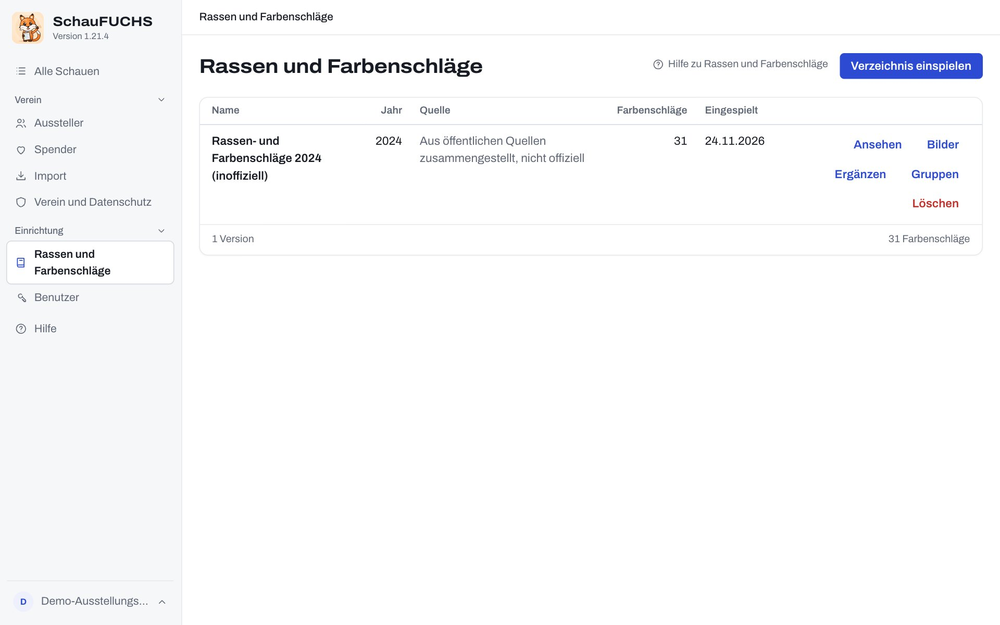

1. „Rassen und Farbenschläge“ → „Verzeichnis einspielen“.
2. „Name“, „Jahr“ und „Quelle“ eintragen (z. B. „Verzeichnis, Stand August 2026“).
3. Unter „Datei“ eine CSV-Datei wählen oder die Zeilen unter „Inhalt“ einfügen.
4. „Einspielen“ klicken.

Aufbau der Datei: drei Spalten **Sparte;Rasse;Farbenschlag**, freiwillig als vierte Spalte die **Gruppe** der Rasse (siehe 4.5). Trennzeichen Semikolon, Komma oder Tabulator; eine Kopfzeile ist erlaubt. **Die Reihenfolge der Zeilen ist die Ausstellungsfolge.** Nach dem Einspielen meldet die Software, wie viele Farbenschläge übernommen und wie viele Zeilen übersprungen wurden.

Mit „Ansehen“ oder einem Klick auf den Namen öffnen Sie eine Version und durchsuchen sie mit dem Suchfeld; unten steht die Anzahl. „Löschen“ geht nur, solange keine Schau sie verwendet und keine gemeldeten Tiere darauf verweisen.

Versionen mit der Marke „für alle Vereine bereitgestellt“ unter dem Namen können Sie nutzen, aber weder ergänzen noch löschen.

### 4.2 Ergänzen: fehlende Rasse oder Farbenschlag

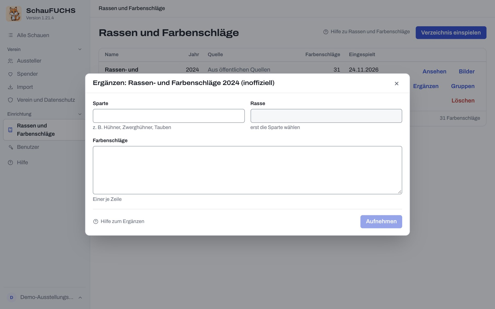

Fehlt etwas im Verzeichnis, nehmen Sie es mit „Ergänzen“ auf – auch mitten in der Meldephase:

1. Bei der eigenen Version „Ergänzen“ klicken.
2. „Sparte“ und „Rasse“ eintragen. Vorhandene werden vorgeschlagen; ein neuer Name legt Sparte oder Rasse neu an.
3. Unter „Farbenschläge“ je Zeile einen Farbenschlag eintragen.
4. „Aufnehmen“ klicken.

Neues kommt **ans Ende** seiner Sparte bzw. Rasse. Die bisherige Reihenfolge und schon vergebene Katalognummern bleiben unverändert. Schon vorhandene Farbenschläge werden übersprungen.

### 4.3 Version einer Schau wechseln

Welche Version eine Schau nutzt, stellen Sie in den Einstellungen der Schau ein (Feld „Rassen und Farbenschläge“). Eine neue Schau bekommt automatisch die neueste Version.

> **Wichtig:** Der Wechsel geht nur, **solange es keine gemeldeten Tiere gibt** (offene oder bestätigte Meldungen). Sonst erscheint: „Es gibt schon gemeldete Tiere – das Verzeichnis lässt sich nicht mehr wechseln. Fehlende Rassen oder Farbenschläge bitte unter „Rassen und Farbenschläge“ → „Ergänzen“ nachtragen (bei einem für alle Vereine bereitgestellten Verzeichnis: eigenes Verzeichnis einspielen, bevor gemeldet wird).“ Nach dem Festschreiben der Katalognummern ist das Feld ganz gesperrt.

Spielen Sie deshalb das richtige Verzeichnis ein und wählen Sie es aus, **bevor** die Meldephase beginnt.

---

### 4.4 Rassebilder

Im Katalog steht bei jeder Rassen-Überschrift ein Foto der Rasse; Urheber und Lizenz stehen im „Bildnachweis Rassebilder“ am Ende. Die Bilder gehören Ihrem Verein und gelten für jede Schau und jede Verzeichnis-Version (zugeordnet über den Namen der Rasse).

1. „Rassen und Farbenschläge“ → beim Verzeichnis „Bilder“.
2. Oben nach Sparte oder Name filtern und den Stand wählen („Alle“, „mit Bild“, „ohne Bild“, „ungeprüft“, je mit Anzahl).
3. „Bild hochladen“ bzw. „Ersetzen“ wählt ein Foto (JPEG oder PNG); Sie können es auch aus dem Dateimanager auf die Bildfläche der Rasse ziehen; hat die Rasse schon ein Bild, fragt die Software vorher, ob es ersetzt werden soll. Die Software verkleinert es auf Druckgröße, dreht hochkant aufgenommene Fotos richtig und speichert es als JPEG. Nach dem Hochladen öffnet sich gleich „Angaben“, denn die Angaben eines ersetzten Bilds gelten für das neue Foto nicht mehr. Erst mit „Speichern“ (Haken „geprüft“ ist gesetzt) kommt das Bild in den Katalog; schließen Sie den Dialog ohne Speichern, bleibt es „ungeprüft“.
4. „Angaben“: Urheber, Lizenz, Lizenz-Adresse und Quelle für den Bildnachweis. Bei fremden Fotos sind sie Pflicht (z. B. „Max Muster“, „CC BY-SA 4.0“, `https://creativecommons.org/licenses/by-sa/4.0/`). Bei einem eigenen Foto des Vereins bleibt alles leer; im Bildnachweis steht dann „eigenes Bild“.

**Nur katalogtaugliche Lizenzen:** Der Katalog wird verkauft und die Bilder werden zugeschnitten. Als geprüft (und damit in den Katalog) nimmt die Software ein Bild deshalb nur, wenn die Lizenz passt: keine „nicht kommerziell“-Lizenz (NC), keine „keine Bearbeitung“-Lizenz (ND), und bei CC BY mit Urheber. Die Lizenz-Adresse leitet die Software aus üblichen Angaben wie „CC BY-SA 4.0“ selbst ab, wenn das Feld leer ist. Passt die Lizenz nicht, wird das Bild gespeichert, bleibt aber ungeprüft („Bild gespeichert, aber noch nicht im Katalog: …“ mit dem Grund). Das gilt auch für den Grundbestand aus Wikimedia Commons.
5. „Löschen“ entfernt das Bild. Auch der Online-Katalog zeigt es danach sofort nicht mehr (wichtig, wenn ein Urheber die Entfernung verlangt).

Ein Grundbestand stammt aus Wikipedia/Wikimedia Commons, nur frei lizenzierte Fotos mit Urheber und Lizenz. Sichere Treffer aus dem eigenen Wikipedia-Artikel der Rasse sind schon als geprüft markiert. Alles andere ist **„ungeprüft“**, zum Beispiel ein Bild der Großform bei einer Zwergrasse. Es kommt erst in den Katalog, wenn Sie bei der Rasse auf „Passt“ klicken. „Angezeigte als geprüft markieren“ bestätigt nach der Rückfrage „… Bilder als geprüft markieren?“ alle gerade angezeigten Bilder auf einmal (höchstens die ersten 200), bitte vorher ansehen. Bilder ohne passende Lizenzangabe bleiben dabei ungeprüft; die Meldung danach nennt ihre Rassen („Ohne passende Lizenzangabe ungeprüft geblieben: …“). Passt ein Bild nicht, ersetzen oder löschen Sie es.

Ein Bild, das sich beim Erstellen des Katalogs nicht lesen lässt, fehlt dort einfach; der Katalog entsteht trotzdem. Das gilt auch für Logo, Titelbild und Anzeigen; beschädigte PNG-Dateien nimmt schon das Hochladen nicht an.

### 4.5 Gruppen der Rassen {#rassen-gruppen}

Jede Rasse gehört zu einer Gruppe des Verzeichnisses (Buchstaben A–M, Z1–Z3, BV o. ä.). Preisrichter sind oft nur für bestimmte Gruppen zugelassen; die Einteilung prüft das (siehe 5.7 und 5.8).

- **Beim Einspielen:** vierte Spalte „Gruppe“, z. B. `Sparte;Rasse;Farbenschlag;Gruppe`. Mit dieser Kopfzeile gilt jeder kurze Text; ohne Kopfzeile nur eine Angabe wie A, Z1 oder BV, klein geschrieben nur mit Ziffer oder als einzelner Buchstabe („z 1“, „a“; sonst meldet die Software ein Trennzeichen im Feld). Die Gruppe gilt für die ganze Rasse; steht bei derselben Rasse eine andere, gilt die erste und die Zeile wird gemeldet.
- **Von Hand:** bei der eigenen Version „Gruppen“ klicken, je Rasse die Gruppe eintragen (leer = keine), „Gruppen speichern“. Jede Änderung steht im Protokoll.

Groß- und Kleinschreibung und Leerzeichen spielen keine Rolle („z 1“ wird „Z1“). Erlaubt sind bis zu 10 Buchstaben und Ziffern. Unter „Ansehen“ erscheint die Spalte „Gruppe“, sobald Gruppen gepflegt sind. Bei einer Version „für alle Vereine bereitgestellt“ lassen sich die Gruppen nicht ändern.

## 5. Eine Schau von Anfang bis Ende

### 5.1 Die Phasen im Überblick

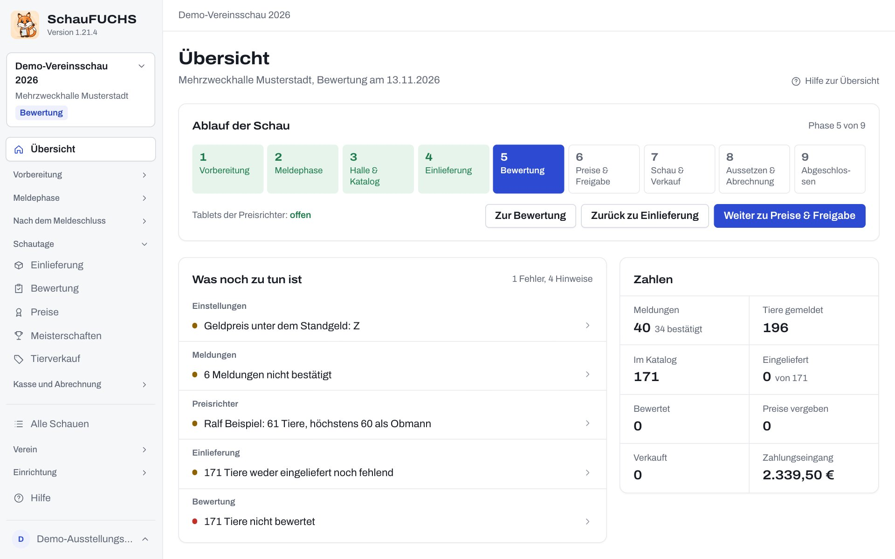

Jede Schau steht in genau einer Phase. Die Phase bestimmt, was gerade möglich ist – zum Beispiel ob das Online-Formular offen ist, ob Preisrichter am Tablet bewerten können oder ob verkauft werden darf.

| Nr. | Phase | Hauptarbeit |
|---|---|---|
| 1 | Vorbereitung | Termine, Gebühren, Preise, Verzeichnis festlegen |
| 2 | Meldephase | Online- und Papiermeldungen, Zahlungen |
| 3 | Halle & Katalog | nach dem Meldeschluss: Preisrichter einteilen, Käfige, Hallenplan, Katalognummern (nach dem Plan), Katalog, Festschreiben |
| 4 | Einlieferung | Tiere und Nachweise abhaken |
| 5 | Bewertung | Preisrichter bewerten (Tablet oder Papier) |
| 6 | Preise & Freigabe | Preise vergeben, Ergebnisse freigeben |
| 7 | Schau & Verkauf | Besuchertage, Tierverkauf |
| 8 | Aussetzen & Abrechnung | Tierausgabe, Abrechnung, Auszahlung |
| 9 | Abgeschlossen | nur noch lesen, Fristen laufen |

**Phase wechseln:** Öffnen Sie die Schau. Die Seite „Übersicht“ zeigt im Abschnitt „Ablauf der Schau“ alle neun Phasen; die aktuelle ist hervorgehoben.

- „Weiter zu: …“ schaltet in die nächste Phase.
- Der Knopf daneben führt dorthin, wo in der Phase die Arbeit liegt. In „Halle & Katalog“ ist das zuerst der Hallenplan („Zum Hallenplan“), solange dort noch etwas zu tun ist: Tiere haben keinen Platz, der feste Plan passt nicht mehr zu Halle oder Käfigmaßen, oder es gibt noch keine Halle und noch keine Katalognummern. Danach führt er zu den Katalognummern („Zu den Katalognummern“) – auch bei einem automatisch gestellten Plan, in dem alle Tiere Platz haben, und in einer Schau ohne Hallenplan, sobald sie nummeriert hat.
- Ein Klick auf eine andere Phase stellt diese ein. Beim Überspringen fragt die Software: „Weiter zur Phase „…“?“
- **Zurück** geht nur mit Grund: Es öffnet sich „Zurück zur Phase „…““ mit dem Feld „Grund“ (mindestens 3 Zeichen, steht im Protokoll); dann „Zurückstellen“.

**Was den Wechsel nach vorn aufhält:** Vor jedem Wechsel nach vorn – auch wenn Sie Phasen überspringen, etwa von der Vorbereitung direkt zu „Halle & Katalog“ – prüft die Software (nur der Schritt von der Vorbereitung in die Meldephase prüft allein Gebühren, Meldeschluss und Impressum, siehe unten):

- **Rote Punkte der Prüfliste.** Jeder rote Punkt gehört zu einer Phase, bis zu der er erledigt sein muss – zum Beispiel fehlende Stammdaten bis zur Vorbereitung, die Anzeige beim Veterinäramt bis zu „Halle & Katalog“, Tiere ohne Preisrichter bis zur Einlieferung, unbewertete Tiere, offene Obmann-Bestätigungen und eingelieferte Tiere ohne Ringnummer bis zu „Preise & Freigabe“. Steht ein solcher Punkt noch offen, hält er den Wechsel in eine spätere Phase auf.
- **Bewertung und Freigabe.** Nach „Schau & Verkauf“ oder weiter geht es erst, wenn alle nummerierten Tiere bewertet und die Ergebnisse freigegeben sind – auch beim Überspringen.
- **Beim Abschluss** zusätzlich die laufende Reklamationsfrist und die offenen Punkte der Kasse (siehe 5.18). Eine abgesagte Schau braucht zum Abschluss nur die Kasse (Erstattungen).

Dann meldet die Software „Vor „…“ ist noch offen: …“ und fragt „Trotzdem weiter zu „…“?“. Weiter geht es nur bewusst: mit einem Grund im Feld „Grund“ und dem Knopf „Trotzdem weiter“. Der Grund steht im Protokoll.

Auch beim Überspringen der Meldephase (z. B. von der Vorbereitung direkt zu „Halle & Katalog“) prüft die Software Gebühren, Meldeschluss und Impressum (siehe 5.4). Wer die Phase „Halle & Katalog“ überspringt, wird außerdem an Tiere ohne Katalognummer erinnert.

Darunter steht, ob die Tablets der Preisrichter gerade offen sind: „offen für Bewertung“ in den Phasen „Einlieferung“, „Bewertung“ und „Preise & Freigabe“ – solange die Ergebnisse nicht freigegeben sind. (Die Software schreibt dort verkürzt „Preise“; gemeint ist die Phase „Preise & Freigabe“. Ebenso sprechen Tierverkauf und Abrechnung verkürzt von den Phasen „Preise“, „Schau“ und „Abrechnung“.)

Neben dem Ablauf finden Sie auf der Übersicht:

- **„Was noch zu tun ist“** – die Prüfliste, nach Seiten gruppiert (zum Beispiel „Einstellungen“, „Meldungen“, „Preisrichter“). Rote Punkte sind Fehler, gelbe Hinweise, grün heißt „Alles erledigt für diese Phase“. Ein Klick auf einen Punkt führt zur passenden Seite. Rechts stehen kurze Zusätze wie die Frist („fällig 11.11.2026“) oder Beispielnummern. Was die einzelnen Punkte bedeuten, steht unten in „Punkte der Prüfliste“.
- **„Zahlen“** – Meldungen, Tiere, Eingelieferte, Bewertete, Preise, Verkäufe, Zahlungseingang.
- **„Adressen zum Weitergeben“** – die Links für die Online-Meldung, das Tablet der Preisrichter und die öffentlichen Ergebnisse.

> **Tipp:** Arbeiten Sie die Prüfliste in jeder Phase ab, bevor Sie weiterschalten. Rote Punkte, eine fehlende Freigabe und beim Abschluss die laufende Reklamationsfrist halten den Wechsel auf; „trotzdem“ geht nur mit Grund. Gelbe Hinweise halten nichts auf.

In einer Schau zeigt die Seitenleiste oben die Schau mit Ort und Phase; ein Klick darauf wechselt zu einer anderen Schau. Darunter stehen die Seiten der Schau in der Reihenfolge, in der eine Schau abläuft:

| Gruppe | Seiten |
|---|---|
| (oben) | Übersicht |
| Vorbereitung | Einstellungen (mit dem Protokoll), Preisrichter |
| Meldephase | Meldungen |
| Nach dem Meldeschluss | Käfige, Hallenplan, Katalognummern, Katalog |
| Schautage | Einlieferung, Bewertung, Preise, Meisterschaften, Tierverkauf |
| Kasse und Abrechnung | Kassenbuch, Spenden, Abrechnung |

Käfige und Hallenplan stehen hinter den Meldungen: Erst mit den Meldungen steht fest, wie viele Käfige welcher Größe in die Halle müssen. Die Halle selbst (Maße, Eingänge) können Sie schon vorher anlegen. Das Protokoll öffnen Sie in den Einstellungen im Reiter „Protokoll“ (siehe 5.17).

Kassenbuch, Spenden und Abrechnung stehen in einer eigenen Gruppe: Sie laufen über die ganze Schau, nicht erst am Ende.

Darunter stehen „Alle Schauen“, die Gruppe „Verein“ (Aussteller, Spender, Import, Verein und Datenschutz), die Gruppe „Einrichtung“ (Rassen und Farbenschläge, Benutzer) und „Hilfe“.

**Gruppen einklappen:** Ein Klick auf die Überschrift einer Gruppe klappt sie zu oder auf; SchauFUCHS merkt sich das in diesem Browser. Ohne eigene Wahl ist in einer Schau die Gruppe der aktuellen Phase offen (in der Meldephase „Meldephase“, an den Schautagen „Schautage“), „Verein“ und „Einrichtung“ sind zu. Öffnen Sie eine Seite in einer zugeklappten Gruppe (etwa über die Übersicht), klappt die Gruppe auf.

**Reiter:** Seiten mit mehreren Bereichen (Einstellungen der Schau, Verein und Datenschutz, Preisrichter, Käfige, Briefvorlage, die Seite eines Benutzers) zeigen jeden Bereich in einem eigenen Reiter unter dem Seitenkopf. Der gewählte Reiter steht in der Adresse (z. B. `…/einstellungen#druck`): Ein Lesezeichen oder Link öffnet ihn wieder. Ungespeichertes geht beim Wechsel des Reiters nicht verloren, und „Speichern“ bleibt oben rechts stehen. Hat ein verborgener Reiter ein Pflichtfeld offen oder einen Fehler beim Speichern, wechselt die Seite dorthin. „Drucken“ auf der Seite „Käfige“ druckt alle Bereiche.

**Speichern oben rechts:** Gespeichert wird immer oben rechts. Sobald Sie auf einer Seite etwas ändern (Einstellungen, Gebühren, Notenskala, Grundplatten, Aufsteller, Preisrichter-Einteilung, Katalog, Meldung, Verein, steuerliche Angaben, Druck- und Briefvorlagen, Spender, Benutzer), erscheinen oben rechts in der Kopfleiste „Verwerfen“ und der Speichern-Knopf des Formulars. Nur in Fenstern (z. B. „Preisrichter bearbeiten“) und für eine einzelne Tabellenzeile (z. B. Bewertung am PC) steht „Speichern“ direkt dabei. Die Kopfleiste bleibt beim Scrollen stehen; Sie müssen also nicht nach unten. Haben mehrere Formulare einer Seite Ungespeichertes, steht für jedes ein eigener Knopf da (z. B. „Einstellungen speichern“ und „Gebühren speichern“). Wer die Seite mit Ungespeichertem verlässt, wird vorher gefragt. **Ausnahme Hallenplan:** Der Editor speichert jede Änderung sofort; dort steht oben rechts „Gespeichert“, „Wird gespeichert …“, „Keine Verbindung – wird erneut gesendet“ oder in Rot „Nicht gespeichert“ (dann steht unten rechts der Grund, und der Plan zeigt wieder den gespeicherten Stand). Der Knopf „Speichern“ im Seitenkopf prüft das nur nach (siehe „Verschieben und drehen“).

#### Punkte der Prüfliste

Die Prüfliste nennt jeden Punkt nur kurz. Hier steht, was dahintersteckt. Die Punkte stehen nach der Seite, auf der man sie erledigt, in der Folge des Ablaufs: Einstellungen, Verein, Meldungen, Preisrichter, Hallenplan, Katalognummern, Katalog, dann die Schautage. In den Phasen „Halle & Katalog“ und „Einlieferung“ stehen unter „Hallenplan“ auch Hinweise zum Plan (gelb, sie halten keinen Wechsel auf); ein Klick führt in den Hallenplan.

| Punkt | Bedeutung |
|---|---|
| Veterinäramt-Anzeige fehlt / Schau beim Veterinäramt anzeigen | Die Schau muss spätestens 4 Wochen vor dem Bewertungstag beim Veterinäramt angezeigt sein. Ab dieser Frist ist es ein Fehler, der den Wechsel nach „Halle & Katalog“ aufhält. Ohne Bewertungstag kann die Software die Frist nicht berechnen. |
| Registriernummer der Veranstaltung fehlt | Die Nummer, die das Veterinäramt für die Schau vergibt; sie steht auf den Listen für das Amt. |
| Klinische Untersuchung nicht festgelegt | Nach § 7 GeflPestSchV: regionale Schau, Einlassuntersuchung oder Bescheinigung (Einstellungen › Veterinäramt). Ab der Phase „Halle & Katalog“ ein Fehler. |
| Einlassuntersuchung: Datum und Tierarzt fehlen | Nachweis für das Veterinäramt, wenn die Tiere beim Einlass untersucht werden. |
| … Meldungen aus dem Ausland | Ausländische Tiere brauchen ein amtliches Gesundheitszertifikat und eine TRACES-NT-Meldung, dazu tierärztliche Einlasskontrolle und Überwachung (gilt dann für die ganze Schau); auch Tauben brauchen eine ND-Impfung. Mit dem Veterinäramt abstimmen. |
| Katalog-Impressum: Angabe „Druck“ fehlt | Der gedruckte Katalog braucht nach dem Landespressegesetz die Druckerei mit Anschrift oder „Eigendruck“ (Katalog › Aufbau). |
| Impressum und Datenschutz unvollständig | Öffentliche Seiten und Meldeformular brauchen Impressum (§ 5 DDG) und Datenschutzhinweise (Art. 13 DSGVO), siehe 3.1. |
| Gemeldet ohne Tarif | Für diese Meldeart ist keine Gebühr eingetragen; solche Tiere kosten nichts. Meist fehlt ein Eintrag unter „Standgeld und Gebühren“. |
| Geldpreis unter dem Standgeld / Gestiftete Geldpreise unter dem kleinsten Geldpreis der Ausstellungsleitung | Geldpreise sollen mindestens so hoch sein wie das Standgeld für ein Einzeltier, gestiftete mindestens so hoch wie die kleinsten Geldpreise der Ausstellungsleitung (AAB XI 1e, f). Nur ein Hinweis. |
| … Meldungen mit offenem Restbetrag | Bestätigt, aber nicht voll bezahlt: Die Meldung wurde erweitert, eine Zahlung storniert oder eine zugesagte Stiftung fehlt noch. |
| … Meldungen nicht bestätigt | Meist fehlt noch die Zahlung. |
| … Online-Meldungen mit Jugend oder Preisrichter prüfen | Jugendtarif und Katalogbefreiung beruhen online auf der Selbstauskunft des Ausstellers. |
| … Meldungen ohne unterschriebenen Meldebogen | Diese Aussteller stehen ohne Namen im Katalog. |
| … Meldungen ohne gültige Registriernummer | Die 12-stellige Registriernummer (§ 26 ViehVerkV) brauchen Verkaufs- und Tierliste. Fehler bis „Preise & Freigabe“. |
| … Meldungen ohne Pflichterklärungen | Herkunft und Karenzzeit sind nicht bestätigt (nur, wenn Pflichterklärungen eingerichtet sind). |
| … Jugendmeldungen ohne Geburtsdatum / ohne Erziehungsberechtigten | Ohne Geburtsdatum ist der Jugendtarif nicht belegt. |
| … stornierte oder abgelehnte Meldungen mit Zahlung | Das Geld fällt aus der Abrechnung: erstatten (Zahlung mit negativem Betrag) oder in der Meldung „Verfall buchen“. In der Abrechnung ein Fehler. |
| Online-Meldung ist geschlossen | Die Halle ist voll, ein Teil davon nur durch unbestätigte Meldungen. Unbekannte Meldungen prüfen und ablehnen. |
| … Tiere ohne Katalognummer | Bestätigte Tiere ohne Nummer. Erst ab der Phase „Halle & Katalog“ (nach dem Meldeschluss) und dort ein Fehler bis zur Einlieferung; vorher kommen laufend Meldungen dazu. |
| … Tiere ohne Platz (Hallenplan) | Im Hallenplan finden so viele Tiere keinen Käfig. Halle, Grundplatten oder Käfigblöcke anpassen, „Plan neu setzen“ oder „Fehlende Käfige einsetzen“ (siehe Hallenplan). |
| Käfigfront zur Wand oder zu einer Reihe (Hallenplan) | Eine Reihe, Platte oder ein Block steht mit der offenen Seite zur Wand oder zu einer anderen Reihe; rechts steht, welche (z. B. „R3: Front zu R4“). Im Hallenplan umdrehen, z. B. mit „Käfige an den Wänden ausrichten …“. |
| Nummern bzw. Käfignummern nicht in Planfolge (Hallenplan) | Im festen Plan wurden Käfige umgestellt, die Nummern laufen nicht mehr in der Folge der Reihen. Im Hallenplan „Nach Plan nummerieren“. |
| Hallenplan nicht festgeschrieben | Die Katalognummern sind festgeschrieben, der Plan rechnet aber noch laufend: eine Nachmeldung oder ein Storno kann Käfige verschieben. Im Hallenplan festschreiben, bevor aufgebaut wird. |
| … Tiere ohne Preisrichter | Diese Tiere sind keinem Preisrichter zugeteilt. Fehler bis zur Einlieferung. |
| Name: … Tiere, höchstens … | Mehr Tiere als die Höchstzahl je Preisrichter oder Obmann. Gezählt wird gewichtet: Stamm zählt 2, Voliere und Bruteier 3. Nur ein Hinweis. |
| Kein Obmann bestimmt / Nur ein Obmann / Nur ein Preisrichter | „vorzüglich“ und u.M. muss ein Obmann bestätigen. Gibt es nur einen Obmann, bestätigt ein anderer Preisrichter dieser Schau seine eigenen Noten. Bei nur einem Preisrichter kann niemand bestätigen. |
| … Preisrichter ohne Tablet-PIN | Ohne PIN kann sich der Preisrichter nicht am Tablet anmelden (siehe 5.8). Erst ab der Phase „Halle & Katalog“. |
| … Tiere weder eingeliefert noch fehlend | Unbewertete Tiere zählen nicht zum Preiskontingent. |
| … Tiere bewertet, aber nicht als eingeliefert abgehakt | Meist fehlt der geprüfte Nachweis; die Tierliste braucht die Einlieferung. Nachweis prüfen oder mit Grund einliefern. |
| … eingelieferte Tiere ohne Ringnummer | Die Kennzeichnung gehört in die Liste für das Veterinäramt. |
| … Jungtiere, deren Ring nicht zum Jahr passt | Alter oder Ring prüfen. |
| … Aussteller: Impf- oder Untersuchungsnachweis nicht geprüft | Gilt für Aussteller mit eingelieferten impfpflichtigen Tieren. |
| … Bewertungen warten auf den Obmann | „vorzüglich“ oder u.M. noch nicht bestätigt. |
| Gestiftete Preise nicht vergeben | Nicht vergebene Geldstiftungen dem Stifter erstatten oder mit ihm absprechen. |
| … Stiftungen ohne Preisart | Unter „Preise › Stiftungen“ eine gestiftete Preisart zuordnen, sonst zählt die Stiftung für keinen Preis. |
| Schau nach der Abrechnung abschließen | 8 Wochen nach der Schau (oder nach einer späteren Reklamationsfrist). Erst der Abschluss lässt die Speicherfristen des Datenschutzes laufen. |

### 5.2 Schau anlegen

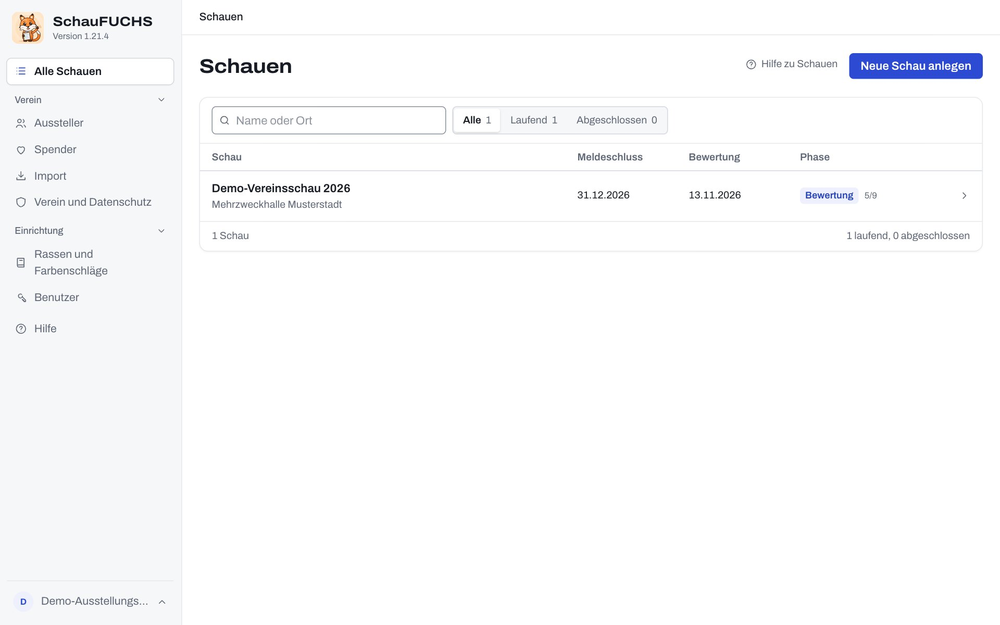

Die Liste zeigt je Schau eine Zeile mit Meldeschluss, Bewertung und Phase (mit dem Schritt, z. B. „3/9“). Oben suchen Sie nach Name oder Ort und wählen „Alle“, „Laufend“ oder „Abgeschlossen“.

1. „Schauen“ → „Neue Schau anlegen“.
2. „Name der Schau“ (z. B. „72. Kreisverbandsschau 2026“) und „Ort / Halle“ eintragen.
3. Bei „Vorlage“ steht schon Ihre letzte Schau („aus „…“ übernehmen“). Wählen Sie eine andere frühere Schau oder „keine – mit Startwerten beginnen“.
4. Nur zum Üben oder Vorführen: „Testschau“ anhaken (siehe unten). Die Testschau wird dann gleich mit Demodaten gefüllt.
5. „Schau anlegen“ klicken.

Die Software öffnet direkt die Einstellungen. Die neue Schau steht in der Phase „Vorbereitung“.

**Mit Vorlage** kommt alles mit außer Meldungen und Geld: die Einstellungen (Veranstalter, Einlieferung, Öffnungszeiten, Bestimmungen, Erklärungen, Bankverbindung, Vereinskonto, Veterinäramt mit Art der klinischen Untersuchung, Impffristen und Zulassung ausländischer Aussteller, Höchstzahl der Tiere je Preisrichter und Obmann, Notenskala, Katalognummern-Einstellungen), Gebühren, Preisarten mit Beträgen, Preisrichter, Katalog-Gestaltung, Grußworte, Anzeigen und Bilder, Käfiggrößen je Rasse, Käfigmaße, die Halle mit allen Flächen und eingesetzten Teilen, die Formate der Drucke und die Vorlage der Bewertungskarten (eine für die frühere Schau angepasste Vorlage als eigene Kopie für die neue, siehe 3.8). Nicht mit kommen Meldungen und Tiere, Stiftungen, Kasse, Belege und Auszahlungen, das Gesundheitsjournal, die Termine (Meldeschluss, Bewertung, Rückmeldung der Preisrichter, Reklamationsfrist, Anzeige beim Veterinäramt und das Aktenzeichen, Tag und Tierarzt der Einlassuntersuchung) und die Einteilung der Preisrichter (nach Rassen und nach Katalognummern) – Meldungen und Nummern sind ja neu. Die Preisrichter kommen mit Anschrift, Sparten, Gruppen und Obmann; ihre Zusage steht wieder auf „offen“, „Zugesagt für“ und Vorbehalt sind leer. Sie brauchen eine neue PIN für ihr Tablet. Die frühere Schau bleibt unverändert.

**Testschau:** Eine Schau zum Üben oder Vorführen kennzeichnen Sie als Testschau – beim Anlegen mit dem Haken „Testschau“ oder später in den Einstellungen mit „Als Testschau kennzeichnen …“. Die Software zeigt vorher alle Aussteller, die dadurch Test-Aussteller werden – prüfen Sie, dass keine echte Person dabei ist – und Sie bestätigen mit dem Namen der Schau. Aussteller, die in einer Testschau gemeldet oder angelegt werden, gehören nur ihr: Sie erscheinen nie in echten Schauen, nicht in der Suche und den Vorschlägen der Meldungserfassung, nicht bei der Online-Meldung und nicht unter „Aussteller“. Umgekehrt lassen sich in einer Testschau keine echten Aussteller melden – Übungsmeldungen landen so nie in Auskunft oder Protokoll echter Personen. Wer mit einer Testschau übt, legt die Aussteller dort neu an. Die Schau trägt überall die Marke „Testschau“; alle ihre öffentlichen Seiten und die Titelseite des Online-Katalogs weisen darauf hin, dass sie keine echte Ausstellung ist.

**Demodaten:** Eine neue Testschau kommt gleich mit Demodaten: erfundene Aussteller (Registriernummer beginnt mit „276 16 999“) und Tiere, Zahlungen, Katalognummern, eingeteilte Preisrichter und eingelieferte Tiere – die Schau steht danach in der Phase „Einlieferung“, und Sie spielen Bewertung, Preise, Verkauf und Abrechnung selbst durch. Typische Fälle sind dabei: eine stornierte Meldung, ein Aussteller kommt nicht, einer hat den Impfnachweis vergessen, einer zahlt nur einen Teil, eine Nachmeldung bei der Einlieferung. Fehlen Termine oder Gebühren, setzt die Software Demowerte. Gemeldet werden so viele Tiere, wie die Halle fasst, höchstens 300. Aus einer echten Vorlage kommen keine Preisrichter mit – die Demodaten bringen erfundene. Es läuft immer nur ein Einspielen zur Zeit. Mit „Demodaten neu einspielen …“ in den Einstellungen der Testschau fangen Sie von vorn an: Alle Meldungen, Test-Aussteller, Zahlungen, Bewertungen, Preise, Verkäufe und die Abrechnung werden durch frische Demodaten ersetzt – jedes Mal dieselben. Einstellungen, Gebühren, Preisarten, Halle und Käfigmaße bleiben. Das Kennzeichen lässt sich nicht zurücknehmen. Nachträglich kennzeichnen geht nur, solange die Schau kein Geld und keine Aufzeichnungen hat: keine Zahlungen, Kassenbuchungen, Tagesabschlüsse, Auszahlungen, SEPA-Dateien, Belege, Verkäufe, Stiftungen und keine Einträge im Gesundheitsjournal – eine Testschau lässt sich samt allem löschen, das darf echte Aufzeichnungen nie treffen. Sind in der Schau echte Aussteller gemeldet (auch in einer anderen Schau gemeldet, von Hand als Vereinsmitglied gesetzt oder unter „Aussteller“ gepflegt), zeigt die Vorschau sie gesondert: Ihre Stammdaten bleiben unverändert, ihre Meldungen in dieser Schau gehen auf eine Test-Kopie über, die nur Name und Verein trägt. Auskunft und Löschen der echten Person erfassen diese Kopie mit; was über Meldungen dieser Schau an den echten Stammdaten geändert wurde, übernimmt die Software ins Vereinsprotokoll. Eine Testschau taugt nur als Vorlage für eine weitere Testschau, nicht für eine echte (sie brächte erfundene Preisrichter und Texte mit).

**Ohne Vorlage** sind Gebührenzeilen mit 0 € sowie zwei Preisarten vorbelegt: „E“ (Ehrenpreis, 1 auf 10 Tiere) und „Z“ (Zuschlagspreis, 2 auf 10 Tiere), beide noch ohne Betrag; Käfigmaße und Halle kommen aus der letzten Schau.

### 5.3 Einstellungen

Die Seite „Einstellungen“ zeigt jeden Punkt in einem eigenen Reiter: „Schau“, „Termine“, „Meldegeld und Konto“, „Katalog und Preise“, „Teilschauen“, „Bestimmungen“, „Veterinäramt“, „Standgeld und Gebühren“, „Preise“, „Notenskala“, „Meisterschaften“, „Käfige und Halle“, „Druck“ (Formate aller Drucke, siehe 3.8), „Protokoll“ und für Administratoren „Verwalten“ („Als Testschau kennzeichnen“ bzw. bei einer Testschau die Demodaten, „Schau absagen“, „Schau löschen“). Die sechs Reiter von „Schau“ bis „Veterinäramt“ sind ein Formular: Änderungen darin speichern Sie zusammen, auch wenn Sie dazwischen den Reiter wechseln. Gebühren, Preise und Notenskala speichern Sie je für sich. Der Reiter „Protokoll“ zeigt die letzten Einträge; „Protokoll öffnen“ führt zum ganzen Protokoll (siehe 5.17).

#### Reiter „Schau“ bis „Veterinäramt“ (Stammangaben)

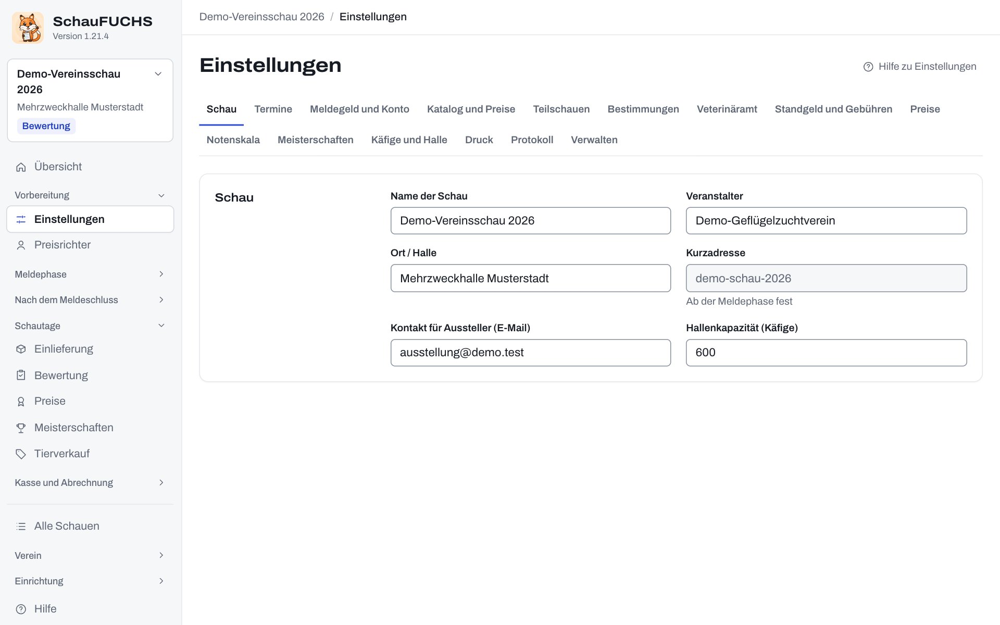

| Feld | Hinweis |
|---|---|
| „Name der Schau“, „Veranstalter“, „Ort / Halle“ | erscheinen im Meldeformular, auf B-Bögen und im Katalog |
| „Kurzadresse“ | für die Links, z. B. `…/s/kurzadresse`. **Nur in der Vorbereitung änderbar** – danach würden versandte Links und angemeldete Tablets ungültig. Auch nach „Zurück zur Vorbereitung“ bleibt sie fest, sobald es Meldungen oder Tablet-PINs gibt („Die Kurzadresse lässt sich nicht mehr ändern: Es gibt schon Meldungen oder Tablet-PINs, deren Links daran hängen.“). |
| „Meldeschluss“ | Die Online-Meldung schließt nach diesem Tag. |
| „Einlieferung“, „Öffnungszeiten“, „Tierausgabe“ | freier Text, z. B. „Donnerstag 15–20 Uhr“. Bei den Öffnungszeiten steht jeder Tag in einer eigenen Zeile – im Feld untereinander geschrieben, oder in einer Zeile mit „;“ getrennt („Sa. 9–18 Uhr; So. 9–16 Uhr“). Katalog, Aushänge und öffentliche Seite setzen sie untereinander. |
| „Bewertung am“ | Stichtag für den Jugendtarif und für Fristen bei Nachweisen. Ein Datum mehr als ein Jahr vor dem Anlegen oder mehr als drei Jahre in der Zukunft wird abgelehnt. |
| „Rückmeldung der Preisrichter bis“ | Datum, bis zu dem die Preisrichter den Abschnitt der Preisrichterverpflichtung zurücksenden sollen (siehe 5.7). Leer: Der Brief nennt keinen Termin. Ein Datum nach dem Bewertungstag wird abgelehnt. |
| „Reklamationsfrist“ | Datum. Solange sie läuft, hält sie den Abschluss auf (nur „trotzdem“ mit Grund). IBAN und Geburtsdatum bleiben bis mindestens 30 Tage nach ihrem Ende gespeichert. |
| „Hallenkapazität (Käfige)“ | Leer lassen, wenn es keine Grenze gibt. Ist sie erreicht, schließt die Online-Meldung. |
| „Rassen und Farbenschläge“ | Version des Verzeichnisses (siehe 4.3) |
| „Provision Tierverkauf (%)“ | Nach dem ersten Verkauf nicht mehr änderbar. |
| „Erste Katalognummer“ | z. B. 1 oder 101 |
| „Höchstens Tiere je Preisrichter“, „Höchstens Tiere je Obmann“ | Vorgabe 80 bzw. 60 Tiere. Ein Stamm zählt 2, Voliere und Bruteier je 3. Hat ein Preisrichter mehr, steht ein gelber Hinweis in der Prüfliste; gesperrt wird nichts. In diesem Verhältnis verteilen auch die Vorschläge der Einteilung (Obmann weniger). |
| „Kontakt für Aussteller (E-Mail)“ | steht in der Eingangsbestätigung |
| „Meldegeld zahlen“ | „vorab per Überweisung“, „vorab per Überweisung mit GiroCode“ (siehe 3.14) oder „bei der Einlieferung der Tiere“. Danach richten sich die Texte für Aussteller: Meldeformular, Eingangsbestätigung und „Meine Meldung“ (bei Einlieferung: „Zu zahlen bei der Einlieferung der Tiere“, keine Bankverbindung, Status „eingegangen – Zahlung bei der Einlieferung“). |
| „Bankverbindung für das Meldegeld“ | erscheint bei Zahlung vorab im Meldeformular und in der Eingangsbestätigung; mit GiroCode gilt stattdessen das Vereinskonto |
| „Kontoinhaber“, „IBAN“, „BIC“ | Vereinskonto für Überweisungen an Aussteller (SEPA-Datei) und für den GiroCode. Ohne IBAN keine SEPA-Datei. |
| „Preise aus dem Standgeld verteilen“ | „je Preisrichter (aus seinen Tieren)“ oder „gemeinsam für die ganze Schau“ – üblich ist je Preisrichter |
| „Jugend im Katalog“ | „eigener Block am Ende“ (Vorgabe) oder „in der Rasse eingereiht“, siehe unten. Nach dem Festschreiben gesperrt. |
| „Volieren und Stämme vor den Einzeltieren“ | nach dem Festschreiben gesperrt |
| „Katalognummern nach Käfigblöcken (so wie die Käfige in der Halle stehen)“ | Jede Käfiggröße bekommt einen durchgehenden Nummernblock, in der Reihenfolge, die Sie mit ↑ und ↓ festlegen (so wie die Käfige in der Halle stehen); innerhalb eines Blocks gilt die Ausstellungsfolge. Eine Sparte kann dann in zwei Blöcken stehen, z. B. Gänse im Großkäfig und Enten im Hühnerkäfig. Mit „Jugend im Katalog: eigener Block am Ende“ folgt die Jugend dahinter wieder in derselben Blockfolge. Wirkt beim nächsten Nummern-Vergeben, nach dem Festschreiben gesperrt. |
| „Sonderbestimmungen“ | erscheinen im Meldeformular; Aussteller stimmen ihnen zu |
| „Pflichterklärungen der Aussteller“ | je Zeile eine Erklärung, die Aussteller ankreuzen müssen (z. B. Herkunft nicht aus Sperrbezirk) |
| Veterinäramt: „Zuständiges Veterinäramt“, „Registriernummer der Veranstaltung“, „Angezeigt am“, „Aktenzeichen“ | Die Prüfliste erinnert an die Anzeige spätestens 4 Wochen vor der Schau. Beim Tippen in „Zuständiges Veterinäramt“ schlägt die Software Ämter aus einem Verzeichnis aller Landkreise und kreisfreien Städte vor (Kreis oder Ort eingeben); ein Klick trägt Amt und Anschrift ein. Passt der Ort der Schau zu einem Kreis, steht das Amt als „Vorschlag“ unter dem leeren Feld. Bitte die Angaben vor der Anzeige kurz prüfen – Zuständigkeiten ändern sich. |
| „Behörde verlangt Untersuchung von Enten und Gänsen“ | Dann braucht jeder Aussteller mit Wassergeflügel eine Untersuchung (höchstens 7 Tage alt) oder eine Sentinel-Bestätigung (höchstens 12 Monate). |
| „Klinische Untersuchung (§ 7 GeflPestSchV)“ | Wie die vorgeschriebene tierärztliche Untersuchung der Vögel erfolgt: „Regionale Schau – alle Tiere aus dem eigenen oder einem angrenzenden Kreis (keine Untersuchung nötig)“, „Einlassuntersuchung durch einen Tierarzt bei der Einlieferung“ oder „Tierärztliche Bescheinigung aus dem Herkunftsbestand je Aussteller“. Fehlt die Festlegung, steht in der Prüfliste zuerst ein Hinweis, spätestens ab der Einlieferung ein roter Punkt; festgelegt sein muss sie bis zum Katalog. |
| „Bescheinigung höchstens (Tage vor der Schau)“ | nur bei „Bescheinigung“: wie alt die Bescheinigung höchstens sein darf, nach dem Merkblatt Ihres Veterinäramts (meist 5 bis 6 Tage). Bei der Einlieferung wird sie dann je Aussteller als Nachweis verlangt. |
| „Einlassuntersuchung am“, „Tierarzt der Einlassuntersuchung“ | nur bei „Einlassuntersuchung“: Tag und Tierarzt als Nachweis für das Veterinäramt. Fehlen sie, steht spätestens ab der Bewertung ein roter Punkt in der Prüfliste. |
| „ND frühestens … Tage vorher“, „ND höchstens … Tage vorher“, „PMV frühestens … Tage vorher“, „PMV höchstens … Tage vorher“ | Impffristen nach dem Merkblatt Ihres Veterinäramts, gezählt in Tagen vor dem Bewertungstag, z. B. ND 21 bis 90 Tage, PMV ab 21 Tage. Leer = keine Frist. Bei der Einlieferung prüft die Software die Impfdaten gegen diese Fristen. |
| „Aussteller aus anderen Mitgliedstaaten zugelassen“ | Vorbelegt ist der Haken gesetzt. Ohne Haken lehnt die Meldung ausländische Registriernummern ab („Diese Schau nimmt keine Tiere aus dem Ausland an …“). Mit Haken brauchen deren Tiere ein amtliches Gesundheitszertifikat und eine TRACES-NT-Meldung, auch Tauben eine ND-Impfung; das Veterinäramt kontrolliert beim Einlass. Die Prüfliste weist auf solche Meldungen hin. |

Klicken Sie auf „Einstellungen speichern“.

#### Jugend im Katalog {#jugend-im-katalog}

Wie die Tiere der Jugend im Katalog stehen, wählen Sie im Reiter „Katalog und Preise“ unter „Jugend im Katalog“:

- **„eigener Block am Ende“** (Vorgabe): Die Jugend bekommt hinter allen Senioren eigene Nummern, im Katalog eine eigene Abteilung „Jugend“ (mit Sparten und Rassen wie vorn), in den Ergebnissen eigene Überschriften „Jugend – …“. Mit Teilschauen gilt das je Teilschau.
- **„in der Rasse eingereiht“**: Die Jugendtiere stehen bei ihrer Rasse und ihrem Farbenschlag zwischen den Senioren, nach der Reihenfolge der Nummern (siehe „Reihenfolge der Katalognummern“). Eine eigene Jugendabteilung gibt es dann weder im Katalog noch in den Ergebnissen. Auf der Seite „Katalognummern“ steht beim Tier weiter „Jugend“. Im gedruckten und im Online-Katalog (auch in der Kurzvorschau) steht hinter dem Aussteller das Kürzel „Jgd.“, die Legende „So lesen Sie den Katalog“ erklärt es; in den Ergebnissen steht hinter dem Aussteller die Marke „Jugend“ (in der Sprache der Seite). In der Ehrentafel steht kein Kürzel. Ist die Spalte schmal, kürzt der Katalog erst den Vornamen auf die Initiale („Schmidt, W. Jgd.“). Das Kennzeichen nennt die Jugendklasse des Ausstellers – nicht zu verwechseln mit „jung“ (Jungtier). Ohne Einwilligung in die Online-Veröffentlichung bleibt der Name im Internet trotzdem verdeckt („nicht veröffentlicht“). Beim eigenen Block gibt es kein Kürzel, dort steht die Überschrift „Jugend“.

Die Wahl gilt beim nächsten „Katalognummern vergeben“ für Nummern, Hallenplan, Bewertungskarten, Listen und Ergebnisse. Nach dem Festschreiben ist sie gesperrt („Festgeschrieben“). Wie die Preisrichter die Jugend bekommen, stellen Sie davon unabhängig unter „Preisrichter“ ein (siehe 5.8, „Jugend in der Einteilung“).

**Schau löschen:** Eine Schau, die nur zum Ausprobieren angelegt wurde, löschen Sie in den Einstellungen im Reiter „Verwalten“ mit „Schau löschen …“. Das geht nur, solange sie in der Phase „Vorbereitung“ steht und noch keine Meldungen, Stiftungen oder Kassenbuchungen hat. Zur Sicherheit tippen Sie den Namen der Schau ein und geben einen Grund an; das Löschen steht danach im Protokoll des Vereins. Einstellungen, Preisrichter und Katalogseiten der Schau sind dann weg. Eine **Testschau** dagegen lässt sich in jeder Phase löschen, mit allen Meldungen, ihren Test-Ausstellern, Bewertungen, Kasse und Belegen; echte Aussteller sind davon nie betroffen.

**Schau absagen:** Muss eine Schau ausfallen, etwa wegen eines Ausstellungsverbots bei einer Tierseuche, sagen Sie sie in den Einstellungen im Reiter „Verwalten“ mit „Schau absagen …“ ab. Das geht in den Phasen „Vorbereitung“, „Meldephase“ und „Halle & Katalog“, also bis vor der Einlieferung. Sind schon Tiere in der Halle, stimmen Sie das Vorgehen mit dem Veterinäramt ab und schließen über die normale Abrechnung ab. Im Fenster tragen Sie den Grund ein (er steht in der E-Mail an die Aussteller) und bestätigen mit „Schau absagen“. Das lässt sich nicht rückgängig machen. Dann geschieht Folgendes:

- Alle offenen und bestätigten Meldungen werden storniert. Vor dem Festschreiben verlieren die Tiere ihre Nummern, danach bleiben die gedruckten Nummern reserviert.
- Jeder Aussteller mit E-Mail-Adresse bekommt die Nachricht „Abgesagt: …“ mit dem Grund und dem Hinweis, dass gezahltes Meldegeld erstattet wird.
- Die Online-Meldung ist geschlossen („Die Schau ist abgesagt: …“), die Schau trägt im Menü die Marke „Abgesagt“ und steht in der Phase „Aussetzen & Abrechnung“.
- Unter „Abrechnung“ steht im Abschnitt „Erstattungen – Schau abgesagt (…)“, wem wie viel zu erstatten ist, mit Kontoinhaber und IBAN (siehe 5.15).

Zum Abschluss braucht eine abgesagte Schau nur noch die Kasse: Erstattungen gebucht oder als Verfall gebucht, Kassentage abgeschlossen. Prüfliste und Freigabe gelten dann nicht.

#### Reiter „Standgeld und Gebühren“

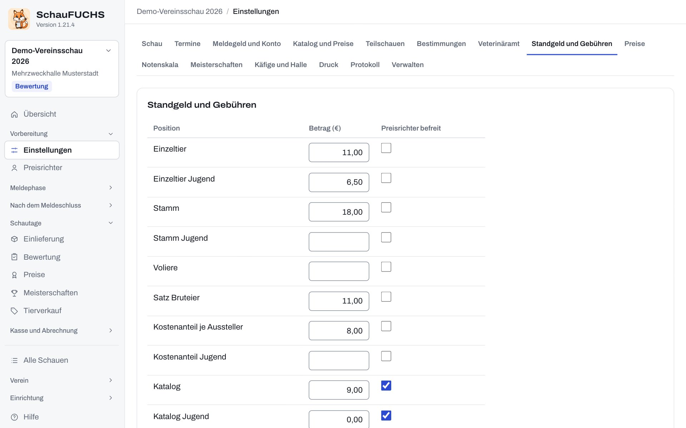

Für jede Position tragen Sie einen Betrag in Euro mit Komma ein, z. B. `3,50`:

„Einzeltier“, „Einzeltier Jugend“, „Stamm“, „Stamm Jugend“, „Voliere“, „Satz Bruteier“, „Kostenanteil je Aussteller“, „Kostenanteil Jugend“, „Katalog“, „Katalog Jugend“.

- **Leere Felder werden nicht berechnet.** Fehlt ein Jugendbetrag, gilt der normale Betrag.
- In der Spalte „Preisrichter befreit“ legen Sie fest, welche Position amtierende Preisrichter nicht zahlen (vorbelegt: Katalog).
- „Gebühren speichern“ klicken.

So rechnet die Software das Meldegeld je Meldung: Standgeld je Tier nach Meldeart (Jugend- oder Normaltarif) + einmal Kostenanteil + einmal Katalog.

**Beispiel:** 4 Einzeltiere à 3,50 € + Kostenanteil 2,00 € + Katalog 5,00 € = **21,00 €**. Ist der Aussteller amtierender Preisrichter und der Katalog befreit: 16,00 €.

> **Wichtig:** Sobald die erste Auszahlung gebucht ist, lassen sich die Gebühren nicht mehr ändern („Es gibt schon Auszahlungen (Quittung …) – Gebühren und Preise lassen sich nicht mehr ändern.“). Ebenso, solange eine SEPA-Datei oder eine Lastschriftdatei offen ist. Für Preisarten gelten eigene Grenzen (siehe unten).

#### Reiter „Preise“ (Preisarten)

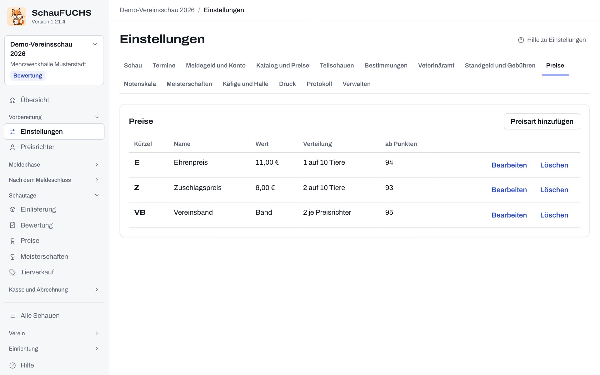

Hier legen Sie fest, welche Preise es gibt. „Preisart hinzufügen“ bzw. „Bearbeiten“ öffnet dieses Formular:

| Feld | Bedeutung |
|---|---|
| „Kürzel“ | steht auf Karte und Katalog, z. B. E, Z, LVEB |
| „Name“ | z. B. Ehrenpreis |
| „Geldbetrag (€)“ oder „oder Sachpreis“ | z. B. 11,00 bzw. „Band“, „Medaille“ |
| „Herkunft“ | „Aus dem Standgeld (über den Schlüssel)“ oder „Gestiftet (Anzahl über Stiftungen)“ |
| „Anzahl Preise“ und „auf … Tiere“ | der Schlüssel, z. B. 1 auf 10 Tiere. Leer = nicht über den Schlüssel |
| „Angebrochene Schlüssel“ | „nur volle zählen (abrunden)“ oder „angefangene zählen mit (aufrunden)“ |
| „Zusätzlich je Preisrichter“ | feste Anzahl je Preisrichter, z. B. 2 Bänder |
| „Mindestpunkte“ | z. B. 94 – darunter gibt es diesen Preis nicht |
| „Gilt für“ | „alle Tiere“, „nur Jugend“ oder „nur Senioren“ – für Jugend- oder Seniorenpreise |
| „Nur Sparte“ | Name der Sparte wie im Verzeichnis, z. B. „Tauben“; leer = alle Sparten |

**So entsteht das Kontingent** je Preisrichter (oder für die ganze Schau, je nach Einstellung): Zahl der ausgestellten Tiere geteilt durch den Schlüssel, gerundet wie eingestellt, mal „Anzahl Preise“, plus „Zusätzlich je Preisrichter“. Ausgestellt heißt: eingeliefert oder bewertet, nicht als fehlend gemeldet. Hat die Preisart eine Bindung („Gilt für“, „Nur Sparte“), zählen nur die passenden Tiere – ein Jugendpreis z. B. nur über die Tiere der Jugend.

**Bindung:** Eine gebundene Preisart lässt sich nur an passende Tiere vergeben. Tablet und Seite „Preise“ bieten bei einem Tier nur die Preisarten an, die zu ihm passen; eine Vergabe an ein unpassendes Tier lehnt die Software ab („„…“ gilt nur Jugend – dieses Tier passt nicht dazu.“). In der Liste der Preisarten und im Katalog steht die Bindung dabei, z. B. „nur Jugend, Sparte Tauben“.

**Hinweise der Prüfliste:** Liegt ein Geldpreis aus dem Standgeld unter dem Standgeld für ein Einzeltier, oder ein gestifteter Geldpreis (Betrag der Stiftung je Preis) unter dem kleinsten Geldpreis der Ausstellungsleitung, steht ein gelber Hinweis in der Prüfliste. Gesperrt wird nichts.

**Beispiel:** Ein Preisrichter hat 47 ausgestellte Tiere. Bei „1 auf 10 Tiere“ ergibt „nur volle zählen“ 4 Preise, „angefangene zählen mit“ 5 Preise. Bei „2 auf 10 Tiere“ (volle) sind es 8.

> **Wichtig:** Ist eine Preisart schon vergeben, lassen sich **Betrag und Herkunft** nicht mehr ändern („„…“ ist schon …× vergeben – Betrag und Quelle lassen sich nicht mehr ändern. Bitte eine neue Preisart anlegen.“). Mindestpunkte nur so, dass alle bereits vergebenen Preise sie erfüllen. Auch die Bindung („Gilt für“, „Nur Sparte“) ist dann fest („… die Bindung (Jugend/Senioren, Sparte) lässt sich nicht mehr ändern. Bitte eine neue Preisart anlegen.“). Name, Kürzel, Sachpreis und Schlüssel bleiben änderbar. Löschen geht erst, wenn kein Preis dieser Art mehr vergeben ist.

#### Reiter „Notenskala“

Voreingestellt ist die übliche BDRG-Skala:

| Kürzel | Note | Punkte |
|---|---|---|
| v | vorzüglich | 97 |
| hv | hervorragend | 96 |
| sg | sehr gut | 95, 94, 93 |
| g | gut | 92, 91 |
| b | befriedigend | 90 |

Dazu kommen die Sondernoten u (ungenügend, 0 Punkte), o.B. (ohne Bewertungsnote), u.M. (unnatürliche Merkmale) und n.a. (nicht anerkannt).

Sie können Kürzel, Note und Punkte anpassen und mit „Notenskala speichern“ übernehmen. „Auf Standard zurücksetzen“ stellt die BDRG-Skala wieder her. Gleichen Sie die Skala vor der Bewertung mit der aktuellen Fassung der AAB ab. **Nach der Freigabe der Ergebnisse ist die Skala fest.**

Die Ehrentafel und der Fettdruck der Noten im Katalog richten sich nach der Skala: Sie umfassen die beiden obersten Stufen (bei der Standardskala „vorzüglich“ und „hervorragend“, also ab 96 Punkten).

#### Reiter „Teilschauen“ {#teilschauen}

Besteht die Ausstellung aus mehreren Teilschauen – zum Beispiel Landesschau, Kreisschau und Jugendschau in einer Halle –,
tragen Sie sie hier in der Reihenfolge ein, in der sie im Katalog stehen sollen („Teilschau hinzufügen“, mit ↑ und ↓
umsortieren). Ohne Einträge ist es eine Schau wie bisher.

- Jede Meldung gehört zu einer Teilschau: Beim Erfassen wählen Sie sie im Feld „Teilschau“, im Online-Formular wählt der
  Aussteller selbst (ab zwei Teilschauen). Ohne Angabe gehört die Meldung zur ersten. In der Liste der Meldungen steht die
  Teilschau hinter dem Ort.
- Die **Katalognummern laufen fortlaufend** über alle Teilschauen: erst alle Tiere der ersten Teilschau, dann die der
  zweiten usw. Innerhalb einer Teilschau gilt die gewohnte Reihenfolge (Sparten, Rassen, Jugend dahinter).
- Im gedruckten Katalog beginnt jede Teilschau auf einer neuen Seite, ihr Name steht vor der Sparte (z. B.
  „Jugendschau: Hühner“); im Rassenverzeichnis steht er in Klammern hinter der Rasse.
- Umbenennen geht jederzeit. Eine Teilschau, zu der noch Meldungen gehören, lässt sich nicht entfernen – ordnen Sie die
  Meldungen erst einer anderen zu. Sind die Katalognummern festgeschrieben, lassen sich Teilschauen nur noch umbenennen.
- Wechselt eine Meldung nach der Nummernvergabe die Teilschau, behält sie ihre Nummer; „Nummern vergeben“ ordnet neu.

### 5.4 Phase „Meldephase“

Schalten Sie auf der Übersicht mit „Weiter zu: Meldephase“ um. **Erst jetzt ist das Online-Formular offen.**

Fehlen Gebühren, der Meldeschluss oder Angaben für Impressum und Datenschutz, fragt die Software nach, z. B. „Vor der Meldephase fehlt: keine Gebühren (Einstellungen › Gebühren), kein Meldeschluss (Einstellungen).“ Tragen Sie alles besser vorher ein – das Meldeformular ist öffentlich und braucht Gebühren, Meldeschluss, Impressum und Datenschutzhinweise (siehe 3.1). Nur wenn Sie es bewusst so wollen, bestätigen Sie die Rückfrage „Trotzdem die Meldephase starten?“ mit „Meldephase starten“. Dieselbe Prüfung gilt, wenn Sie die Meldephase überspringen.

#### Online-Meldung

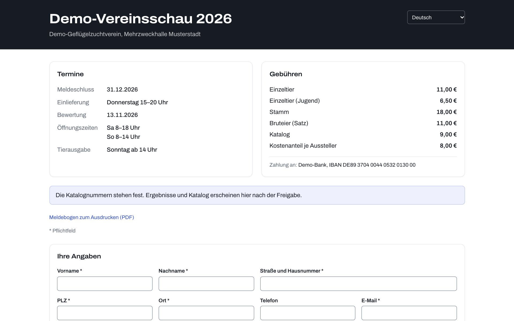

Geben Sie den Link aus „Adressen zum Weitergeben“ → „Online-Meldung und Infos für Aussteller“ weiter (Vereinsseite, Rundschreiben, Zeitung). Er hat die Form `https://schau.ihr-verein.de/s/kurzadresse`.

Das Formular ist geschlossen, wenn

- die Schau nicht in der Meldephase steht („Die Online-Meldung ist zurzeit nicht geöffnet.“),
- der Meldeschluss vorbei ist („Der Meldeschluss ist vorbei.“),
- die Hallenkapazität erreicht ist („Die Hallenkapazität ist erreicht.“),
- die Schau abgesagt ist („Die Schau ist abgesagt: …“).

Ausländische Registriernummern nimmt das Formular nur an, wenn in den Einstellungen „Aussteller aus anderen Mitgliedstaaten zugelassen“ angehakt ist.

Online-Meldungen erscheinen von selbst unter „Meldungen“. Der Aussteller bekommt eine Eingangsbestätigung mit Betrag, Bankverbindung und einem persönlichen Link zur Seite „Meine Meldung“. Dort sieht er später auch seine Ergebnisse.

> **Wichtig:** Jugendtarif und Preisrichter-Befreiung beruhen online auf der Angabe des Ausstellers. In der Liste stehen solche Meldungen mit „(Selbstauskunft – prüfen)“; die Prüfliste erinnert daran.

> **Tipp:** Eine unbezahlte Online-Meldung belegt Käfige nur 14 Tage lang. Danach zählt sie für die Hallenkapazität nicht mehr, bis sie bezahlt ist. Unbekannte oder unsinnige Meldungen lehnen Sie besser gleich ab.

Ändern kann der Aussteller eine Online-Meldung nicht selbst. Änderungen erfassen Sie bzw. die Meldestelle.

#### Online-Meldung in anderen Sprachen

Die Seiten für Aussteller gibt es auf Deutsch, Deutsch (Schweiz), Englisch, Französisch, Niederländisch, Polnisch und Tschechisch: Schauseite, Meldeformular, „Meine Meldung“, Ergebnisse, Impressum und Datenschutz. Die Seite öffnet in der Sprache des Browsers; oben rechts kann der Aussteller umstellen. Für einen Link in einer bestimmten Sprache hängen Sie `?sprache=en` an (ebenso `de-CH`, `fr`, `nl`, `pl`, `cs`).

- Die Sprache des Formulars wird mit der Meldung gespeichert. Eingangsbestätigung, „Eingangsbestätigung mailen“, Absage der Schau und SEPA-Vorabankündigung gehen in dieser Sprache hinaus; Papiermeldungen bleiben deutsch.
- Was Sie selbst schreiben, bleibt, wie Sie es schreiben: Schauname, Termine als Text, Sonderbestimmungen, Erklärungen zur Herkunft, Bankverbindung, Grund einer Absage. Impressum und Datenschutzhinweise gibt es nur auf Deutsch; die Seiten sagen das in der Sprache des Ausstellers. Die Kurzfassung des Datenschutzes im Formular ist übersetzt.
- Rassen und Farbenschläge stehen im Verzeichnis deutsch. Ausländische Aussteller tippen sie deutsch ein (z. B. „wyan weiß“); das Formular sagt das im Suchfeld.
- Ihre eigene Oberfläche bleibt immer deutsch.

#### A-Bogen: Meldebogen zum Ausfüllen

Wer lieber auf Papier meldet, braucht den A-Bogen: Anschrift, Registriernummer, Tiere in der Reihenfolge des Meldebogens, Stiftung und Spende, Ihre Erklärungen zur Herkunft, die Kurzfassung des Datenschutzes und die Unterschrift, mit der der Aussteller AAB und Sonderbestimmungen anerkennt. Gebühren, Meldeschluss, Ihre Anschrift als Meldestelle, Termine und Sonderbestimmungen stehen schon darauf.

- **Leer:** „Meldungen“ → „A-Bogen (leer)“ – zum Verteilen im Verein oder Beilegen ins Rundschreiben. Auf der öffentlichen Schauseite steht über dem Formular „Meldebogen zum Ausdrucken (PDF)“, solange die Online-Meldung offen ist.
- **Vorausgefüllt:** an einer Meldung unter „Für den Aussteller“ → „A-Bogen zum Unterschreiben (PDF)“ – z. B. wenn eine Meldung per Telefon oder E-Mail kam und die Unterschrift fehlt. Anschrift und Tiere stehen darauf; Bankdaten nie, und die Kreuze für Erklärungen, Datenschutz und Internet setzt der Aussteller selbst.
- **Für die Vereinsmitglieder:** unter „Aussteller“ → „A-Bögen drucken“ – je Mitglied ein Bogen mit Name und Anschrift, ohne Tiere (siehe 3.5).

Kommt der unterschriebene Bogen zurück, übernehmen Sie an der Meldung, was angekreuzt ist: „Meldebogen ist unterschrieben“, „Pflichterklärungen zur Herkunft abgegeben“, „Veröffentlichung im Internet erlaubt“ (nur mit Kreuz) und bei Jugend den Namen des Erziehungsberechtigten. Den B-Bogen (Meldebestätigung mit Katalognummern) bekommt der Aussteller später zurück. Für eine Testschau trägt der Bogen auf jeder Seite den Vermerk „Testschau – keine echte Ausstellung“.

#### Papiermeldungen erfassen

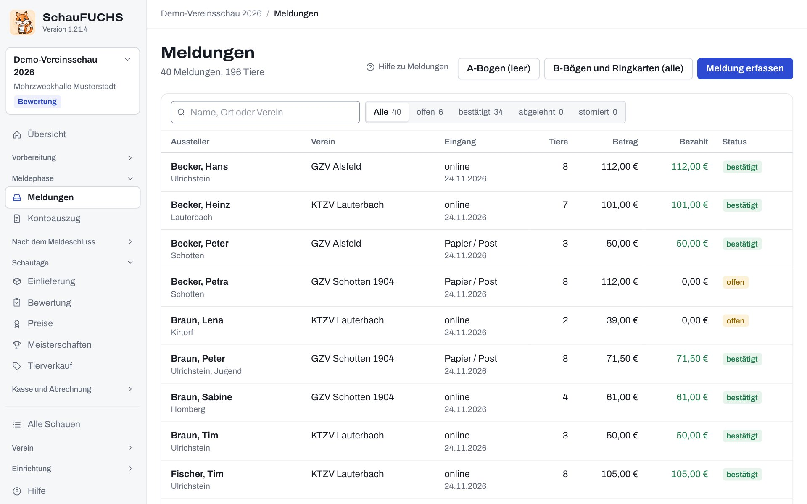

1. „Meldungen“ → „Meldung erfassen“.
2. Unter „Bekannten Aussteller suchen“ Namen oder Registriernummer eintippen – spart das Abtippen der Anschrift. Sonst die Felder neu ausfüllen. Dabei schlägt die Software Orte, Straßen, Vereine und Kreisverbände aus Ihren bisherigen Ausstellern vor; der Ort zur PLZ und der Kreisverband zum Verein werden eingetragen, wenn sie eindeutig bekannt sind und das Feld leer ist. Dazu kommen die Vereine aus dem Vereinsverzeichnis: die Namen der Rassegeflügelzuchtvereine in Deutschland mit Kreis- und Landesverband, gesammelt aus den öffentlichen Seiten der Verbände – nur Vereinsnamen, keine Personen und keine Adressen. Im Online-Formular erscheinen nur Vereine und Kreisverbände (aus bestätigten Meldungen, höchstens 100 Zeichen, und aus dem Verzeichnis), nie Anschriften anderer Aussteller.
3. Bei Bedarf „Jugendlicher“ (dann „Erziehungsberechtigter“ eintragen) und „Amtierender Preisrichter“ ankreuzen.
4. Unter „Tiere“ den Meldebogen Zeile für Zeile übertragen: Rasse und Farbenschlag aus dem Suchfeld wählen, „Art“, „Geschlecht“, „Alter“, bei Bedarf „Ring-Nr.“, „Verkaufspreis (€)“ und „Eigene Zucht“.
   - „Nächstes Tier“ übernimmt Rasse und Farbe und geht im Meldebogen weiter: 1,0 jung → 1,0 alt → 0,1 jung → 0,1 alt.
   - „Tier hinzufügen“ fügt eine leere Zeile an.
   - Rassen außerhalb des Verzeichnisses tragen Sie als AOC oder Neuzüchtung mit freier Bezeichnung ein.
5. Unter „Eingang“: „Eingegangen per“ (Papier / Post, E-Mail, online), „Bemerkung“ und die Haken:
   - „Meldebogen ist unterschrieben (AAB und Sonderbestimmungen anerkannt)“ – **ohne diesen Haken steht der Aussteller ohne Namen im Katalog**,
   - „Pflichterklärungen zur Herkunft abgegeben“ (nur, wenn in den Einstellungen Erklärungen stehen),
   - „Veröffentlichung im Internet erlaubt“ – nur, wenn der Aussteller das ausdrücklich angekreuzt oder geschrieben hat. Ohne Haken erscheint er online als „nicht veröffentlicht“. Bei Jugendlichen braucht die Veröffentlichung das Einverständnis eines Erziehungsberechtigten; ohne dessen Namen speichert die Software nicht („Jugendmeldung: Die Veröffentlichung im Internet braucht das Einverständnis eines Erziehungsberechtigten – bitte dessen Namen eintragen.“).
   - „Widerspruch: im Katalog ohne Namen“ – wenn der Aussteller der Nennung widersprochen hat (Art. 21 DSGVO, z. B. aus persönlichen Gründen). Seine Tiere stehen dann im gedruckten und im Online-Katalog ohne Name, Wohnort und Verein; die Anerkennung der AAB bleibt.
6. „Meldung speichern“ (oben rechts in der Kopfleiste, sobald etwas geändert ist). Die Software zeigt „Meldung gespeichert. Betrag: …“. „Zurück zur Liste“ führt zur Meldungsliste.

Über dem Formular stehen Tiere, Meldegeld, Bezahlt und Offen; der Status steht als Marke oben und im Abschnitt „Status“.

Hat inzwischen jemand anders dieselbe Meldung gespeichert (z. B. an einem zweiten Tisch), speichert das Formular nicht: „Die Meldung wurde inzwischen geändert – bitte neu laden …“. Ihre Eingaben bleiben stehen. Merken Sie sich, was Sie ändern wollten, klicken Sie auf „Neu laden“ und tragen Sie die Änderung noch einmal ein.

Je Aussteller gibt es **eine** Meldung pro Schau. Ein zweiter Meldebogen desselben Ausstellers wird in die vorhandene Meldung eingetragen.

#### Zahlungen erfassen und bestätigen

Auf der Seite einer Meldung steht rechts der Abschnitt „Meldegeld“ mit den Positionen, der Summe, den Zahlungen und „Offen: …“ bzw. „Vollständig bezahlt“.

1. Betrag (vorbelegt mit dem offenen Rest), Datum und Zahlart („Überweisung“, „bar“, „sonstige“) wählen. Für Administratoren ist „Überweisung“ vorgewählt – bei Bargeld auf „bar“ umstellen.
2. „Zahlung erfassen“ klicken.

**Ist der volle Betrag bezahlt, wird die Meldung automatisch bestätigt** („Zahlung erfasst – Meldung ist jetzt bestätigt.“). Das steht mit dem Grund „automatisch nach vollständiger Zahlung“ im Protokoll. Nur bestätigte Meldungen bekommen später eine Katalognummer und werden abgerechnet (siehe 5.15).

Weitere Möglichkeiten im Abschnitt „Status“:

- „Bestätigen“ – Meldung von Hand bestätigen (z. B. Zahlung bei der Einlieferung) oder eine abgelehnte bzw. stornierte Meldung wieder aufnehmen. Offene Meldungen dürfen auch Helfer bestätigen.
- „Bestätigung zurücknehmen“ – eine versehentlich bestätigte Meldung wieder auf „offen“ setzen (auch Helfer). Geht nicht mehr, sobald eine Zahlung gebucht ist (erst die Zahlung stornieren), ein Tier eingeliefert, bewertet, prämiert oder verkauft oder der Aussteller abgerechnet ist. Nach dem Abschluss der Schau ändert sich der Status einer Meldung nicht mehr.
- „Ablehnen“ – offene Meldung ablehnen, mit Grund (nur Administratoren).
- „Stornieren“ – bestätigte Meldung zurückziehen, mit Grund (nur Administratoren).

Bitte bei Gründen keine Personennamen eintragen; sie stehen im Protokoll.

**Storniert oder abgelehnt, aber schon bezahlt:** Ist für eine stornierte oder abgelehnte Meldung Geld eingegangen, steht an der Meldung ein gelber Hinweis („Für diese stornierte Meldung sind … eingegangen …“). Das Geld steht in keiner Abrechnung mehr; entscheiden Sie deshalb:

- **erstatten** – unten eine Zahlung mit negativem Betrag erfassen (mit Grund), oder
- **„Verfall buchen …“** – der Verein behält das Geld, z. B. bei Rücktritt nach dem Meldeschluss laut Ausstellungsbestimmungen. Im Fenster „Verfall buchen“ tragen Sie den Grund ein; danach steht an der Meldung „Verfall gebucht: …“. Nur Ausstellungsleitung, steht im Protokoll.

Bis eines davon geschehen ist, ist das in der Prüfliste ein Hinweis, in der Phase „Aussetzen & Abrechnung“ ein roter Punkt, und die Schau lässt sich nicht abschließen. Eine Meldung mit gebuchtem Verfall lässt sich nicht wieder aufnehmen („… Bitte eine neue Meldung erfassen.“).

> **Wichtig:** Funktionstrennung – Helfer buchen nur **Bargeld**, und höchstens den offenen Betrag („Offen sind … – mehr bucht nur die Ausstellungsleitung (Überzahlung).“). Überweisungen und „sonstige“ Eingänge bucht die Ausstellungsleitung nach dem Kontoauszug. **Erstattungen** (negativer Betrag, mit Grund) und das **Stornieren einer Zahlung** (Knopf „Zahlung stornieren“ mit dem Kreuz-Symbol hinter der Zahlung, als Gegenbuchung mit Grund) ebenfalls nur die Ausstellungsleitung.

Im Abschnitt „Für den Aussteller“ finden Sie „A-Bogen zum Unterschreiben (PDF)“, „B-Bogen und Ringkarten (PDF)“, den Link zur Seite „Meine Meldung“ und „Eingangsbestätigung mailen“ (höchstens fünfmal am Tag je Meldung; ohne E-Mail-Adresse des Ausstellers ist der Knopf grau).

> **Tipp:** Die Liste „Meldungen“ zeigt je Aussteller Betrag und bezahlten Betrag; mit dem Status-Filter finden Sie schnell alle „offen“-Meldungen.

### 5.5 Nach dem Meldeschluss: Phase „Halle & Katalog“

Schalten Sie mit „Weiter zu Halle & Katalog“ um. Damit schließt die Online-Meldung.

**Reihenfolge nach dem Meldeschluss** (so stehen die Seiten auch in der Seitenleiste unter „Nach dem Meldeschluss“):

1. Offene Meldungen bestätigen oder ablehnen (unten).
2. Preisrichter nach Rassen einteilen (siehe 5.8) – die Nummernbereiche folgen später den Katalognummern von selbst.
3. „Käfige“: Käfigbedarf prüfen, Käfiggröße je Rasse festlegen.
4. „Hallenplan“: die Käfige in der Halle aufstellen und den Plan festschreiben. Die Farben der Preisrichter stehen schon vor den Nummern im Plan (aus der Einteilung nach Rassen). Die Halle können Sie schon in der Vorbereitung anlegen; planen lässt sie sich erst sinnvoll mit den Meldungen.
5. „Katalognummern“: nach dem Hallenplan vergeben („Nach Hallenplan vergeben“, siehe „Katalognummern vergeben“ unten) – die Nummern folgen dann den Käfigen. Ohne Hallenplan in Ausstellungsfolge.
6. Ausgaben drucken, „Katalog“ gestalten (siehe 5.6), Nummern festschreiben.

Der Knopf der Phase auf der Übersicht und die Prüfliste folgen dieser Reihenfolge (siehe 5.1). Die Abschnitte unten stehen ebenso: erst Käfige und Hallenplan, dann die Katalognummern.

**Unbezahlte Meldungen:** Die Software lehnt unbezahlte Meldungen nach dem Meldeschluss **nicht** automatisch ab. Das ist Absicht: Viele Vereine kassieren das Meldegeld erst bei der Einlieferung.

- **Bezahlung bei der Einlieferung (so bei uns):** Bestätigen Sie die offenen Meldungen unter „Meldungen“ (Filter „offen“) von Hand mit „Bestätigen“. Nur bestätigte Meldungen bekommen Katalognummern und erscheinen bei der Einlieferung. Kassiert wird dann an der Einlieferung im Kasten „Meldegeld“.
- **Bezahlung vorab:** Fassen Sie bei offenen Meldungen nach und entscheiden Sie je Meldung: „Bestätigen“ oder „Ablehnen“.

#### Käfige (Käfigbedarf)

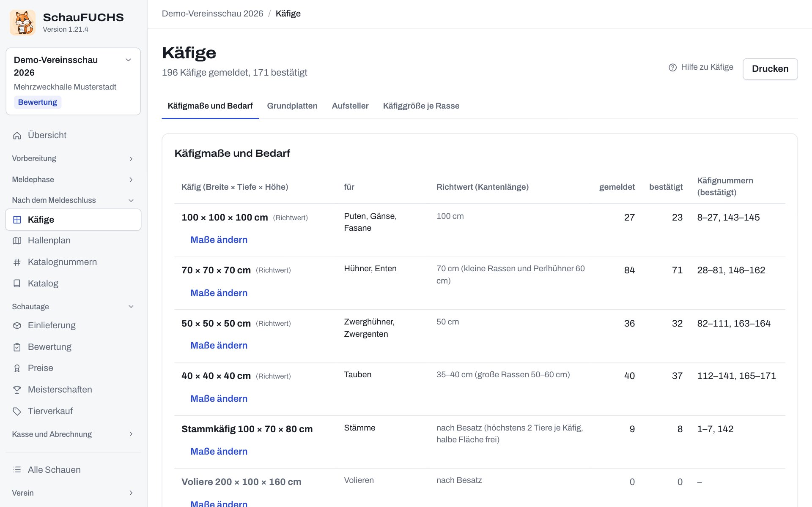

Unter „Käfige“ stellen Sie Ihre Käfige ein (Maße, Grundplatten, Käfiggröße je Rasse) und sehen, wie viele Käfige welchen Maßes Sie aufbauen müssen – ein Tier je Käfig, Stämme und Volieren je ein eigener, Bruteier ohne Käfig. „gemeldet“ zählt offene und bestätigte Meldungen (schon während der Meldephase nützlich), „bestätigt“ nur bestätigte; abgelehnte, stornierte und als fehlend gemeldete Tiere zählen nicht. Sobald die Katalognummern vergeben sind, steht je Größe dabei, welche Käfignummern dazugehören (die Käfignummer ist die Katalognummer), z. B. „70 × 70 × 70 cm: 17–32, 38–78“. Mit „Drucken“ bekommen die Aufbauhelfer die Liste auf Papier.

**Maße Ihrer Käfige:** Überall steht das Maß des Käfigs (Breite × Tiefe × Höhe), nicht ein Name. Bis Sie Ihre eigenen Maße eintragen, gilt der Richtwert als Würfel (z. B. 70 × 70 × 70 cm); Stammkäfige und Volieren heißen so, bis Sie ein Maß angeben. Klicken Sie neben dem Maß auf „Maße ändern“, tragen Sie Breite, Tiefe und Höhe in cm ein und speichern Sie; „Richtwert“ stellt zurück. In den Einstellungen der Schau führt der Reiter „Käfige und Halle“ hierher.

**Grundplatten:** Die Käfige stehen auf Grundplatten von rund 2 m Länge, so tief wie die Käfige, je Platte nur eine Käfigart: zwei 100er auf 200 × 100 cm, drei 70er auf 210 × 70 cm (etwas länger, damit alle drei Platz haben), vier 50er auf 200 × 50 cm, fünf 40er auf 200 × 40 cm. Allgemein stehen so viele Käfige auf einer Platte, wie auf höchstens 2,15 m passen. In der Tabelle stellen Sie je Käfigart ein eigenes Plattenmaß (Länge × Tiefe in cm, beide angeben) und die Zahl der Käfige je Platte ein; leer heißt automatisch, der Platzhalter zeigt den Wert. Unter **Etagen** tragen Sie ein, wie viele Käfige einer Art übereinander stehen (1 bis 4, leer heißt eine): Bei zwei Etagen trägt eine Platte mit fünf 40er-Käfigen zehn Tiere. Der Plan stellt dann Spalte für Spalte, unten zuerst (unten Nr. 1, darüber Nr. 2, daneben unten Nr. 3 …), und zeigt jeden Käfig als eigenes Feld: die Grundfläche quer geteilt, das untere vorn am Gang. Auch Nachmeldungen, freie Plätze, Käfigblöcke, „Nach Plan nummerieren“ und die 3D-Ansicht kennen die Etagen. Daneben steht, wie viele Platten Sie für die gemeldeten Tiere brauchen. „Grundplatten speichern“ übernimmt die Werte; der Hallenplan stellt die Platten danach auf, und die Änderung steht im Protokoll. Die Maße gelten für Meldung, Einlieferung und Einstellungen und werden in jede neue Schau übernommen – die Käfige gehören ja dem Verein.

**Anderer Käfig für ein einzelnes Tier:** Bei der Einlieferung können Sie und die Helfer für jedes Tier einen anderen Käfig wählen, z. B. wenn für ein Zwerghuhn nur noch ein Großkäfig frei ist. Das zählt im Käfigbedarf (unter der Tabelle steht, wie viele Tiere so umgesetzt sind) und im Protokoll; die Größe der Rasse bleibt unverändert, und die Katalognummer auch – sie kommt an den gewählten Käfig. Nachmeldungen werden nach dem Käfigblock eingeordnet, den die Tiere bei der Nummernvergabe hatten; eine später geänderte Größe je Rasse verschiebt also nichts.

Schon beim Melden zeigt jede Meldezeile (am PC und im Online-Formular) unter „Art“ die Käfiggröße, und bei der Einlieferung steht sie neben jedem Tier. Den Käfig vergibt die Software nach Sparte: Puten und Gänse kommen in den Großkäfig, Tauben in den Taubenkäfig, Zwerghühner und Wachteln in den Zwerghuhnkäfig, alle übrigen Einzeltiere (Hühner, Enten, Perlhühner, Ziergeflügel) in den Hühnerkäfig. Braucht eine Rasse eine andere Größe, stellen Sie das im Reiter „Käfiggröße je Rasse“ um; „automatisch (…)“ stellt es zurück. Das gilt für Einzeltiere dieser Rasse, Stämme und Volieren bleiben in ihrem eigenen Käfig.

**Richtwerte und Vorschläge:** Neben jedem Käfig steht unter „für“, wofür er gedacht ist, und daneben der Richtwert (Innenmaß als Kantenlänge für ein Tier): Puten, Gänse, Fasane 100 cm; Hühner, Enten 70 cm; Zwerghühner, Zwergenten 50 cm; Tauben 35–40 cm (große Rassen 50–60 cm). Sie stammen aus den BMEL-Leitlinien zur Ausrichtung von Tierbörsen (2006), die Veterinärämter als Richtwert für Geflügelausstellungen übernehmen; bundesweit verbindlich sind sie nicht, maßgeblich ist das Merkblatt Ihres Veterinäramts. Wo die Richtwerte eine andere Größe nahelegen, steht in der Rassentabelle ein Vorschlag mit „übernehmen“: Fasane in den Großkäfig, Römer und Montauban in den Hühnerkäfig, Strasser in den Zwerghuhnkäfig. Für große Hühnerrassen wie Brahma oder Cochin nennen die Richtwerte keinen größeren Käfig als den Hühnerkäfig.

> **Wichtig:** Laufen die Katalognummern nach Käfigblöcken (Einstellungen), legen Sie die Käfiggrößen je Rasse **vor** dem Vergeben der Katalognummern fest. Ändern Sie danach eine Größe, nummerieren Sie unter „Katalognummern“ neu, damit die Blöcke wieder durchgehend sind – nach dem Festschreiben geht das nicht mehr: Eine dann geänderte Größe ändert keine Käfignummern, das Tier bleibt in seinem Block.

#### Hallenplan

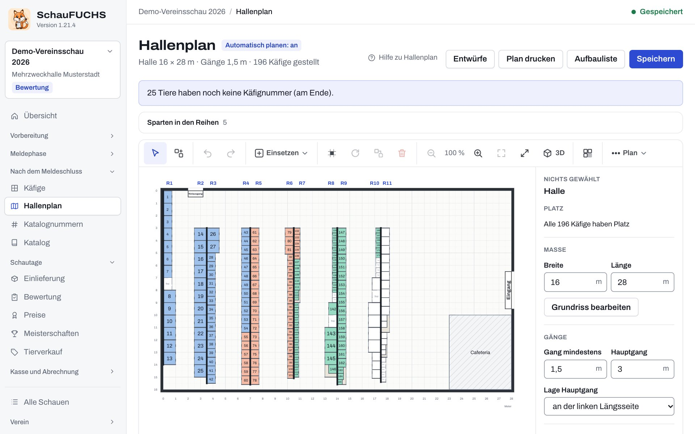

Unter „Hallenplan“ rechnet die Software aus, wie die Käfige in Ihrer Halle stehen, und zeichnet den Plan zum Ansehen und Drucken. Für die Ausstellungsleitung ist die Seite zugleich der **Halleneditor**: Einstellungen der Halle, Eingänge und Flächen, Stellvorschläge und das freie Planen liegen an einer Stelle (siehe „Hallenplan bearbeiten“). Helfer sehen den Plan nur an.

**Neue Halle:** Gibt es in der Schau noch keine Halle, stehen dort eine Skizze und die Maße: Breite (kurze Seite), Länge und Gang mindestens, in Metern. „Halle anlegen“ speichert sie; danach geht es im Halleneditor weiter – Eingänge und Flächen setzen Sie dort direkt in den Plan. Die Halle wird wie die Käfigmaße in jede neue Schau übernommen.

**Einstellungen der Halle:** Ist im Editor nichts gewählt, stehen rechts die Einstellungen der Halle (am Tablet hinter „Einstellungen der Halle“). Jede Änderung wirkt sofort im Plan und lässt sich rückgängig machen (im festen Plan mit derselben Rückfrage wie unten; nach einem Neusetzen beginnt der Verlauf neu). Ein Feld übernimmt seinen Wert beim Verlassen oder mit der Eingabetaste.

1. **Maße und Gänge:** Breite (kurze Seite) und Länge in Metern, „Gang mindestens“ (Vorgabe 1,5 m – die Auflagen Ihrer Gemeinde oder Halle für Rettungswege gehen vor). Bei „Lage Hauptgang“ wählen Sie, wo der breite Gang an den Reihenenden liegt (an einer oder beiden Längsseiten, durch die Mitte oder keiner), bei „Hauptgang“, wie breit er ist (Vorgabe 3 m). Die Einheit (m) steht jeweils im Feld. Unter „Reihen“ laufen die Käfigreihen „quer“ (parallel zur kurzen Seite, üblich) oder „längs“ (für besondere Hallen). „Einzelreihen an den Wänden“ stellt eine Einzelreihe (Front zur Halle) an die Wände, an denen die Reihen entlanglaufen – an beide, nur an eine („nur links“, „nur oben“ … wie in der Zeichnung) oder keine; dazwischen stehen Doppelreihen Rücken an Rücken.
2. **Grundplatten:** Die Käfige stehen auf Grundplatten von rund 2 m Länge, so tief wie die Käfige, je Platte eine Käfigart (zwei 100er, drei 70er auf 2,10 m, vier 50er, fünf 40er). Eigene Plattenmaße je Käfigart stellen Sie unter „Käfige“ ein. Weicht Ihr Bestand ab, tragen Sie unter „Grundplatten je Käfigart“ die Zahl ein; leer lassen heißt Vorgabe (sie steht grau im Feld). Eine Grundplatte steht immer ganz – Einzelkäfige und angeteilte Platten gibt es nicht. Passt am Ende eines Abschnitts keine ganze Platte mehr hinein, beginnt sie im nächsten bzw. in der nächsten Reihe. Die Platten stehen lückenlos aneinander, auf jeder Platte die Käfige lückenlos nebeneinander. Wechselt die Käfiggröße und ist die letzte Platte noch nicht voll, stehen die Käfige der nächsten Art zuerst auf deren Rest, wenn sie hineinpassen (Länge und Tiefe der Platte reichen, die Platte wird nie gekürzt), z. B. Zwerghühner oder Tauben auf dem Rest einer Hühnerplatte. Jeder Käfig steht in seiner echten Breite, die Etagen gelten je Käfigart, die Katalogfolge bleibt. Danach geht es auf einer eigenen Platte weiter. So bleibt mitten in einer Reihe nur dort ein Platz frei, wo der nächste Käfig nicht passt (z. B. kein Huhn auf einer Taubenplatte). Freie Plätze stehen im Plan gestrichelt als „frei“ – dort kommen Nachmeldungen hin, und sie zählen bei „Platz“ mit. Unter „Grundplatten nach Käfigart“ zählt eine solche Platte als „gemischt“ bei der Art, mit der sie beginnt; die Angaben zur Grundplatte nennen ihre Käfige je Art. In einer Doppelreihe stehen die Käfige Rücken an Rücken, in einer Wandreihe direkt an der Wand.
3. **Beim Aufstellen gilt die Katalogfolge:** Die Software stellt alle Käfige streng aufsteigend in Katalogfolge (= Käfignummern) Reihe für Reihe – ohne Sonderregeln für Tauben oder Großkäfige. Die Reihen sind geschlossen: Eine neue Sparte (Wassergeflügel, Hühner, Zwerghühner, Tauben, auch die Jugend-Blöcke) und eine kleinere Käfigart gehen direkt weiter, ohne Lücke, ohne Gang und ohne neue Reihe. Danach macht die Software die Reihen etwa gleich lang: Sie beginnen bündig am Reihenanfang und enden ungefähr gleich weit (die letzte Reihe kürzer). Teilt eine Fläche eine Reihe, gilt das je Stück; endet ein Stück an einer Freifläche, rücken seine Käfige bis an die Fläche. Der Rest jeder Reihe bleibt Reserve für Nachmeldungen. Läuft die Halle über, füllt die Software die Reihen vom Anfang her ganz – kein Tier verliert seinen Platz an eine spätere Nummer. Rücken an Rücken (die beiden Seiten einer Doppelreihe) stehen die Käfige ohne Abstand, vor jeder Front bleibt mindestens die Gangbreite. Im festgeschriebenen Plan bekommt eine Nachmeldung eine neue Grundplatte möglichst hinter ihrer eigenen Sparte oder in einer leeren Reihe. Ein schon festgeschriebener Plan bleibt, wie er ist: Für die neue Aufstellung „Plan neu setzen“. Was keinen Platz mehr findet, steht unter „Platz“ als ohne Platz – es wird nicht auf freie Plätze weiter vorn verteilt. Beim Neu-Setzen (auch nach einer geänderten Einstellung) bekommen solche Tiere Käfigblöcke in den freien Resten der Reihen, siehe „Plan neu setzen“. Eine Wandreihe an einer Wand ohne Eingang läuft über die ganze Wand, auch durch den Hauptgang bis in die Ecke. Immer eingehalten wird die Gangbreite: zwischen den Reihen, an den Reihenenden (wo eingestellt) und vor Eingängen. Der Hauptgang gehört an die Seite mit dem Eingang.
4. **Flächen** setzen Sie im Editor über „Einsetzen“ (siehe „Hallenplan bearbeiten“): „Eingang / Ausgang“ für Ein- und Notausgänge an der Wand (z. B. 2 m breit, 0,5 m tief – im Plan als Öffnung in der Wand, in 3D mit einer Tür, siehe [Türen in den Eingängen](#hallenplan-tueren)), „Freier Bereich“ für Bühne, Kasse, Verkaufsstand oder Cafeteria, dazu ein „Volierenbereich“ für die Volieren. Im Volierenbereich stellt die Software die Volieren in Reihen entlang der längeren Seite, nebeneinander ohne Abstand: an einer Hallenwand eine Einzelreihe (Front zur Halle), sonst Doppelreihen Rücken an Rücken; zwischen den Reihen bleiben immer 1,50 m frei. Die genauen Werte einer gewählten Fläche stehen rechts: „von links“ und „von oben“ wie in der Zeichnung, dazu Breite und Höhe. Vor einem Eingang oder Notausgang bleibt ein Gang frei, so breit wie der Ausgang und 1 Gang tief in die Halle – seitlich daneben dürfen Käfige bis an den Ausgang heran, auch in die Ecke. Um Volierenbereiche bleibt rundherum ein Gang frei; an eine Fläche ohne Käfige laufen die Käfige ohne Abstand heran. Steht eine solche Fläche im Gang vor den Käfigen, bleibt die Reihe dort frei – der Gang behält seine volle Breite. Endet ein Stück Reihe an einer Fläche, rücken die Käfige bis an die Fläche; der Rest bleibt am Gang.
5. „bündig an Wänden ohne Eingang“ (Vorgabe): Die Reihen gehen bis an die Wand, so wie üblich gestellt wird. Ein Eingang oder Notausgang hält nur dort einen Gang frei, wo er ist: Die Reihen davor beginnen erst hinter dem Gang, alle anderen gehen bis an dieselbe Wand. Am Hauptgang bleibt der Gang frei. Ohne Hauptgang bleibt am Ende der Reihen ein Quergang, damit die Gänge zwischen den Reihen nicht an beiden Enden zu sind. Grundplatten stehen immer ganz und werden nie gekürzt: Passt am Ende einer Reihe keine ganze Platte mehr, bleibt der Rest frei und kommt zum Quergang hinzu. Beispiel: Halle 15,5 m, Quergang 1,5 m, also 14 m Reihe – Hühnerplatten zu 2,1 m passen sechsmal (12,6 m), unten bleiben 2,9 m frei; Zwerghühner- und Taubenplatten zu 2,0 m füllen die 14 m. Die Einzelreihen an den Wänden stehen ohnehin direkt an der Wand.
6. **Eine geänderte Einstellung setzt den Plan neu:** Maße, Gänge, Hauptgang, Reihenrichtung (quer/längs), Wandreihen, „bündig“ oder Grundplatten – die Software stellt alle Käfige neu, genau wie mit „Plan neu setzen“ (siehe unten): Verschobenes und eingesetzte Teile der alten Aufstellung fallen weg, Tiere, die nicht in die Reihen passen, bekommen Käfigblöcke. Ist der Plan fest oder steht etwas von Hand Geplantes (verschobene Reihen oder Platten, von Hand eingesetzte oder verschobene Blöcke, Volieren), kommt vorher die Rückfrage „Plan neu setzen?“; mit „Abbrechen“ bleibt alles, wie es ist. Käfigblöcke, die die Software selbst eingesetzt hat (beim Neu-Setzen oder mit „Alle fehlenden Käfige einsetzen“), zählen nicht dazu – im automatischen Plan wechseln Sie also ohne Rückfrage z. B. zwischen quer und längs, und die Blöcke werden jedes Mal passend neu gesetzt.

Solange keine Tiere gemeldet sind, ist die Halle leer. Der Plan stellt alle gemeldeten Tiere (offene und bestätigte Meldungen – gemeldet heißt noch nicht eingeliefert, aufgebaut wird ja vorher) in Katalogfolge (= Käfignummern) Platte für Platte und Reihe für Reihe auf, mit den Maßen Ihrer Käfige (unter „Käfige“). Jede Reihe heißt R1, R2 …; die Käfige tragen ihre Nummer, und jeder Preisrichter hat eine eigene Farbe – schon vor den Katalognummern: Ein Tier ohne Nummer bekommt den Preisrichter aus der Einteilung nach Rassen (auch die Jugend, wenn sie separat eingeteilt ist), ein nummeriertes den seines Nummernbereichs. Ohne Nummer ist der Preisrichter nur vorgesehen – die Angaben zum Käfig zeigen dann „(vorgesehen)“: Fest wird er erst mit den Nummern (eine Nachmeldung mit Unternummer geht z. B. an den Preisrichter der Hauptnummer, eine Einteilung von Hand nach Nummern geht vor). Die Farben stehen in der Folge, in der die Preisrichter im Plan zuerst vorkommen (Reihe für Reihe, dann Volieren und eingesetzte Teile) – so behält jeder Preisrichter seine Farbe, wenn die Nummern vergeben werden. Ab dem fünften zusätzlich schraffiert, damit die Farben auch bei Farbschwäche und im Schwarzweiß-Druck unterscheidbar bleiben). Der Plan ist wie eine Bauzeichnung gezeichnet: kräftige Wände, Eingänge als Öffnung in der Wand, alles in der Halle mit feinen dunklen Linien. Die Bauteile haben eigene, neutrale Farben: Grundplatten sandfarben, freie Bereiche fein grau schraffiert, Volierenbereiche grün gestrichelt, eingesetzte Volieren weiß mit kräftigerem Rand. Ein leichtes Raster von 0,5 m (jeder Meter etwas kräftiger) und die Meterzahlen unten und links helfen beim Abmessen. Die Legende steht unter dem Plan. Gezeichnet sind nur die Reihen mit Käfigen; wie viel Platz noch frei ist, steht unter „Platz“. Darunter stehen:

- **Platz:** ob alle Käfige Platz haben, wie viele Grundplatten noch frei sind und wie viele Käfige jeder Art noch hineinpassen würden – auf ganzen Platten in den freien Reihen plus die freien Plätze auf angefangenen Platten. Fehlt das Maß für Stammkäfige oder Volieren, steht ein Hinweis da – tragen Sie es unter „Käfige“ ein.
- **Aufbauliste je Reihe:** Lage, Käfignummern, Käfige je Maß, Zahl der Grundplatten und die Länge der Käfigblöcke („Länge“ ist die Summe der Grundplatten der Reihe; die Platten stehen lückenlos aneinander), Rassen und Preisrichter – mit „Zusammen“ für die ganze Halle und darunter die Grundplatten je Käfigart.

**Vollansicht und Angaben zum Käfig:** „Vollansicht“ zeigt den Plan bildschirmfüllend (zurück mit „Schließen“ oder Esc). Helfer finden den Knopf oben neben „Drucken“, im Editor steht er in der Werkzeugleiste. Helfer klicken auf einen Käfig, im Editor wählen Sie die Grundplatte und klicken rechts bei „Tiere“ auf „Angaben“. Dann öffnen sich rechts oben die Angaben zum Käfig: Tier, Klasse, Sparte, Ring, Käfig, Züchter mit Ort und Verein (der Name führt zur Meldung), Preisrichter, Status, Bewertung und Preise. Der Käfig ist dabei schwarz umrandet; „ד schließt die Angaben. Mit der Tastatur: Tabulator bis zum Käfig, Eingabetaste.

**Stellvorschläge:** Der Knopf „Stellvorschläge“ in der Werkzeugleiste (oder „Stellvorschläge ansehen“ bei den Einstellungen der Halle) öffnet rechts über dem Plan eine Schublade mit derselben Halle in allen möglichen Aufstellungen: Reihen quer oder längs, mit oder ohne Wandreihen, bündig an Wänden ohne Eingang oder mit Gang an allen Wänden, Hauptgang am Anfang, am Ende, an beiden Enden, in der Mitte oder ohne (ohne eingestellten Hauptgang mit 3 m Breite). Weggelassen wird nur, was nicht geht: wenn keine Reihe in die Halle passt oder die Gänge zwischen den Reihen an beiden Enden zu wären. Eingänge, Freiflächen und Volierenbereiche bleiben, die Reihen weichen ihnen aus. Jeder Vorschlag ist so gestellt wie mit „Plan neu setzen“: Tiere, die nicht in die Reihen passen, bekommen Käfigblöcke; „ohne Platz“ heißt, auch dafür reicht der Platz nicht. Oben steht zum Vergleich „So wie jetzt“, darüber, wie viele Aufstellungen es gibt und in wie vielen alle Tiere Platz haben; „Nur mit Platz für alle“ blendet die übrigen aus. Zuerst stehen die Vorschläge, in denen alle Tiere Platz haben, dann die mit dem meisten Platz für Nachmeldungen; je Vorschlag die Zahl der Tiere ohne Platz, die freien Grundplatten, die Reihen und eine kleine Zeichnung. „Übernehmen“ stellt die Halle so ein und setzt den Plan neu (mit Protokoll); von Hand Verschobenes und eingesetzte Teile gehören zur alten Aufstellung und fallen dabei weg. Ist der Plan festgeschrieben, fragt die Software „Plan neu setzen und übernehmen?“ – dann werden alle Käfige in dieser Aufstellung neu aufgestellt. „Schließen“ oder Esc schließt die Schublade. Ändern Sie die Halle, während die Schublade offen ist, rechnet die Software die Vorschläge neu. Wurde die Halle inzwischen an einem anderen Rechner gespeichert, schließen Sie die Schublade und öffnen sie neu. Zeichnen Sie Eingänge und Flächen vorher ein – die Vorschläge richten sich danach.

**Sparten in den Reihen:** Über dem Plan klappt „Sparten in den Reihen“ auf. Dort steht je Sparte (Hühner, Zwerghühner, Tauben, Wassergeflügel …), wie viele Tiere gemeldet sind und in welchen Reihen sie stehen. Festlegen lässt sich dort nichts mehr – die Käfige stehen streng in Katalogfolge.

#### Hallenplan bearbeiten

Für die Ausstellungsleitung ist der Plan immer der Editor – einen eigenen Bearbeiten-Modus gibt es nicht. In der abgeschlossenen Schau lässt sich der Plan nur noch ansehen. **Automatisch planen: an/aus** (Schalter in der Statuszeile unter dem Plan und bei den Einstellungen der Halle unter „Plan“, oben steht der Zustand): Bei „an“ stellt die Software die Käfige und stellt sie neu, wenn sich etwas ändert (Einstellungen der Halle, Nachmeldungen, Stornos). Bei „aus“ ist der Plan festgeschrieben – nichts rückt mehr von selbst: Eine geänderte Einstellung gilt, die Käfige bleiben aber stehen (über dem Plan steht dann „Maße nach dem Festschreiben geändert“ mit „Plan neu setzen“); neue Tiere kommen auf freie Plätze oder stehen unter „Platz“ zum Einsetzen. Nur die Reihenrichtung (quer/längs) lässt sich bei „aus“ nicht ändern, ohne die Automatik wieder einzuschalten – die Rückfrage sagt das. Einschalten fragt „Automatisch planen einschalten?“ und setzt den Plan neu (Verschobenes und eingesetzte Teile fallen weg). **Ausschalten geschieht auch von selbst:** Solange die Software den Plan rechnet („Automatisch gestellt“), schreibt das erste Verschieben, Drehen oder Ausrichten einer Reihe oder Grundplatte (und das Entfernen leerer Plätze, nach der Rückfrage) ihn vorher fest, mit der Meldung „Automatisch planen ist aus – die Käfige bleiben, wo sie stehen.“ Hat sich der Plan seit dem Laden geändert (Nachmeldung, Storno) oder wurde er inzwischen anderswo festgeschrieben, unterbleibt beides: Der Plan lädt neu, und Sie machen die Änderung noch einmal – so landet eine Verschiebung nie auf der falschen Platte. Einstellungen der Halle, Flächen und eingesetzte Teile ändern ihn nicht; ein verschobener Eingang lässt die Reihen im automatischen Plan neu rechnen. Der Editor hat drei Teile:

- **Werkzeugleiste** oben (bleibt beim Scrollen stehen). Jedes Symbol nennt beim Darüberfahren seinen Namen und sein Tastenkürzel. Die Gruppen von links: *Auswahl* (Auswählen, Mehrfachauswahl), *Verlauf* (Rückgängig, Wiederholen), *Einsetzen* (Menü), *Bearbeiten* (Am Raster ausrichten, Drehen, An ihren Platz zurück, Entfernen), *Ansicht* (Verkleinern, Zoomstufe, Vergrößern, Ganze Halle, Vollansicht, 3D), *Stellvorschläge* (auf breiten Bildschirmen mit Text) und das Menü *Plan*.
- **Eigenschaften** rechts neben dem Plan. Ist nichts gewählt, die Einstellungen der Halle (siehe oben) mit dem Stand des Plans. Ganz oben unter „Platz“ steht, für welche Tiere noch Käfige fehlen: je Käfigart die Anzahl mit Maß (Breite × Tiefe × Höhe), z. B. „34 Taubenkäfige (40 × 40 × 40 cm)“, und wie viele Käfigblöcke (bzw. Volieren) dafür nötig sind, die Tiere mit Katalognummer und Rasse (ohne Aussteller) und der Knopf „Käfigblock einsetzen“ bzw. „Voliere einsetzen“ – die Tiere kommen dann automatisch hinein. „Alle fehlenden Käfige einsetzen“ setzt auf einmal so viele Blöcke ein, wie nötig sind. Beide stellen die Blöcke nur dorthin, wo auch die Reihen stehen dürfen – bündig an eine Platte derselben Käfigart, sonst an eine andere Platte oder an das Ende des Reihenstücks, in Reihenrichtung –, nie in einen Gang, den Quergang, den Gang vor einem Eingang oder auf eine Fläche. Passt nicht alles, setzt die Software so viele wie möglich; die Meldung nennt die Tiere, die weiter ohne Platz sind. Ist in den Reihen gar nichts mehr frei, nennt die Meldung, wie viele Tiere ohne Platz bleiben; „Käfigblock einsetzen“ setzt dann einen einzelnen Block in die Mitte der Halle (von Hand an seinen Platz ziehen). Der Knopf sucht genau wie „Plan neu setzen“ – was dieses nicht unterbringt, findet auch der Knopf nicht. Jeder Käfig hat vorn eine offene Gitterfront, Rück- und Seitenwände sind dicht – im Plan und im Druck ist die Rückwand jeder Grundplatte, jedes Blocks und jeder Voliere eine kräftige dunkle Linie (bei Doppelreihen die gemeinsame Mittellinie), die Seiten sind fein, die Front ist hell gestrichelt; beim Drehen und Ziehen wandert die Rückwand mit. Schieben Sie eine Grundplatte, einen Block oder eine Voliere mit der langen Seite an eine Wand (bis 30 cm, auch an eine Innenwand eines freien Grundrisses), dreht die Software sie so, dass die Rückwand an der Wand liegt. Stellen Sie ein solches Teil mit der Front an ein anderes – an dessen Front, Rückwand oder Seitenwand, bis 30 cm davor und mindestens 30 cm überlappend (Ecke an Ecke zählt nicht) –, dreht die Software das gestellte Teil an Ort und Stelle um, sodass Rückwand an Rückwand steht. Das gilt beim Ziehen, mit den Pfeiltasten, beim Einsetzen und beim Drehen; gedreht wird aber nur, wenn die Gegenseite frei ist (nach einer Wand nicht direkt an einem Teil oder einer Sperrfläche, nach einem Nachbarn ein ganzer Gang in Gangbreite) – sonst bleibt es, wie Sie es gestellt haben, und der Hinweis „Front zu …“ bzw. „Front zur Wand“ bleibt stehen. Eine eben mit „Drehen“ (R) gewählte Richtung bleibt also, solange ihre Front frei ist. Das stehende Teil dreht nie mit. Verschieben Sie eine Gruppe, richtet sich jedes Teil für sich aus – auch eines, das schon vorher falsch stand. Eine Reihe (oder mehrere Platten einer Reihe) dreht nur als Ganzes: alle Platten, wenn danach jede Front frei ist, sonst keine – nie eine einzelne Platte mitten in der Reihe. Für ältere Pläne richtet „Käfige an den Wänden ausrichten …“ im Menü „Plan“ (oder der Knopf beim Hinweis „Front zur Wand“) alle auf einmal aus – die Käfignummern auf einer gedrehten Platte laufen danach andersherum, der Hinweis „Nummern nicht in Planfolge“ bietet dann „Nach Plan nummerieren“ an: Eingesetzte Blöcke bekommen die Front ihrer Reihe (zum Gang), „Drehen“ (R) dreht einen Block samt Front in vier Schritten; wäre die Front nach einem Schritt verdeckt und ist die Gegenseite frei, dreht die Software gleich um 180° weiter (dann springt R um 270°). Zeigt die Front eines Blocks oder einer Reihe nicht zu einem freien Gang (mindestens Gangbreite), steht über dem Plan ein kurzer Hinweis, z. B. „R3: Front zu R4“ oder „Block 40 × 40 × 40 cm: Front zur Wand“. Sobald Tiere in einem eingesetzten Block stehen, lässt er sich nicht mehr entfernen – auch nicht mit „Rückgängig“ (sonst verlören die Tiere ihren Platz); verschieben und drehen lässt er sich wie jedes Teil. Haben alle Platz, steht dort nur „Alle … Käfige haben Platz“. Dieselbe Liste steht unter dem Plan im Abschnitt „Platz“. Sonst, was gewählt ist, ob es leer oder belegt ist (mit Käfignummern), Käfigart, Lage (Abstand von der linken und oberen Wand, wie in der Zeichnung), Größe, Drehung und ob es von Hand verschoben ist, dazu die passenden Knöpfe und bei einer belegten Platte, einem Käfigblock oder einer Voliere die Tiere darauf mit „Angaben“. Bei einer Fläche stehen hier Name, Art, Lage und Größe zum Eintragen. Am Tablet und auf schmalen Bildschirmen steht das als feste Zeile über dem Plan; sie bricht nie um, damit der Plan beim Antippen nicht verrutscht. Bei einer Fläche oder belegten Platte öffnet dort „Eigenschaften“ die Werte bzw. die Tiere mit „Angaben“.
- **Statuszeile** unten: ob der Plan automatisch gestellt oder seit wann er festgeschrieben ist, wie viele Reihen und Platten verschoben und wie viele leere Plätze entfernt sind, und der Link „Hilfe zum Editor“ hierher. Den Stand des Plans („Automatisch gestellt“ oder festgeschrieben) zeigt auch der Seitenkopf.

Im Menü **Einsetzen**:

- **Voliere** setzt eine Voliere in die Mitte der Halle; die gemeldeten Volieren kommen der Reihe nach in die eingesetzten Volieren (die übrigen in den Volierenbereich). Ohne eingetragenes Volierenmaß ist eine Voliere 2 × 1 m groß. Stehen zwei eingesetzte Volieren weniger als 1,50 m auseinander (direkt aneinander, also Rücken an Rücken oder nebeneinander, ist erlaubt), steht über dem Plan ein Hinweis.
- **Käfigblock** in einer der Größen setzt eine Grundplatte mit Käfigen dieser Größe. Haben Tiere dieser Käfiggröße keinen Platz (bzw. sind im festen Plan „noch zu stellen“), kommen sie automatisch hinein – in Katalogfolge; die übrigen Plätze bleiben leer (Reserve, Verkaufs- oder Fundtiere). Ein Käfigblock lässt sich bündig an eine Reihe ansetzen (an ihr Ende oder in eine Lücke); die Reihe macht ihm nur genau dort Platz, wo er steht. Eingesetzte Volieren und Volierenbereiche halten dagegen rundherum einen Gang Abstand, Eingänge einen Gang davor.
- **Garnitur, Tisch, Bank** (unten im Menü unter „Tische und Bänke“) für Cafeteria und Sitzplätze: ein Biertisch 2,20 × 0,50 m, eine Bank 2,20 × 0,25 m, eine Garnitur ist ein Tisch mit je einer Bank an den langen Seiten (zusammen 1,30 m tief). Die Maße stellen Sie rechts bei den Eigenschaften ein (Länge, Tiefe, bei der Garnitur auch die Tiefe der Bänke). Verschieben, drehen und entfernen wie die übrigen Teile. Tische und Bänke stellen Sie frei: auch direkt vor die Käfige, in Gänge und Hauptgänge und in einen freien Bereich (Bühne, Cafeteria). Nicht erlaubt sind nur Käfige, Platten, Blöcke, Volieren und andere Tische oder Bänke darunter, die Türöffnung eines Eingangs und außerhalb der Halle – dorthin lässt der Editor sie nicht ziehen. Im Gang vor einem Ein- oder Notausgang dürfen sie stehen, dann erinnert ein Hinweis über dem Plan an den Fluchtweg („Tisch 1 steht im Gang vor „E1““). Tische und Bänke verschieben nie einen Käfig: Die Reihen werden geplant, als gäbe es sie nicht. Umgekehrt kommen Käfige nie auf einen freien Bereich – weder durch die Planung noch durch „Fehlende Käfige einsetzen“ noch beim Verschieben oder Drehen von Hand („Nicht gedreht: … stünde dann auf „Bühne““). Im Plan und im Druck sind sie holzfarben, in 3D stehen sie mit ihren Beinen in der Halle.
- **Pokaltisch (Ehrenpreise)** (ebenfalls unter „Tische und Bänke“) für die Ausstellung der Pokale und Ehrenpreise: ein Tisch, 2,00 × 0,80 m vorgegeben; Länge und Tiefe stellen Sie rechts bei den Eigenschaften ein. Er ist ein Möbelstück wie Tisch und Bank – es gelten dieselben Regeln (steht frei, verschiebt nie einen Käfig, bleibt beim Neu-Setzen stehen). Im Plan und im Druck ist er holzfarben mit einem goldenen Pokal darauf, die Legende nennt ihn „Pokaltisch“; in 3D stehen einige Pokale auf der Platte, auf einem kleinen Tisch entsprechend kleiner.
- **Eingang / Ausgang, Freier Bereich, Volierenbereich** (oben im Menü unter „Flächen“): Danach ziehen Sie im Plan ein Rechteck auf (oder klicken nur, dann in Vorgabegröße). Ein Eingang kommt an die nächste Wand, 0,5 m tief und so lang wie aufgezogen (mit einem Klick 2 m). Esc oder „Abbrechen“ beendet das Aufziehen (während des Ziehens bricht das erste Esc nur das Rechteck ab).

Volieren und Käfigblöcke erscheinen in der Mitte der Halle bzw. auf dem nächsten freien Platz daneben (nie auf einem anderen Teil); alles Neue ist gleich gewählt – ziehen Sie es an seinen Platz. Im Menü **Plan** stehen die Befehle für den ganzen Plan: „Nach Plan nummerieren“ (im festen Plan, siehe unten), „Alle Reihen an ihren Platz“ und „Alle Platten an ihren Platz“ (mit der Zahl der verschobenen), und „Plan neu setzen …“.

**Verschieben und drehen:** Ziehen Sie ein Teil, eine Fläche, eine einzelne Grundplatte oder eine ganze Käfigreihe mit der Maus an den richtigen Platz (Raster 10 cm). Ein Klick auf eine Grundplatte wählt nur diese Platte mit den Käfigen darauf – so stellen Sie einzelne Käfigblöcke um, ohne die Reihe zu bewegen; die ganze Reihe greifen Sie an ihrer Beschriftung „R1“, „R2“ … „Drehen“, die Taste R oder ein Doppelklick dreht um 90° – auch eine ganze Reihe (um ihren Anfang; kommen Tiere dazu, wächst sie nur nach einer Seite), etwa um ein paar Käfige quer an eine Wand zu stellen; die blaue Ecke unten rechts an einer gewählten Fläche ändert ihre Größe. „An ihren Platz zurück“ stellt eine gewählte, von Hand verschobene oder gedrehte Reihe oder Platte wieder dorthin, wo die Software sie gestellt hat. Eine verschobene Reihe merkt sich ihre Nummer (R1, R2 …): Ändern Sie danach die Halle (Wandreihen, Richtung, Gang) oder kommen tiefere Käfige dazu, können sich die Nummern verschieben – prüfen Sie dann die verschobenen Reihen. Alles wird sofort gespeichert und steht im Protokoll; oben rechts (in der Vollansicht unter dem Plan) steht „Gespeichert“, „Wird gespeichert …“ oder „Nicht gespeichert“. Ist die Verbindung zum Server weg (WLAN in der Halle, Server kurz nicht erreichbar), steht dort „Keine Verbindung – wird erneut gesendet“: Die Änderung bleibt im Plan, und die Software schickt sie von selbst noch einmal – erst nach 1, 2, 4 … Sekunden, höchstens alle 30 Sekunden, und sofort, sobald das Gerät wieder Netz hat. Sie können weiterarbeiten; weitere Änderungen werden der Reihe nach danach gespeichert – eine Verschiebung im automatisch gestellten Plan immer erst nach dem Festschreiben. Antwortet der Server zwar, aber unlesbar (etwa beim Neustart), versucht es die Software gut eine halbe Minute lang und meldet dann „Nicht gespeichert“. Wer die Seite in dieser Zeit verlassen will, wird vorher gefragt. Kam die Änderung schon beim ersten Mal an und ging nur die Antwort verloren, gilt sie als gespeichert. Lehnt der Server die Änderung ab, kommt wie sonst „Nicht gespeichert“ mit dem Grund. Der Knopf „Speichern“ im Seitenkopf ist gesperrt, solange noch etwas gespeichert wird; danach holt er den Stand vom Server und meldet „Alles gespeichert …“, „Die letzte Änderung wurde nicht gespeichert (Grund siehe Meldung).“ oder, wenn inzwischen jemand anders am Plan gespeichert hat, „Gespeichert. Inzwischen hat jemand anders den Plan geändert …“ – dann zeigt der Plan dessen Stand. Ein Klick ist nie nötig, schadet aber nicht. Lässt sich der Plan einmal nicht neu laden (Netz oder Server kurz weg), bleibt der Editor mit dem zuletzt geladenen Stand stehen; darüber steht „Die Daten konnten nicht geladen werden“ mit „Erneut versuchen“. Die Käfigreihen rechnet die Software danach neu. Hat inzwischen jemand anders an der Halle gespeichert (zweiter Rechner), erscheint „Die Halle wurde inzwischen von jemand anderem geändert …“, und der Plan lädt neu – nichts wird still überschrieben; machen Sie die Änderung dann noch einmal. Ragt etwas über die Halle hinaus oder überschneidet es sich mit einer Reihe oder Fläche, steht über dem Plan ein Hinweis.

**Leere Käfige entfernen:** Im festen Plan bleiben nach einem Storno oder einer geänderten Käfiggröße freie Plätze stehen (gestrichelt, „frei“). Was leer ist, lässt sich entfernen: Wählen Sie eine leere Grundplatte (ein Klick auf einen ihrer freien Plätze wählt die ganze Platte), auf einer teils belegten Platte einen einzelnen freien Platz, eine ganz leere Reihe, einen leeren Käfigblock, eine leere Voliere oder eine Fläche – gern auch mehrere auf einmal – und drücken Sie Entf (oder den Papierkorb, bzw. „Entfernen“ bei den Eigenschaften). Eine Rückfrage nennt, was verschwindet. Der Platz einer entfernten Platte bleibt frei: Eine Nachmeldung kommt dort nicht hin (auch nicht in eine ganz leer geräumte Reihe), sondern wie sonst in einen freien Platz oder hinter die letzte Platte. **Belegtes bleibt immer stehen:** Ist nur Belegtes gewählt, sagt eine Meldung das mit den Nummern, z. B. „Bleibt stehen: Grundplatte 2 in R14 (belegt, Nr. 270, 271)“; bei einer gemischten Auswahl nennt die Rückfrage, was stehen bleibt. Auch die freien Plätze auf einer Platte, die die Software für eine Nachmeldung angebaut hat, bleiben (sie gehören zu dieser Platte). Kommt auf einen entfernten Platz später doch wieder ein Tier (etwa weil ein Storno zurückgenommen wird), steht es dort wie vorher. Die übrigen Platten der Reihe bleiben, wo sie stehen, auch die von Hand verschobenen; ihre Nummern (Grundplatte 1, 2, 3 …) ändern sich nicht. Entfernt wird als eine Änderung mit Protokoll („Leeres entfernt: …“); „Rückgängig“ holt alles zurück. Gestrichen wird das Entfernen erst mit „Plan neu setzen“.

**Rückgängig und Wiederholen:** Die beiden Pfeile in der Werkzeugleiste (Strg+Z und Strg+Umschalt+Z, am Mac ⌘) nehmen jede Änderung im Editor zurück bzw. stellen sie wieder her – Verschieben, Drehen, Einsetzen, Entfernen, Ausrichten, Umbenennen –, auch mehrere nacheinander. Rückgängig speichert den Stand von vorher wie jede andere Änderung, mit Protokoll („Rückgängig: …“). Hat sich der Plan inzwischen anders geändert (etwa an einem zweiten Rechner), geht es nicht mehr – das sagt eine Meldung, und nichts wird überschrieben. Ein eingesetzter Käfigblock, in dem schon Tiere stehen, bleibt auch beim Rückgängigmachen stehen (die Meldung nennt ihn); nur leere Teile lassen sich wieder wegnehmen.

**Zoom:** „Vergrößern“ und „Verkleinern“ (Tasten + und −) zoomen in Stufen bis 400 %; die Zeichnung lässt sich dann seitlich verschieben, die Mitte bleibt stehen. „Ganze Halle“ (Taste 0) zeigt wieder die ganze Breite. „Vollansicht“ (Taste F) zeigt den Editor bildschirmfüllend.

**Tastenkürzel im Editor:**

| Taste | Wirkung |
|---|---|
| Entf oder ⌫ | Leeres der Auswahl entfernen |
| R | Drehen um 90° |
| A | Auswahl am Raster ausrichten (alles: Knopf in der Leiste ohne Auswahl) |
| Pfeiltasten | Auswahl um 10 cm verschieben, mit Umschalt 50 cm |
| Esc | Auswahl aufheben, dann Vollansicht schließen |
| Strg+Z / Strg+Umschalt+Z | Rückgängig / Wiederholen (am Mac ⌘) |
| + / − / 0 | Vergrößern / Verkleinern / Ganze Halle |
| F | Vollansicht ein und aus |
| M / V | Mehrfachauswahl ein und aus / Auswählen |
| Tabulator | nächstes Teil wählen |

**Mehrere Teile zusammen verschieben:** Halten Sie die Umschalttaste (oder Strg, am Mac Cmd) und klicken Sie weitere Grundplatten, Reihenbeschriftungen, Teile oder Flächen an – jeder Klick nimmt ein Teil in die Auswahl auf oder wieder heraus. Am Tablet schalten Sie dafür in der Werkzeugleiste die „Mehrfachauswahl“ ein (zweites Symbol); dann nimmt jedes Antippen ein Teil dazu oder heraus. Oder ziehen Sie auf einer freien Stelle der Halle ein Rechteck auf: gewählt wird, was ganz darin liegt; liegen alle Grundplatten einer Reihe darin, die ganze Reihe (mit Umschalt kommt das zur bisherigen Auswahl dazu). Gewählte Teile sind blau getönt und gestrichelt umrandet, bei den Eigenschaften steht „… Teile gewählt“ mit der Liste und ob jedes leer oder belegt ist. Ziehen Sie dann eines davon, rückt die ganze Auswahl mit – die Abstände untereinander bleiben, das Raster von 10 cm gilt wie sonst; ebenso verschieben die Pfeiltasten alle zusammen – gleich nach dem Auswahlrechteck oder wenn das Teil mit dem Tastaturfokus zur Auswahl gehört. Esc während des Ziehens bricht das Ziehen ab. Ein einfacher Klick auf ein gewähltes Teil wählt nur noch dieses; Esc, ein Klick auf eine freie Stelle oder „Auswahl aufheben“ hebt die Auswahl auf. Gespeichert wird die Verschiebung der ganzen Gruppe als eine Änderung (ein Eintrag im Protokoll). Drehen und Umbenennen gelten für ein einzelnes Teil; Entfernen nimmt alles Leere der Auswahl.

**Reihe an die Wand ziehen:** Ziehen Sie eine ganze Doppelreihe (an ihrem Namen „R…“) bis auf weniger als 75 cm an eine der Wände, an denen die Reihen entlanglaufen, und steht dort noch keine Einzelreihe, fragt die Software „An der Wand eine Einzelreihe stellen?“. Ohne Ziehen geht es auch so: Reihe anklicken und rechts „Einzelreihe links“ bzw. „Einzelreihe rechts“ (oder „oben“/„unten“, wie in der Zeichnung) wählen – die Knöpfe stehen nur für Wände, an denen noch keine Einzelreihe steht. So stellen Sie zuerst eine Einzelreihe an eine Wand, die Doppelreihen folgen danach. Mit „Einzelreihe stellen“ steht an dieser Wand eine Einzelreihe, die übrigen Reihen ordnen sich neu – vor Eingängen und Notausgängen bleibt der Gang frei. Andere von Hand verschobene Reihen bleiben, wo sie stehen; eingesetzte Käfigblöcke werden wie bei „Plan neu setzen“ neu gesetzt. Im festen Plan werden dabei alle Käfige neu aufgestellt (die Rückfrage sagt das). Braucht die Einzelreihe mehr Platz, als frei war, nennt der Hinweis über dem Plan die Tiere ohne Platz; „Einzelreihen an den Wänden: keine“ nimmt es zurück. Das Protokoll hält es fest („Einzelreihe an der Wand“).

**Gang vor Eingängen:** In den Gang vor einem Eingang oder Notausgang lässt der Editor keine Reihe, Platte oder kein eingesetztes Teil ziehen; die Meldung nennt den Gang. Der Gang ist so breit wie der Ausgang und reicht einen Gang tief in die Halle. Seitlich daneben darf alles bis an den Ausgang heran – etwa eine Reihe in die Ecke neben dem Notausgang. Was schon darin steht, lässt sich herausziehen.

**Kein Verschieben auf andere Teile oder über die Wand:** Bevor die Software etwas verschiebt – ein einzelnes Teil oder eine Gruppe –, prüft sie den neuen Platz. Käme dabei eine Grundplatte, eine Reihe, ein eingesetztes Teil oder eine Voliere auf etwas anderem zu stehen (auch auf einem freien Bereich oder Eingang) oder ragte etwas über die Hallenwand, bleibt alles an seinem Platz, und eine Meldung nennt, was wo anstößt, z. B. „Nicht verschoben: ‚Grundplatte 3 in R2‘ stünde dann auf ‚Grundplatte 3 in R4‘. Die ganze Auswahl bleibt an ihrem Platz.“ Beim Ziehen färbt sich die Auswahl schon vorher rot. Direkt aneinander (bündig) ist erlaubt, ebenso Volieren in einem Volierenbereich und Flächen übereinander. **Bündig einrasten:** Landet beim Ziehen eine Kante weniger als 10 cm neben der Kante eines anderen Teils oder der Hallenwand, rastet sie bündig daran ein (und quer dazu in dessen Flucht). Das ist nötig, weil die Software die übrige Breite gleichmäßig auf die Gänge verteilt – die Reihen liegen deshalb oft nicht auf ganzen 10 cm, und im 10-cm-Raster bliebe sonst neben einer Reihe eine Lücke von ein paar Zentimetern oder die Platte stieße an. Mit den Pfeiltasten rückt ein Teil, das mit dem vollen Schritt anstoßen würde, bis bündig heran. Was schon vorher übereinander oder über die Wand stand (etwa nach dem Ändern der Halle), lässt sich weiter herausziehen; der Hinweis über dem Plan nennt solche Stellen.

**Am Raster ausrichten:** „Am Raster ausrichten“ in der Werkzeugleiste (Taste A für die Auswahl) rückt jede Reihe, jede einzeln verschobene Grundplatte, jedes eingesetzte Teil und jede Fläche mit ihrer linken oberen Ecke auf das 10-cm-Raster – oder bündig an die Hallenwand, wenn die näher liegt. Ist etwas gewählt, nur die gewählten Teile. Was bündig aneinanderstößt (etwa die beiden Seiten einer Doppelreihe), rückt gemeinsam und bleibt aneinander. Was bündig an etwas anderem steht – an einer Bühne oder Kasse, an einem nicht gewählten Teil, an der Nachbarplatte –, bleibt in dieser Richtung bündig; eine gewählte Platte bleibt in der Flucht ihrer Reihe. Steht ein Teil weniger als 10 cm neben einem anderen, schließt das Ausrichten die Lücke (bündig daran), statt aufs Raster zu runden. Es gilt dieselbe Prüfung wie beim Verschieben: Käme dabei etwas auf einem anderen Teil oder über der Hallenwand zu stehen, wird nichts verändert, und eine Meldung nennt, was wo anstößt. Steht schon alles am Raster, sagt das die Meldung. Ausgerichtet wird als eine Änderung (ein Eintrag im Protokoll).

**Tier versetzen oder tauschen:** Im Editor eine Grundplatte oder einen Käfigblock wählen, rechts unter „Tiere“ bei einem Tier auf „Versetzen“ klicken (dort stehen nur Katalognummer und Rasse). Danach im Plan das Ziel anklicken: Käfige gleicher Größe sind blau hervorgehoben, freie kräftiger. Ein freier Käfig nimmt das Tier auf; ein belegter Käfig gleicher Größe tauscht die beiden Tiere. Ein Käfig anderer Größe wird abgelehnt („Der Käfig hat eine andere Größe.“), Esc oder „Abbrechen“ beendet die Auswahl. Das gilt im festen Plan; ist „Automatisch planen“ noch an, schreibt die Software den Plan vorher fest (wie beim ersten Verschieben). „Rückgängig“ setzt das Tier zurück, beim Tausch tauschen beide wieder. Die Katalognummern ändern sich nicht – „Nach Plan nummerieren“ gibt den Tieren danach Nummern in der Folge des Plans und lässt die versetzten Tiere an ihrem neuen Platz. Bis dahin zeigt der Hinweis „Nummern nicht in Planfolge“ (nach dem Druck „Käfigplätze nach Plan“), siehe unten; die Einteilung der Preisrichter hängt an den Nummern und bleibt. Ist der Katalog gedruckt oder ein Tier schon eingeliefert, fragt die Software vorher nach (das Tier muss dann in der Halle umgesetzt werden). Getauscht wird nur zwischen Tieren mit Käfig; auch Plätze auf einer für Nachmeldungen angebauten Platte lassen sich wählen (die Platte gehört danach fest zum Plan). Beim Versetzen bleiben alle anderen Tiere, wo sie sind. „Plan neu setzen“ stellt alles wieder in Katalogfolge, auch versetzte Tiere. Jedes Versetzen steht im Protokoll („Tier im Hallenplan versetzt“ bzw. „Tiere im Hallenplan getauscht“, dann bei beiden Tieren). Bricht man die Rückfrage ab, ändert sich nichts.

**Festgeschriebener Plan:** Solange der Plan nicht festgeschrieben ist, rechnet die Software ihn bei jeder Änderung neu – eine Nachmeldung oder ein Storno lässt die Käfige dahinter rücken. Das erste Verschieben im Editor schreibt ihn fest (siehe „Hallenplan bearbeiten“). Danach behält jeder Käfig seinen Platz:
- Ein Storno oder eine geänderte Käfiggröße macht den Platz frei; er ist im Plan gestrichelt mit „frei“ markiert.
- Eine Nachmeldung kommt in einen freien Platz gleicher Käfiggröße, möglichst neben das Tier mit der nächstkleineren Nummer. Ist keiner frei, kommt sie an ein freies Reihenende – auf eine ganze neue Grundplatte, deren übrige Plätze frei bleiben. Passt auch dort keine ganze Platte mehr, steht sie unter „Platz“ als „Noch zu stellen: Nr. …“ – setzen Sie dann einen Käfigblock ein oder setzen Sie den Plan neu („Plan neu setzen“).
- Reihen und einzelne Grundplatten verschieben und drehen sowie Teile und Flächen einsetzen geht weiter.
- Leere Grundplatten und freie Plätze lassen sich entfernen (siehe „Leere Käfige entfernen“).
- Ändern Sie die Einstellungen der Halle, fragt die Software vorher „Plan neu setzen?“. Ändern Sie die Käfigmaße (unter „Käfige“), weist ein Hinweis über dem Plan darauf hin, dass der feste Plan nicht mehr passt; der Knopf „Plan neu setzen“ daneben stellt die Käfige neu auf.
„Plan neu setzen“ (Menü „Plan“, nach einer geänderten Einstellung auch von selbst) stellt alle Käfige neu – nach den Einstellungen der Halle und ihren Flächen – und hebt die Festschreibung auf. Was zur bisherigen Aufstellung gehört, fällt dabei weg: von Hand verschobene und gedrehte Reihen und Platten, entfernte leere Plätze und alle eingesetzten Käfigblöcke und Volieren, auch belegte (ihre Tiere stellt der neue Plan). So bleibt nach einem Wechsel von quer auf längs nichts von der alten Aufstellung quer in der Halle stehen. Tiere, die nicht in die Reihen passen, bekommen danach Käfigblöcke wie mit „Alle fehlenden Käfige einsetzen“ – nur in die freien Reste der Reihen, nie in Gänge oder vor Eingänge; die Reihen selbst bleiben dabei, wie sie sind. Nur was auch dann keinen Platz findet, steht unter „Platz“ als ohne Platz (die Meldung nennt die Zahl) – dann ist die Halle zu klein. Volieren setzt die Software dabei nicht selbst ein: Ohne Volierenbereich setzen Sie sie danach von Hand ein. Kommen Nachmeldungen oder Stornos dazu, solange der Plan nicht festgeschrieben ist, rücken die Reihen, die Käfigblöcke bleiben stehen – setzen Sie den Plan dann noch einmal neu. Beim Übernehmen der Halle in eine neue Schau bleiben die Käfigblöcke weg. Flächen (Eingang, Volierenbereich, Sitzplätze …), Tische, Bänke und Garnituren und die Einstellungen der Halle bleiben – die Reihen weichen den Tischen aus. Alles steht im Protokoll („Hallenplan neu gesetzt“).

**Drucken:** „Plan drucken“ öffnet den Hallenplan als PDF auf genau einem Blatt DIN A4 (oder A3, siehe 3.8 „Formate aller Drucke“) – quer, wenn die Zeichnung breiter als hoch ist (das ist der Normalfall, die lange Seite liegt waagrecht), sonst hochkant. Der Plan füllt das Blatt; eine große Halle wird verkleinert, nie abgeschnitten. Die Reihennamen R1, R2 … stehen außerhalb der Halle am Rand (über der Wand bzw. links davor, neben der Meterleiste) – so verdecken sie im Plan nichts, auf dem Bildschirm wie im Druck. Darüber stehen nur Schau, Hallenmaße und Stand, darunter eine kleine Legende (Preisrichter-Farben, Eingang/Notausgang, freie Fläche, Volierenbereich, Grundplatte, freier Platz). „Aufbauliste“ öffnet die Aufbauliste je Reihe als eigenes PDF im Hochformat. Bevor die Katalognummern vergeben sind, stehen die Tiere in Ausstellungsfolge ohne Nummern; danach stimmt der Plan mit den Käfignummern überein. Abgelehnte und stornierte Meldungen fallen heraus; ein Tier, das bei der Einlieferung als fehlend gemeldet wird, behält seinen Käfig im Plan – die Reihen ordnen sich während der Schau nicht neu. Ein bei der Einlieferung anders gewählter Käfig erscheint im Plan in seiner gewählten Größe.

#### Nach Plan nummerieren {#hallenplan-nummerieren}

Steht der Plan fest, vergibt „Nach Plan nummerieren“ (im Menü „Plan“ des Editors, auf der Seite „Katalognummern“ als „Nach Hallenplan vergeben“) die Nummern in der Reihenfolge, in der die Käfige jetzt stehen: Reihe für Reihe, in jeder Reihe vom Anfang zum Ende (so wie die Software stellt) – eine einzeln versetzte Platte dort, wo sie jetzt steht, eine gedrehte Reihe von ihrem eigenen Anfang, ein eingesetzter Käfigblock an seiner Stelle –, danach die Volieren in der Folge, in der sie aufgebaut werden. Dabei wechselt kein Tier den Käfig: Freie Plätze bleiben frei, wo sie sind, auch mitten in einer Reihe – vergeben werden nur die Nummern. Freie Plätze auf der letzten Platte einer Käfigart vor der nächsten Käfigart sind Reserve, kein Platz „dazwischen“. Vorher erscheint eine Rückfrage. Nach dem Umstellen zeigt ein Hinweis unter dem Plan, wenn freie Plätze zwischen belegten stehen oder die Nummern nicht mehr der Reihenfolge im Plan folgen; im zweiten Fall mit dem Knopf „Jetzt nach Plan nummerieren“ (nach dem Druck „Jetzt Käfigplätze nach Plan vergeben“). Einen freien Platz dazwischen füllen Sie bei Bedarf mit „Tier versetzen“. Von selbst nummeriert die Software nach dem Verschieben nicht um – sonst sprängen die Nummern bei jedem Ziehen, und gedruckte Karten stimmten nicht mehr. Eingesetzte Käfigblöcke nehmen die Tiere ohne Platz in dieser Planfolge auf (der vorderste Block die kleinsten Nummern) – nach dem Nummerieren bleibt jedes Tier in seinem Block, und der Hinweis „Nummern nicht in Planfolge“ verschwindet.

- *Katalognummern noch nicht festgeschrieben:* Alle bestätigten Tiere bekommen neue Katalognummern ab der eingestellten Startnummer, Käfignummer gleich Katalognummer; Tiere ohne Platz kommen ans Ende. Die Nummern folgen dann dem Plan, nicht mehr der Katalogfolge – steht eine Rasse an zwei Stellen in der Halle, steht sie auch im Katalog an zwei Stellen. „Ohne Hallenplan vergeben“ unter „Katalognummern“ stellt die Katalogfolge wieder her. Ist nach Rassen eingeteilt, folgen die Preisrichter-Bereiche den neuen Nummern; eine Einteilung von Hand nach Nummernbereichen bleibt auf den alten Nummern stehen – die Meldung danach weist darauf hin, bitte unter „Preisrichter“ neu einteilen. Gibt es schon Bewertungen, Preise oder Verkäufe, geht das nicht mehr.
- *Katalognummern festgeschrieben (Katalog gedruckt):* Der Knopf heißt dann „Käfigplätze nach Plan“. Die Katalognummern bleiben, wie sie sind; vergeben werden nur die Käfignummern 1, 2, 3 … in der Reihenfolge des Plans. Bewertungs- und Käfigkarten zeigen dann „Käfig-Nr.“ neben der Katalognummer – schon gedruckte Karten bitte neu drucken. Tiere ohne Platz bekommen keine Käfignummer. Eine Nachmeldung bekommt danach zunächst nur ihre Unternummer, keine Käfignummer; führen Sie „Käfigplätze nach Plan“ nach dem Nachmelden noch einmal aus – die Nachmeldung bekommt ihren Platz, die übrigen Tiere behalten ihre Käfignummer, solange vor ihnen nichts dazukommt.

Das geht nur mit festgeschriebenem Plan, denn sonst würde die Software die Käfige nach den neuen Nummern wieder umstellen. In der abgeschlossenen Schau ist es gesperrt. Das Protokoll hält jede geänderte Nummer mit altem und neuem Wert fest.

**Wie gezählt wird:** In den Eigenschaften der Halle (rechts, wenn nichts gewählt ist) legt „Nach Plan nummerieren“ fest,
wie die Zählung läuft. „Beginnen bei“ wählt die Reihe, bei der die 1 steht; die übrigen folgen ringsum. „Reihen“:
aufsteigend (R1, R2 …) oder absteigend. „Erste Reihe“: vom Anfang oder vom Ende. „Schlangenlinie“ lässt jede nächste
Reihe in Gegenrichtung laufen, so zählt man beim Gehen durch. „Doppelreihen“: Seite für Seite (erst eine Seite ganz,
dann die andere) oder abwechselnd links und rechts. Ohne Einstellung zählt die Software wie oben beschrieben. „Beginnen bei“ auf der
zweiten Seite einer Doppelreihe beginnt dort. „Erste Reihe“ gilt ohne Schlangenlinie für alle Reihen. Die Einstellung
gehört zur Halle (sie steht im Protokoll, „Rückgängig“ nimmt sie zurück, Entwürfe nehmen sie mit) und setzt den Plan
nicht neu. Auch der Hinweis „Nummern nicht in Planfolge“ rechnet mit ihr, ebenso die Reihenfolge, in der eingesetzte
Käfigblöcke Tiere ohne Platz aufnehmen – ändern Sie die Einstellung, können solche Tiere den Block wechseln, bis
nummeriert ist.

#### Grundriss der Halle {#grundriss}

Nicht jede Halle ist ein Rechteck. Unter „Einstellungen der Halle“ → **Grundriss bearbeiten** zeichnen Sie den Grundriss nach: L-, T- oder U-Form, Nischen, Bühnenvorbau, Anbau. Die Wände sind immer waagrecht oder senkrecht (rechtwinklig).

- **Wand ziehen:** Eine Wand greifen und nach innen oder außen ziehen (in 10-cm-Schritten). Liegt daneben eine Wand in derselben Flucht, entsteht dazwischen eine neue Querwand – so wird aus dem Rechteck eine Nische oder ein Vorsprung.
- **Wand teilen:** Doppelklick auf eine Wand teilt sie an dieser Stelle (auf 50 cm genau); danach lässt sich jedes Teilstück einzeln ziehen.
- **Rechteck** setzt den Grundriss zurück, **Übernehmen** speichert ihn. An jeder Wand steht ihre Länge; Eingänge und Flächen sind zur Orientierung eingezeichnet.
- Jede Wand ist mindestens 0,5 m lang, und keine Wand lässt sich über die gegenüberliegende hinaus ziehen. Läge eine Fläche oder ein Tisch danach außerhalb, steht der Grund unter der Zeichnung und „Übernehmen“ ist gesperrt.

Breite und Länge der Halle ergeben sich danach aus dem Grundriss („freier Grundriss“ bei den Maßen). Wo die Halle nicht ist, stehen keine Käfige, Blöcke, Tische oder Bänke – die Planung stellt die Reihen nur im Hallenteil, beim Verschieben ist dort „Hallenwand“. Ein neuer Grundriss setzt den Plan neu (im festen Plan nach Rückfrage); liegt eine Fläche oder ein eingesetztes Teil danach außerhalb, lehnt die Software ab – erst verschieben. Wird die linke oder obere Wand nach außen gezogen, rücken Eingänge, Flächen und Teile mit, sie bleiben also, wo sie in der Halle stehen. Eingänge setzen Sie an jede Wand, auch an eine Innenwand einer Nische. Plan, Druck und 3D zeigen die Wände entlang des Grundrisses.

#### Entwürfe und Archiv {#hallenplan-entwuerfe}

Für eine Schau lassen sich mehrere Hallenpläne entwerfen und vergleichen. „Entwürfe“ (oben auf der Seite) öffnet die
Übersicht:

- **Aktuellen Plan als Entwurf speichern:** Namen eingeben (z. B. „Variante quer“), „Speichern“. Gespeichert wird die
  Halle, wie sie gerade ist – Maße, Gänge, Reihen, Grundplatten, Flächen, eingesetzte Teile, verschobene Reihen und
  Platten – und ein festgeschriebener Plan mit der Lage jedes Käfigs.
- **Laden:** ersetzt den aktuellen Plan durch den Entwurf. Ein festgeschriebener Entwurf dieser Schau (auch aus dem
  Archiv) kommt genau so zurück, wie er gespeichert wurde; Tiere, die seitdem dazukamen, bekommen freie Plätze,
  stornierte lassen ihren Platz frei. Ein Entwurf ohne festen Plan (automatisch geplant, oder vor Version 1.17 gespeichert)
  wird neu gesetzt wie mit „Plan neu setzen“. Die Katalognummern bleiben. Der ersetzte feste Plan steht vollständig im
  Protokoll; wer den aktuellen Plan behalten will, speichert ihn trotzdem besser vorher als Entwurf. Ist der Katalog
  schon gedruckt oder sind schon Tiere eingeliefert, fragt die Software noch einmal nach: Sitzt ein eingeliefertes Tier
  nach dem Entwurf woanders, muss es in der Halle umgesetzt werden; nach dem Druck stimmen Käfigplätze und Karten erst
  wieder nach „Käfigplätze nach Plan“. Dieselbe Rückfrage kommt bei „Diesen nehmen“.
- **Diesen nehmen:** Der Verein hat entschieden – der Entwurf wird geladen und gilt. Alle übrigen Entwürfe der Schau
  gehen ins **Archiv**. „Aktuellen Plan nehmen – Entwürfe ins Archiv“ macht dasselbe mit dem Plan, der gerade gilt.
- **Archiv:** Hier stehen die nicht gewählten Pläne aller früheren Schauen des Vereins, mit Schau und Datum. „Laden“
  übernimmt einen Plan einer früheren Schau in die aktuelle und setzt ihn neu (wie „Plan neu setzen“, ohne Teile, die zu
  den Tieren der früheren Schau gehörten). Archivierte Entwürfe dieser Schau lädt es wie unter „Laden“.
- Umbenennen und Löschen gehen jederzeit; gelöschte Entwürfe sind endgültig weg. Speichern, Laden und Entscheiden stehen
  im Protokoll.

Eine neue Schau übernimmt wie bisher die Halle der letzten Schau; das Archiv kommt dazu.

#### Hallenplan in 3D {#hallenplan-3d}

Der Knopf **3D** (im Editor in der Werkzeugleiste unter *Ansicht*, für Helfer oben neben „Vollansicht“) öffnet die Halle räumlich in einem neuen Browser-Tab: Wände mit Ein- und Notausgängen (über einem Ausgang, dessen Name „Not…“ enthält, hängt ein grünes Schild), die Aufsteller mit den Grundplatten, die Käfige in ihrer Breite, Tiefe und Höhe (Maße unter „Käfige“) – wie Ausstellungskäfige gebaut: Seitenwände und Rückwand dicht, damit die Tiere sich nicht sehen, vorn und oben Gitter; die Gitterfront zeigt immer zum Gang, die Rückwand zur Wand bzw. zur Rückwand der Gegenreihe (eingesetzte Käfigblöcke richten sich nach der Reihe, in der sie stehen) – die eingesetzten Käfigblöcke, Käfige in Etagen übereinander, die Volieren (Rückwand und Seiten dicht, vorn und oben Draht, die Front wie im Plan), Tische und Bänke und die Flächen am Boden. Die Käfige tragen die Farbe ihres Preisrichters wie im Plan (Legende unten links), freie Plätze sind grau. In jedem belegten Käfig sitzt eine einfache Figur: Huhn, kleiner bei Zwerghühnern, Taube, Ente, Gans oder Pute; die Farbe richtet sich grob nach dem Farbenschlag. In einer Voliere laufen mehrere Tiere. Um die Halle liegt eine Umgebung mit Himmel, Wiese und Hof, vor dem Haupteingang (der Seite mit den meisten Eingängen) ein Parkplatz, gegenüber ein Sportplatz und ein paar Bäume – nur zur Anschauung: Sie hat keine Maße, gehört nicht zum heruntergeladenen 3D-Modell und verdeckt die Halle nicht.

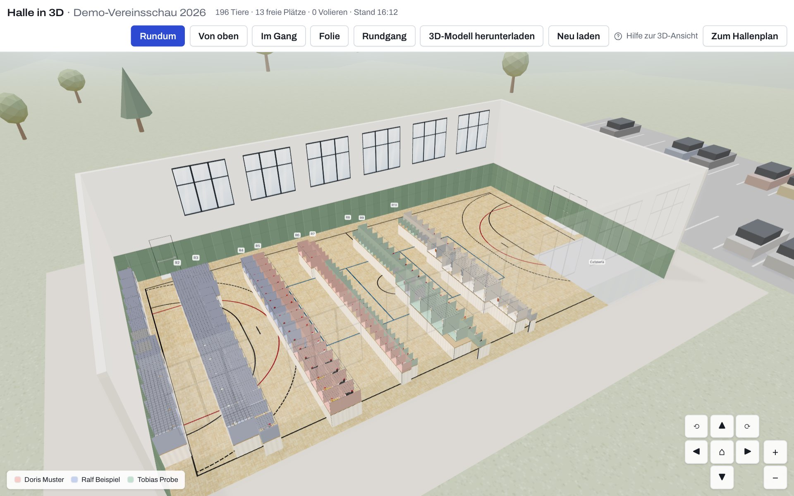

Gezeigt wird der gespeicherte Plan, derselbe wie in der Zeichnung. Ist im Editor noch eine Änderung unterwegs, geht der Tab gleich auf und zeigt die Halle, sobald sie gespeichert ist. Oben steht, von wann der Stand ist. Wechseln Sie zurück in den 3D-Tab, lädt er den Plan neu – Sie können also im einen Tab planen und im anderen schauen; „Neu laden“ holt den Stand sofort. Den Tab können Sie als Lesezeichen ablegen oder neu laden.

- **Bewegen:** mit gedrückter linker Maustaste drehen, mit dem Mausrad zum Mauszeiger hin zoomen, mit der rechten Maustaste (oder Umschalt) verschieben; die Bewegung läuft weich aus. Am Tablet mit einem Finger drehen, mit zwei Fingern zoomen und verschieben. Ein **Doppelklick** auf den Hallenboden bringt Sie dorthin, im Gang in Augenhöhe.
- **Tasten und Steuerkreuz:** Solange Sie eine Taste halten, bewegt sich die Ansicht gleichmäßig: Pfeiltasten oder W, A, S, D gehen vor, zurück und zur Seite, Q und E drehen, + und − zoomen; mit Umschalt geht es schneller. Im Gang sehen Sie sich beim Drehen auf der Stelle um, von weiter weg kreist die Ansicht um die Halle. Im Gang gehen Sie nicht durch Käfige, Volieren, Tische oder Wände: Sie gleiten daran entlang. Dasselbe können Sie mit dem Steuerkreuz unten rechts tun (gedrückt halten), das am Tablet die Tasten ersetzt; ⌂ stellt die gewählte Ansicht wieder her.
- **Rundgang:** Der Knopf „Rundgang“ beginnt am Haupteingang, geht eine Runde an allen Käfigen entlang und kommt zum Eingang zurück – in Augenhöhe und gemütlichem Schritttempo. Haupteingang ist ein Eingang namens „Haupteingang“, sonst der breiteste Eingang auf der Seite mit den meisten Eingängen (dort steht auch der Parkplatz); Notausgänge zählen nicht, Nebeneingänge zuletzt. Ohne Eingang beginnt er am Gang, der den kürzesten Weg ergibt. Jeder Gang mit Käfigen (auch eingesetzte Blöcke und Volieren) kommt genau einmal dran, nur so weit, wie dort Käfige stehen; Reihenfolge und Richtung ergeben den kürzesten Weg. Dazwischen nimmt er den kürzesten Weg und geht nicht ein zweites Mal an Käfigen entlang, wenn es anders geht; Wände, Bänke, Tische und Pokaltische umgeht er nur. Er hält rund 35 cm Abstand zu allem; um Ecken geht er im Bogen, langsamer. Im Gang blickt er in Gehrichtung, stehen nur auf einer Seite Käfige, leicht zu ihnen. Endet ein Gang an der Wand (Sackgasse), dreht er beim letzten Käfig um. Einen Gang, zu dem kein freier Weg führt, lässt er aus. Stehen Sie schon im Gang, geht er zu Fuß zum Start; sonst schwebt er über die Reihen dorthin und senkt sich senkrecht hinab. „Rundgang anhalten“, Esc oder jede eigene Bewegung (Maus, Finger, Taste) beendet ihn; Sie stehen dann dort, wo er gerade war.
- **Wände:** Innen wie in einer Turnhalle: unten eine Prallwand (Vorgabe helles Holz bis 2 m), darüber weiß gestrichen, oben Fenster; Boden, Decke und mehr stellen Sie unter [Aussehen der Halle](#hallenplan-3d-aussehen) ein. In den Eingängen stehen geschlossene Türen (siehe [Türen in den Eingängen](#hallenplan-tueren)). Eine Wand, die zwischen Ihnen und der Halle steht, blendet sich samt ihren Türen von selbst aus; zoomen Sie von oben hinein, werden auch die übrigen Wände durchsichtig. Türen bleiben als Umriss am Boden und mit ihrem Namen zu sehen. Im Gang in Augenhöhe stehen die Wände.
- **Folie:** Der Knopf „Folie“ deckt den Boden mit grauer Schutzfolie ab bzw. nimmt sie weg – nur in dieser Ansicht, gespeichert wird dabei nichts. Wie die Halle beim Öffnen aussieht, stellen Sie unter [Aussehen der Halle](#hallenplan-3d-aussehen) ein.
- **Ansichten:** „Rundum“ zeigt die ganze Halle schräg von oben, „Von oben“ wie den Plan, „Im Gang“ stellt Sie in Augenhöhe (1,65 m) an den Anfang eines Gangs.
- **Käfig ansehen:** Zeigen Sie auf einen Käfig (am Tablet antippen): Es erscheinen Katalognummer, Rasse, Sparte, Reihe und Preisrichter – nie der Aussteller.
- **3D-Modell herunterladen** speichert die Halle als Datei `hallenplan.glb` (glTF); Wände, Fenster und Türen sind darin immer voll zu sehen, auch wenn sie in der Ansicht gerade ausgeblendet sind. Sie öffnet sich in gängigen 3D-Betrachtern, unter Windows z. B. im 3D-Viewer.
- „Zum Hallenplan“ wechselt im selben Tab zum Editor; sonst schließen Sie den Tab einfach.

**Aufsteller:** Die Grundplatten stehen auf Gestellen (Aufstellern). Deren Höhe bis Oberkante Grundplatte stellen Sie unter „Käfige“ bei „Aufsteller“ ein (Vorgabe 80 cm, leer lassen heißt Vorgabe); die Grundfläche ist die der Grundplatte. Die Höhe gilt nur für die 3D-Ansicht, an der Aufstellung ändert sie nichts. Sie wird wie die Käfigmaße in jede neue Schau übernommen; jede Änderung steht im Protokoll. Darunter stellen Sie die **Sockelverkleidung** ein – den Raum unter den Grundplatten verkleiden die Schauen meist mit weißen Planen, auf denen das Logo eines Sponsors wiederkehrt. Vorgabe ist Weiß; die Farbe können Sie ändern oder die Verkleidung ausschalten. Unter „Logo bzw. Banner der Verkleidung“ laden Sie das Logo hoch, das Sie vom Sponsor bekommen (z. B. vom Futtermittelhersteller, etwa Mifuma), als PNG oder JPEG bis 2 MB (auch auf die Zeile gezogen); ein PNG mit durchsichtigem Hintergrund liegt sauber auf der weißen Plane. In 3D kehrt das Logo an der Gangseite jeder Reihe etwa alle 1,25 m wieder, mittig und unverzerrt; ein breites Banner (mehr als dreimal so breit wie hoch) läuft in Bahnhöhe durch. Die Stirnseiten bleiben weiß, Rücken und Wand frei. Verwenden Sie nur Logos, die Sie nutzen dürfen. Das Logo gehört nicht zum Katalog; bei einer neuen Schau aus einer Vorlage kommt es mit.

Die 3D-Ansicht braucht einen Browser mit WebGL (alle aktuellen Browser und Tablets). Sie wird erst geladen, wenn Sie sie öffnen, und ist nicht Teil der Offline-Daten der Preisrichter-Tablets.

#### Aussehen der Halle in 3D {#hallenplan-3d-aussehen}

Im Editor unter den Eigenschaften der Halle (nichts gewählt) stellen Sie im aufklappbaren Abschnitt **Aussehen (3D)** ein, wie Ihre Halle in der 3D-Ansicht aussieht – damit sie der echten Halle ähnelt:

- **Boden:** Parkett (helles Mosaikparkett, Vorgabe), Sportboden (Kunststoff) oder Estrich. Das Meterraster bleibt fein darüber.
- **Boden mit Folie abgedeckt:** Viele Hallen legen zur Schau graue Schutzfolie aus; dann ist vom Parkett und von den Linien nichts zu sehen. In der 3D-Ansicht können Sie die Folie mit dem Knopf „Folie“ zum Vergleich weg- und wieder hinlegen, ohne die Einstellung zu ändern.
- **Prallwand:** Farbe der Wandverkleidung unten – Holz hell (Vorgabe), Graugrün, Grau, Blau oder eine eigene Farbe – und ihre Höhe (Vorgabe 2 m).
- **Wandhöhe:** bis zur Decke bzw. zum Dachansatz (Vorgabe 3,50 m; 2,80 bis 15 m). Sporthallen sind meist 5,50 bis 7 m hoch.
- **Firsthöhe:** Höhe der Halle in der Mitte (bis 20 m). Ist sie höher als die Wand, steigt die Decke als Satteldach von den Längswänden zur Mitte an (First entlang der langen Seite), mit geschlossenen Giebeln an den Stirnseiten; gleich hoch heißt flache Decke. Ändern Sie danach die Wandhöhe, zieht der First mit – das Dach bleibt gleich hoch (höchstens bis 20 m). Beim freien Grundriss bleibt die Decke flach. Die Firsthöhe wirkt mit der Holzdecke.
- **Fenster:** ein Fensterband oben an den Längsseiten, nie über einer Tür.
- **Holzdecke mit Leuchten:** Profilbretter, Leimbinder und Leuchtbänder. Steht die Wand noch auf der Vorgabe von 3,50 m und ist kein First gesetzt, schlägt das Einschalten eine übliche Sporthalle vor (Wand 7 m, First 9 m) – ändern Sie die Werte darunter, wenn Ihre Halle anders ist. Die Leuchten hängen unter den Bindern, aber mindestens 1,50 m über dem höchsten Käfig und nie unter 3 m; ist die Decke dafür zu niedrig, sitzen sie direkt an der Decke. Die Decke sehen Sie nur von innen (im Gang, beim Rundgang); von oben oder außen ist sie weg, damit sie nichts verdeckt. Im heruntergeladenen 3D-Modell ist sie immer dabei, das Meterraster nicht.
- **Spielfeldlinien:** Handball (schwarz), Volleyball (blau) und Basketball (rot), passend zur Größe der Halle; in kleinen Hallen und wenn das Feld beim freien Grundriss nicht ganz hineinpasst, ohne Linien.
- **Sportgeräte an den Wänden:** Basketballbretter mittig oben an den Stirnwänden und eine Sprossenwand – nur dort, wo keine Tür ist und keine Käfige an der Wand stehen.

Das Aussehen ist reine Anschauung: Es ändert nie den Plan, die Käfigplätze oder die Nummern, auch nicht im festgeschriebenen Plan. Jede Änderung wird sofort gespeichert und steht im Protokoll; der 3D-Tab zeigt sie, sobald Sie hineinwechseln oder „Neu laden“ drücken. Das Aussehen gehört zur Halle und kommt deshalb mit Entwürfen, dem Archiv und einer neuen Schau aus der Vorlage mit.

#### Türen in den Eingängen {#hallenplan-tueren}

In der 3D-Ansicht steht in jedem Eingang und Ausgang eine geschlossene Tür, leicht in die Wand zurückgesetzt und von innen wie von außen zu sehen. Welche, wählen Sie im Editor: Eingang anklicken, rechts unter **Tür**:

- **wie Wand** (Vorgabe): bündig in der Wand wie in den meisten Sporthallen – unten in der Farbe der Prallwand, darüber wie die Wand, mit feiner Fuge und flachem Drücker.
- **Glastür:** dunkler Rahmen, helles Glas, durch das man Hof bzw. Halle sieht, Griffstangen auf beiden Seiten.
- **Holztür:** Holzblatt in Zarge mit Drücker.
- **offen:** keine Tür, nur die Öffnung (für Tore und Durchgänge).

Ein Ausgang breiter als 1,30 m bekommt eine zweiflügelige Tür; schmaler als 50 cm bleibt er eine Öffnung. Ein Notausgang (Name enthält „Not…“) hat innen eine Panikstange und behält das grüne Schild. Die Tür ist reine Anschauung: Sie ändert nie den Plan, die Käfigplätze oder die Nummern, auch nicht im festgeschriebenen Plan, und hält keinen Rundgang auf. Die Wahl wird sofort gespeichert und steht im Protokoll; sie gehört zum Eingang und kommt mit Entwürfen, dem Archiv und einer neuen Schau aus der Vorlage mit. Im heruntergeladenen 3D-Modell sind die Türen dabei, voll zu sehen wie alle Wände – auch wenn sie in der Ansicht gerade ausgeblendet sind. Im 2D-Plan und im Druck bleibt der Eingang eine Öffnung.

#### Katalognummern vergeben

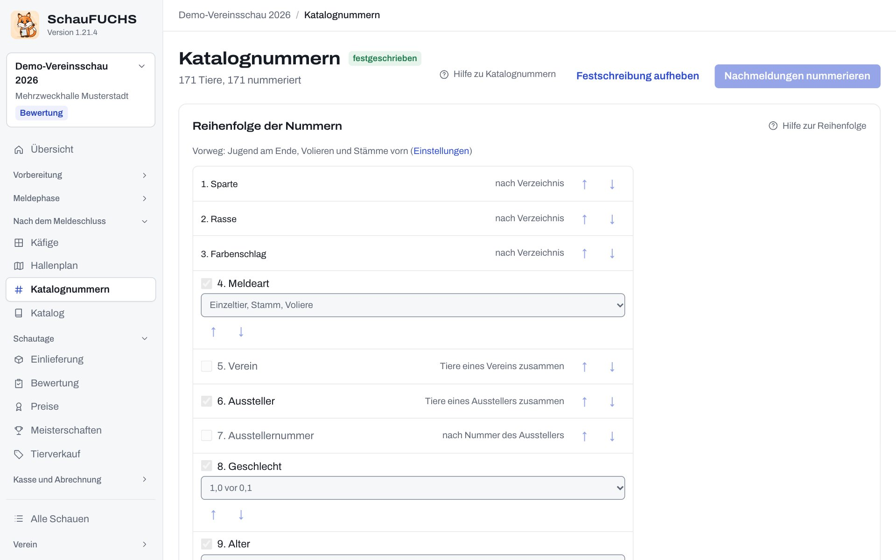

Die Katalognummern kommen nach dem Hallenplan. Steht ein festgeschriebener Plan mit Tieren, zeigt die Seite „Katalognummern“ oben im Seitenkopf **„Nach Hallenplan vergeben“** als ersten Weg: Die Tiere bekommen ihre Nummern in der Folge der Käfige im Plan – genau wie „Nach Plan nummerieren“ im Halleneditor, mit derselben Rückfrage „Katalognummern nach dem Plan vergeben?“ (Knopf „Neu nummerieren“; siehe „Nach Plan nummerieren“ oben). Daneben steht „Ohne Hallenplan vergeben“: Das nummeriert nach der Rückfrage „Ohne Hallenplan vergeben?“ in Ausstellungsfolge wie unten beschrieben; die Käfige im festen Plan bleiben dabei stehen, die Prüfliste meldet dann „Nummern nicht in Planfolge“. Haben Tiere noch keinen Platz oder passt der feste Plan nicht mehr zu Halle oder Käfigmaßen, steht darüber ein gelber Hinweis mit „Zum Hallenplan“; ein veralteter Plan lässt sich erst nach „Plan neu setzen“ nach dem Plan nummerieren. Stehen im Plan nur offene Meldungen, meldet die Software „Es gibt keine bestätigten Meldungen.“ Ist keine Halle angelegt oder der Plan nicht festgeschrieben (automatisch gestellt), steht wie bisher „Katalognummern vergeben“ – im automatischen Plan rücken die Käfige danach von selbst in Nummernfolge.

Ohne Hallenplan:

1. „Katalognummern“ → „Katalognummern vergeben“ (oben im Seitenkopf, wie „Nummern festschreiben“).
2. Die Software nummeriert alle bestätigten Tiere lückenlos in Ausstellungsfolge. Ohne eigene Wahl gilt: Sparte, Rasse, Farbenschlag, dann je Züchter 1,0 jung, 1,0 alt, 0,1 jung, 0,1 alt – die Tiere eines Züchters stehen im Farbenschlag also nacheinander, auch wenn er nachgemeldet hat. Mit „Volieren und Stämme vor den Einzeltieren“ entsprechend vorn, mit „Jugend im Katalog: eigener Block am Ende“ getrennt, mit „in der Rasse eingereiht“ zwischen den Senioren (siehe „Jugend im Katalog“ in 5.3). Die Käfignummer ist die Katalognummer. Eine andere Folge stellen Sie unter „Reihenfolge der Nummern“ ein (siehe unten).

Bis zum Festschreiben können Sie beliebig oft neu vergeben, etwa nach späten Zahlungen. Dabei werden **alle** Nummern neu gesetzt. Sind die Preisrichter nach Rassen eingeteilt (unter „Preisrichter“), bekommen sie ihre Nummernbereiche dabei gleich mit.

#### Reihenfolge der Katalognummern

Auf der Seite „Katalognummern“ legt der Abschnitt „Reihenfolge der Nummern“ fest, wonach die Nummern laufen. Die Liste ist die Rangfolge: Das oberste Merkmal entscheidet zuerst, das nächste nur bei Gleichstand, und so weiter.

| Merkmal | Wahl |
|---|---|
| Sparte, Rasse, Farbenschlag | immer an und immer oben, in der Folge des Verzeichnisses (Rassen und Farbenschläge). So bleiben Sparten- und Rassenköpfe im Katalog, das Rassenverzeichnis und die Reihen im Hallenplan zusammen. Tiere ohne Verzeichniseintrag (AOC, Neuzüchtung) stehen nach ihrer Bezeichnung dahinter. |
| Meldeart | „Einzeltier, Stamm, Voliere“ oder „Voliere, Stamm, Einzeltier“; Bruteier immer am Ende. |
| Verein | „Tiere eines Vereins zusammen“ (Verein aus der Angabe beim Aussteller, Groß- und Kleinschreibung egal; ohne Verein dahinter). Ab Werk aus. |
| Aussteller | „Tiere eines Ausstellers zusammen“ (nach Name, auch über Nachmeldungen). Ohne Haken stehen gleiche Tiere verschiedener Aussteller in der Folge des Meldeeingangs. |
| Ausstellernummer | „nach Nummer des Ausstellers“ statt nach dem Namen: die Nummer, unter der der Aussteller im Verein erfasst ist (Reihenfolge der Erfassung). Ab Werk aus; für „statt Name“ den Haken bei „Aussteller“ herausnehmen. |
| Geschlecht | „1,0 vor 0,1“ oder „0,1 vor 1,0“; Stämme und Gruppen (z. B. 1,2) dahinter. |
| Alter | „jung vor alt“ oder „alt vor jung“. |

- Mit den Haken schalten Sie Meldeart, Verein, Aussteller, Ausstellernummer, Geschlecht und Alter an oder ab, mit ↑ und ↓ verschieben Sie sie untereinander (unterhalb von Farbenschlag). Beispiel: Steht „Geschlecht“ über „Aussteller“, kommen im Farbenschlag erst alle 1,0 (je Aussteller), dann alle 0,1. Steht „Alter“ über „Geschlecht“, kommen erst alle Jungtiere, dann die alten. Volieren und Stämme als eigene Abteilung vor allen Einzeltieren stellen Sie in den Einstellungen ein (siehe unten).
- Vorweg gilt die Gliederung aus den Einstellungen (Reiter „Katalog und Preise“): „Jugend im Katalog“ (eigener Block am Ende oder in der Rasse eingereiht), Käfigblöcke und „Volieren und Stämme vor den Einzeltieren“. Die Zeile „Vorweg: …“ nennt sie, der Link führt dorthin. In den Einstellungen steht unter „Reihenfolge der Nummern“ die aktuelle Folge mit einem Link hierher.
- „Vorgabe“ stellt die bisherige Folge wieder her. Gespeichert wird mit „Reihenfolge speichern“ oben rechts; die Änderung steht im Protokoll („Reihenfolge der Katalognummern“).
- Die Nummern ändern sich erst beim nächsten „Katalognummern vergeben“. Nach dem Festschreiben ist die Reihenfolge gesperrt („Festgeschrieben“). Nachmeldungen bekommen ihre Unternummer nach der gespeicherten Folge, vorhandene Nummern bleiben.
- Laufen die Nummern nach dem Hallenplan („Nach Plan nummerieren“), bestimmt der Plan die Folge. Der Plan selbst stellt nicht nummerierte Tiere in der hier gewählten Folge auf.

#### Ausgaben drucken

Unter „Drucken und Exportieren“:

- „Bewertungskarten (PDF)“,
- „B-Bögen und Ringkarten (PDF)“ – für alle Aussteller (dasselbe gibt es unter „Meldungen“ als „B-Bögen und Ringkarten (alle)“ und je Meldung einzeln),
- „Ergebnisliste (CSV für Excel)“.

Die B-Bögen und Ringkarten verschicken Sie selbst (Post oder E-Mail); die Software versendet sie nicht.

#### Nummern festschreiben

Sind Einteilung und Drucke fertig, klicken Sie „Nummern festschreiben“ und bestätigen die Rückfrage „Katalognummern festschreiben?“ mit „Festschreiben“. Danach:

- bestehende Nummern ändern sich nicht mehr,
- nachträglich bestätigte Tiere nummerieren Sie mit „Nachmeldungen nummerieren“; sie bekommen Unternummern wie **100a**,
- passt eine Nachmeldung nicht sauber in die Folge, meldet die Software „Nicht ganz in Ausstellungsfolge …“ – vermerken Sie das im Katalognachtrag,
- Verzeichnisversion, „Jugend im Katalog“ und Reihenfolge der Stämme sind gesperrt,
- nummerierte Tiere bleiben in ihrer Meldung, und Rasse, Farbenschlag, Art, Geschlecht und Alter lassen sich nicht mehr ändern – sie stehen schon auf Karten und im Katalog. In der Meldung steht dann „Katalog festgeschrieben – Tier bleibt so. Falsches Tier: bei der Einlieferung „fehlt“ und richtig nachmelden.“ Kommt ein Tier nicht, markieren Sie es bei der Einlieferung als „fehlt“; das richtige Tier melden Sie nach (Unternummer). Die ganze Meldung lässt sich weiter stornieren.

„Festschreibung aufheben“ geht nur, solange es noch keine Bewertungen, Preise oder Verkäufe gibt. Danach passen gedruckte Bewertungskarten nicht mehr.

> **Wichtig:** Sobald das erste Tier bewertet, prämiert oder verkauft ist, lässt sich nicht mehr neu nummerieren: „Neu nummerieren geht nicht mehr – es gibt schon Bewertungen, Preise oder Verkäufe … Bitte die Nummern festschreiben; neue Tiere bekommen dann Unternummern.“ Schreiben Sie die Nummern deshalb spätestens vor der Einlieferung fest.

> **Tipp:** Wird eine bestätigte Meldung storniert oder abgelehnt, verliert sie ihre Nummern nur vor dem Festschreiben. Danach bleiben gedruckte Nummern reserviert und kommen zurück, wenn die Meldung wieder aufgenommen wird.

### 5.6 Katalog gestalten

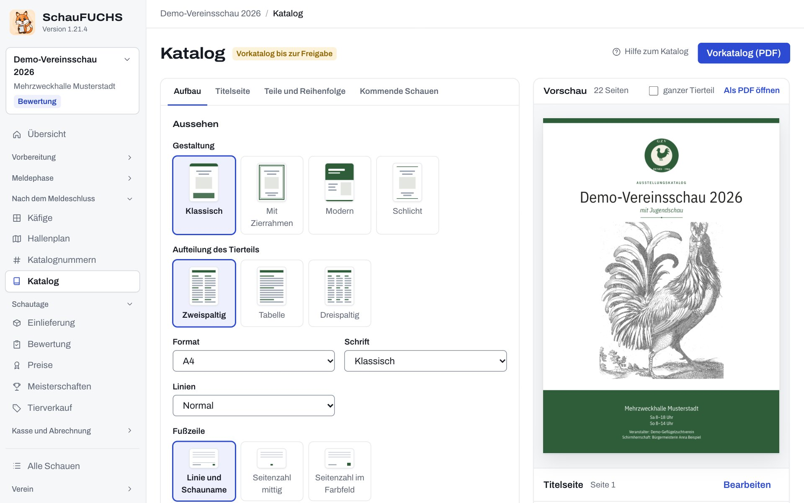

Den gedruckten Katalog gestalten Sie unter „Katalog“ (in der Seitenleiste unter „Nach dem Meldeschluss“ nach „Katalognummern“, der Seite für die Nummern). **Gedruckt wird nach der Bewertung** – erst dann stehen Noten, Preise und die Ehrentafel darin. Gestalten können Sie schon vorher.

Links stehen die Einstellungen in vier Reitern, rechts die **Vorschau** (auf schmalen Bildschirmen darunter).

| Reiter | Inhalt |
|---|---|
| „Aufbau“ | Abschnitt „Aussehen“: „Gestaltung“ und „Aufteilung des Tierteils“ als Bildkacheln, darunter „Format“ (A4 ist die Vorgabe, A5 als kleines Heft), „Schrift“, „Linien“ und „Fußzeile“. Abschnitt „Farben“: „Abgestimmte Farbpaare“, „Vereinsfarbe“ und „Eigene Akzentfarbe“ (siehe unten). Abschnitt „Impressum“: „Druck (Impressum)“ |
| „Titelseite“ | „Vereinslogo“ und „Titelbild“ (JPEG oder PNG, über „Bild wählen“ oder aus dem Dateimanager auf das Feld gezogen; große Bilder rechnet die Software vor dem Hochladen herunter, das Logo darf höchstens 600 KB groß sein, weil es auf jedem Beleg steht; darunter der Bildnachweis, siehe unten), „Gestaltung der Titelseite“ mit „Hintergrund“ und „Titelfoto“ (siehe unten), „Unterzeile auf dem Titel“, „Schirmherr / Schirmherrin“, „Eintritt“, „Ausstellungsleitung und Helfer“ (eine Zeile je Aufgabe) |
| „Teile und Reihenfolge“ | alle Teile des Katalogs in der Reihenfolge, in der sie gedruckt werden – siehe unten |
| „Kommende Schauen“ | Termine anderer Schauen nach dieser: Kreis, Landesverband, Deutschland, Europa – siehe unten |

**Speichern:** Sobald Sie etwas an Aufbau, Titelseite oder den Schaltern ändern, erscheinen oben rechts in der Kopfleiste „Speichern“ und „Verwerfen“ (sie bleiben beim Scrollen stehen). Erst „Speichern“ übernimmt die Änderungen in den Katalog. „Verwerfen“ stellt nach einer Rückfrage den zuletzt gespeicherten Stand wieder her. Grußworte, freie Seiten, Anzeigen, Bilder und Termine speichern dagegen sofort, auch ihre Reihenfolge.

**Vorschau:** Etwa eine Sekunde nach jeder Änderung zeigt die Vorschau den Katalog so, wie er mit dem **ungespeicherten** Stand gedruckt würde – auch mit Texten wie Unterzeile oder Ausstellungsleitung. Gespeichert wird dabei nichts. Oben steht eine Seite groß, darunter alle Seiten als kleine Bilder. Ein Klick auf ein kleines Bild zeigt diese Seite groß, darunter steht, zu welchem Teil sie gehört. Bei Teilen, die sich abwählen lassen, steht dort der Schalter „im Katalog“, und „Bearbeiten“ springt zur passenden Stelle links.

Damit die Vorschau schnell bleibt, enthält sie vom Tierteil nur die ersten zehn Tiere je Sparte („Kurzvorschau“), ebenso Rassen- und Ausstellerverzeichnis. Die Seitenzahlen ab dem Tierteil sind deshalb kleiner als im gedruckten Katalog. Mit dem Haken „ganzer Tierteil“ zeigt die Vorschau den vollständigen Katalog, das dauert bei großen Schauen einige Sekunden. „Als PDF öffnen“ öffnet genau das, was die Vorschau zeigt, als PDF in einem neuen Fenster.

**Teile und Reihenfolge:** Jede Zeile ist ein Teil des Katalogs, links mit den Seiten aus der Vorschau („S. 8–16“). Fehlt ein Teil, obwohl er nicht abgewählt ist, steht dahinter der Grund, z. B. „entfällt: kein Text unter „Einstellungen““ bei den Ausstellungsbestimmungen oder „entfällt: erst mit Ergebnissen“ bei der Ehrentafel. Ein Klick auf eine Zeile zeigt ihre erste Seite in der Vorschau.

- **Schalter:** Teile, die sich abwählen lassen, haben rechts einen Schalter (siehe „Teile des Katalogs“ unten).
- **Grußworte** (je eine Seite vorn im Katalog, mit Porträtfoto möglich), **Freie Seiten** (z. B. Hallenplan, Vereinsgeschichte, Ehrungen – nach den Grußworten) und **Unsere Förderer (Anzeigen)** (gesammelt am Ende; am besten die fertige Anzeige als Bild): Mit „+ Grußwort“, „+ Seite“ bzw. „+ Anzeige“ legen Sie einen neuen Beitrag an, mit „Bearbeiten“ und „Löschen“ ändern Sie ihn. Die Reihenfolge ändern Sie, indem Sie einen Beitrag am Griff ⠿ ziehen (mit Maus oder Finger), oder mit ↑ und ↓. Für Bilder und Texte einer Anzeige ist der Inserent verantwortlich – das steht so im Bildnachweis. Das Bild eines Beitrags wählen Sie mit „Bild wählen“ oder ziehen es aus dem Dateimanager auf das Feld „Bild“ (es wird beim Ziehen umrandet); eine Datei, die daneben auf die Seite fällt, bleibt ohne Wirkung – die Seite wird nicht verlassen.
- **Tierteil:** Darunter stehen „Rassebilder drucken“ und „Jede Sparte auf neuer Seite“ (siehe unten).

Die Reihenfolge der Teile selbst ist fest, wie in den Verbandskatalogen.

**Schrift:** Der ganze Katalog steht in einer Schriftfamilie – Titel, Überschriften, Tierzeilen, Verzeichnisse und Zahlen; unterschieden wird nur durch fett, kursiv und feste Größen. „Klassisch“ (IBM Plex Sans Condensed – schmal, viel passt auf eine Seite), „Traditionell“ (EB Garamond – wie ein gedrucktes Buch), „Gut lesbar“ (Atkinson Hyperlegible – für beste Lesbarkeit entworfen, etwas breiter), „Modern“ (Source Sans 3 – klar und sachlich), „Buch, schmal“ (IBM Plex Sans Condensed, nur der Name der Schau auf der Titelseite in EB Garamond) oder „Ausgewogen“ (Source Sans 3, nur der Name der Schau auf der Titelseite in Spectral). Alle Schriften stehen unter der SIL Open Font License und sind im Katalog eingebettet; die Druckerei braucht keine Schriften nachzuladen. Lange Namen (Rasse, Farbenschlag, Sparte, Preisrichter, Aussteller) brechen um, nichts wird gekürzt: Erst wird die Schrift etwas kleiner, reicht das nicht, geht der Name in der nächsten Zeile weiter und die Zeile wird höher. Beim Aussteller steht in schmalen Spalten zuerst der Vorname als Anfangsbuchstabe („Schmidt, W.“).

**Gestaltung:** „Klassisch“ (Titel mittig, Farbband oben, Farbfeld mit Ort und Öffnungszeiten unten), „Mit Zierrahmen“ (doppelter Rahmen in der Vereinsfarbe, alles mittig – wie ein traditionelles Programmheft) oder „Modern“ (große Schrift linksbündig, Farbblock auf der Titelseite, Spartenköpfe als Farbband) oder „Schlicht“ (ohne Farbflächen, nur feine Linien in der Akzentfarbe, alles in Schwarz gesetzt – spart Farbe, wenn der Verein den Katalog selbst am Bürodrucker druckt).

**Farben:** Unter „Abgestimmte Farbpaare“ setzt ein Klick Vereins- und Akzentfarbe zusammen, z. B. „Tanne und Gold“ oder „Marine und Rot“. Die **Vereinsfarbe** füllt die Flächen: Farbband und Farbfeld der Titelseite, die Spartenbänder bei „Modern“, die Rahmen. Die **Akzentfarbe** färbt Zierlinien, kleine Versalzeilen („AUSSTELLUNGSKATALOG“, „SPARTE“), die Unterzeile auf dem Titel, die Farbkante der Rassenbalken und die Seitenzahlen. Ohne Haken bei „Eigene Akzentfarbe für Linien und kleine Überschriften“ ist sie gleich der Vereinsfarbe – so sahen alle Kataloge bisher aus. Neben jeder Farbe steht ihr **Kontrast** zu weißem Papier, z. B. „Kontrast 8,2 : 1“. Ab 4,5 : 1 ist kleine Schrift gut lesbar. Darunter erscheint „Schrift wird dunkler gedruckt“: Der Katalog dunkelt die Farbe dann für Schrift so weit ab, dass sie lesbar bleibt, Flächen und Linien behalten die gewählte Farbe. Tipp: Kräftige, eher dunkle Farben drucken auf jedem Drucker gleichmäßiger als sehr helle.

**Linien:** „Fein“, „Normal“ (wie bisher) oder „Kräftig“ – die Stärke von Zierlinien, Balken und Rahmen.

**Fußzeile:** „Linie und Schauname“ (wie bisher: feine Linie, Seitenzahl außen, Name der Schau innen), „Seitenzahl mittig“ (nur die Seitenzahl, mittig) oder „Seitenzahl im Farbfeld“ (Seitenzahl in einem kleinen Feld der Vereinsfarbe am äußeren Rand, Name der Schau innen).

**Titelseite:** „Hintergrund“ ist „Weiß“ (wie bisher), „Zart in der Vereinsfarbe“ (ganz leicht getönt) oder „Papierton“ (warmes Creme). „Titelfoto“: „Eingepasst“ (wie bisher, das ganze Foto ist zu sehen) oder „Randlos“ (das Foto füllt die Bildfläche bis an den Rand der Seite und wird dafür am Rand beschnitten). „Randlos“ gilt nur für ein eigenes Titelfoto, der Stich des Hahns bleibt eingepasst. Für randlosen Druck braucht die Druckerei meist einen Beschnitt; beim Bürodrucker bleibt ein schmaler weißer Rand.

**Aufteilung des Tierteils:** „Zweispaltig“ (wie in den Verbandskatalogen: Klasse und Farbenschlag als Zwischenzeile, darunter die Tiere), „Tabelle“ (eine Zeile je Tier über die ganze Breite mit Nr., Klasse, Farbenschlag, Aussteller, Note, Preis und Verkaufspreis – am übersichtlichsten, braucht mehr Seiten) oder „Dreispaltig“ (drei schmale Spalten mit etwas kleinerer Schrift, die wenigsten Seiten; nur bei A4, bei A5 wird zweispaltig gedruckt).

**Tierteil:** „Rassebilder drucken“ abwählen macht den Katalog deutlich dünner – die Stiche in den Spartenköpfen bleiben. „Jede Sparte auf neuer Seite“ lässt Hühner, Zwerghühner, Tauben usw. immer oben auf einer neuen Seite beginnen; sonst läuft die nächste Sparte darunter weiter, wenn noch genug Platz ist.

**Teile des Katalogs:** Titelseite, Inhalt, Ausstellungsleitung mit Terminen und der Tierteil stehen immer darin. Mit dem Schalter in „Teile und Reihenfolge“ (oder unter der großen Seite der Vorschau) abwählen lassen sich „Preisrichter“, „Preise und Stifter“, „Ausstellungsbestimmungen“, „So lesen Sie den Katalog“, „Ehrentafel“, „Rassenverzeichnis“, „Ausstellerverzeichnis“, „Kommende Schauen“ und „Notizseiten“. Ohne Notizseiten bleiben die Füllseiten am Ende leer, denn ein Heft braucht eine durch vier teilbare Seitenzahl (A4 beidseitig: durch zwei). Den Bildnachweis druckt der Katalog immer, wenn Bilder darin sind – das verlangen die Lizenzen. Wählen Sie „Preisrichter“ oder „Ausstellungsbestimmungen“ ab, steht in der Zeile die gelbe Marke „gehört in den Katalog“: Nach den Hinweisen der Preisrichtervereinigungen gehören die amtierenden Preisrichter und Obleute und die Bestimmungen in den Katalog. Lassen Sie sie nur bewusst weg.

**Druck (Impressum):** Der gedruckte Katalog braucht nach dem Landespressegesetz ein Impressum. Herausgeber und Anschrift übernimmt die Software aus „Verein und Datenschutz“ (siehe 3.1). Unter „Druck (Impressum)“ tragen Sie Name und Anschrift der Druckerei ein, oder „Eigendruck“, wenn der Verein selbst druckt. Fehlt die Angabe, steht das bis zur Meldephase als Hinweis, danach als roter Punkt in der Prüfliste.

**Bildnachweis für eigene Bilder:** Unter Logo, Titelbild und den Fotos bei Grußworten und freien Seiten steht „Eigenes Foto (kein Bildnachweis)“ bzw. „Bildnachweis: …“ mit dem Link „ändern“. Im Fenster „Bildnachweis“ tragen Sie bei fremden Fotos „Urheber (Fotograf)“, „Lizenz“ (z. B. „mit Genehmigung“, „CC BY-SA 4.0“) und „Quelle (Adresse)“ ein; bei eigenen Fotos des Vereins bleibt alles leer. Lizenzen „nicht kommerziell“ (NC) oder „keine Bearbeitung“ (ND) nimmt die Software nicht an. Der Katalog druckt alle Angaben im Bildnachweis am Ende; er steht auch im Inhaltsverzeichnis.

**Bilder der Sparten:** Jede Sparte (Hühner, Zwerghühner, Tauben, Wassergeflügel, Gänse, Puten, Wachteln, Stämme und Volieren) bekommt im Spartenkopf einen historischen Stich. Ohne eigenes Titelbild steht auf der Titelseite ein großer Stich eines Hahns. Alle Stiche sind gemeinfrei und einheitlich aufbereitet: ohne Papierton, mit gleicher Strichdichte und in derselben Druckfarbe, egal welche Vereinsfarbe Sie wählen.

Oben rechts stehen „Hilfe zum Katalog“ und „Vorkatalog (PDF)“ – der gespeicherte Katalog. Neben dem Titel steht „Vorkatalog bis zur Freigabe“ bzw. „mit Ergebnissen“. Vor der Freigabe entsteht ein Vorkatalog mit Notizlinien. Solange die Katalognummern nicht festgeschrieben sind, trägt er auf dem Titel den Zusatz „vorläufig“ und im Stand den Hinweis, dass sich die Nummern noch ändern können. Nach der Freigabe heißt der Knopf „Katalog mit Ergebnissen (PDF)“.

**Im Katalog mit Ergebnissen** stehen außerdem:

- bei jedem bewerteten Tier der Preisrichter, der es tatsächlich bewertet hat – auch wenn die Einteilung danach geändert wurde,
- unter „Preise und Stifter“ der Abschnitt „Gestiftete Preise und ihre Gewinner“: je Stifter, welcher Preis an welche Katalognummer ging (nur Stifter, die genannt werden dürfen),
- bei Preisarten mit Bindung der Zusatz, z. B. „nur Jugend“.

Fehlende und im Gesundheitsjournal gesperrte Tiere stehen ohne Verkaufspreis im Katalog.

**Ausprobieren ohne Speichern:** Die Vorschau zeigt immer den ungespeicherten Stand (siehe oben). So probieren Sie z. B. „Tabelle“ aus, ohne den gespeicherten Katalog zu ändern – „Verwerfen“ stellt ihn wieder her.

#### Kommende Schauen

Am Ende des Katalogs (vor den Anzeigen) steht die Seite „Kommende Schauen“: wo und wann die nächsten Schauen stattfinden, gegliedert nach „Im Kreis“, „Landesverband“, „Deutschland“ und „Europa“, je Ebene nach Datum. Darauf kommen nur Schauen, die **nach dieser Schau** beginnen. Wann diese Schau vorbei ist, liest die Software aus dem Bewertungstag und den Öffnungszeiten (unter „Einstellungen“ → „Schau“). Je Ebene stehen höchstens zehn Termine darin, die frühesten. Unten auf der Seite stehen der Stand, die Quellen und „Angaben ohne Gewähr“. Gibt es keine Termine, entfällt die Seite.

**Ob die Seite in den Katalog kommt, entscheiden Sie selbst:** Ganz oben im Reiter „Kommende Schauen“ steht der Haken „Seite „Kommende Schauen“ im Katalog drucken“. Ohne Haken hat der Katalog dieser Schau keine solche Seite, die Termine bleiben trotzdem für andere Schauen gespeichert. Derselbe Schalter steht im Reiter „Teile und Reihenfolge“, beide zeigen immer dasselbe.

Gepflegt wird sie im Reiter „Kommende Schauen“ auf derselben Seite. **Die Termine gelten für alle Schauen des Vereins** – einmal eingetragen, stehen sie auch im nächsten Katalog.

- **Kreis und Landesverband wählen:** Unter „Kreisschauen im Katalog“ wählen Sie Ihren Kreisverband. Dann druckt der Katalog nur dessen Kreisschauen, nicht alle eingetragenen. Genauso „Landesschauen im Katalog“. Mit „keine Kreisschauen“ bzw. „keine Landesschauen“ lassen Sie die Ebene ganz weg, bei „keine Kreisschauen“ auch die eigenen anderen Schauen. Schauen auf Bundes- und Europaebene stehen immer darin. Die Wahl gilt für den Katalog dieser Schau. Eigene andere Schauen des Vereins (keine Testschauen, keine abgesagten) erscheinen von selbst unter „Im Kreis“.
- **Termin eintragen:** „Termin eintragen“ (im Abschnitt „Alle Termine“) öffnet ein Fenster mit Name (z. B. „Kreisschau Musterstadt mit Jugendschau“ oder „108. Nationale“), Beginn, Ende, Ort, Ebene, Kreis- bzw. Landesverband und Quelle. Die Quelle steht im Katalog, leer gilt „eigene Eintragung“. Die großen Schauen sehen Sie z. B. beim BDRG nach (Link „Termine beim BDRG“ daneben) und tragen sie von Hand ein. Die Seiten des BDRG und der Fachpresse liest die Software nicht selbst aus, solange der BDRG dem nicht zugestimmt hat.
- **Kalender abonnieren:** Bietet ein anderer Verein oder Verband seine Termine als Kalender an (iCal, Adresse meist mit „.ics“ am Ende, auch „webcal://“), tragen Sie ihn unter „Kalender abonnieren“ ein: Name (er steht als Quelle im Katalog), Ebene, Verband und Adresse. Der Server ruft ihn gleich und danach täglich ab, „Jetzt abrufen“ holt ihn sofort. Am Kalender steht, wann er zuletzt abgerufen wurde und wie viele Termine er hatte; ohne den Haken „Täglich abrufen“ trägt er die Marke „pausiert“. Klappt der Abruf nicht, steht dort rot der Grund. Adressen im eigenen Netz (z. B. 192.168.…) nimmt die Software nicht an.
- **Zu prüfen:** Neue Termine aus Kalendern kommen **nicht von selbst** in den Katalog. Sie stehen im Abschnitt „Zu prüfen“ (mit Anzahl) mit „Übernehmen“ und „Verwerfen“. Verworfene kommen beim nächsten Abruf nicht wieder. Meldet ein Kalender später ein anderes Datum oder einen anderen Ort für einen übernommenen Termin, ändert die Software nichts selbst. Sie zeigt „Bisher: … → laut Quelle: …“ mit „Änderung übernehmen“ und „Behalten wie bisher“. Steht ein übernommener Termin nicht mehr im Kalender, fragt sie, ob Sie ihn löschen möchten.
- **Abo beenden:** Offene Vorschläge aus dem Kalender verschwinden, übernommene Termine bleiben stehen.
- **Eigene Schauen als Kalender:** Ist „Unsere Schauen als Kalender veröffentlichen“ angehakt (Vorgabe), steht darunter eine Adresse zum Weitergeben. Andere Vereine mit SchauFUCHS abonnieren sie, dann stehen Ihre Schauen automatisch in deren Katalogen. Der Kalender enthält nur Name, Ort, Tage und den Link zur Schauseite.

Jede Änderung an Terminen und Kalendern steht im Protokoll. Ändern dürfen nur Administratoren, Helfer sehen die Termine.

> **Tipp:** Aussteller ohne unterschriebenen Meldebogen und Aussteller mit Widerspruch gegen die Nennung stehen ohne Namen im Katalog. Prüfen Sie vor dem Druck die Prüfliste („… Meldung(en) ohne unterschriebenen Meldebogen …“, „Impressum des gedruckten Katalogs: Angabe „Druck“ fehlt …“).

### 5.7 Preisrichter anlegen

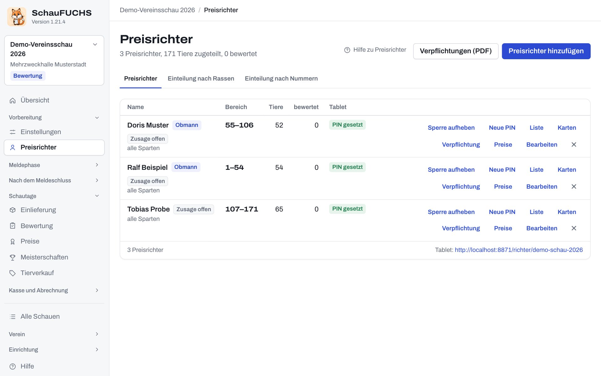

1. „Preisrichter“ → „Preisrichter hinzufügen“.
2. „Name“, „Anschrift“, „Telefon“, „E-Mail“ eintragen.
3. Bei einem Preisrichter den Haken „Obmann“ setzen. Er bestätigt die Note „vorzüglich“ (und u.M.). Den Haken dürfen mehrere haben – bei großen Schauen zwei Obmänner, die sich gegenseitig bestätigen.
4. Unter „Bewertet diese Sparten“ ankreuzen, was er bewertet – z. B. nur „Tauben“ oder „Hühner“ und „Zwerghühner“. Kein Haken heißt: alle Sparten. In der Liste steht darunter „bewertet: …“. Unter „Zugelassen für Gruppen“ tragen Sie zusätzlich die Gruppen ein, für die er zugelassen ist, z. B. „A, C, Z1“ (leer = keine Einschränkung über Gruppen; siehe unten).
5. „Anschrift im gedruckten Katalog nennen“ nur ankreuzen, wenn der Preisrichter einverstanden ist. Sonst stehen im Katalog Name, Obmann und Nummern; im Internet steht die Anschrift nie. Bei Preisrichtern, die schon vor Version 1.0 mit Anschrift angelegt waren, ist der Haken gesetzt (bisheriger Stand) – prüfen Sie das bei der nächsten Schau.
6. „Speichern“.

> **Wichtig:** Der Obmann kann seine eigenen Bewertungen nicht selbst bestätigen. Legen Sie deshalb einen zweiten Obmann an. Gibt es nur einen, bestätigt ein anderer Preisrichter dessen eigene Bewertungen – das geht aber nur am PC: Sie tragen die Bestätigung unter „Bewertung“ im Abschnitt „Wartet auf den Obmann (…)“ ein (der andere Preisrichter steht dort mit dem Zusatz „(nur für eigene Bewertungen des Obmanns)“). Am Tablet sieht nur ein Obmann die zu bestätigenden Noten. Mit nur einem einzigen Preisrichter kann niemand bestätigen – die Prüfliste weist darauf hin.

Ändern: „Bearbeiten“ oder ein Klick auf den Namen. Einen Preisrichter, der schon bewertet hat, können Sie nicht mehr löschen.

#### Gruppen, Obmann und Zusage {#preisrichter-gruppen-zusage}

- **Zugelassen für Gruppen:** Hat ein Preisrichter Gruppen eingetragen, bekommt er nur Rassen dieser Gruppen – genau wie bei den Sparten. Unter dem Feld stehen die Gruppen, die im Verzeichnis der Schau vorkommen (siehe 4.5). Rassen ohne Gruppe im Verzeichnis prüft die Software nicht über Gruppen. In der Liste steht „Gruppen: …“.
- **Obmann für diesen Preisrichter:** Hier wählen Sie, welchem Obmann der Preisrichter zugeordnet ist (nur Preisrichter derselben Schau mit dem Haken „Obmann“, nicht er selbst). In der Liste steht „Obmann: …“. Nimmt man einem Obmann den Haken oder löscht ihn, verlieren die ihm zugeordneten Preisrichter die Zuordnung. Wer die Note „vorzüglich“ bestätigt, ändert sich dadurch nicht.
- **Zusage:** „offen“ (Vorgabe), „zugesagt“ oder „abgesagt“, dazu „Zugesagt für“ (z. B. „2027 und 2028“) und ein „Vorbehalt“ (z. B. „klären wir, wenn der Termin bekannt ist“). In der Liste steht der Stand als Marke neben dem Namen, darunter Zusage-Zeitraum und Vorbehalt.

Jede Änderung an einem Preisrichter steht im Protokoll, auch das Löschen; Anschrift, Telefon, E-Mail und Vorbehalt nur als „geändert“ ohne die Werte. Legen Sie eine Schau mit einer Vorlage an, kommen Sparten, Gruppen und die Zuordnung zum Obmann mit; die Zusage startet dort wieder bei „offen“, „Zugesagt für“ und Vorbehalt sind leer – fragen Sie für die neue Schau neu an.

#### Preisrichterverpflichtung {#preisrichter-verpflichtung}

Mit der Preisrichterverpflichtung bitten Sie einen Preisrichter schriftlich, bei Ihrer Schau zu bewerten. „Verpflichtungen (PDF)“ oben auf der Seite „Preisrichter“ druckt den Brief für alle Preisrichter der Schau (nach Namen, jeder ab neuer Seite), „Verpflichtung“ in der Zeile eines Preisrichters nur seinen.

Der Brief folgt Ihrer Briefvorlage (Briefkopf, Anschrift im Fenster, Fußzeile, Gruß wie im Serienbrief; siehe 3.9). Er nennt Schau, Ort und Bewertungstag aus den Einstellungen der Schau – tragen Sie den Bewertungstag vorher ein. Steht in den Einstellungen im Reiter „Termine“ eine „Rückmeldung der Preisrichter bis“, bittet der Brief, den Abschnitt bis zu diesem Tag zurückzusenden; das Datum steht auch rechts oben bei den Angaben und im Abschnitt zum Abtrennen. Betreff und Text können Sie in der Briefvorlage im Reiter „Preisrichterverpflichtung“ selbst schreiben. Die Anschrift kommt aus dem Feld „Anschrift“ des Preisrichters.

Unten steht ein Abschnitt zum Abtrennen (gestrichelte Linie, „hier abtrennen“). Der Preisrichter kreuzt „Ich sage zu“ oder „Ich sage ab“ an, dazu die Gruppen, die er bewerten möchte, trägt einen Vorbehalt ein und unterschreibt. Zum Ankreuzen stehen die Gruppen, die im Verzeichnis der Schau vorkommen (siehe 4.5); sind dort keine gepflegt, die Gruppen A bis M und Z1 bis Z3. Kommt der Abschnitt zurück, tragen Sie Zusage, Gruppen und Vorbehalt beim Preisrichter ein (siehe oben).

### 5.8 Einteilung und PINs

#### Einteilung nach Rassen (vor den Katalognummern)

Die Seite „Preisrichter“ steht in der Seitenleiste bei der Vorbereitung (Preisrichter anlegen). Eingeteilt wird nach dem Meldeschluss: Teilen Sie die Preisrichter **nach Rassen** ein, stellen Sie den Hallenplan auf (er zeigt die Preisrichter schon farbig), dann vergeben Sie die Nummern (siehe 5.5). Die Nummernbereiche je Preisrichter rechnet die Software beim Vergeben selbst – auch beim Neu-Vergeben und bei Nachmeldungen.

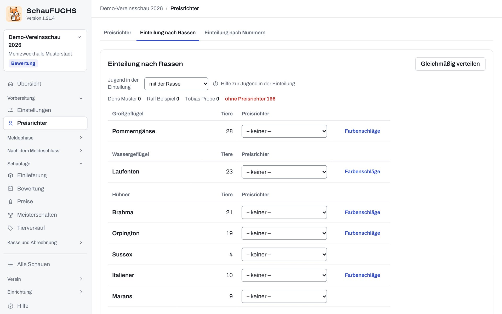

1. Im Reiter „Einteilung nach Rassen“ stehen alle gemeldeten Rassen (offene und bestätigte Meldungen) nach Sparten in Ausstellungsfolge, mit der Zahl der Tiere.
2. Je Rasse einen Preisrichter wählen. Zur Auswahl stehen nur Preisrichter, die diese Sparte und – wenn sie Gruppen eingetragen haben – die Gruppe der Rasse bewerten. Eine große Rasse teilen Sie mit „Farbenschläge“: Je Farbenschlag lässt sich ein anderer Preisrichter wählen, „wie die Rasse“ übernimmt den der Rasse.
3. Oder „Gleichmäßig verteilen“: Die Software schlägt eine Einteilung vor. Sie trennt möglichst keine Rasse, beachtet Sparten und Gruppen der Preisrichter, lässt eine Sparte möglichst bei einem und teilt eine Rasse nur, wenn es nicht anders geht (dann je Farbenschlag). Ein Obmann bekommt weniger Tiere: Verteilt wird im Verhältnis der Höchstzahlen aus den Einstellungen (Vorgabe 60 je Obmann zu 80 je Preisrichter). Bewertet niemand eine Sparte, steht „Kein Preisrichter für: …“ da (bei einer fehlenden Gruppe „Gruppe …“); diese Tiere bleiben ohne Preisrichter. Ergänzen Sie dann bei einem Preisrichter die Sparte bzw. Gruppe (siehe 5.7) oder legen Sie einen weiteren an. Derselbe Hinweis erscheint bei der Einteilung nach Nummern.
4. Über der Tabelle steht, wie viele Tiere jeder Preisrichter hätte und wie viele noch ohne Preisrichter sind. Hat ein Preisrichter mehr Tiere als die Höchstzahl aus den Einstellungen (Stamm zählt 2, Voliere und Bruteier 3), nennt die Prüfliste ihn als gelben Hinweis.
5. Oben rechts „Rassen-Einteilung speichern“. Sind die Katalognummern schon vergeben, werden die Bereiche gleich neu berechnet.

Eine Nachmeldung mit Unternummer (24a) geht an den Preisrichter der Nummer 24 – gehörte sie nach ihrer Rasse zu einem anderen, nennt die Software die Nummer nach dem Speichern.

#### Jugend in der Einteilung {#einteilung-jugend}

Oben im Reiter „Einteilung nach Rassen“ wählen Sie unter „Jugend in der Einteilung“, wie die Tiere der Jugend an die Preisrichter gehen:

- **„mit der Rasse“** (Vorgabe): Die Jugend einer Rasse bewertet der Preisrichter dieser Rasse bzw. ihres Farbenschlags.
- **„separat“**: Je Rasse mit Jugendtieren steht eine eigene Zeile „Jugend: Rasse“ mit der Zahl der Jugendtiere (und auf Wunsch „Farbenschläge“). Dort wählen Sie einen eigenen Preisrichter; „wie die Rasse“ lässt die Jugend beim Preisrichter der Rasse. Hat eine Rasse nur Jugendtiere, gibt es keine Zeile der Rasse; die leere Wahl heißt dann „– keiner –“. Eine Wahl für einen Farbenschlag der Jugend geht vor der Wahl für die ganze Jugend der Rasse. Die Zeilen stehen wie im Katalog: mit „Jugend im Katalog: eigener Block am Ende“ hinter allen Senioren der Sparte, sonst gleich unter ihrer Rasse.

Bei „separat“ behandelt „Gleichmäßig verteilen“ die Jugend jeder Rasse als eigene Einheit; Sparten und Gruppen der Preisrichter gelten wie bei den Senioren. Die Bereiche nach Nummern ergeben sich wie gewohnt aus der Einteilung – steht die Jugend im Katalog eingereiht, kann ein Preisrichter so mehrere kleine Bereiche bekommen.

Die Einstellung wirkt sofort und steht im Protokoll („Jugend in der Einteilung“). Sind schon Katalognummern vergeben, rechnet die Software die Bereiche gleich neu und nennt wie beim Speichern Tiere ohne Preisrichter – etwa die Jugend einer Rasse ohne Senioren nach dem Zurückschalten auf „mit der Rasse“; wechseln dabei schon bewertete Tiere den Preisrichter, fragt sie vorher nach. Zurück auf „mit der Rasse“ bleiben die Preisrichter der Jugendzeilen gespeichert, auch über „Gleichmäßig verteilen“ und Speichern hinweg, gelten aber erst wieder bei „separat“. Eine neue Schau aus einer Vorlage übernimmt die Einstellung.

#### Einteilung nach Nummern

Der Reiter „Einteilung nach Nummern“ zeigt die Bereiche je Preisrichter, sobald Katalognummern vergeben sind. Hier lässt sich auch von Hand nach Nummern einteilen (ohne Einteilung nach Rassen, etwa in älteren Schauen): „Gleichmäßig verteilen“, Zeilen anpassen („von Nr.“, „bis Nr.“, „Bereich hinzufügen“, „✕“), oben rechts „Nummern-Einteilung speichern“. Ändern Sie die Bereiche hier, obwohl nach Rassen eingeteilt ist, fragt die Software nach: Die Einteilung nach Rassen gilt danach nicht mehr, und die Bereiche folgen neuen Nummern nicht mehr von selbst.

Bereiche dürfen sich nicht überschneiden. Gerät ein Bereich an einen Preisrichter, der eine der Sparten oder Gruppen darin nicht bewertet, lehnt die Software das Speichern ab und nennt Preisrichter, Sparte bzw. Gruppe und Nummern. Oben steht, wie viele Tiere „ohne Preisrichter“ sind – das muss vor der Bewertung 0 sein. Die Tabelle der Preisrichter zeigt je Person „Bereich“, „Tiere“ und „bewertet“.

Wechseln schon bewertete Tiere den Preisrichter, fragt die Software nach: Kontingent und Preise dieser Tiere gehen auf den neuen Preisrichter über.

Je Preisrichter gibt es die Links „Liste“ (Bewertungsliste als PDF), „Karten“ (seine Bewertungskarten), „Verpflichtung“ (siehe 5.7) und „Preise“ (seine Preisverteilung als PDF, siehe „Preise vergeben“).

**Bewertungsliste:** Zum Mitnehmen in die Käfigreihe, wie die bisherige Papierliste. Je A4-Seite stehen zwei Listen nebeneinander; die Nummern laufen links herunter, dann rechts, dann auf der nächsten Seite weiter. Mit dem Format A5 (siehe 3.8 „Formate aller Drucke“) steht eine Liste je Seite, für das Klemmbrett. Über den Tieren steht ein Zwischenkopf je Rasse und darunter je Farbenschlag; läuft eine Rasse in die nächste Spalte weiter, steht ihr Name dort noch einmal mit „(Forts.)“. Je Tier gibt es Katalognummer und Klasse, dazu leere Kästchen für Note, Punkte und Preis zum Eintragen; „fehlt“ steht bei als fehlend gemeldeten Tieren. Im Kopf stehen Bewertungstag, Obmann (der zugeordnete Obmann, siehe 5.7; sonst leer zum Eintragen), Nummernbereich und Zahl der Tiere, unten die Seitenzahl. Ausstellernamen stehen nicht darauf. Maßgeblich bleibt die Bewertungskarte bzw. das Tablet.

#### PIN und Tablet-Link

Preisrichter melden sich am Tablet mit ihrem Namen und einer **8-stelligen PIN** an.

1. Beim Preisrichter auf „PIN erzeugen“ klicken.
2. Die PIN erscheint groß in einem Fenster – **nur dieses eine Mal**. Notieren Sie sie und geben Sie sie dem Preisrichter persönlich.

„Neue PIN“ ersetzt die alte. Alle Tablets, auf denen dieser Preisrichter angemeldet war, werden abgemeldet; dort wartende Bewertungen bleiben im Gerät und werden nach der neuen Anmeldung übertragen.

Hat ein Preisrichter die PIN zu oft falsch eingegeben, sieht er „Zu viele Fehlversuche. Bitte 15 Minuten warten oder bei der Ausstellungsleitung eine neue PIN holen.“ Mit „Sperre aufheben“ geht die Anmeldung sofort wieder, ohne neue PIN.

Den Tablet-Link finden Sie unter der Preisrichter-Tabelle („Tablet: …“) und auf der Übersicht: `https://schau.ihr-verein.de/richter/kurzadresse`.

> **Wichtig:** Die Anmeldung am Tablet ist nur in den Phasen „Einlieferung“, „Bewertung“ und „Preise & Freigabe“ möglich, sonst erscheint „Die Anmeldung am Tablet ist nur von der Einlieferung bis zu den Preisen möglich.“ Nach der Freigabe der Ergebnisse können Preisrichter sich zwar noch anmelden, aber nichts mehr ändern. Preisrichter sehen am Tablet **keine Ausstellernamen** – die Bewertung ist anonym.

Für die Preisrichter gibt es ein eigenes Handbuch: unter „Hilfe“, Reiter „Preisrichter“, am Tablet über den Knopf „Hilfe“.

### 5.9 Phase „Einlieferung“

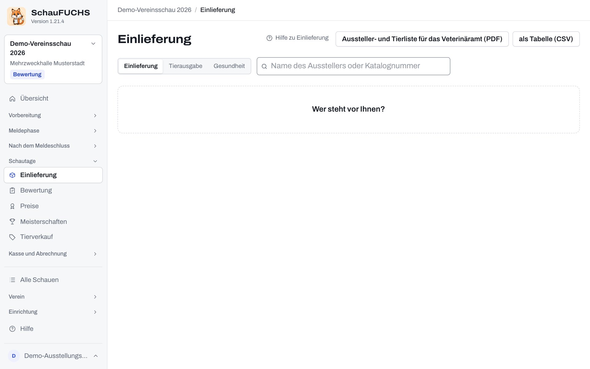

Schalten Sie auf „Einlieferung“. Ab jetzt können sich Preisrichter am Tablet anmelden.

Die Seite „Einlieferung“ hat drei Arbeitsweisen, die Sie unter dem Seitenkopf wählen: „Einlieferung“, „Tierausgabe“ und „Gesundheit“.

**Einlieferung abhaken:**

1. Den Nachnamen des Ausstellers oder eine Katalognummer von der Ringkarte eintippen („Wer steht vor Ihnen?“).
2. Im Kasten „Meldegeld“ stehen Meldegeld, zugesagte Stiftung, bezahlt und offen. Das Geld entgegennehmen und auf „… € bar kassiert“ klicken – die Zahlung steht dann im Kassenbuch, die Einzahlungsquittung im Belegarchiv. Eine Überzahlung erstatten Sie über die Meldung.
3. Bei „Nachweise“ die nötigen Angaben eintragen (Datum, Impfstoff/Charge, Tierarzt bzw. Labor). Die Angaben werden beim Verlassen des Feldes gespeichert. Welche Nachweise verlangt sind, richtet sich nach den Tierarten und den Einstellungen:
   - ND-Impfung für Hühner und Puten, PMV-Impfung für Tauben,
   - bei entsprechender Einstellung die Untersuchung von Enten und Gänsen,
   - bei „Tierärztliche Bescheinigung aus dem Herkunftsbestand“ die „Klinische Untersuchung (tierärztliche Bescheinigung)“ mit Datum und Tierarzt,
   - bei Ausstellern aus einem anderen Mitgliedstaat (Registriernummer mit ausländischem Ländercode) das „Gesundheitszertifikat / TRACES (Herkunft im Ausland)“ mit Datum und Zertifikat- bzw. TRACES-Nummer; auch Tauben brauchen dann eine ND-Impfung.
4. Den Haken „Nachweise liegen vor und sind geprüft“ setzen. Er geht nur, wenn alle nötigen Nachweise vollständig und in der Frist sind. Die Impffristen für ND und PMV stellen Sie in den Einstellungen nach dem Merkblatt Ihres Veterinäramts ein (siehe 5.3); ohne Eintrag prüft die Software dort keine Frist. Passt ein Datum nicht, nennt die Software den Grund, z. B. „… nur 14 Tage vor der Schau – mindestens 21 Tage verlangt.“
5. Je Tier die „Ring-Nr. von der Ringkarte“ eintragen.
6. „Alle als eingeliefert“ oder je Tier „Ist da“ bzw. „Fehlt“ klicken.

Ohne geprüften Nachweis meldet die Software „Nachweis nicht geprüft: … Erst den Nachweis prüfen oder mit Grund ohne Nachweis einliefern.“ und fragt „Trotzdem fortfahren?“ mit dem Feld „Grund (bitte ohne Personennamen)“ und dem Knopf „Fortfahren“. Der Grund steht im Protokoll.

**Ringnummer:** Ein eingeliefertes Tier ohne Ringnummer ist ein roter Punkt in der Prüfliste („… eingelieferte Tiere ohne Ringnummer (Kennzeichnung für das Veterinäramt) …“), der bis zur Freigabe erledigt sein muss; in der Tierliste für das Veterinäramt steht bei ihm „fehlt“. Passt bei einem Jungtier das Jahr im Ring nicht zum Jahr der Schau, weist die Prüfliste darauf hin („Alter oder Ring prüfen“).

**Einlassuntersuchung:** Haben Sie in den Einstellungen „Einlassuntersuchung durch einen Tierarzt bei der Einlieferung“ gewählt, tragen Sie dort Tag und Tierarzt ein. Ohne diese Angaben steht spätestens ab der Bewertung ein roter Punkt in der Prüfliste.

Als fehlend gemeldete Tiere zählen nicht für das Preiskontingent und können weder bewertet noch prämiert werden. Ein bewertetes, prämiertes oder verkauftes Tier kann nicht mehr auf „fehlt“ gesetzt werden.

**Gesundheit:** Unter „Gesundheit“ halten Sie Krankheit, Verdacht und Todesfälle fest („Neuer Eintrag“: „Katalognummer“, „Befund *“, „Maßnahme“, „Tierarzt“, „Tier ist verendet“, „Für Verkauf und Preise sperren“ → „Eintragen“). Gesperrte Tiere werden weder verkauft noch prämiert und nur mit Grund ausgegeben; im Katalog stehen sie ohne Verkaufspreis. Die Sperre hebt nur die Ausstellungsleitung mit Grund wieder auf (Fenster „Sperre aufheben“); ein verendetes Tier bleibt gesperrt. Seuchenverdacht melden Sie sofort dem Veterinäramt.

**Liste für das Veterinäramt:** „Aussteller- und Tierliste für das Veterinäramt (PDF)“ und „als Tabelle (CSV)“ – auch als Grundlage für die Anzeige der Schau. Drei Jahre aufbewahren.

> **Wichtig:** Ringnummern – bis zur Freigabe darf jeder Benutzer Ringnummern eintragen und ändern. **Nach der Freigabe, nach einem Verkauf des Tiers oder nach dem Abschluss** ändert nur noch die Ausstellungsleitung die Ringnummer, und nur **mit Grund** („Nach Freigabe, Verkauf oder Abschluss ändert nur die Ausstellungsleitung die Ringnummer (mit Grund).“). Die Ringnummer steht dann schon auf Belegen und der Liste für das Veterinäramt; die Software fragt im Fenster „Ringnummer ändern“ nach dem Grund.

### 5.10 Phase „Bewertung“

#### Am Tablet

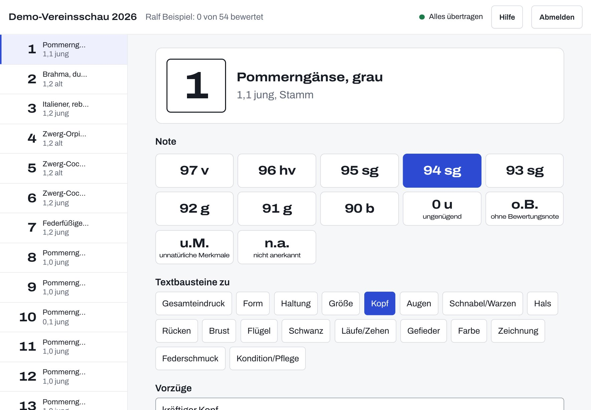

Die Preisrichter bewerten am Tablet. Das Tablet arbeitet auch **ohne Netz** weiter und überträgt später. Oben zeigt es den Stand: „Alles übertragen“, „… warten“ oder „Ohne Verbindung“. Preise vergeben und Obmann-Bestätigungen gehen dagegen nur mit Verbindung.

Bewertungen, die das Tablet nicht übertragen konnte (z. B. weil die Bewertung inzwischen geschlossen ist), zeigt es dem Preisrichter mit „Bitte der Ausstellungsleitung zum Nachtragen geben.“ Diese tragen Sie dann am PC nach.

Wurde eine Note gleichzeitig anderswo geändert (Tablet und PC), erkennt die Software den Konflikt und überschreibt nicht still – am Tablet mit „Trotzdem senden“ oder „Verwerfen“, am PC mit einer Rückfrage.

#### Bewertung am PC (Papierkarten)

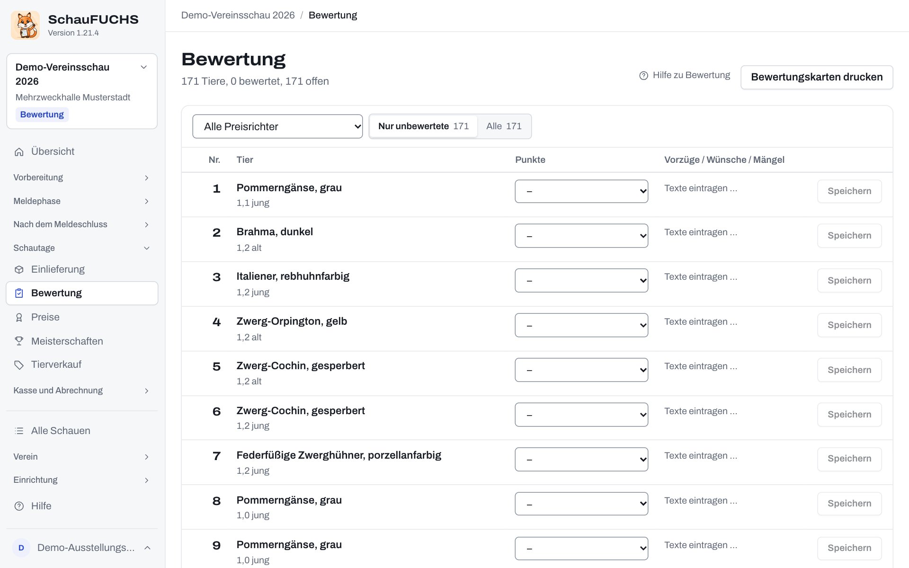

Unter „Bewertung“ tragen Sie Papierkarten nach oder korrigieren Bewertungen. **Noten vergeben nur die Preisrichter am Tablet und die Administratoren hier am PC.** Helfer sehen die Seite nur zum Lesen – geben Sie Papierkarten also nicht an Helfer zum Nachtragen.

1. Bei Bedarf einen Preisrichter wählen; der Umschalter steht auf „Nur unbewertete …“, solange es unbewertete Tiere gibt, „Alle …“ zeigt alle.
2. In der Spalte „Punkte“ die Punktzahl oder Sondernote wählen und **Enter** drücken (oder „Speichern“ in der Zeile) – die Zeile wird gespeichert, der Cursor springt zum nächsten Tier.
3. Für Vorzüge, Wünsche und Mängel auf „Texte eintragen …“ klicken.
4. „Zurücksetzen“ löscht Note und Texte eines Tiers.

Am PC können Sie auch dann eintragen, wenn das Tablet gerade geschlossen ist – nicht aber nach dem Abschluss der Schau. Nach der Freigabe und bei verkauften Tieren fragt die Software in einem eigenen Fenster nach dem Grund der Änderung (siehe 5.12); das Zurücksetzen einer Bewertung bestätigen Sie mit „Zurücksetzen“.

#### Obmann

Die Note „vorzüglich“ und die Sondernote u.M. muss der Obmann bestätigen. Das geschieht normalerweise am Tablet. Hat der Obmann auf Papier bestätigt, tragen Sie das unter „Bewertung“ im Abschnitt „Wartet auf den Obmann (…)“ ein: Obmann auswählen und beim Tier auf „… bestätigen“ klicken.

Ändert sich eine bestätigte Note, verfällt die Bestätigung.

> **Wichtig:** Ein Tier mit Preis kann nicht unter die Mindestpunkte des Preises fallen oder zurückgesetzt werden: „… gibt es erst ab … Punkten. Bitte zuerst den Preis entfernen.“ Ein **verkauftes** Tier: Die Note ändert nur die Ausstellungsleitung mit Grund; zurücksetzen erst nach Storno des Verkaufs.

### 5.11 Phase „Preise & Freigabe“: Preise vergeben

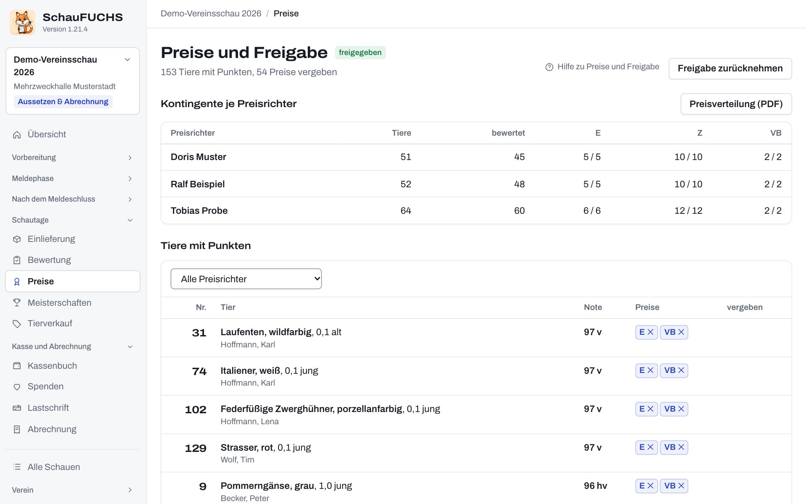

Schalten Sie auf „Preise & Freigabe“. Die Preisrichter vergeben ihre Preise aus dem Standgeld am Tablet aus ihrem Kontingent. **Gestiftete Preise vergibt nur die Ausstellungsleitung** hier am PC – das Tablet zeigt sie nicht (siehe „Stiftungen“). Die Seite „Preise“ zeigt:

- **„Kontingente je Preisrichter“** (bzw. „Kontingent (gemeinsam für die Schau)“) – je Preisart „vergeben / verfügbar“, gelb, solange noch etwas offen ist; gestiftete Preisarten mit „Zusätzlich je Preisrichter“ stehen mit darin, gezählt nur ihre Preise ohne bestimmte Stiftung (siehe „Stiftungen“); daneben **„Preisverteilung (PDF)“** für alle Preisrichter,
- **„Tiere mit Punkten“** – alle bewerteten Tiere, nach Punkten sortiert, mit ihren Preisen.

**Preisverteilung (PDF):** je Preisrichter ein Blatt ab neuer Seite, ohne Ausstellernamen. Je Preisart aus dem Standgeld (auch Bänder und Sachpreise) stehen so viele Zeilen darauf, wie sein Kontingent erlaubt: vergebene mit Katalognummer und Wert, die übrigen leer zum Eintragen in der Halle. Gestiftete Preise erscheinen nur, wenn sie an seine Tiere vergeben sind, mit dem Stifter unter „Bemerkung“ – hat die gestiftete Preisart „Zusätzlich je Preisrichter“, stehen davon auf jedem Blatt so viele Zeilen für Preise ohne bestimmte Stiftung (vergebene und leere), wie dort eingetragen ist; Preise aus einer Stiftung stehen zusätzlich darin und belegen keine dieser Zeilen. Mehr Preise ohne Stiftung als „Zusätzlich je Preisrichter“ tragen „über dem Kontingent“. Unten stehen der Gesamtwert und, wie viel davon vergeben ist. Ist das Kontingent für die ganze Schau eingestellt, zeigt das Blatt nur die vergebenen Preise. Preise an Tieren, die als fehlend gemeldet sind, tragen „Tier fehlt“. Wurde mehr vergeben, als das Kontingent heute erlaubt (z. B. weil danach Tiere als fehlend gemeldet wurden), steht „über dem Kontingent“ zuerst bei den Preisen an fehlenden Tieren, sonst bei den letzten Nummern.

**Preis von der Papierkarte eintragen:** beim Tier auf „+ E“ (bzw. das Kürzel) klicken. Angeboten werden nur Preisarten, die zum Tier passen (Bindung an Jugend, Senioren oder Sparte). Einen Preis entfernen Sie mit einem Klick auf das vergebene Kürzel und bestätigen mit „Entfernen“.

Die Software prüft jede Vergabe:

| Regel | Meldung |
|---|---|
| Nur Tiere mit Punkten | „Das Tier hat keine Punktbewertung.“ |
| Mindestpunkte | „… erst ab … Punkten.“ |
| Jede Preisart je Tier nur einmal | „Das Tier hat bereits ….“ |
| **Je Tier höchstens ein Geldpreis aus dem Standgeld** (E oder Z); Bänder und Stiftungen kommen zusätzlich | „Das Tier hat bereits einen Geldpreis aus dem Standgeld.“ |
| Kontingent (auch Zusatzpreise ohne Stiftung, siehe „Stiftungen“) | „Kontingent für … ist ausgeschöpft (…).“ |
| Bindung der Preisart (Jugend, Senioren, Sparte) | „„…“ gilt nur Jugend – dieses Tier passt nicht dazu.“ |
| Gestiftete Preise nur durch die Ausstellungsleitung (auch über die Schnittstelle des Tablets) | „Gestiftete Preise vergibt die Ausstellungsleitung.“ |
| Keine Preise für fehlende oder gesperrte Tiere | „Tier ist als fehlend gemeldet …“ / „Tier ist im Gesundheitsjournal gesperrt …“ |

Der Geldbetrag wird bei der Vergabe festgehalten. Eine spätere Änderung der Preisart ändert weder Abrechnung noch Quittung.

#### Stiftungen

Gestiftete Preise (Bänder, Ehrenpreise von Verbänden und Stiftern) tragen Sie im Abschnitt „Stiftungen“ ein:

1. „Stiftung eintragen“.
2. „Stifter“, „Preisart“ (eine Preisart mit Herkunft „Gestiftet“), „Anzahl“, „Betrag (€)“ (der ganze gestiftete Betrag für alle Preise zusammen), „Eingang“ (Datum), „Vorgabe des Stifters“ (z. B. „bestes Tier Zwerg-Wyandotten“).
3. Bei Bedarf den Haken „Der Stifter ist einverstanden, im Online-Katalog genannt zu werden (gedruckt steht er immer).“
4. „Speichern“.

Die Tabelle zeigt je Stiftung „Anzahl“, „vergeben“, „Betrag“, „Vorgabe“ und „Eingang“; ein Klick auf den Stifter öffnet wie „Bearbeiten“ das Formular. Unter „Preise und Stifter“ im Katalog stehen gestiftete Preise nur, wenn sie rechtzeitig vor dem Druck eingehen und hier eingetragen sind. Eine Stiftung ohne Preisart (z. B. online mit der Meldung zugesagt) trägt die Marke „keine Preisart“: Sie zählt für keinen Preis. Ordnen Sie ihr mit „Bearbeiten“ eine gestiftete Preisart zu – ab der Phase „Preise & Freigabe“ ist das ein roter Punkt in der Prüfliste.

Verfügbar sind von einer gestifteten Preisart die gestifteten Preise jeder Stiftung und, wenn die Preisart „Zusätzlich je Preisrichter“ hat, diese Zusatzpreise ohne Stiftung. **Die Zusatzpreise zählen je Preisrichter:** Jeder Preisrichter hat so viele für die Tiere, die ihm zugeteilt sind – nutzt ein anderer seine nicht, bekommt er deshalb nicht mehr. Ist das Kontingent für die ganze Schau eingestellt („Preise aus dem Standgeld verteilen“), gelten die Zusatzpreise gemeinsam: „Zusätzlich je Preisrichter“ mal Zahl der Preisrichter. Tiere ohne Preisrichter bekommen keinen Zusatzpreis („Das Tier ist keinem Preisrichter zugeteilt.“). Preise aus einer Stiftung zählen nur gegen die Stiftung, auch an Tieren ohne Preisrichter. Ohne „Zusätzlich je Preisrichter“ gibt es einen gestifteten Preis nur aus einer Stiftung („Diesen Preis gibt es nur aus einer Stiftung.“).

**Gestifteten Preis vergeben:** Klicken Sie beim Tier auf das Kürzel der gestifteten Preisart. Es öffnet sich „Gestifteter Preis für Nr. …“ mit allen Stiftungen dieser Preisart: Stifter, wie viele noch frei sind, der Betrag je Preis und die Vorgabe des Stifters. Prüfen Sie die Vorgabe und klicken Sie die passende Stiftung an. Gibt es bei der Preisart „Zusätzlich je Preisrichter“, steht darunter „Ohne bestimmte Stiftung (zusätzlich je Preisrichter)“; dann gilt der Betrag der Preisart. Hat der Preisrichter des Tieres seine Zusatzpreise schon vergeben, ist dieser Knopf grau. Gibt es zu der Preisart keine Stiftung, vergibt ein Klick auf das Kürzel gleich einen Zusatzpreis; sind alle Stiftungen vergeben, bleibt im Fenster nur „Ohne bestimmte Stiftung“. Sind weder Stiftungen noch Zusatzpreise des Preisrichters frei, wird die Preisart beim Tier nicht mehr angeboten.

- **Der Gewinner bekommt den Anteil der Stiftung je Preis.** Jeder Preis bekommt den noch nicht vergebenen Rest der Stiftung, geteilt durch die freien Plätze (aufgerundet; der letzte genau den Rest): 20,00 € für 3 Preise ergibt 6,67 €, 6,67 €, 6,66 €. So zahlt die Schau nie mehr aus als gestiftet – auch wenn Sie einen Preis entfernen oder die Anzahl später ändern.
- Die Vergabe merkt sich die Stiftung. Beim Darüberfahren über das vergebene Kürzel steht „Gestiftet von … – Preis entfernen“.
- Ist aus einer Stiftung schon ein Preis vergeben, sind Preisart und Betrag der Stiftung fest, die Anzahl kann nicht unter die Zahl der vergebenen Preise sinken, und die Stiftung lässt sich nicht löschen („Aus dieser Stiftung sind schon … Preise vergeben …“). Erst die Preise entfernen.

Noch nicht vergebene Stiftungspreise nennt die Prüfliste („Gestiftete Preise noch nicht vergeben: …“). Nicht vergebene Geldstiftungen erstatten Sie dem Stifter oder sprechen sich mit ihm ab.

**Bar übergebene Stiftung:** Bringt ein Stifter ohne Meldung (z. B. ein Verband oder ein Förderer) das Geld bar, klicken Sie bei seiner Stiftung auf „Bar erhalten“ und bestätigen „… von … bar erhalten?“ mit „Bar erhalten“. Der Betrag wird als Einlage ins Kassenbuch gebucht, mit Eigenbeleg im Belegarchiv; die Stiftung trägt danach die Marke „in der Kasse“ und als Eingang den heutigen Tag (wenn noch keiner eingetragen war). Danach ist der Betrag fest, und die Stiftung lässt sich nicht mehr löschen. Nur Ausstellungsleitung.

**Abstimmung:** Unter der Tabelle steht „Geldstiftungen eingegangen: … von … zugesagt · als Preisgeld vergeben: …“. So sehen Sie, ob eingegangenes und als Preisgeld vergebenes Stiftungsgeld zusammenpassen.

Aussteller können online mit ihrer Meldung einen Ehrenpreis stiften. Diese Stiftung erscheint hier mit dem Hinweis „Wird mit dem Meldegeld bezahlt – Zahlung bitte an der Meldung erfassen.“ Ändern lässt sie sich nur hier, nicht an der Meldung. „Bar erhalten“ gibt es für sie nicht – das Geld kommt mit dem Meldegeld.

### 5.12 Ergebnisse freigeben

Wenn alles bewertet und bestätigt ist, klicken Sie auf der Seite „Preise“ oben auf „Ergebnisse freigeben“. Danach steht am Titel die Marke „freigegeben“, und an der Stelle des Knopfs steht „Freigabe zurücknehmen“.

Die Freigabe geht nur, wenn

- alle Tiere (außer den fehlenden) bewertet sind – sonst „… Tiere sind noch nicht bewertet.“,
- alle Noten „vorzüglich“ und u.M. vom Obmann bestätigt sind – sonst „… Bewertungen („vorzüglich“ oder u.M.) sind noch nicht vom Obmann bestätigt.“,
- alle bestätigten Tiere eine Katalognummer haben – sonst „… bestätigte Tiere haben keine Katalognummer – erst nummerieren oder die Meldung bereinigen.“,
- kein Kontingent überschritten ist (z. B. nach einer geänderten Einteilung; auch die Zusatzpreise gestifteter Preisarten je Preisrichter) – sonst „Kontingent überschritten: … Bitte erst Preise entfernen.“ Früher zählten die Zusatzpreise für die ganze Schau; ist eine Schau so schon freigegeben, sind überzogene Zusatzpreise in der Prüfliste nur ein gelber Hinweis, vor einer erneuten Freigabe aber zu bereinigen,
- die Preise aus Stiftungen durch die gestiftete Anzahl gedeckt sind – sonst „Stiftungspreise nicht gedeckt: … Bitte Stiftung ergänzen oder Preise entfernen.“

Vor der Freigabe weist die Software auf weitere Punkte hin und fragt nach („Trotzdem freigeben?“, Knopf „Freigeben“):

- Die Schau steht noch vor der Phase „Preise & Freigabe“ – dann können die Preisrichter am Tablet noch Preise vergeben.
- Es sind noch Preise aus dem Kontingent frei, z. B. „Noch freie Preise: E 2 von 3 (Preisrichter Müller).“ Das kann richtig sein, wenn kein Tier die Mindestpunkte erreicht. Freie Zusatzpreise gestifteter Preisarten („Zusätzlich je Preisrichter“) nennt die Software nicht.
- Gestiftete Preise sind noch nicht vergeben („Gestiftete Preise noch nicht vergeben: …“).
- Tiere sind bewertet, aber nicht als eingeliefert abgehakt („… Tiere sind bewertet, aber nicht als eingeliefert abgehakt (Nachweis prüfen oder mit Grund einliefern).“).

Prüfen Sie die Hinweise und bestätigen Sie erst dann.

**Was die Freigabe bewirkt:**

- Die Ergebnisse erscheinen auf der öffentlichen Seite (`…/s/kurzadresse/ergebnisse`) und bei den Ausstellern unter „Meine Meldung“.
- Die Tablets sind geschlossen. Preisrichter können nichts mehr ändern.
- Der Katalog enthält Noten, Preise und Ehrentafel („Katalog mit Ergebnissen (PDF)“) – jetzt drucken.
- Die Notenskala ist fest.

**Nach der Freigabe** gilt:

| Was | Wer | Bedingung |
|---|---|---|
| Note ändern oder zurücksetzen | nur Ausstellungsleitung | mit Grund (Reklamation) |
| Preis vergeben oder entfernen | nur Ausstellungsleitung | mit Grund (Reklamation) |
| Obmann-Bestätigung eintragen | nur Ausstellungsleitung | – |
| Status eines Tiers (fehlt, nicht eingeliefert) | nur Ausstellungsleitung | mit Grund; Ausgabe und Zurücknehmen der Ausgabe darf jeder |
| Ringnummer | nur Ausstellungsleitung | mit Grund |

**Freigabe zurücknehmen** geht nur mit Grund: „Freigabe zurücknehmen“ öffnet ein Fenster mit dem Feld „Grund“ (steht im Protokoll), dann „Zurücknehmen“. Die Bewertung öffnet sich wieder, und die Tablets sind wieder offen, sofern die Phase passt. Ein schon gedruckter oder veröffentlichter Katalog mit Ergebnissen kann danach abweichen. Steht die Schau schon in „Schau & Verkauf“ oder später, oder gibt es schon Auszahlungen, fragt die Software zusätzlich nach („Trotzdem zurücknehmen?“), weil sich Ergebnisse, Preise und Abrechnung danach ändern können.

> **Wichtig:** Wer einem bereits abgerechneten Aussteller nachträglich einen Geldpreis gibt oder nimmt, bucht eine Reklamation: „Aussteller ist bereits abgerechnet (Quittung …). Als Reklamation nur durch die Ausstellungsleitung mit Grund – der Unterschied erscheint dann als Differenz.“ Die Differenz rechnen Sie in der Abrechnung ab (siehe 5.15).

### 5.13 Phase „Schau & Verkauf“: Tierverkauf

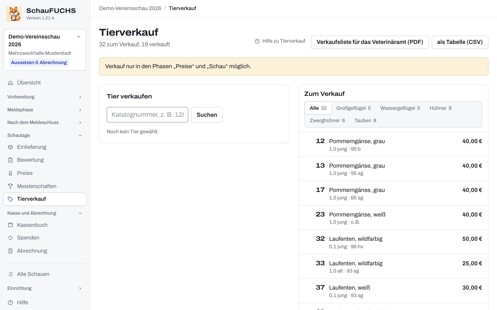

Verkauft wird in den Phasen „Preise & Freigabe“ und „Schau & Verkauf“, und nur **eingelieferte, bewertete** Tiere, die der Aussteller mit Verkaufspreis gemeldet hat.

1. „Tierverkauf“ → Katalognummer eingeben und „Suchen“, oder rechts unter „Zum Verkauf“ das Tier antippen. Bei mehreren Sparten grenzen Sie die Liste mit dem Umschalter darüber ein („Alle“ oder eine Sparte, je mit Anzahl).
2. Die Software zeigt Nummer, Tier und Preis.
3. Pflichtangaben eintragen: „Name des Käufers *“, „Registriernummer des Käufers *“ (12 Ziffern, Ländercode 276 darf fehlen; ausländische Nummern mit Ländercode), „Alter des Käufers *“. Bei „unter 16 – Erziehungsberechtigter ist einverstanden“ zusätzlich „Name des Erziehungsberechtigten *“ (direkt darunter). „Anschrift“ ist freiwillig.
4. „Bezahlt“ wählen: „bar“ (wird im Kassenbuch gebucht); nur für die Ausstellungsleitung zusätzlich „Karte“ und „Überweisung“ – darunter steht dann „Tier erst nach Zahlungseingang ausgeben.“
5. „Verkaufen und Beleg drucken“. Der Kaufbeleg öffnet sich zum Drucken.

**Verkauf per Überweisung:** Der Erlös zählt für den Aussteller erst, wenn der Zahlungseingang gebucht ist, und erst dann darf das Tier hinaus. Bis dahin steht der Verkauf in der Liste mit „Überweisung offen“, oben weist ein gelber Hinweis darauf hin, und in der Abrechnung steht beim Aussteller „+ … Überweisung offen“. Ist das Geld laut Kontoauszug da, klicken Sie beim Verkauf auf „Zahlung eingegangen …“, tragen das „Datum des Eingangs“ ein und bestätigen mit „Eingang buchen“. Das steht im Protokoll und lässt sich nicht ändern. Ohne gebuchten Eingang lässt sich die Schau nicht abschließen.

> **Hinweis:** Auf einer Ausstellung ist nur der Verkauf einzelner Tiere an registrierte Halter üblich. Wer viele Tiere abgibt, handelt wie ein Markt und braucht eine Erlaubnis nach § 11 TierSchG; manche Veterinärämter untersagen den Verkauf auf Ausstellungen ganz. Die Seite „Tierverkauf“ zeigt diesen Hinweis ebenfalls. Klären Sie das vorher mit dem Veterinäramt.

Blockiert der Browser das automatische Öffnen (z. B. Safari auf dem iPad), erscheint oben „Verkauft – Beleg …“ mit dem Knopf „Beleg … drucken“.

Die Provision behält der Verein ein; sie wird beim Verkauf mit dem aktuellen Satz festgehalten. Darum ist der Provisionssatz nach dem ersten Verkauf gesperrt.

Unten unter „Verkauft“ stehen alle Verkäufe mit Summe. „Verkaufsliste für das Veterinäramt (PDF)“ und „als Tabelle (CSV)“ stehen oben im Seitenkopf – mindestens drei Jahre aufbewahren.

**Stornieren** kann nur die Ausstellungsleitung, mit Grund (beim Tier: roter Knopf „Stornieren“, dann im Fenster „Verkauf stornieren (Beleg …)“ den Grund eintragen und „Stornieren“). Der Verkauf bleibt als storniert in der Verkaufsliste stehen.

> **Wichtig:** Ist ein Tier verkauft, ändert nur noch die Ausstellungsleitung seine Note (mit Grund). Korrekturen der Preisrichter am Tablet werden dann abgelehnt. Verkaufen Sie deshalb möglichst erst nach der Freigabe.

### 5.14 Phase „Aussetzen & Abrechnung“: Tierausgabe

Unter „Einlieferung“ → „Tierausgabe“ geben Sie die Tiere heraus und sammeln die zweite Ringkarte ein.

- „Alle nicht verkauften ausgeben“ oder je Tier „Ausgeben“.
- **Verkaufte Tiere nur gegen Kaufbeleg:** Die Software fragt im Fenster „Verkauftes Tier ausgeben“ nach der Nummer des Kaufbelegs, den der Käufer vorlegt.
- **Per Überweisung verkaufte Tiere erst nach dem Zahlungseingang** (siehe 5.13). Vorher meldet die Software „Nr. … ist per Überweisung verkauft – der Zahlungseingang ist noch nicht gebucht … Ausgabe vorher nur durch die Ausstellungsleitung mit Grund.“
- Gesperrte Tiere (Gesundheitsjournal) nur mit Grund, z. B. Anordnung des Tierarztes.
- „Zurücknehmen“ macht eine Ausgabe rückgängig.

### 5.15 Abrechnung

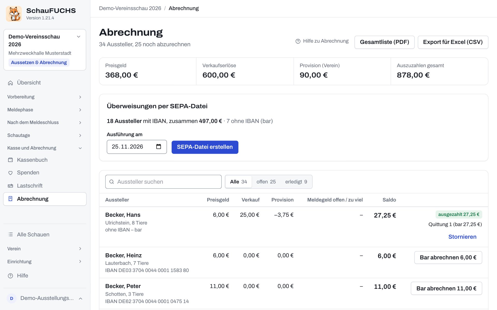

Die Seite „Abrechnung“ zeigt je Aussteller:

**Saldo = Preisgeld + Verkaufserlös − Provision − noch offenes Meldegeld (bzw. + zu viel gezahltes Meldegeld)**

Abgerechnet werden nur Aussteller mit bestätigter Meldung; ohne solche Meldungen bleibt die Liste leer („Keine Aussteller.“). Zugesagte Ehrenpreisstiftungen und Spenden aus der Meldung zählen wie Meldegeld.

**Eine Quittung für alles:** Abrechnung und Quittung eines Ausstellers sind eine Gesamtabrechnung. Jeder Posten steht einzeln darauf: Meldegeld, zugesagte Ehrenpreisstiftung, Spende für die Ausstellung, bereits bezahlt, Preisgeld, Verkaufserlös und Provision – darunter, was an den Aussteller geht bzw. was er noch zahlt. Hat er außerdem an der Kasse oder per Überweisung gespendet (eigene Spendenquittung), steht das als Hinweis darunter. Ist der Saldo negativ, muss der Aussteller zahlen. Im Seitenkopf steht „… Aussteller, … noch abzurechnen“, darunter die Summen „Preisgeld“, „Verkaufserlöse“, „Provision (Verein)“ und „Auszuzahlen gesamt“. „Alle“, „offen“ und „erledigt“ über der Ausstellertabelle schränken nur die Anzeige ein. Verkäufe per Überweisung ohne gebuchten Zahlungseingang zählen noch nicht zum Verkaufserlös; sie stehen beim Aussteller als „+ … Überweisung offen“.

**Stornierte Meldungen mit Zahlungseingang:** Gibt es stornierte oder abgelehnte Meldungen, für die Geld eingegangen ist, zeigt die Seite gleich unter dem Seitenkopf den Abschnitt „Stornierte Meldungen mit Zahlungseingang“ – nach einer Absage „Erstattungen – Schau abgesagt (…)“ – mit Aussteller, Kontoinhaber, IBAN und Betrag. Überweisen Sie die Beträge im Online-Banking, wählen Sie dann unten im Abschnitt „Überwiesen am“ und klicken Sie „Erstattungen als überwiesen buchen“. Die Software bucht für jede Meldung eine Erstattung (Gegenbuchung per Überweisung). Erst buchen, wenn das Geld tatsächlich überwiesen ist. Soll der Verein das Geld behalten, buchen Sie stattdessen an der Meldung „Verfall buchen …“ (siehe 5.4). Vorher lässt sich die Schau nicht abschließen.

Ausgezahlt wird in den Phasen „Schau & Verkauf“ und „Aussetzen & Abrechnung“.

#### Bar abrechnen

1. Aussteller suchen.
2. „Bar abrechnen …“ klicken und die Rückfrage „Bar abrechnen“ mit „Buchen“ bestätigen („… bar an … auszahlen?“ bzw. bei negativem Saldo „… bar von … erhalten?“).
3. Die Quittung öffnet sich zum Drucken; sonst oben „Quittung … drucken“.

Weist das Kassenbuch nicht genug Bargeld aus, erscheint „Laut Kassenbuch sind nur … in der Kasse …“. Helfer müssen dann die Ausstellungsleitung holen; die Ausstellungsleitung kann nach der Rückfrage „Trotzdem buchen?“ mit „Trotzdem buchen“ buchen.

#### Überweisung per SEPA-Datei

Aussteller mit IBAN bekommen ihr Geld per Sammelüberweisung. Das geht nur in der Phase „Aussetzen & Abrechnung“ und nur mit eingetragenem Vereinskonto.

1. Im Abschnitt „Überweisungen per SEPA-Datei“ das Datum unter „Ausführung am“ wählen (nicht in der Vergangenheit).
2. „SEPA-Datei erstellen“. Aussteller und Beträge werden festgehalten; bis zum Buchen oder Verwerfen sind diese Aussteller für Barauszahlung, Verkauf und Storno gesperrt.
3. „SEPA-Datei herunterladen“ und im Online-Banking des Vereins als Sammelüberweisung hochladen. Jeder Download liefert denselben Inhalt.
4. Nach der Freigabe durch die Bank: „Als überwiesen buchen“. Das erzeugt die Quittungsnummern.
5. Hat die Bank die Datei abgelehnt: „Datei verwerfen“ (mit Grund) und neu erstellen.

Aussteller ohne IBAN zahlen Sie bar aus.

#### Nachzahlung und Rückforderung

Ändert sich nach einer Quittung noch etwas (nachträglicher Preis, Verkauf, Meldegeld), zeigt die Liste „Abweichung …“. Bereits gezahltes Geld wird **nie doppelt** ausgezahlt; abgerechnet wird nur der Unterschied mit eigener Quittung:

- „Differenz bar auszahlen …“ bzw. „Differenz bar zurückfordern …“,
- „als Überweisung“ (Sie führen die Überweisung selbst im Online-Banking aus) bzw. „Überweisung eingegangen“ – eine Rückforderung per Überweisung erst buchen, wenn das Geld auf dem Vereinskonto ist.

**Stornieren** einer Quittung (mit Grund) nur, wenn kein Geld geflossen ist – etwa bei einer Fehlbuchung oder einer zurückgebuchten Überweisung. Bei mehreren Quittungen zuerst die spätere. Für Korrekturen nehmen Sie „Differenz“.

> **Wichtig:** Funktionstrennung – die erste Barauszahlung dürfen auch Helfer buchen. **Überweisungen, die SEPA-Datei, Nachzahlungen, Rückforderungen und Stornos bucht nur die Ausstellungsleitung.** Eine vorhandene IBAN oder den Kontoinhaber ändert ebenfalls nur die Ausstellungsleitung – und nie, solange der Aussteller in einer offenen SEPA-Datei steht.

Ausdrucke: „Gesamtliste (PDF)“ und „Export für Excel (CSV)“.

### 5.16 Kassenbuch und Tagesabschluss

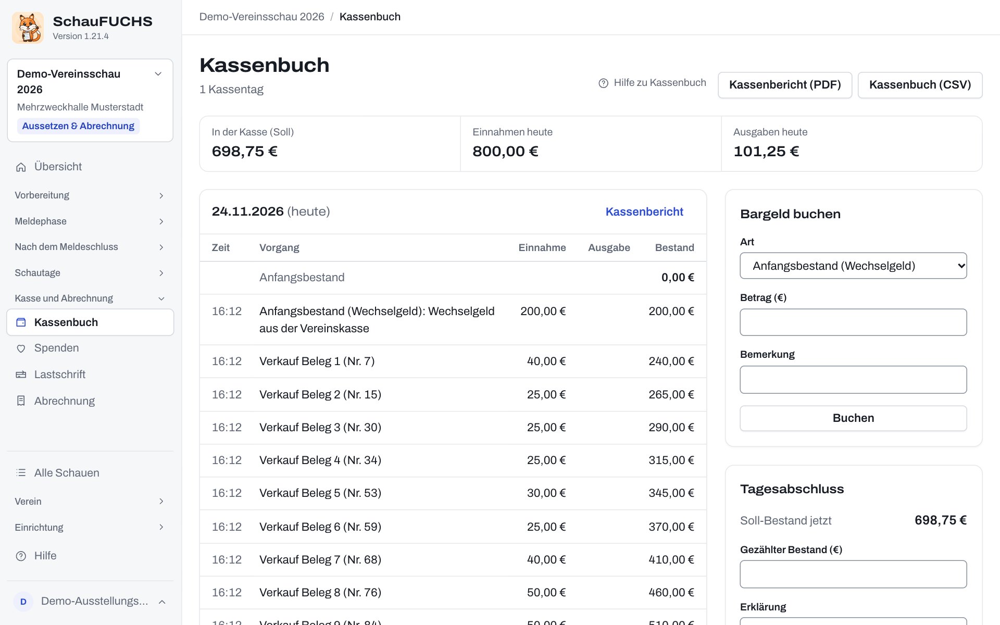

Das Kassenbuch erfasst alle Bargeldbewegungen der Schau mit Soll-Bestand: Meldegeld bar, Verkäufe bar, Barauszahlungen und die Buchungen von Hand. Oben steht unter „In der Kasse (Soll)“, wie viel Bargeld laut Kassenbuch gerade in der Kasse sein muss.

> **Wichtig:** Ob SchauFUCHS als elektronisches Kassensystem eine TSE nach § 146a AO braucht, ist noch nicht mit dem Steuerberater geklärt. Die Software hat keine TSE. Führen Sie Bargeld bis zur Klärung zusätzlich im Kassenbuch auf Papier (offene Ladenkasse mit Kassenbericht).

**Zu Beginn jedes Kassentags:**

1. „Kassenbuch“ → Abschnitt „Bargeld buchen“.
2. „Art“: „Anfangsbestand (Wechselgeld)“, Betrag eintragen, „Buchen“.

Weitere Arten: „Einlage“ und – nur Ausstellungsleitung, mit Zweck – „Entnahme (z. B. zur Bank)“. Bar übergebene Stiftungen buchen Sie nicht hier, sondern unter „Preise“ → „Stiftungen“ mit „Bar erhalten“ (siehe 5.11); sie erscheinen dann als Einlage „Stiftung von …“ mit Eigenbeleg im Kassenbuch.

**Am Ende jedes Kassentags:**

1. Bargeld zählen.
2. Abschnitt „Tagesabschluss“: „Gezählter Bestand (€)“ eintragen. Sind mehrere Kassentage offen (z. B. nach Mitternacht), zuerst unter „Kassentag“ den Tag wählen.
3. Bei einer Differenz die „Erklärung“ ausfüllen (Pflicht).
4. „Tagesabschluss buchen“ und die Rückfrage bestätigen.

> **Wichtig:** Auch nach dem Tagesabschluss können Sie weiter bar buchen – Verkauf, Meldegeld, Auszahlung. Solche Buchungen stehen im Kassenbuch unter „Nachtrag nach dem Tagesabschluss“. Der Abschluss selbst bleibt unverändert; niemand kann ihn rückgängig machen.

**Nachtragsabschluss:** Gab es nach dem Abschluss noch Barbuchungen, steht beim Tag „Nach dem letzten Abschluss gab es noch Barbuchungen …“, und rechts heißt der Abschnitt „Nachtragsabschluss“. Zählen Sie die Kasse erneut und buchen Sie „Nachtragsabschluss buchen“ genauso wie den Tagesabschluss. Der Soll-Bestand ist dann der zuletzt gezählte Bestand plus die Nachträge. Kassentage werden der Reihe nach abgeschlossen; ein offener Nachtrag eines früheren Tages muss zuerst abgeschlossen werden.

**Kassendifferenz:** Hat ein Abschluss eine Differenz, geht das Kassenbuch danach mit dem gezählten Bestand weiter. Unter dem Soll-Endbestand stehen dann „Kassendifferenz laut Abschluss“ und „Endbestand (gezählt + Nachträge)“ – so auch im Kassenbericht und in der CSV. Wird Meldegeld zusammen mit einer zugesagten Stiftung bar kassiert, steht der Stiftungsanteil im Kassenbuch und auf der Einzahlungsquittung („davon Meldegeld …, Stiftung …“).

„Kassenbericht (PDF)“ (gesamt oder je Tag) und „Kassenbuch (CSV)“ stehen oben. Das „Belegarchiv“ enthält jeden Beleg mit Prüfsumme. Ein Storno erzeugt einen eigenen Beleg; das Original bleibt im Archiv abrufbar.

**Zweitschrift:** Normalerweise entsteht jeder Beleg direkt bei der Buchung und kommt so ins Belegarchiv; jeder Nachdruck ist dann genau dieses Original. Ging das Ablegen bei der Buchung schief, erzeugt die Software den Beleg erst beim Abruf – mit dem Stand zu diesem Zeitpunkt. Entsteht ein Beleg so mehr als 10 Minuten nach der Buchung, gilt er als Zweitschrift: Solche Kaufbelege, Quittungen und Kassenbelege tragen auf jeder Seite oben rechts in Rot den Vermerk „ZWEITSCHRIFT – erzeugt am …, Stand beim Erzeugen (gebucht am …)“. Quittungen aus einer SEPA-Datei zeigen den bei der Buchung festgehaltenen Stand und bleiben Original.

> **Tipp:** Drucken Sie zum Tagesende den Kassenbericht des Tages aus und lassen Sie ihn unterschreiben (Felder für Ort, Datum und Unterschriften sind vorbereitet). Er gehört zu den Kassenunterlagen des Vereins.

### 5.17 Protokoll und Prüfliste

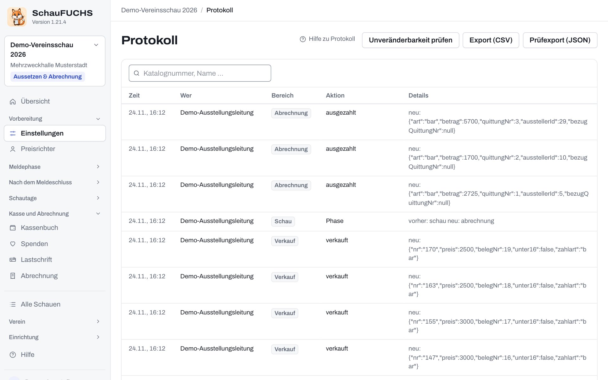

**Protokoll:** Sie öffnen es in den Einstellungen der Schau: Der Reiter „Protokoll“ zeigt die letzten Einträge, „Protokoll öffnen“ das ganze Protokoll. Jede Änderung an Meldungen, Bewertungen, Preisen, Verkäufen und Geld steht dort mit Zeit, Person und – wo verlangt – Grund. Bei Bewertungen stehen auch die Texte der Bewertungskarte (Vorzüge, Wünsche, Mängel) darin, bei gestifteten Preisen der Stifter, und die automatische Bestätigung einer bezahlten Meldung ebenfalls. Einträge lassen sich nicht ändern oder löschen; eine Hash-Kette macht nachträgliche Eingriffe sichtbar. Die Datenbank lässt auch nicht zu, dass Protokoll oder Kassendaten im Ganzen geleert werden (außer beim Löschen einer Schau). Die Inhalte des Protokolls bleiben 10 Jahre ab Jahresende erhalten (siehe 3.6).

- Suchfeld: z. B. Katalognummer oder Name.
- „Ältere laden“ (unter der Tabelle) blättert zurück.
- „Unveränderbarkeit prüfen“ (oben neben den Exporten) prüft die Hash-Kette; das Ergebnis erscheint darunter. Bei Erfolg: „… Einträge geprüft – unverändert.“ mit dem „Stand der Kette“ und einem Prüfwert, der auch auf jedem Kassenbericht steht. Weicht der Prüfwert eines späteren Ausdrucks davon ab, obwohl nichts gelöscht wurde, oder meldet die Prüfung Einträge, die nicht mit der Hash-Kette übereinstimmen, informieren Sie den Administrator bzw. den Betreuer der Technik.
- Darunter stehen bei Bedarf Vermerke, die kein Fehler sind: „… vor der Hash-Kette“ (Einträge aus der Zeit, bevor es die Hash-Kette gab), „… anonymisiert (vermerkt)“ (nach Ablauf einer Speicherfrist oder auf Löschwunsch anonymisiert, siehe 3.5 und 3.6) und „… Lücken durch entfernten Demo-/Test-Verein (vermerkt)“.
- „Export (CSV)“ und „Prüfexport (JSON)“.

Das Protokoll ist die Grundlage für Reklamationen. Geben Sie deshalb bei jeder Rückfrage nach einem Grund einen verständlichen Grund an – aber **ohne Personennamen**.

**Prüfliste:** „Was noch zu tun ist“ auf der Übersicht (siehe 5.1). Rote Punkte halten den Wechsel in spätere Phasen auf, gelbe sind Hinweise. Typische Punkte:

- „Keine Stammdaten (Rassen und Farbenschläge) gewählt.“
- „Anzeige beim Veterinäramt fehlt – fällig spätestens am …“
- „Tiergesundheit: festlegen, wie die klinische Untersuchung nach § 7 GeflPestSchV erfolgt …“
- „Impressum des gedruckten Katalogs: Angabe „Druck“ fehlt …“
- „… Meldung(en) aus dem Ausland: amtliches Gesundheitszertifikat und TRACES-NT-Meldung …“
- „… hat … Tiere zu bewerten (Stamm 2, Voliere/Bruteier 3) – mehr als die Höchstzahl …“
- „Geldpreis unter dem Standgeld für ein Einzeltier: …“
- „… Meldung(en) noch nicht bestätigt (Zahlung fehlt?).“
- „… bestätigte Meldung(en) ohne gültige Registriernummer (12 Ziffern) …“
- „… Tiere sind keinem Preisrichter zugeteilt …“
- „… Preisrichter haben noch keine PIN für das Tablet.“
- „… Tiere sind bewertet, aber nicht als eingeliefert abgehakt …“
- „… eingelieferte Tiere ohne Ringnummer (Kennzeichnung für das Veterinäramt) …“
- „… Bewertungen („vorzüglich“ oder u.M.) warten auf Bestätigung durch den Obmann.“
- „Kontingent überschritten: …“
- „… Stiftung(en) ohne Preisart (…) – unter „Preise › Stiftungen“ eine gestiftete Preisart zuordnen.“
- „Gestiftete Preise noch nicht vergeben: …“
- „… stornierte oder abgelehnte Meldung(en) mit Zahlungseingang (…) – erstatten … oder in der Meldung „Verfall buchen“.“
- „Kassenbuch: … Tag(e) mit Bargeld ohne Tagesabschluss oder mit offenem Nachtrag.“
- „… Aussteller sind noch nicht abgerechnet.“
- „Die Schau liegt über 8 Wochen zurück, die Reklamationsfrist ist abgelaufen. Nach der Abrechnung bitte abschließen …“ (bei einer späteren Reklamationsfrist erst nach deren Ende)

### 5.18 Schau abschließen

Ist alles abgerechnet, klicken Sie auf der Übersicht auf die Phase „Abgeschlossen“ bzw. „Weiter zu: Abgeschlossen“. Die Rückfrage „Schau abschließen?“ lautet: „30 Tage danach löscht die Bereinigung IBANs, Geburtsdaten und Preisrichter-PINs.“ Bestätigen Sie mit „Abschließen“.

Der Abschluss geht ohne Weiteres nur, wenn

- die Reklamationsfrist abgelaufen ist („Reklamationsfrist läuft noch bis …“),
- die Prüfliste keine roten Punkte mehr zeigt und die Ergebnisse freigegeben sind (siehe 5.1),
- alle Aussteller vollständig abgerechnet sind,
- stornierte oder abgelehnte Meldungen mit Zahlungseingang erstattet oder als Verfall gebucht sind,
- jeder Verkauf per Überweisung seinen Zahlungseingang hat,
- keine SEPA-Datei und keine Lastschriftdatei offen ist,
- jeder Kassentag mit Bargeld einen Tagesabschluss hat und kein Nachtrag offen ist.

Sonst meldet die Software „Noch nicht abschließbar: …“ und fragt „Trotzdem abschließen?“. Abschließen geht dann nur mit Grund im Feld „Grund“ und dem Knopf „Trotzdem abschließen“; der Grund steht im Protokoll. **Eine offene SEPA-Datei** verhindert den Abschluss immer: „Es gibt noch eine offene SEPA-Datei. Bitte erst buchen oder verwerfen, dann abschließen.“

Eine **abgesagte Schau** (siehe 5.3) braucht zum Abschluss nur die Kasse: Erstattungen bzw. Verfall gebucht und Kassentage abgeschlossen. Prüfliste und Freigabe gelten für sie nicht.

Mit dem Abschluss werden alle Preisrichter-Tablets abgemeldet. Öffnet ein Tablet die Seite danach mit Netz, löscht es Tierlisten und Textbausteine dieser Schau von selbst; nicht übertragene Bewertungen zeigt es weiter an, bis der Preisrichter sie nach Rücksprache mit Ihnen löscht.

**Nach dem Abschluss** ist die Schau weitgehend nur noch zu lesen:

- Meldungen, Zahlungen und Zahlungsstornos, Kassenbuchungen, Bewertungen, Preise und die Freigabe, die Einteilung der Preisrichter, Katalognummern und Festschreiben, Tierstatus und Impfnachweise, Auszahlungen und Stornos sind gesperrt („Die Schau ist abgeschlossen – für Korrekturen erst mit Grund zurück zur Abrechnung.“).
- Ringnummern ändert nur die Ausstellungsleitung mit Grund.
- Für Korrekturen schalten Sie mit Grund zurück auf „Aussetzen & Abrechnung“.

Ist die Reklamationsfrist abgelaufen und die Schau liegt über 8 Wochen zurück, erinnert die Prüfliste an den Abschluss – erst danach greifen die Speicherfristen.

### 5.19 Datenschutz-Fristen und Auskunft nach der Schau

- 30 Tage nach dem Abschluss löscht die Bereinigung IBAN, Geburtsdatum sowie Kontaktdaten, PIN und Vorbehalt der Preisrichter (siehe 3.6). IBAN und Geburtsdatum bleiben aber mindestens bis 30 Tage nach dem Ende der Reklamationsfrist – eine berechtigte Reklamation braucht noch die Bankverbindung.
- 12 Monate nach der Schau sind Ergebnisse und Online-Katalog nicht mehr im Internet abrufbar.
- Verkaufsaufzeichnungen, Tierliste und Gesundheitsjournal bleiben 3 Jahre nach der Schau, Buchungsbelege 8 Jahre und die Inhalte des Änderungsprotokolls 10 Jahre ab Jahresende.
- Auskunfts- und Löschwünsche bearbeiten Sie unter „Verein und Datenschutz“ (siehe 3.5).
- Für Ihre Unterlagen: Kassenbericht, Verkaufsliste und Tierliste für das Veterinäramt als PDF speichern bzw. ausdrucken.

---

### 5.20 Spenden

Unter „Spenden“ (Gruppe „Kasse und Abrechnung“ der Schau) erfassen Sie Geld- und Sachspenden für die Schau, zum Beispiel 100 € vom Bürgermeister. Mitarbeiter dürfen Spenden erfassen; bestätigen und stornieren darf nur die Ausstellungsleitung.

**Spende erfassen:**
1. Spender suchen (Name oder Ort) oder „Neuer Spender“ und Name und Anschrift eintragen.
2. „Geld“ oder „Sache“ wählen, bei Geld „bar in die Kasse“ oder „Überweisung“.
3. Betrag bzw. Wert eintragen. Bei Überweisung und Sache den Tag des Eingangs (leer: heute).
4. Bei einer Sache genau bezeichnen (mit Alter, Zustand, Kaufpreis), die Herkunft wählen und angeben, ob Unterlagen zum Wert vorliegen (z. B. eine Rechnung).
5. „Mit Gegenleistung“ ankreuzen, wenn der Spender etwas dafür bekommt, zum Beispiel eine Anzeige im Katalog. Das ist dann Sponsoring – dafür gibt es keine Zuwendungsbestätigung.
6. „Spende bar buchen“ bzw. „Spende erfassen“.

Eine Barspende steht sofort als Einnahme im Kassenbuch (Beleg S-…), und es gibt eine Spendenquittung zum Drucken. Die Quittung bestätigt den Empfang; sie ist keine Zuwendungsbestätigung.

**Spende bei der Tiermeldung:** Im Meldeformular gibt es den freiwilligen Posten „Spende für die Ausstellung“. Der Betrag kommt zum Meldegeld dazu und wird mit ihm bezahlt; in der Liste steht er als „mit dem Meldegeld“. Er gilt als eingegangen, sobald die Meldung ganz bezahlt ist (oder bei der Abrechnung verrechnet wurde). Erst dann lässt er sich bestätigen. Wird die Meldung abgelehnt oder storniert, gilt er nicht mehr als eingegangen. Nach der Abrechnung des Ausstellers lässt er sich nicht mehr stornieren.

**Zuwendungsbestätigung:** In einer Testschau gibt es keine. „Bestätigen“ stellt eine Bestätigung nach dem amtlichen Muster aus (Geld- oder Sachzuwendung), mit fortlaufender Nummer. Das PDF wird beim Ausstellen gespeichert und ist das Doppel, das der Verein aufbewahren muss. Drucken Sie es aus und unterschreiben Sie es von Hand. Steht statt „möglich“ ein Grund in der Spalte „Bestätigung“, geht es (noch) nicht – zum Beispiel ohne vollständige Anschrift, bei einer Gegenleistung, solange das Geld nicht eingegangen ist oder wenn die steuerlichen Angaben fehlen (siehe 3.10).

**Storno:** Eine falsch erfasste Spende stornieren Sie mit Grund; eine Barspende geht dabei als Gegenbuchung aus dem Kassenbuch. Steht die Spende auf einer Zuwendungsbestätigung, stornieren Sie zuerst die Bestätigung (siehe 3.11).

> **Hinweis:** Eine Ehrenpreisstiftung (Preise und Freigabe) ist keine Spende im Sinne dieser Seite und bekommt keine Zuwendungsbestätigung: Wer einen Preis stiftet, kann ihn oft selbst gewinnen. Fragen Sie im Zweifel Ihr Finanzamt.

### 5.21 Meisterschaften

Meisterschaften (Vereins-, Kreis- oder Landesmeister, Zuchtpreis, Leistungspreis) richten Sie in den Einstellungen der Schau im Reiter „Meisterschaften“ ein. Die Ergebnisse stehen unter „Meisterschaften“ (Gruppe „Schautage“). Sie rechnen sich aus Katalog und Bewertung jedes Mal neu – nach einer Korrektur der Bewertung stimmen sie sofort.

**Einrichten:** Eine Vorlage wählen und „Meisterschaft hinzufügen“, dann anpassen und oben rechts „Meisterschaften speichern“. Die Vorlagen folgen den Bestimmungen von AAB und BDRG; gleichen Sie die Werte vor jeder Schau mit den aktuellen Bestimmungen Ihres Verbands ab.

| Vorlage | Wertung |
|---|---|
| Zuchtpreis (AAB) | 4 Jungtiere je Aussteller und Farbenschlag, beide Geschlechter (1,3 bis 3,1), eigene Zucht |
| Leistungspreis (AAB) | 6 Tiere, jung und alt, beide Geschlechter |
| Bundessieger (BDRG) | 5 Tiere, Großgeflügel 4; jung und alt, beide Geschlechter |
| Deutsche Jugendmeisterschaft (BDRG) | nur Jugend: 4 Jungtiere ab 378 Punkten, Zwerghühner und Tauben 5 ab 472 |
| Vereinsmeisterschaft | die 12 besten Tiere je Verein von mindestens 3 Züchtern aus mindestens 2 Sparten |

Einstellbar sind unter anderem:
- die Zahl der gewerteten Tiere, auch abweichend je Sparte (Name genau wie im Verzeichnis, z. B. „Zwerghühner“);
- Mindestpunkte, für die Jugend eigene;
- nur Jungtiere oder jung und alt (mit höchstens n Alttieren), beide Geschlechter Pflicht, nur eigene Zucht;
- Jugend mit den Senioren, getrennt, ohne oder nur Jugend; alle Aussteller oder nur Vereinsmitglieder;
- die Mindestbeteiligung (Aussteller bzw. Tiere je Farbenschlag).

**Gewertet** werden bewertete Einzeltiere bestätigter Meldungen; Sondernoten (u, o. B.) zählen mit 0 Punkten. Je Aussteller zählt die beste Auswahl, die alle Bedingungen erfüllt – notfalls also ein schwächeres Tier des anderen Geschlechts. Einen Platz bekommt, wer genug Tiere hat; den Titel bekommt Platz 1, wenn er die Mindestpunkte erreicht und die Mindestbeteiligung erfüllt ist.

**Gleichstand:** Bei gleicher Punktsumme entscheiden die Kriterien in der eingestellten Reihenfolge, z. B. „höhere Einzelnoten der Reihe nach“ (wer das beste Einzeltier hat, dann das zweitbeste …), „höhere Preise“ (Reihenfolge der Preisarten in den Einstellungen) oder „weitere Tiere“. Bleibt es gleich, erhalten beide den Titel oder die Ausstellungsleitung entscheidet – auch das ist einstellbar. Die AAB regeln den Gleichstand selbst; prüfen Sie die Reihenfolge an Ihrer Ausgabe der AAB.

**Aushang und Liste:** „Aushang (PDF)“ druckt alle Ergebnisse (Namen wie im gedruckten Katalog), „Tabelle (CSV)“ lädt alle Kandidaten mit ihren Tieren für die Tabellenkalkulation.

## 6. Checkliste für den Schautag

**Einige Tage vorher**

- [ ] Mindestens **zwei Administratoren** mit eingerichteter Zwei-Faktor-Anmeldung.
- [ ] **Notfallcodes** beider Administratoren ausgedruckt im Kassenordner.
- [ ] Prüfliste der Übersicht abgearbeitet: alle Tiere einem Preisrichter zugeteilt, alle Preisrichter mit PIN, Obmann bestimmt (besser zwei). Rote Punkte halten sonst den Phasenwechsel auf.
- [ ] Klinische Untersuchung festgelegt (Einstellungen → Veterinäramt), bei Einlassuntersuchung Tierarzt bestellt; Impffristen nach dem Merkblatt des Veterinäramts eingetragen.
- [ ] Katalognummern festgeschrieben; „Druck (Impressum)“ beim Katalog eingetragen.
- [ ] Stiftungen eingetragen, jede mit gestifteter Preisart; bar übergebene Stiftungen mit „Bar erhalten“ gebucht.
- [ ] Gedruckt: Bewertungskarten (falls auf Papier bewertet wird), Bewertungslisten je Preisrichter, B-Bögen und Ringkarten, Aussteller- und Tierliste für das Veterinäramt.
- [ ] Textbausteine geprüft („Verein und Datenschutz“ → Reiter „Textbausteine“).
- [ ] Anzeige beim Veterinäramt erledigt und eingetragen („Angezeigt am“).
- [ ] **Betreuer der Technik informiert:** Er nimmt die öffentliche Internetadresse der Halle vorsorglich von den automatischen Sperren aus (der Befehl steht in der Betriebsdokumentation, Abschnitt „Schutz am Rand“ → „Schautag“) und entfernt die Ausnahme nach der Schau wieder. Hintergrund: In der Halle teilen sich alle Geräte eine Adresse.

**Tablets**

- [ ] Tablets **geladen**, Ladegeräte und Mehrfachsteckdose dabei.
- [ ] Link `https://schau.ihr-verein.de/richter/kurzadresse` auf jedem Tablet geöffnet und **zum Startbildschirm hinzugefügt** (als App; nicht im privaten Modus).
- [ ] Je Preisrichter die **PIN** auf einem Zettel (die PIN wird nur beim Erzeugen angezeigt – sonst „Neue PIN“).
- [ ] Probeanmeldung, solange noch Netz da ist. Die Anmeldung geht erst ab der Phase „Einlieferung“.

**WLAN und Netz**

- [ ] Hallen-WLAN oder mobiler Hotspot getestet.
- [ ] Wissen bei allen: Das Tablet bewertet **auch ohne Netz** und überträgt später. Preise vergeben und Obmann-Bestätigungen brauchen Verbindung.
- [ ] Vor dem Abmelden am Tablet „Alles übertragen“ abwarten.

**Kasse**

- [ ] Wechselgeld gezählt und als **„Anfangsbestand (Wechselgeld)“** gebucht.
- [ ] Drucker für Kaufbelege und Quittungen angeschlossen; Pop-up-Sperre des Browsers für SchauFUCHS aus.
- [ ] Phase richtig: Verkauf geht in „Preise & Freigabe“ und „Schau & Verkauf“, Auszahlung in „Schau & Verkauf“ und „Aussetzen & Abrechnung“.
- [ ] Abends: Bargeld zählen, **Tagesabschluss** buchen, Kassenbericht ausdrucken und unterschreiben.

**Phasen am Ablauf**

- [ ] Einlieferungstag: Phase „Einlieferung“ (Tablets offen). Ringnummern aller eingelieferten Tiere eintragen.
- [ ] Bewertungstag: Phase „Bewertung“.
- [ ] Nach der Bewertung: Phase „Preise & Freigabe“, Preise vergeben (gestiftete Preise am PC), Ergebnisse freigeben, Katalog drucken. Ohne Freigabe geht es nicht ohne Grund weiter zu „Schau & Verkauf“.
- [ ] Besuchertage: Phase „Schau & Verkauf“.
- [ ] Ausgabe: Phase „Aussetzen & Abrechnung“.

---

## 7. Häufige Fragen

| Problem | Was tun |
|---|---|
| Ich sehe nur „Mein Zugang“ und keine Verwaltung. | Als Administrator ist Ihre Zwei-Faktor-Anmeldung noch nicht eingerichtet oder nicht mit „Habe ich gesichert“ abgeschlossen. Einrichten wie in 1.2. |
| Mein Telefon ist weg. | Mit einem Notfallcode anmelden. Ein anderer Administrator klickt „Zwei-Faktor-Anmeldung zurücksetzen“; danach neu einrichten. |
| Kein Administrator kommt mehr herein. | Betreuer der Technik verständigen (Betriebsdokumentation, „Zwei-Faktor-Anmeldung: Pflicht und Notfall“). |
| Ein Helfer hat sein Passwort vergessen. | „Benutzer“ → Name → „Neues Passwort setzen“ und persönlich weitergeben. |
| „Zu viele Fehlversuche für dieses Konto …“ | „Benutzer“ → Name → „Sperre nach Fehlversuchen aufheben“. |
| Der Einladungslink geht nicht mehr. | Er gilt 7 Tage und nur einmal. „Neue Einladung senden“. |
| Ein Aussteller findet seine Rasse nicht im Online-Formular. | Unter „Rassen und Farbenschläge“ → „Ergänzen“ nachtragen. Ein Wechsel der Verzeichnisversion geht nicht mehr, sobald Tiere gemeldet sind. |
| Das Online-Formular ist geschlossen. | Phase prüfen (nur „Meldephase“), Meldeschluss und Hallenkapazität prüfen. |
| Ein Aussteller aus dem Ausland erreicht die Seite nicht. | Aufrufe von außerhalb Deutschlands werden abgewiesen. Meldung per Papier oder E-Mail annehmen und selbst erfassen. |
| Eine Meldung bleibt „offen“, obwohl bezahlt wurde. | Zahlung an der Meldung erfassen. Bei vollem Betrag wird sie automatisch bestätigt; sonst von Hand „Bestätigen“. |
| Ein Helfer kann keine Überweisung erfassen. | Gewollt: Überweisungen bucht die Ausstellungsleitung nach dem Kontoauszug. |
| „Neu nummerieren geht nicht mehr …“ | Es gibt schon Bewertungen, Preise oder Verkäufe. Nummern festschreiben; Nachzügler bekommen mit „Nachmeldungen nummerieren“ Unternummern. |
| Ein Preisrichter kommt am Tablet nicht hinein. | Phase prüfen (nur „Einlieferung“, „Bewertung“, „Preise & Freigabe“; nach der Freigabe ist nichts mehr zu ändern). Bei Fehlversuchen „Sperre aufheben“, sonst „Neue PIN“. |
| Ein Tablet zeigt Bewertungen „nicht übernommen“. | Sie am PC unter „Bewertung“ nachtragen; anschließend kann der Preisrichter sie am Tablet verwerfen. |
| „Die Note wurde inzwischen anderswo geändert …“ | Jemand hat am Tablet gespeichert. Seite neu laden, Stand prüfen, dann entscheiden. |
| Eine Note „vorzüglich“ des Obmanns lässt sich nicht bestätigen. | Die eigenen Bewertungen des Obmanns bestätigt ein zweiter Obmann bzw. – gibt es nur einen – ein anderer Preisrichter (Auswahl im Abschnitt „Wartet auf den Obmann“ unter „Bewertung“). |
| Freigabe wird abgelehnt. | Die Meldung nennt den Grund: unbewertete Tiere bewerten oder als fehlend markieren, offene Obmann-Bestätigungen erledigen, Tiere ohne Katalognummer nummerieren, überzogene Kontingente oder ungedeckte Stiftungspreise bereinigen. |
| „Vor „…“ ist noch offen: …“ beim Phasenwechsel | Rote Punkte der Prüfliste oder die fehlende Freigabe. Erst erledigen; nur bewusst mit „Trotzdem weiter“ und Grund. |
| Am Tablet fehlt ein gestifteter Preis. | Gewollt: Gestiftete Preise vergibt nur die Ausstellungsleitung unter „Preise“ (mit Auswahl der Stiftung). |
| Ein Preis wird bei einem Tier nicht angeboten. | Die Preisart ist an Jugend, Senioren oder eine Sparte gebunden und passt nicht zu diesem Tier. |
| Die Kurzadresse lässt sich nicht ändern. | Außerhalb der Vorbereitung nie; in der Vorbereitung nicht mehr, sobald es Meldungen oder Tablet-PINs gibt. |
| Ein per Überweisung verkauftes Tier lässt sich nicht ausgeben. | Erst unter „Tierverkauf“ beim Verkauf „Zahlung eingegangen …“ buchen. Vorher nur durch die Ausstellungsleitung mit Grund. |
| Ein Aussteller ist storniert, hat aber schon bezahlt. | Erstatten (Zahlung mit negativem Betrag bzw. gesammelt unter „Abrechnung“) oder an der Meldung „Verfall buchen …“. |
| Ein Beleg trägt den Vermerk „ZWEITSCHRIFT“. | Der Beleg entstand erst beim Abruf, nicht bei der Buchung; er zeigt den Stand beim Erzeugen (siehe 5.16). |
| Nach der Freigabe muss eine Note korrigiert werden. | Als Administrator unter „Bewertung“ ändern und den Grund (Reklamation) angeben. |
| Ein Preis soll weg, das Tier hat aber zu wenig Punkte. | Erst den Preis entfernen, dann die Note ändern. |
| Ein verkauftes Tier soll anders bewertet werden. | Nur Ausstellungsleitung mit Grund. Zurücksetzen erst nach Storno des Verkaufs. |
| Der Kaufbeleg öffnet sich nicht. | Pop-up-Sperre; den Knopf „Beleg … drucken“ im grünen Hinweis „Verkauft – Beleg …“ benutzen. |
| Ein Kassentag zeigt „Nach dem letzten Abschluss gab es noch Barbuchungen …“ | Nach dem Tagesabschluss wurde noch bar gebucht. Kasse zählen und den „Nachtragsabschluss“ buchen. |
| „Laut Kassenbuch sind nur … in der Kasse …“ | Anfangsbestand vergessen oder Betrag falsch? Prüfen; die Ausstellungsleitung kann nach Rückfrage trotzdem buchen. |
| In der Abrechnung steht „Abweichung“. | Nachträglicher Preis, Verkauf oder Meldegeld. Mit „Differenz …“ abrechnen – es entsteht eine eigene Quittung nur über den Unterschied. |
| Die Bank hat die SEPA-Datei abgelehnt. | „Datei verwerfen“ mit Grund, Fehler beheben (z. B. IBAN), neu erstellen. |
| Gebühren lassen sich nicht mehr ändern. | Es gibt schon Auszahlungen oder eine offene SEPA-Datei. Das ist gewollt, damit die Salden stimmen. |
| Die Schau lässt sich nicht abschließen. | Die Meldung nennt den Grund: laufende Reklamationsfrist, rote Punkte der Prüfliste, nicht abgerechnete Aussteller, stornierte Meldungen mit Zahlungseingang, Überweisungsverkäufe ohne Zahlungseingang, offene SEPA-Datei, Kassentag ohne Tagesabschluss. |
| Nach dem Abschluss fällt ein Fehler auf. | Mit Grund zurück zur Phase „Aussetzen & Abrechnung“, korrigieren, erneut abschließen. |
| Mails an Aussteller kommen nicht an. | „Verein und Datenschutz“ → „Postausgang“ prüfen; nach Korrektur der Mailserver-Einstellungen „Erneut senden“. |
| Ein Aussteller möchte gelöscht werden. | „Aussteller“ → Aussteller suchen → „Löschen“ mit Grund ohne Namen. |
| Demo- oder Übungsaussteller stehen zwischen den echten. | Die Übungsschau in den Einstellungen „Als Testschau kennzeichnen …“ – ihre Aussteller verschwinden aus „Aussteller“ und aus echten Schauen (siehe 5.2). |

---

## Anhang A: Wer darf was?

| Aufgabe | Helfer (Mitarbeiter) | Ausstellungsleitung (Administrator mit Zwei-Faktor-Anmeldung) |
|---|---|---|
| Benutzer, Verein, Datenschutz, Aussteller verwalten, Verzeichnis einspielen | – | ja |
| Schau anlegen, Einstellungen, Phasen | nur lesen | ja |
| Als Testschau kennzeichnen, Testschau samt Inhalt löschen | – | ja, mit eingetipptem Namen |
| Offene Meldung bestätigen (auch ohne Zahlung) | ja | ja |
| Meldung ablehnen, stornieren, wieder aufnehmen | – | ja, mit Grund |
| Verfall buchen, Erstattungen gesammelt buchen | – | ja, Verfall mit Grund |
| Schau absagen | – | ja, mit Grund (bis vor der Einlieferung) |
| Meldungen erfassen und ändern | ja, bis zur Phase „Aussetzen & Abrechnung“ bzw. bis der Aussteller abgerechnet ist (danach Tiere, Jugend, Befreiung nur Ausstellungsleitung) | ja |
| Zahlung bar erfassen | ja, höchstens den offenen Betrag | ja |
| Zahlung per Überweisung / sonstige, Erstattung, Zahlungsstorno | – | ja |
| IBAN oder Kontoinhaber ändern (wenn schon vorhanden) | – | ja |
| Katalognummern vergeben, festschreiben | – | ja |
| Preisrichter, Einteilung, PINs | – | ja |
| Einlieferung, Nachweise, Tierausgabe, Gesundheitsjournal | ja | ja |
| Gesundheitssperre aufheben | – | ja, mit Grund |
| Meldegeld bei der Einlieferung bar kassieren | ja | ja |
| Bewertung am PC (Noten, Obmann-Bestätigung) | – | ja; nach der Freigabe mit Grund |
| Preise am PC | – | ja; nach der Freigabe mit Grund |
| Gestiftete Preise vergeben | – (auch Preisrichter nicht) | ja |
| Stiftungen, „Bar erhalten“, Ergebnisse freigeben | – | ja |
| Freigabe zurücknehmen | – | ja, mit Grund |
| Verkauf bar | ja | ja |
| Verkauf auf Karte / Überweisung, Zahlungseingang zum Verkauf, Verkaufsstorno | – | ja |
| Erste Barauszahlung | ja | ja |
| SEPA-Datei, Überweisung, Nachzahlung, Rückforderung, Quittungsstorno | – | ja |
| Anfangsbestand, Einlage, Tagesabschluss, Nachtragsabschluss | ja | ja |
| Entnahme aus der Kasse | – | ja |
| Spende erfassen (bar, Überweisung, Sache), Spender anlegen | ja | ja |
| Zuwendungsbestätigung, Sammelbestätigung, Spende oder Bestätigung stornieren, steuerliche Angaben | – | ja; Storno mit Grund |
| Ringnummer nach Freigabe, Verkauf oder Abschluss | – | ja, mit Grund |
| Import aus anderen Programmen, Import zurücknehmen | – | ja |

## Anhang B: Was ist in welcher Phase möglich?

| Phase | Online-Meldung | Tablets | Verkauf | Auszahlung | SEPA-Datei |
|---|---|---|---|---|---|
| Vorbereitung | – | – | – | – | – |
| Meldephase | offen (bis Meldeschluss / Kapazität) | – | – | – | – |
| Halle & Katalog | – | – | – | – | – |
| Einlieferung | – | offen | – | – | – |
| Bewertung | – | offen | – | – | – |
| Preise & Freigabe | – | offen bis zur Freigabe | ja | – | – |
| Schau & Verkauf | – | – | ja | ja | – |
| Aussetzen & Abrechnung | – | – | – | ja | ja |
| Abgeschlossen | – | – | – | – | – |

Zusätzlich: Die Kurzadresse ist nur in der Vorbereitung änderbar, und auch dort nicht mehr, sobald es Meldungen oder Tablet-PINs gibt. Den Wechsel nach vorn halten ab der Meldephase rote Prüflisten-Punkte, die fehlende Freigabe (ab „Schau & Verkauf“) und beim Abschluss die laufende Reklamationsfrist auf (siehe 5.1). Absagen lässt sich eine Schau bis einschließlich der Phase „Halle & Katalog“. Ab der Phase „Aussetzen & Abrechnung“ ändern Helfer an Meldungen nichts mehr, was Geld betrifft. In der Phase „Abgeschlossen“ ist die Schau nur noch zu lesen: Meldungen, Zahlungen, Kasse, Bewertung, Preise, Freigabe, Einteilung, Nummern, Tierstatus, Impfnachweise und Auszahlungen sind gesperrt.
