# Handbuch für Helfer

SchauFUCHS 1.22.0 · Stand 26. November 2026

Dieses Handbuch erklärt Schritt für Schritt, wie Sie als Helfer mit SchauFUCHS arbeiten: an der Meldestelle, bei der Einlieferung, an der Verkaufskasse und bei der Abrechnung. Sie brauchen dafür keine Computerkenntnisse. Wörter in „Anführungszeichen“ stehen genau so auf dem Bildschirm.

In der Software heißt Ihre Rolle „Helfer (Meldestelle, Kasse, Halle)“, in der Benutzerliste der Ausstellungsleitung „Mitarbeiter“. Die Ausstellungsleitung hat die Rolle „Administrator“. Einige Aufgaben sind bewusst nur der Ausstellungsleitung vorbehalten, vor allem alles, was mit Bankkonten und Überweisungen zu tun hat. In jedem Kapitel steht, wo diese Grenze liegt.

## Inhalt

1. Zugang
2. Überblick: Seitenleiste, Schau, Phasen
3. Meldungen erfassen (Papiermeldung)
4. Einlieferung, Gesundheit und Tierausgabe
5. Tierverkauf
6. Kasse und Abrechnung
7. Bewertung und Preise am PC
8. Häufige Fragen

## 1. Zugang

### Die Einladungsmail

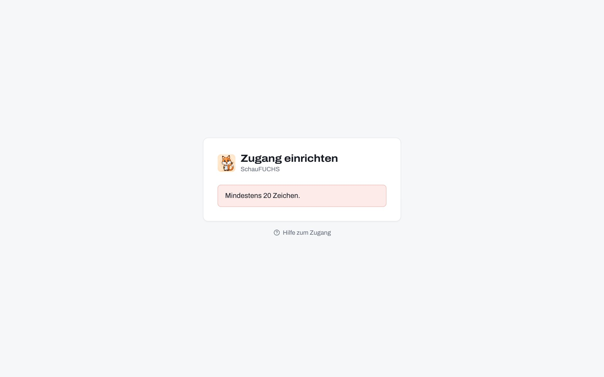

Die Ausstellungsleitung legt Ihren Zugang an. Danach bekommen Sie eine E-Mail mit dem Text „für Sie wurde ein Zugang zu SchauFUCHS … angelegt“. Darin stehen die Adresse zum Anmelden, Ihre E-Mail-Adresse, Ihre Rolle und ein persönlicher Link.

Der Link gilt **nur einmal** und **7 Tage lang**. Das genaue Ablaufdatum steht in der Mail.

So richten Sie Ihren Zugang ein:

1. Öffnen Sie den Link aus der Mail.
2. Es erscheint die Seite „Zugang einrichten“ mit der Begrüßung „Guten Tag …, bitte legen Sie Ihr Passwort fest.“
3. Tippen Sie ein Passwort in das Feld „Neues Passwort“. Es braucht mindestens 10 Zeichen.
4. Tippen Sie es noch einmal in das Feld „Passwort wiederholen“.
5. Klicken Sie auf „Passwort festlegen und anmelden“.
6. Sie sind jetzt angemeldet und sehen die Liste „Schauen“.

Mögliche Meldungen:

- „Die beiden Passwörter stimmen nicht überein.“ – Tippen Sie beide Felder noch einmal.
- „Dieser Einladungslink ist ungültig oder abgelaufen. Bitte die Ausstellungsleitung um eine neue Einladung.“ – Der Link ist älter als 7 Tage oder wurde schon benutzt. Die Ausstellungsleitung schickt Ihnen eine neue Einladung.
- „Dieser Link ist unvollständig. Bitte den Link aus der Einladungsmail vollständig öffnen.“ – Manche Mailprogramme schneiden lange Links ab. Kopieren Sie den ganzen Link in die Adresszeile des Browsers.
- „Gerade ist … angemeldet – danach wechselt die Anmeldung zu ….“ – In diesem Browser ist noch jemand anders angemeldet, z. B. an einem gemeinsamen Rechner. Mit „Passwort festlegen und anmelden“ endet diese Anmeldung, und Sie sind mit Ihrem Zugang angemeldet.

Unter der Karte führt der Link „Hilfe zum Zugang“ zu diesem Abschnitt.

> **Tipp:** Steht in Ihrer Mail statt eines Links „Ihr Passwort erhalten Sie von … persönlich“, hat die Ausstellungsleitung das Passwort selbst vergeben. Melden Sie sich damit an und ändern Sie es gleich unter „Mein Zugang“ (siehe unten).

### Anmelden

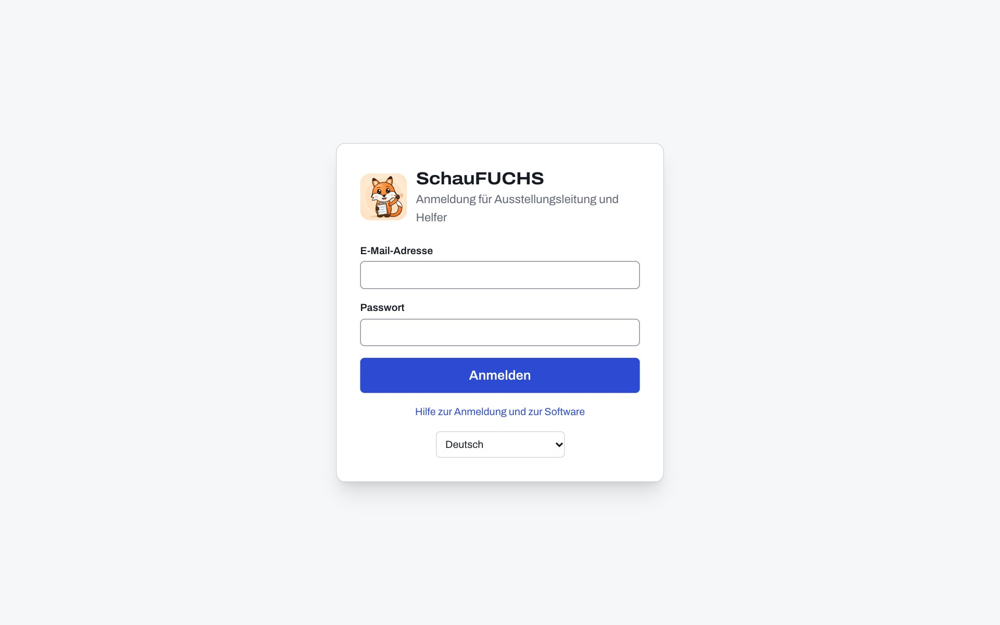

1. Öffnen Sie im Browser **https://schau.ihr-verein.de/anmelden**.
2. Auf der Seite „Anmeldung für Ausstellungsleitung und Helfer“ tragen Sie Ihre „E-Mail-Adresse“ und Ihr „Passwort“ ein.
3. Klicken Sie auf „Anmelden“.
5. Nur wenn Sie die Zwei-Faktor-Anmeldung eingerichtet haben: Es erscheint „Bestätigungscode“. Tippen Sie den 6-stelligen Code aus Ihrer Authenticator-App in das Feld „Code“ und klicken Sie auf „Anmelden“. Ohne Telefon geht auch einer Ihrer Notfallcodes. Mit „Zurück zur Anmeldung“ beginnen Sie von vorn.

Sie bleiben auf diesem Gerät bis zu 14 Tage angemeldet. Danach fragt die Software wieder nach E-Mail und Passwort.

> **Tipp:** Unter dem Knopf „Anmelden“ führt der Link „Hilfe zur Anmeldung und zur Software“ zu diesem Handbuch – auch ohne Anmeldung.

> **Wichtig:** An gemeinsam genutzten Rechnern (Meldestelle, Kasse) klicken Sie am Ende Ihres Dienstes unten in der Seitenleiste auf Ihren Namen und dann auf „Abmelden“. Sonst arbeitet der Nächste unter Ihrem Namen, und das Protokoll ordnet seine Buchungen Ihnen zu. Nach längerer Zeit ohne Eingabe (Vorgabe 120 Minuten) meldet SchauFUCHS Sie zusätzlich selbst ab; in der letzten Minute steht unten „Automatische Abmeldung in … s“.

### Mein Zugang

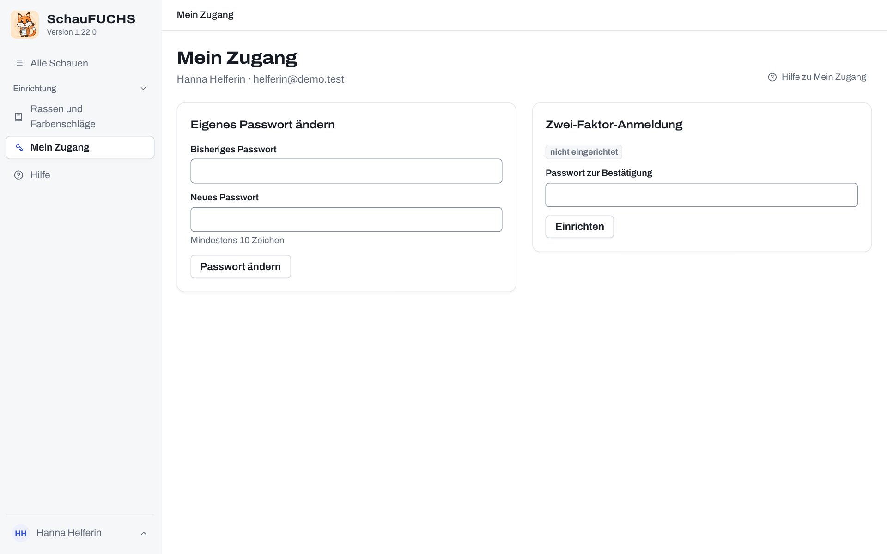

Links in der Seitenleiste finden Sie „Mein Zugang“. Dort stehen Ihr Name und Ihre E-Mail-Adresse, darunter zwei Bereiche.

**Eigenes Passwort ändern**

1. Tragen Sie Ihr „Bisheriges Passwort“ ein.
2. Tragen Sie unter „Neues Passwort“ das neue Passwort ein (mindestens 10 Zeichen).
3. Klicken Sie auf „Passwort ändern“. Es erscheint „Passwort geändert.“

Auf allen anderen Geräten werden Sie dabei abgemeldet. Das ist gewollt: So schließen Sie auch ein vergessenes Gerät aus.

**Zwei-Faktor-Anmeldung (freiwillig)**

Für Helfer ist die Zwei-Faktor-Anmeldung freiwillig. Sie schützt Ihr Konto, auch wenn jemand Ihr Passwort kennt: Bei der Anmeldung kommt ein Code aus einer App auf Ihrem Telefon dazu.

1. Installieren Sie auf Ihrem Telefon eine Authenticator-App, z. B. Google Authenticator, Microsoft Authenticator oder 2FAS.
2. Tragen Sie unter „Zwei-Faktor-Anmeldung“ Ihr Passwort in das Feld „Passwort zur Bestätigung“ ein und klicken Sie auf „Einrichten“.
3. Es erscheint ein QR-Code. Scannen Sie ihn mit der App. Ohne Kamera wählen Sie in der App „Schlüssel eingeben“ und tippen den angezeigten Schlüssel ab.
4. Die App zeigt einen 6-stelligen Code. Tippen Sie ihn in das Feld „2. Den angezeigten 6-stelligen Code eingeben“ und klicken Sie auf „Bestätigen“.
5. Es erscheint „Eingerichtet.“ und eine Liste mit **Notfallcodes**. Jeder Code gilt einmal und ersetzt das Telefon, falls es fehlt.
6. Drucken Sie die Notfallcodes aus oder schreiben Sie sie ab und bewahren Sie sie sicher auf. Sie werden nicht noch einmal angezeigt.
7. Klicken Sie auf „Habe ich gesichert“.

Danach steht dort „aktiv“ und wie viele Notfallcodes Sie noch übrig haben. Sie bekommen außerdem eine Hinweismail.

Abschalten: Klicken Sie auf „Abschalten …“, tragen Sie Ihr „Passwort“ und einen „Code aus der App oder Notfallcode“ ein und klicken Sie auf „Zwei-Faktor-Anmeldung abschalten“.

### Sprache der Oberfläche

SchauFUCHS gibt es auf Deutsch, Deutsch (Schweiz), Englisch, Französisch, Niederländisch, Polnisch und Tschechisch.

- Vor der Anmeldung: Auf der Anmeldeseite ganz unten die Sprache wählen. Dieser Browser merkt sich die Wahl.
- Angemeldet: unten in der Seitenleiste auf Ihren Namen klicken und unter „Sprache“ wählen. Die Sprache gehört zu Ihrem Zugang und gilt auf jedem Gerät.

Deutsch bleiben Rassen und Farbenschläge, Bewertungstexte, alle Drucke und PDFs, was der Verein selbst geschrieben hat, und dieses Handbuch.

> **Wichtig:** Telefon verloren und keine Notfallcodes mehr? Dann kann nur die Ausstellungsleitung die Zwei-Faktor-Anmeldung zurücksetzen. Danach melden Sie sich wieder nur mit dem Passwort an.

## 2. Überblick: Seitenleiste, Schau, Phasen

### Die Seitenleiste links

Die Seitenleiste links enthält (auf dem Handy und am Tablet hochkant öffnet sie der Knopf mit den drei Strichen oben links):

- ganz oben das Logo, darunter klein die Versionsnummer (z. B. „Version 1.22.0“),
- „Alle Schauen“ – die Liste aller Ausstellungen Ihres Vereins,
- unter „Einrichtung“: „Rassen und Farbenschläge“ – das Verzeichnis zum Nachschlagen (Einspielen und Ändern nur durch die Ausstellungsleitung) – und „Mein Zugang“ – Passwort und Zwei-Faktor-Anmeldung,
- „Hilfe“ – die Handbücher zum Nachlesen, in einem eigenen Tab: Reiter „Helfer“ für dieses Handbuch, „Drucken“ druckt das geöffnete Handbuch, „Als PDF“ öffnet die Druckfassung, die Leiste „Handbücher zum Ausdrucken“ lädt jedes Handbuch als PDF herunter; „Schließen“ schließt den Tab wieder,
- ganz unten Ihren Namen; ein Klick zeigt den Verein, Ihre Rolle mit der Versionsnummer („SchauFUCHS 1.22.0“), die Darstellung („System“, „Hell“, „Dunkel“) und den Knopf „Abmelden“.

In einer Schau steht oben in der Leiste die Schau mit Ort und Phase, darunter ihre Seiten, gruppiert nach dem Ablauf: „Vorbereitung“, „Meldephase“, „Nach dem Meldeschluss“, „Schautage“ und „Kasse und Abrechnung“. Das Protokoll steht in den Einstellungen der Schau.

Ein Klick auf die Überschrift einer Gruppe klappt sie zu oder auf; das merkt sich SchauFUCHS in diesem Browser. Ohne eigene Wahl ist die Gruppe der aktuellen Phase offen. Öffnen Sie eine Seite in einer zugeklappten Gruppe, klappt sie auf.

### Rückfragen

Fragt die Software vor einem Schritt nach, öffnet sich ein eigenes Fenster in der Seite. Oben steht, worum es geht, unten „Abbrechen“ und ein Knopf, der die Aktion nennt, z. B. „Buchen“ oder „Ausgeben“. Verlangt die Rückfrage einen Grund, lässt sich der Knopf erst drücken, wenn mindestens 3 Zeichen eingetragen sind. Gründe stehen im Protokoll – bitte ohne Personennamen.

### Eine Schau auswählen

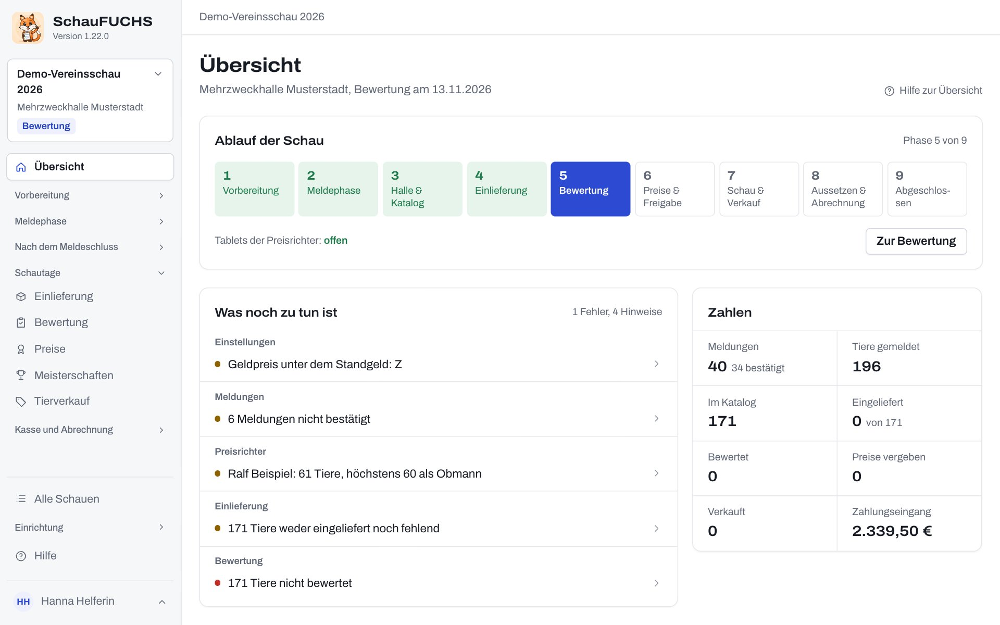

1. Klicken Sie auf „Schauen“.
2. Klicken Sie auf die gewünschte Schau. In der Zeile stehen Name, Ort, Meldeschluss und die aktuelle Phase.
3. Links (auf schmalen Bildschirmen oben, zum Wischen) erscheinen die Bereiche der Schau. Unter dem Namen der Schau steht die aktuelle Phase.

Die Bereiche und was Sie als Helfer dort tun:

| Bereich | Was Sie dort tun |
|---|---|
| „Übersicht“ | Phase ansehen, „Was noch zu tun ist“, „Zahlen“, Knopf zur Arbeit der Phase |
| „Einstellungen“ | nur ansehen („Nur Administratoren können die Einstellungen ändern.“) |
| „Meldungen“ | Papiermeldungen erfassen, Meldungen bearbeiten, Meldegeld bar kassieren |
| „Katalognummern“ | ansehen und drucken; vergeben nur die Ausstellungsleitung |
| „Käfige“ | Käfigbedarf je Käfigmaß mit den Käfignummern ansehen und für den Aufbau drucken |
| „Hallenplan“ | Plan der Halle mit Reihen, Käfignummern und Preisrichtern sowie die Aufbauliste je Reihe ansehen und drucken; „Vollansicht“ füllt den Bildschirm, ein Klick auf einen Käfig zeigt Tier, Züchter und Preisrichter |
| „Preisrichter“ | ansehen |
| „Einlieferung“ | Meldegeld bar kassieren, Tiere abhaken, Nachweise prüfen, Gesundheitsjournal, Tierausgabe |
| „Bewertung“ | nur ansehen – Noten vergeben die Preisrichter und die Ausstellungsleitung |
| „Preise“ | nur ansehen – Preise vergeben die Preisrichter und die Ausstellungsleitung |
| „Katalog“ | nur ansehen („Nur Administratoren können den Katalog gestalten.“) |
| „Tierverkauf“ | Tiere gegen Bargeld verkaufen |
| „Abrechnung“ | Aussteller bar abrechnen |
| „Kassenbuch“ | Wechselgeld buchen, Tagesabschluss |
| „Protokoll“ (in den Einstellungen, Reiter „Protokoll“) | nachlesen, wer wann was geändert hat |

> **Tipp:** Auf der „Übersicht“ führt ein Knopf direkt zur Arbeit der aktuellen Phase, z. B. „Zu den Meldungen“ oder „Zum Tierverkauf“.

### Die Phasen der Schau

Jede Schau läuft durch neun Phasen. Die Phase stellt **nur die Ausstellungsleitung** um. Sie sehen sie auf der „Übersicht“ unter „Ablauf der Schau“; die aktuelle Phase ist farbig hervorgehoben. Von der Phase hängt ab, was die Software erlaubt.

| Nr. | Phase | Was Sie als Helfer typischerweise tun |
|---|---|---|
| 1 | „Vorbereitung“ | nichts – die Ausstellungsleitung legt Termine, Standgeld und Preise fest |
| 2 | „Meldephase“ | Papiermeldungen erfassen, Meldegeld bar annehmen; das Online-Formular ist offen |
| 3 | „Halle & Katalog“ | Nachmeldungen nach Absprache erfassen; die Ausstellungsleitung vergibt die Katalognummern |
| 4 | „Einlieferung“ | Meldegeld bar kassieren, Tiere abhaken, Impfnachweise prüfen, Ringnummern eintragen |
| 5 | „Bewertung“ | Fragen der Preisrichter weitergeben; Noten vergeben Sie nicht |
| 6 | „Preise & Freigabe“ | **Tierverkauf beginnt** |
| 7 | „Schau & Verkauf“ | Tierverkauf; **Barauszahlung an Aussteller beginnt** |
| 8 | „Aussetzen & Abrechnung“ | Tiere ausgeben, Aussteller bar abrechnen |
| 9 | „Abgeschlossen“ | nur noch lesen |

Den Wechsel in die nächste Phase halten rote Punkte unter „Was noch zu tun ist“ auf. Sehen Sie dort einen roten Punkt aus Ihrem Bereich (z. B. „… eingelieferte Tiere ohne Ringnummer …“), erledigen Sie ihn oder sagen Sie der Ausstellungsleitung Bescheid.

Merken Sie sich drei Regeln:

- **Tierverkauf** geht nur in den Phasen „Preise & Freigabe“ und „Schau & Verkauf“.
- **Auszahlen** an Aussteller geht nur in den Phasen „Schau & Verkauf“ und „Aussetzen & Abrechnung“.
- In der Phase „Abgeschlossen“ bucht und ändert niemand mehr etwas – weder Meldungen und Zahlungen noch Einlieferung, Nachweise oder Kasse. Es erscheint „Die Schau ist abgeschlossen – für Korrekturen erst mit Grund zurück zur Abrechnung.“

Die Tablets der Preisrichter sind in den Phasen „Einlieferung“, „Bewertung“ und „Preise & Freigabe“ offen, bis die Ausstellungsleitung die Ergebnisse freigibt.

## 3. Meldungen erfassen (Papiermeldung)

Online-Meldungen erscheinen von selbst in der Liste. Meldebögen, die per Post, E-Mail oder persönlich kommen, übertragen Sie von Hand.

### Die Meldungsliste

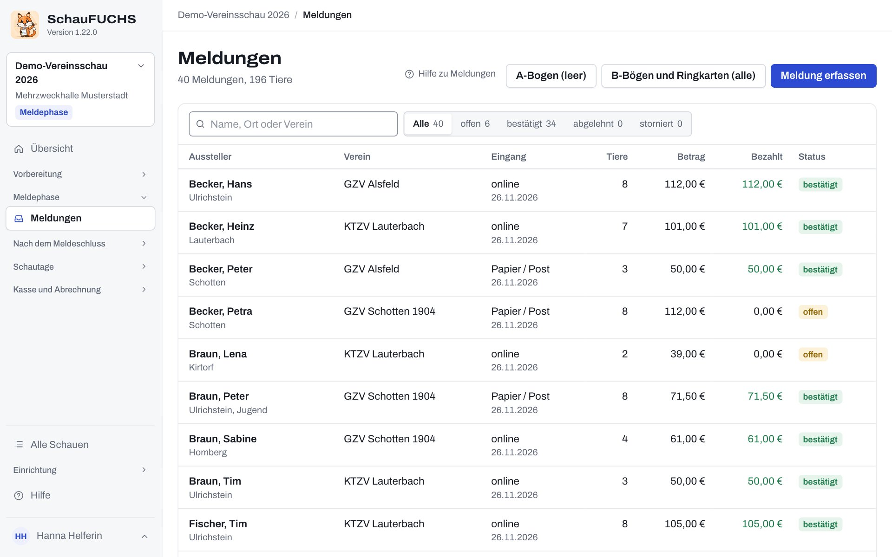

Klicken Sie links auf „Meldungen“. Sie sehen alle Meldungen mit Aussteller, Verein, Eingang, Anzahl der Tiere, Betrag, bezahltem Betrag und Status („offen“, „bestätigt“, „abgelehnt“, „storniert“).

- Im Suchfeld „Name, Ort oder Verein …“ finden Sie einen Aussteller schnell.
- Mit „Alle Status“ filtern Sie z. B. nur offene Meldungen.
- „(Selbstauskunft – prüfen)“ heißt: Jugend oder Preisrichter-Befreiung hat der Aussteller online selbst angegeben.
- „ohne Registriernummer“ heißt: Die Registriernummer fehlt noch.

### Eine neue Meldung erfassen

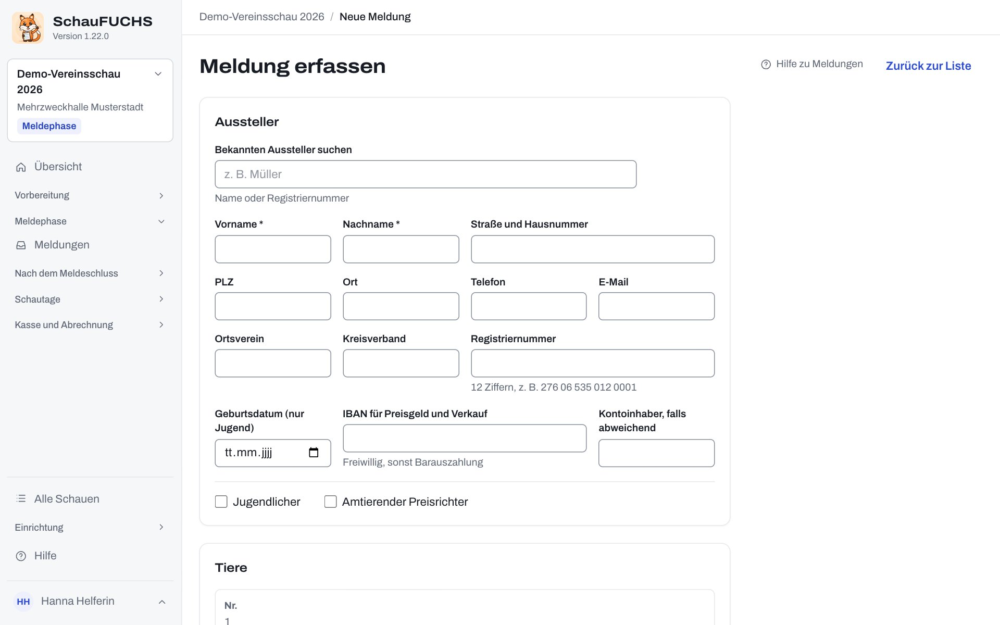

1. Klicken Sie auf „Meldung erfassen“. Es erscheint „Übertragen Sie den Meldebogen Zeile für Zeile.“
2. **Aussteller suchen:** Tippen Sie im Feld „Bekannten Aussteller suchen“ mindestens zwei Buchstaben des Namens oder die Registriernummer. Klicken Sie auf den richtigen Treffer. Es erscheint „Bekannter Aussteller ausgewählt. Änderungen an der Anschrift werden übernommen.“ War es der Falsche, klicken Sie auf „Doch neu anlegen“.
3. **Neuer Aussteller:** Gibt es keinen Treffer, füllen Sie die Felder aus: „Vorname“ und „Nachname“ (Pflicht), „Straße und Hausnummer“, „PLZ“, „Ort“, „Telefon“, „E-Mail“, „Ortsverein“, „Kreisverband“ und „Registriernummer“ (12 Ziffern, z. B. 276 06 535 012 0001). Beim Tippen schlägt die Software Orte, Straßen, Vereine und Kreisverbände aus den bisherigen Ausstellern Ihres Vereins vor, Vereine außerdem aus dem Vereinsverzeichnis (Rassegeflügelzuchtvereine in Deutschland, nur Namen). Ist der Ort zur PLZ eindeutig bekannt, steht er gleich im Feld „Ort“; den Kreisverband zum Verein trägt die Software ein, sobald Sie das Feld „Ortsverein“ verlassen. Das geschieht nur, solange das Feld noch leer ist, und alles lässt sich überschreiben.
4. **Bankdaten:** Das Feld „IBAN für Preisgeld und Verkauf“ ist freiwillig. Ohne IBAN wird bar an der Kasse ausgezahlt. Weicht der Kontoinhaber ab, tragen Sie ihn unter „Kontoinhaber, falls abweichend“ ein.
5. **Jugend und Preisrichter:** Setzen Sie bei Bedarf den Haken „Jugendlicher“ oder „Amtierender Preisrichter“ (siehe unten).
6. **Tiere:** Tragen Sie die Tiere ein (siehe nächster Abschnitt).
7. **Eingang:** Wählen Sie unter „Eingegangen per“ „Papier / Post“ oder „E-Mail“. Unter „Bemerkung“ ist Platz für Notizen.
8. Setzen Sie den Haken „Meldebogen ist unterschrieben (AAB und Sonderbestimmungen anerkannt)“, wenn die Unterschrift vorhanden ist. Ohne Unterschrift steht der Aussteller ohne Namen im Katalog.
9. Falls angezeigt: Setzen Sie „Pflichterklärungen zur Herkunft abgegeben“, wenn der Aussteller sie auf dem Bogen abgegeben hat.
10. Setzen Sie „Veröffentlichung im Internet erlaubt“ **nur**, wenn der Aussteller das ausdrücklich angekreuzt oder geschrieben hat. Bei Jugendlichen braucht das zusätzlich den Namen eines Erziehungsberechtigten (siehe unten).
11. Setzen Sie „Widerspruch: im Katalog ohne Namen“ nur, wenn der Aussteller der Nennung im Katalog widersprochen hat. Seine Tiere stehen dann im gedruckten und im Online-Katalog ohne Name, Wohnort und Verein.
12. Klicken Sie auf „Meldung speichern“. Es erscheint „Meldung gespeichert. Betrag: …“.

Nach dem Speichern zeigt die Seite rechts zusätzlich „Status“, „Meldegeld“ und „Für den Aussteller“.

> **Tipp:** Möchten Sie die Seite mit ungespeicherten Eingaben verlassen, fragt die Software: „Ihre Eingaben sind noch nicht gespeichert. Seite trotzdem verlassen?“ Klicken Sie auf „Abbrechen“, wenn Sie noch speichern wollen.

Hat der Aussteller eine Registriernummer aus dem Ausland und die Schau nimmt keine ausländischen Aussteller an, speichert die Software nicht („Diese Schau nimmt keine Tiere aus dem Ausland an …“). Sagen Sie der Ausstellungsleitung Bescheid.

### Tiere eingeben

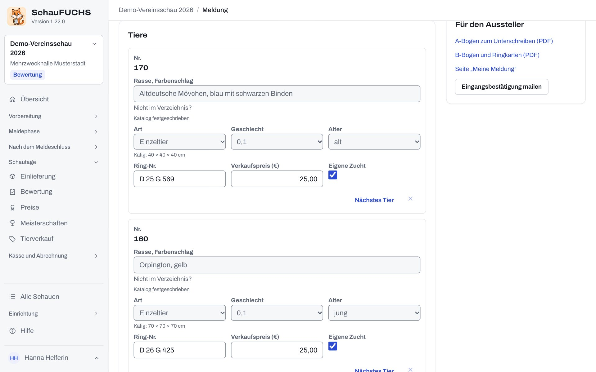

Die Tiere stehen in einer Tabelle mit den Spalten „Rasse, Farbenschlag“, „Art“, „Geschlecht“, „Alter“, „Ring-Nr.“, „Verkauf (€)“ und „E. Z.“ (eigene Zucht). Übertragen Sie den Meldebogen in derselben Reihenfolge.

1. **Rasse und Farbenschlag:** Tippen Sie in das Feld „Rasse und Farbe tippen, z. B. „wyan weiß““ mindestens zwei Buchstaben. Es öffnet sich eine Liste. Wählen Sie den Eintrag mit der Maus oder mit den Pfeiltasten und Enter.
2. **Art:** „Einzeltier“, „Stamm“, „Voliere“ oder „Bruteier (Satz)“.
3. **Geschlecht:** Bei Einzeltieren wählen Sie „1,0“ (männlich) oder „0,1“ (weiblich). Bei Stamm und Voliere tippen Sie die Besetzung, z. B. „1,2“. Passt sie nicht zur Vorschrift, erscheint z. B. „Vorgeschrieben ist 1,2. Falsch besetzte Stämme und Volieren bleiben ohne Bewertungsnote (o.B.).“ Prüfen Sie dann den Meldebogen. Unter „Art“ zeigt jede Zeile, sobald die Rasse gewählt ist, das Maß des Käfigs an (z. B. „Käfig: 70 × 70 × 70 cm“, „Käfig: Voliere“).
4. **Alter:** „jung“ oder „alt“.
5. **Ring-Nr.:** freiwillig. Sie kann auch bei der Einlieferung eingetragen werden. Bei Stamm und Voliere mehrere Ringnummern mit Komma trennen.
6. **Verkauf (€):** Nur ausfüllen, wenn das Tier verkäuflich ist, z. B. „25“ oder „25,50“. Leer heißt: nicht zu verkaufen.
7. **E. Z.:** Der Haken für eigene Zucht ist vorbelegt. Entfernen Sie ihn, wenn der Aussteller das Tier nicht selbst gezogen hat.

Weitere Knöpfe:

- „Nächstes Tier“ übernimmt Rasse und Farbe und geht im Meldebogen weiter: 1,0 jung → 1,0 alt → 0,1 jung → 0,1 alt. Das spart viel Tipparbeit.
- „Tier hinzufügen“ hängt eine leere Zeile an.
- „✕“ entfernt eine Zeile. Bei Tieren, die schon bewertet oder in der Halle sind, ist der Knopf gesperrt.

**Nach dem Festschreiben der Katalognummern** bleiben nummerierte Tiere so, wie sie sind: Rasse, Farbenschlag, Art, Geschlecht und Alter lassen sich nicht mehr ändern, und die Zeile lässt sich nicht entfernen. Unter dem Tier steht „Katalog festgeschrieben – Tier bleibt so. Falsches Tier: bei der Einlieferung „fehlt“ und richtig nachmelden.“ Neue Tiere können Sie weiter hinzufügen; sie bekommen später eine Unternummer.

**Rasse oder Farbenschlag nicht im Verzeichnis (AOC, Neuzüchtung, neuer Farbenschlag):**

Findet die Suche nichts, steht am Ende der Liste „„…“ als freie Angabe übernehmen“ – ein Klick (oder Pfeiltaste und Eingabetaste) übernimmt den getippten Text, weiter mit Schritt 3. Sonst:

1. Klicken Sie unter dem Feld auf „Nicht im Verzeichnis?“.
2. Tragen Sie die Bezeichnung frei ein („Rasse, Farbenschlag (frei)“).
3. Wählen Sie im Feld „Im Katalog einordnen bei Rasse …“ die Rasse, bei der das Tier im Katalog stehen soll.
4. Setzen Sie den Haken „AOC“ oder „Neuzüchtung“.
5. Mit „Aus dem Verzeichnis wählen“ kommen Sie zurück zur normalen Suche.

Kommt ein Farbenschlag öfter vor, nimmt ihn die Ausstellungsleitung dauerhaft ins Verzeichnis auf („Rassen und Farbenschläge“ → „Ergänzen“); danach findet ihn die Suche.

Vor dem Speichern prüft die Software jede Zeile. Fehler stehen rot unter dem Formular, z. B. „Zeile 3: Rasse und Farbenschlag auswählen.“, „Zeile 2: Geschlecht als 1,0 / 0,1 / 1,2.“ oder „Zeile 4: Ringnummer … steht schon in Zeile 1.“

Hat inzwischen jemand anders dieselbe Meldung gespeichert (z. B. an einem zweiten Tisch), speichert das Formular nicht: „Die Meldung wurde inzwischen geändert – bitte neu laden …“. Ihre Eingaben bleiben stehen. Merken Sie sich, was Sie ändern wollten, klicken Sie auf „Neu laden“ und tragen Sie die Änderung noch einmal ein.

> **Wichtig:** Erscheint „Für diese Schau ist noch kein Verzeichnis der Rassen und Farbenschläge gewählt (Einstellungen).“, können Sie keine Tiere auswählen. Sagen Sie der Ausstellungsleitung Bescheid.

### Jugendliche Aussteller

1. Setzen Sie den Haken „Jugendlicher“ (Jugendtarif; im Katalog je nach Einstellung der Schau eigener Jugendblock oder bei der Rasse).
2. Tragen Sie das „Geburtsdatum (nur Jugend)“ ein.
3. Tragen Sie unter „Erziehungsberechtigter“ ein, wer auf dem Meldebogen unterschrieben hat.

Soll ein Jugendlicher im Internet veröffentlicht werden („Veröffentlichung im Internet erlaubt“), braucht das den Namen des Erziehungsberechtigten. Fehlt er, erscheint „Jugendmeldung: Die Veröffentlichung im Internet braucht das Einverständnis eines Erziehungsberechtigten – bitte dessen Namen eintragen.“

Ist der Aussteller am Bewertungstag 18 Jahre oder älter, erscheint „Laut Geburtsdatum am Bewertungstag nicht mehr jugendlich (unter 18 Jahre) – bitte ohne Jugend erfassen.“ Entfernen Sie dann den Haken „Jugendlicher“.

### Meldegeld bar kassieren

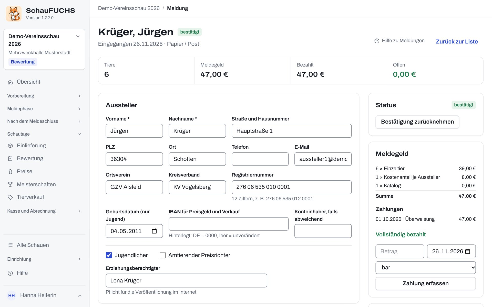

Rechts im Bereich „Meldegeld“ sehen Sie die Gebühren, die „Summe“, alle bisherigen „Zahlungen“ und darunter „Offen: …“ oder „Vollständig bezahlt“.

1. Nehmen Sie das Bargeld entgegen.
2. Prüfen Sie den vorgeschlagenen Betrag (das ist der offene Betrag) und das Datum.
3. Als Zahlart steht „bar“.
4. Klicken Sie auf „Zahlung erfassen“.
5. Es erscheint „Zahlung erfasst.“ oder, wenn jetzt alles bezahlt ist, „Zahlung erfasst – Meldung ist jetzt bestätigt.“

Bares Meldegeld steht automatisch im Kassenbuch. Die Einzahlungsquittung liegt im Belegarchiv.

> **Wichtig:** Als Helfer buchen Sie nur **Bargeld**, und höchstens den offenen Betrag. Will ein Aussteller mehr zahlen, erscheint „Offen sind … – mehr bucht nur die Ausstellungsleitung (Überzahlung).“ Überweisungen nach dem Kontoauszug, „sonstige“ Eingänge und Erstattungen (Geld zurück an den Aussteller) bucht die Ausstellungsleitung. Haben Sie sich vertippt, kann nur die Ausstellungsleitung eine Zahlung stornieren. Buchen Sie keine Gegenbuchung selbst, sondern sagen Sie der Ausstellungsleitung Bescheid.

### Status einer Meldung

Bei einer offenen Meldung steht unter „Status“ der Knopf „Bestätigen“. Sie dürfen Meldungen **auch ohne Zahlung** bestätigen – bezahlt wird oft erst bei der Einlieferung. Bezahlte Meldungen werden von selbst bestätigt. Nur bestätigte Meldungen bekommen Katalognummern.

Aus Versehen bestätigt? Klicken Sie unter „Status“ auf „Bestätigung zurücknehmen“ und bestätigen Sie die Rückfrage mit „Zurücknehmen“ – die Meldung steht dann wieder auf „offen“ (steht im Protokoll). Das geht, solange noch keine Zahlung gebucht, kein Tier der Meldung eingeliefert, bewertet, prämiert oder verkauft und der Aussteller nicht abgerechnet ist; sonst erscheint „Die Meldung kann nicht mehr zurückgesetzt werden: …“ mit dem Grund.

**Ablehnen und Stornieren** macht nur die Ausstellungsleitung; als Helfer sehen Sie diese Knöpfe nicht. Ebenso nimmt nur sie eine abgelehnte oder stornierte Meldung wieder auf.

Steht an einer stornierten oder abgelehnten Meldung der gelbe Hinweis „Für diese … Meldung sind … eingegangen …“, ist schon Geld da. Ob es erstattet wird oder als Verfall beim Verein bleibt, entscheidet die Ausstellungsleitung. Zahlen Sie nichts bar zurück.

> **Wichtig:** Soll eine Meldung abgelehnt oder storniert werden, geben Sie der Ausstellungsleitung Bescheid. Sind Tiere der Meldung schon eingeliefert, bewertet, prämiert, verkauft oder im Gesundheitsjournal eingetragen oder ist der Aussteller schon abgerechnet, lehnt die Software ab: „Die Meldung kann nicht mehr storniert werden: …“.

### Für den Aussteller

- „B-Bogen und Ringkarten (PDF)“ – zum Ausdrucken für diesen Aussteller. Alle auf einmal gibt es in der Liste unter „B-Bögen und Ringkarten (alle)“.
- „Seite „Meine Meldung““ – die Seite, die auch der Aussteller sieht.
- „Eingangsbestätigung mailen“ – schickt die Bestätigung an die hinterlegte E-Mail-Adresse. Ohne E-Mail-Adresse ist der Knopf grau.

### Was nur die Ausstellungsleitung darf

- **Eine vorhandene IBAN oder den Kontoinhaber ändern.** Sie sehen die IBAN nur gekürzt, mit dem Hinweis „Hinterlegt: … Leer lassen = unverändert; ändern kann sie nur die Ausstellungsleitung.“ Lassen Sie das Feld leer. Versuchen Sie es trotzdem, erscheint „Eine vorhandene IBAN oder den Kontoinhaber ändert nur die Ausstellungsleitung (Administratoren).“ Ab der Phase „Schau & Verkauf“ trägt auch eine **erste** IBAN nur die Ausstellungsleitung ein.
- Überweisungen, sonstige Eingänge und Erstattungen buchen, Zahlungen stornieren.
- Meldungen ablehnen, stornieren oder wieder aufnehmen.
- Den Verkaufspreis eines schon bewerteten Tiers ändern.
- Ab der Phase „Aussetzen & Abrechnung“ oder wenn der Aussteller schon abgerechnet ist: Tiere, Jugend und Preisrichter-Befreiung ändern.
- Eine Ehrenpreis-Stiftung an einer bestehenden Meldung ändern.

Den Aussteller einer gespeicherten Meldung kann niemand wechseln. Ist die Meldung dem falschen Aussteller zugeordnet, muss sie storniert und neu erfasst werden – sprechen Sie mit der Ausstellungsleitung.

## 4. Einlieferung, Gesundheit und Tierausgabe

Klicken Sie links auf „Einlieferung“. Unter dem Seitenkopf wählen Sie den Arbeitsmodus: „Einlieferung“, „Tierausgabe“ oder „Gesundheit“.

Ganz oben finden Sie „Aussteller- und Tierliste für das Veterinäramt (PDF)“ und „als Tabelle (CSV)“. Die Seite weist darauf hin, sie drei Jahre aufzubewahren.

### Tiere annehmen

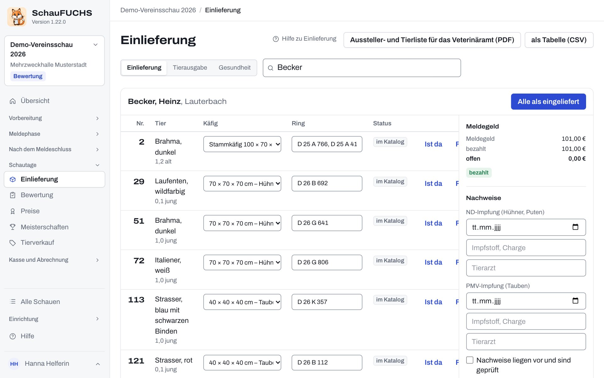

1. Wählen Sie den Modus „Einlieferung“.
2. Tippen Sie in das Suchfeld „Name des Ausstellers oder Katalognummer …“ den Nachnamen oder eine Katalognummer von der Ringkarte.
3. Es erscheint eine Karte mit dem Namen des Ausstellers und allen seinen Tieren.
4. **Meldegeld kassieren** (rechts im Kasten „Meldegeld“): Dort stehen Meldegeld, eine zugesagte Stiftung, was schon bezahlt ist, und der offene Betrag. Nehmen Sie das Geld entgegen und klicken Sie auf „… € bar kassiert“. Nach der Rückfrage „Bar kassieren“ („… von … bar erhalten?“, Knopf „Bar erhalten“) ist die Zahlung im Kassenbuch gebucht und die Einzahlungsquittung im Belegarchiv. Ist alles bezahlt, steht dort „bezahlt“. Hat inzwischen jemand anders (z. B. am zweiten Tisch) schon kassiert, erscheint „Das Meldegeld wurde inzwischen schon kassiert …“ – dann nichts annehmen und die Anzeige neu laden.
5. **Nachweise prüfen** (rechts im Kasten „Nachweise“). Je nach Tierart verlangt die Software:
   - „ND-Impfung (Hühner, Puten)“: Impfdatum, „Impfstoff, Charge“, „Tierarzt“,
   - „PMV-Impfung (Tauben)“: Impfdatum, „Impfstoff, Charge“, „Tierarzt“,
   - „Untersuchung Wassergeflügel (Enten, Gänse)“: Datum, „Labor bzw. Behörde“ oder der Haken „Sentinel-Bestätigung (statt Untersuchung)“,
   - „Klinische Untersuchung (tierärztliche Bescheinigung)“: Datum und Tierarzt – nur wenn die Ausstellungsleitung das so eingestellt hat; die Bescheinigung darf nur wenige Tage alt sein,
   - „Gesundheitszertifikat / TRACES (Herkunft im Ausland)“: Datum und Zertifikat- bzw. TRACES-Nummer – bei Ausstellern aus einem anderen Land der EU. Deren Tauben brauchen außerdem eine ND-Impfung.

   Die Angaben werden beim Verlassen jedes Feldes gespeichert. Steht „Für diese Tierarten ist kein Nachweis vorgeschrieben.“, entfällt dieser Schritt. Liegt ein Impfdatum außerhalb der Frist, die die Ausstellungsleitung nach dem Merkblatt des Veterinäramts eingestellt hat, nennt die Software das, z. B. „… nur 14 Tage vor der Schau – mindestens 21 Tage verlangt.“
6. Setzen Sie den Haken „Nachweise liegen vor und sind geprüft“. Fehlt etwas oder ist ein Nachweis zu alt, erscheint „Nachweis nicht vollständig: …“ mit dem Grund.
7. **Käfig:** In der Spalte „Käfig“ steht bei jedem Tier sein Käfig mit Maß, z. B. „50 × 50 × 50 cm – Zwerghühner, Zwergenten (automatisch)“. Die Käfignummer ist die Katalognummer. Ist kein passender Käfig mehr frei, wählen Sie in dieser Liste einen anderen, z. B. für ein Zwerghuhn den letzten freien Großkäfig. Die Wahl wird gleich gespeichert, steht im Protokoll und zählt im Käfigbedarf mit; „(automatisch)“ stellt es zurück. Die Katalognummer bleibt dieselbe – sie kommt an den gewählten Käfig.
8. **Ringnummern:** Tragen Sie bei jedem Tier die Nummer von der Ringkarte in das Feld „Ring-Nr. von der Ringkarte“ ein. Sie wird beim Verlassen des Feldes gespeichert. Die Ringnummer ist Pflicht: Ein eingeliefertes Tier ohne Ringnummer ist ein roter Punkt in der Prüfliste und steht in der Tierliste für das Veterinäramt mit „fehlt“.
9. **Tiere abhaken:** Klicken Sie bei jedem Tier auf „Ist da“ oder, wenn alle da sind, oben auf „Alle als eingeliefert“. Fehlt ein Tier, klicken Sie auf „Fehlt“.

Der Status steht neben jedem Tier: „im Katalog“, „eingeliefert“, „fehlt“ oder „ausgegeben“.

> **Wichtig:** Ohne geprüften Nachweis meldet die Software „Nachweis nicht geprüft: … Erst den Nachweis prüfen oder mit Grund ohne Nachweis einliefern.“ und fragt „Trotzdem fortfahren?“ mit dem Feld „Grund (bitte ohne Personennamen)“. Geben Sie hier nur dann einen Grund ein und klicken auf „Fortfahren“, wenn die Ausstellungsleitung oder der Tierarzt das ausdrücklich erlaubt. Sonst klicken Sie auf „Abbrechen“ und nehmen die Tiere nicht an.

> **Tipp:** Erscheint bei der Suche „Nichts gefunden“ mit dem Hinweis „Nur bestätigte Meldungen mit Katalognummer erscheinen hier.“, ist die Meldung noch nicht bestätigt oder hat noch keine Katalognummer. Holen Sie die Ausstellungsleitung.

Weitere Grenzen:

- Ein Tier, das schon bewertet, prämiert oder verkauft ist, kann nicht mehr auf „Fehlt“ gesetzt werden. Die Meldung beginnt mit „Geht nicht: …“.
- Nach der Freigabe der Ergebnisse, nach einem Verkauf oder nach dem Abschluss ändert nur die Ausstellungsleitung die Ringnummer. Sie sehen dann „Nach Freigabe, Verkauf oder Abschluss ändert nur die Ausstellungsleitung die Ringnummer (mit Grund).“
- Falsches Tier gebracht (anderes Geschlecht, anderer Farbenschlag)? Nach dem Festschreiben bleibt das gemeldete Tier im Katalog. Markieren Sie es als „Fehlt“; das richtige Tier meldet die Meldestelle nach (Unternummer).

### Gesundheitsjournal

Im Modus „Gesundheit“ halten Sie Krankheit, Verdacht und Todesfälle fest.

1. Tragen Sie unter „Neuer Eintrag“ die „Katalognummer“ ein (leer lassen für Beobachtungen ohne einzelnes Tier).
2. Beschreiben Sie den „Befund *“, z. B. „Niesen, Durchfall, matt“.
3. Tragen Sie die „Maßnahme“ und gegebenenfalls den „Tierarzt“ ein.
4. Setzen Sie bei Bedarf „Tier ist verendet“.
5. Der Haken „Für Verkauf und Preise sperren“ ist vorbelegt. Ein gesperrtes Tier wird weder verkauft noch prämiert.
6. Klicken Sie auf „Eintragen“. Es erscheint „Eintrag gespeichert.“

> **Wichtig:** Seuchenverdacht sofort der Ausstellungsleitung melden – sie informiert das Veterinäramt. Eine Sperre aufheben kann nur die Ausstellungsleitung.

### Tierausgabe am Ende der Schau

1. Wählen Sie den Modus „Tierausgabe“.
2. Suchen Sie den Aussteller wie bei der Einlieferung.
3. Sammeln Sie die zweite Ringkarte ein.
4. Klicken Sie auf „Alle nicht verkauften ausgeben“ oder bei einzelnen Tieren auf „Ausgeben“.
5. Mit „Zurücknehmen“ machen Sie eine versehentliche Ausgabe rückgängig.

**Verkaufte Tiere** gibt es nur gegen den Kaufbeleg. In der Zeile steht „verkauft (Beleg …) an … – nur gegen Kaufbeleg“.

1. Lassen Sie sich den Kaufbeleg zeigen.
2. Klicken Sie beim Tier auf „Ausgeben“.
3. Es öffnet sich „Verkauftes Tier ausgeben“ („Nr. … ist verkauft.“). Tippen Sie in das Feld „Nummer des Kaufbelegs, den der Käufer vorlegt“ nur die Belegnummer (Ziffern) ein und klicken Sie auf „Ausgeben“.
4. Passt die Nummer nicht, erscheint „Der Kaufbeleg … gehört nicht zu Nr. …“. Geben Sie das Tier dann nicht heraus.

Ein **per Überweisung** verkauftes Tier darf erst hinaus, wenn die Ausstellungsleitung den Zahlungseingang gebucht hat. Vorher erscheint „Nr. … ist per Überweisung verkauft – der Zahlungseingang ist noch nicht gebucht … Ausgabe vorher nur durch die Ausstellungsleitung mit Grund.“ Holen Sie dann die Ausstellungsleitung.

Gesperrte Tiere (Gesundheitsjournal) sind mit „gesperrt (Gesundheitsjournal) – Ausgabe nur mit Grund“ markiert. Die Software verlangt dafür einen Grund. Geben Sie solche Tiere nur auf Anweisung der Ausstellungsleitung oder des Tierarztes heraus.

## 5. Tierverkauf

Klicken Sie links auf „Tierverkauf“.

Verkauft wird nur:

- in den Phasen „Preise & Freigabe“ und „Schau & Verkauf“ (sonst steht oben „Verkauf ist nur in den Phasen „Preise“ und „Schau“ möglich – zurzeit nicht.“ – die Seite nennt die Phasen verkürzt),
- ein Tier, das verkäuflich gemeldet, eingeliefert und bewertet ist und nicht gesperrt ist,
- gegen **Bargeld**. Verkäufe auf Karte oder Überweisung bucht nur die Ausstellungsleitung.

Oben auf der Seite steht ein Hinweis: Auf einer Ausstellung ist nur der Verkauf einzelner Tiere üblich; wer viele Tiere abgibt, braucht eine Erlaubnis. Will jemand sehr viele Tiere kaufen oder verkaufen, fragen Sie die Ausstellungsleitung.

### Ein Tier verkaufen

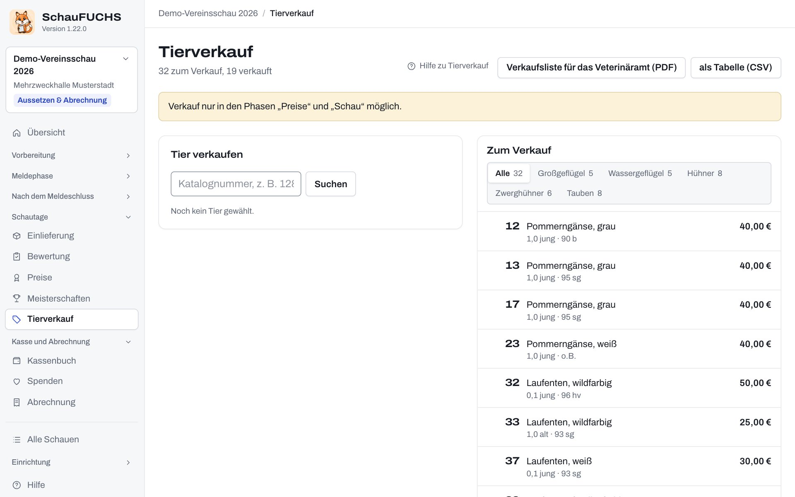

1. Tippen Sie die Katalognummer in das Feld „Katalognummer, z. B. 128“ und klicken Sie auf „Suchen“. Oder klicken Sie rechts in der Liste „Zum Verkauf“ auf das Tier. Bei mehreren Sparten grenzen Sie die Liste mit dem Umschalter darüber ein („Alle“ oder eine Sparte, je mit Anzahl).
2. Prüfen Sie im grauen Kasten Katalognummer, Tier und Preis.
3. Tragen Sie den „Name des Käufers *“ ein, möglichst auch die „Anschrift“.
4. Tragen Sie die „Registriernummer des Käufers *“ ein. Sie ist Pflicht (Viehverkehrsordnung).
5. Wählen Sie unter „Alter des Käufers *“ entweder „mindestens 16 Jahre alt“ oder „unter 16 – Erziehungsberechtigter ist einverstanden“. Im zweiten Fall tragen Sie den „Name des Erziehungsberechtigten *“ ein.
6. Unter „Bezahlt“ steht „bar“; der Betrag wird im Kassenbuch gebucht.
7. Kassieren Sie den Betrag.
8. Klicken Sie auf „Verkaufen und Beleg drucken“. Es erscheint „Verkauft – Beleg …“, und der Kaufbeleg öffnet sich zum Drucken.
9. Geben Sie dem Käufer den Kaufbeleg. Das Tier holt er damit bei der Tierausgabe ab.

> **Tipp:** Blockiert der Browser das neue Fenster (z. B. Safari auf dem iPad), klicken Sie auf den grünen Knopf „Beleg … drucken“ über dem Formular.

Mögliche Meldungen:

- „Der Aussteller hat dieses Tier nicht zum Verkauf gemeldet.“ – Das Tier hat keinen Verkaufspreis.
- „Tier ist noch nicht bewertet – verkauft wird erst nach der Bewertung.“
- „Tier ist nicht in der Halle (nicht eingeliefert oder schon ausgegeben).“
- „Tier ist im Gesundheitsjournal gesperrt (krank, verdächtig oder verendet) und darf nicht abgegeben werden.“
- „Bereits verkauft (Beleg …).“
- „Aussteller ist bereits abgerechnet (Quittung …). Verkauf, Storno und Preise sind danach gesperrt.“
- „Registriernummer des Käufers ungültig: …“ – Prüfen Sie die Nummer (12 Ziffern, ausländische Nummern mit Ländercode).

> **Wichtig:** Solange die Ergebnisse nicht freigegeben sind, zeigt die Seite: „Ist ein Tier verkauft, ändert nur noch die Ausstellungsleitung seine Note (mit Grund) – Korrekturen der Preisrichter am Tablet werden dann abgelehnt.“ Die Note gehört zum Kaufbeleg. Wünscht ein Käufer eine Korrektur, holen Sie die Ausstellungsleitung.

**Storno:** Ist ein Tier schon verkauft, steht dort „Bereits verkauft an … (Beleg …).“ und „Stornieren kann nur die Ausstellungsleitung.“ Holen Sie bei einem Fehlverkauf die Ausstellungsleitung.

Unten auf der Seite steht unter „Verkauft“ jeder Verkauf mit Belegnummer, Käufer und Zeit. Die „Verkaufsliste für das Veterinäramt (PDF)“ steht oben im Seitenkopf. Mit „Beleg“ drucken Sie einen Kaufbeleg nach. Steht bei einem Verkauf „Überweisung offen“, ist das Geld noch nicht eingegangen; den Eingang bucht die Ausstellungsleitung.

## 6. Kasse und Abrechnung

Alle Bargeldbewegungen landen automatisch im Kassenbuch: Meldegeld bar, Tierverkauf bar und Barauszahlungen. Sie buchen von Hand nur das Wechselgeld und Einlagen.

### Kassenbuch: den Tag beginnen

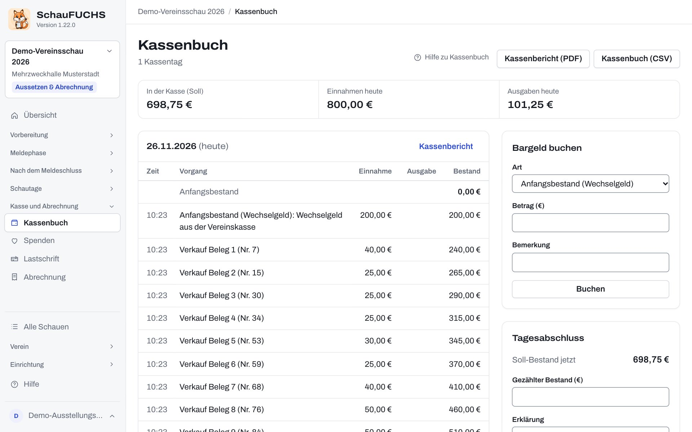

1. Klicken Sie links auf „Kassenbuch“.
2. Wählen Sie rechts unter „Bargeld buchen“ die „Art“ „Anfangsbestand (Wechselgeld)“.
3. Tragen Sie den „Betrag (€)“ ein, z. B. „200“.
4. Unter „Bemerkung“ können Sie etwas notieren.
5. Klicken Sie auf „Buchen“. Es erscheint „Gebucht.“

Mit der Art „Einlage“ buchen Sie zusätzliches Bargeld, das in die Kasse kommt. Über dem Formular steht immer „Laut Kassenbuch in der Kasse: …“.

Links sehen Sie jeden Kassentag mit allen Bewegungen, „Einnahme“, „Ausgabe“, „Bestand“ und „Soll-Endbestand“.

> **Wichtig:** „Entnahme (z. B. zur Bank)“ bucht nur die Ausstellungsleitung. Nehmen Sie kein Geld aus der Kasse, ohne dass die Ausstellungsleitung es bucht.

Zum Tagesende wird der Kassenbericht ausgedruckt und unterschrieben. Den Ausdruck erzeugen Sie mit „Kassenbericht (PDF)“ oder beim einzelnen Tag mit „Kassenbericht“.

### Aussteller bar abrechnen

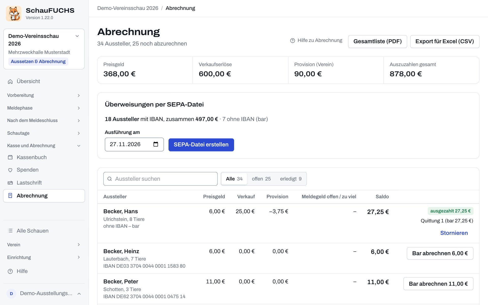

Klicken Sie links auf „Abrechnung“. Abgerechnet wird nur in den Phasen „Schau & Verkauf“ und „Aussetzen & Abrechnung“. Vorher steht bei offenen Beträgen nur „offen …“.

Je Aussteller zeigt die Tabelle „Preisgeld“, „Verkauf“, „Provision“, „Meldegeld offen / zu viel“ und den „Saldo“. Unter dem Namen steht entweder die gekürzte IBAN oder „ohne IBAN – bar“. Die Seite lädt alle 30 Sekunden neu, damit neue Verkäufe mitzählen.

1. Suchen Sie den Aussteller im Feld „Aussteller suchen …“.
2. Klicken Sie auf „Bar abrechnen … €“.
3. Es öffnet sich „Bar abrechnen“:
   - bei Guthaben: „… bar an … auszahlen?“,
   - bei negativem Saldo (der Aussteller schuldet dem Verein noch Geld): „… bar von … erhalten?“
4. Klicken Sie auf „Buchen“ und zahlen Sie das Geld aus oder nehmen Sie es entgegen.
5. Es erscheint „Abgerechnet – Quittung …“, und die Quittung öffnet sich zum Drucken. Blockiert der Browser das Fenster, klicken Sie oben auf „Quittung … drucken“.
6. Lassen Sie die Quittung unterschreiben („Unterschrift Empfänger“ bzw. „Unterschrift Aussteller“) und unterschreiben Sie selbst bei „Unterschrift Kasse“.

Danach steht beim Aussteller „ausgezahlt …“ mit einem Link zur Quittung.

> **Tipp:** Steht beim Aussteller eine IBAN, ist meist eine Überweisung durch die Ausstellungsleitung vorgesehen. Der Knopf „Bar abrechnen“ erscheint trotzdem. Fragen Sie im Zweifel die Ausstellungsleitung, bevor Sie diesen Aussteller bar auszahlen.

Mögliche Meldungen:

- „Laut Kassenbuch sind nur … in der Kasse – danach wären es …. Bitte Betrag prüfen oder die Ausstellungsleitung holen.“ – Im Kassenbuch ist nicht genug Bargeld. Zahlen Sie nichts aus und holen Sie die Ausstellungsleitung.
- „Der Betrag hat sich geändert: jetzt … statt …. Bitte die Seite neu laden und prüfen.“ – Inzwischen wurde z. B. noch ein Tier verkauft. Prüfen Sie den neuen Betrag und rechnen Sie erneut ab.
- „Differenz: Ausstellungsleitung“ – Der Aussteller ist schon abgerechnet, aber danach hat sich etwas geändert. Nachzahlungen und Rückforderungen bucht nur die Ausstellungsleitung.
- „in SEPA-Datei, …“ – Der Aussteller bekommt sein Geld per Überweisung. Zahlen Sie nicht bar aus.
- „+ … Überweisung offen“ unter dem Verkaufserlös – ein Tier des Ausstellers ist per Überweisung verkauft, das Geld aber noch nicht da. Dieser Betrag zählt erst nach dem Zahlungseingang und wird erst dann ausgezahlt.

### Tagesabschluss

Am Ende jedes Kassentages zählen Sie das Bargeld und buchen den Tagesabschluss.

1. Zählen Sie das Bargeld in der Kasse.
2. Klicken Sie im „Kassenbuch“ rechts unter „Tagesabschluss“ in das Feld „Gezählter Bestand (€)“ und tragen Sie den gezählten Betrag ein. Darüber steht der „Soll-Bestand“.
3. Weicht der Betrag ab, erscheint „Differenz … – bitte erklären.“ Schreiben Sie unter „Erklärung“, woher die Differenz kommen könnte. Ohne Erklärung bucht die Software keinen Abschluss mit Differenz.
4. Klicken Sie auf „Tagesabschluss buchen“ und bestätigen Sie die Rückfrage mit „Buchen“.
5. Es erscheint „Tagesabschluss gebucht – Kasse stimmt.“ oder „Tagesabschluss gebucht – Differenz …“.

> **Wichtig:** Auch nach dem Tagesabschluss können Sie weiter bar buchen – Verkauf, Meldegeld, Auszahlung. Solche Buchungen stehen im Kassenbuch unter „Nachtrag nach dem Tagesabschluss“. Der Abschluss selbst bleibt unverändert; niemand kann ihn rückgängig machen.

**Nachtragsabschluss:** Gab es nach dem Abschluss noch Barbuchungen, steht beim Tag „Nach dem letzten Abschluss gab es noch Barbuchungen …“, und rechts heißt der Abschnitt „Nachtragsabschluss“. Zählen Sie die Kasse erneut und buchen Sie „Nachtragsabschluss buchen“ genauso wie den Tagesabschluss. Der Soll-Bestand ist dann der zuletzt gezählte Bestand plus die Nachträge.

> **Tipp:** Sind mehrere Kassentage offen (z. B. nach Mitternacht), erscheint zusätzlich das Feld „Kassentag“; wählen Sie dort den Tag, den Sie abschließen. Kassentage werden der Reihe nach abgeschlossen.

### Belegarchiv

Rechts unten im „Kassenbuch“ steht das „Belegarchiv“ mit allen Kaufbelegen, Quittungen und Einzahlungsbelegen. Jeder Nachdruck kommt aus diesem Archiv und sieht genauso aus wie das Original. Ein Storno erzeugt einen eigenen Beleg; das Original bleibt abrufbar.

Ausnahme: Konnte ein Beleg bei der Buchung nicht abgelegt werden, entsteht er erst beim Abruf. Er trägt dann oben auf jeder Seite in Rot „ZWEITSCHRIFT – erzeugt am …, Stand beim Erzeugen (gebucht am …)“. Geben Sie ihn so heraus; bei Fragen holen Sie die Ausstellungsleitung.

Bar übergebene Stiftungen (z. B. von einem Verband) bucht die Ausstellungsleitung unter „Preise“; sie stehen danach als Einlage „Stiftung von …“ im Kassenbuch. Nehmen Sie solches Geld nicht als eigene Einlage an.

### Was nur die Ausstellungsleitung darf

- Überweisungen und die SEPA-Datei (Sie sehen nur: „Die SEPA-Datei erstellt und bucht die Ausstellungsleitung.“),
- Nachzahlungen und Rückforderungen nach einer ersten Abrechnung („Differenz …“),
- Quittungen stornieren,
- Entnahmen aus der Kasse,
- Verkäufe auf Karte oder Überweisung und Verkäufe stornieren,
- Erstattungen von Meldegeld.

Vollständige IBANs sehen Sie als Helfer nicht, nur gekürzte.

## 7. Bewertung und Preise am PC

**Noten vergeben nur die Preisrichter am Tablet und die Ausstellungsleitung.** Als Helfer sehen Sie unter „Bewertung“ den Stand nur zum Lesen; die Seite zeigt den Hinweis „Noten vergeben nur die Preisrichter am Tablet und die Ausstellungsleitung. Hier sehen Sie den Stand nur zum Lesen.“ Alle Felder und Knöpfe sind gesperrt.

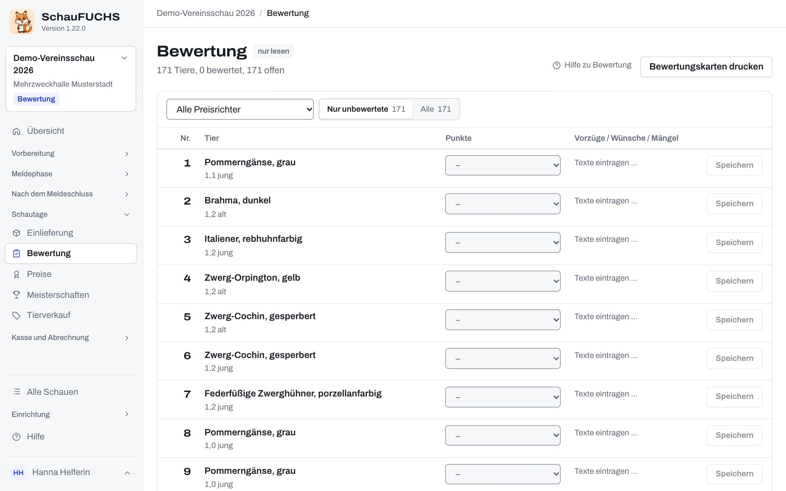

Arbeitet ein Preisrichter auf Papier, geben Sie seine Bewertungskarten der Ausstellungsleitung. Sie trägt die Noten und Obmann-Bestätigungen am PC ein. Die Seite zeigt keine Ausstellernamen. Mit „Bewertungskarten drucken“ erzeugen Sie die Karten als PDF.

### Preise ansehen

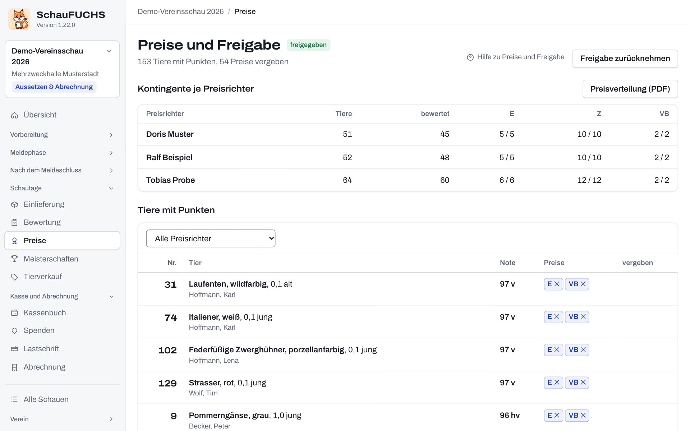

Unter „Preise“ sehen Sie, welche Tiere welche Preise haben und wie viele Preise je Preisrichter noch frei sind. **Preise vergeben nur die Preisrichter am Tablet und die Ausstellungsleitung**; gestiftete Preise (Ehrenpreise von Stiftern) vergibt nur die Ausstellungsleitung. Für Helfer ist die Seite nur zum Lesen. Steht ein Preis nur auf einer Papierkarte, geben Sie die Karte der Ausstellungsleitung.

## 8. Häufige Fragen

| Problem | Was tun |
|---|---|
| „Dieser Einladungslink ist ungültig oder abgelaufen. …“ | Der Link gilt 7 Tage und nur einmal. Bitten Sie die Ausstellungsleitung um eine neue Einladung. |
| „E-Mail oder Passwort stimmt nicht.“ | Prüfen Sie die E-Mail-Adresse und die Feststelltaste. Passwort vergessen? Die Ausstellungsleitung kann Ihnen ein neues Passwort setzen. |
| „Zu viele Fehlversuche. Bitte später erneut versuchen.“ | Nach 10 falschen Passwörtern wartet die Software. Warten Sie 15 Minuten, dann geht es wieder. |
| „Zu viele Fehlversuche für dieses Konto. Bitte bis zu … Minuten warten oder die Ausstellungsleitung bitten, die Sperre aufzuheben.“ | Warten Sie die genannte Zeit ab, oder die Ausstellungsleitung hebt die Sperre auf. |
| „Zu viele Fehlversuche von dieser Adresse. Bitte 15 Minuten warten.“ | Alle Geräte im Hallen-WLAN zählen hier zusammen. Warten Sie 15 Minuten. Bitten Sie die anderen, ihr Passwort sorgfältig einzugeben. |
| „Der Code stimmt nicht. Bitte den aktuellen Code aus der App eingeben.“ | Nehmen Sie den Code, der gerade in der App steht. Prüfen Sie, ob die Uhrzeit des Telefons stimmt. Ohne Telefon: einen Notfallcode eingeben. |
| „Zu viele falsche Codes. Bitte 15 Minuten warten …“ | 15 Minuten warten oder die Ausstellungsleitung bitten, die Sperre aufzuheben. |
| „Zu viele falsche Codes. Die Anmeldung mit Code ist gesperrt …“ | Mit einem Notfallcode anmelden oder die Ausstellungsleitung bitten, die Sperre aufzuheben. Haben Sie eine Hinweismail „Anmeldung: Code mehrmals falsch“ bekommen und waren es nicht Sie, ändern Sie sofort Ihr Passwort. |
| „Die Anmeldung ist abgelaufen. Bitte noch einmal mit Passwort anmelden.“ | Zwischen Passwort und Code ist zu viel Zeit vergangen. Melden Sie sich neu an. |
| Plötzlich erscheint die Anmeldeseite (Sitzung abgelaufen). | Sie waren länger als 14 Tage angemeldet oder haben Ihr Passwort auf einem anderen Gerät geändert. Melden Sie sich neu an. |
| Beim Speichern erscheint „Bitte anmelden.“ | Ihre Sitzung ist abgelaufen. Die Eingaben stehen noch im Formular. Öffnen Sie einen zweiten Browser-Tab, melden Sie sich dort an, kehren Sie zurück und klicken Sie noch einmal auf Speichern. |
| „Nur für Administratoren.“ | Diese Funktion ist der Ausstellungsleitung vorbehalten. Sagen Sie der Ausstellungsleitung Bescheid, was erledigt werden soll. |
| „Keine Verbindung zum Server.“ | Prüfen Sie WLAN oder Internet. Die letzte Eingabe wurde nicht gespeichert – wiederholen Sie sie, wenn die Verbindung wieder steht. |
| „Gleichzeitig hat jemand dasselbe geändert. Bitte noch einmal versuchen.“ | Zwei Personen haben im selben Moment gebucht. Klicken Sie einfach noch einmal. |
| „Interner Fehler. Bitte erneut versuchen; besteht er weiter, die Ausstellungsleitung informieren.“ | Noch einmal versuchen. Kommt die Meldung wieder, die Ausstellungsleitung informieren. |
| Beim Kassentag steht „Nach dem letzten Abschluss gab es noch Barbuchungen …“ | Nach dem Tagesabschluss wurde noch bar gebucht. Kasse zählen und den „Nachtragsabschluss“ buchen. |
| Der Kaufbeleg oder die Quittung öffnet sich nicht. | Der Browser blockiert neue Fenster. Klicken Sie auf den grünen Knopf „Beleg … drucken“ bzw. „Quittung … drucken“. |
| Ein Aussteller erscheint bei der Einlieferung nicht. | Es erscheinen nur bestätigte Meldungen mit Katalognummer. Prüfen Sie die Meldung unter „Meldungen“ und holen Sie die Ausstellungsleitung. |
| Der Käufer hat keine Registriernummer. | Ohne Registriernummer ist kein Verkauf möglich (Viehverkehrsordnung). |
| „Ihre Eingaben sind noch nicht gespeichert. Seite trotzdem verlassen?“ | „Abbrechen“ wählen und zuerst speichern. Nur mit „Verlassen“ gehen die Eingaben verloren. |
| „Offen sind … – mehr bucht nur die Ausstellungsleitung (Überzahlung).“ | Als Helfer buchen Sie höchstens den offenen Betrag. Mehr bucht die Ausstellungsleitung. |
| „Die Schau ist abgeschlossen – für Korrekturen erst mit Grund zurück zur Abrechnung.“ | Nach dem Abschluss ändert niemand mehr etwas. Sagen Sie der Ausstellungsleitung Bescheid. |
| „Katalog festgeschrieben – Tier bleibt so.“ | Das Tier steht schon im Katalog. Kommt ein anderes Tier, bei der Einlieferung „Fehlt“ und das richtige nachmelden. |
| „Diese Seite gibt es nicht“ | Die Adresse stimmt nicht. Klicken Sie auf „Zur Startseite“. |
| „Es ist ein Fehler aufgetreten“ – „Die Seite konnte nicht angezeigt werden – bitte neu laden.“ | Klicken Sie auf „Seite neu laden“. Bleibt der Fehler, wenden Sie sich an die Ausstellungsleitung. |
| Die Seite lädt gar nicht, z. B. im Ausland oder mit VPN. | SchauFUCHS ist nur aus Deutschland erreichbar. Schalten Sie ein VPN ab. |
