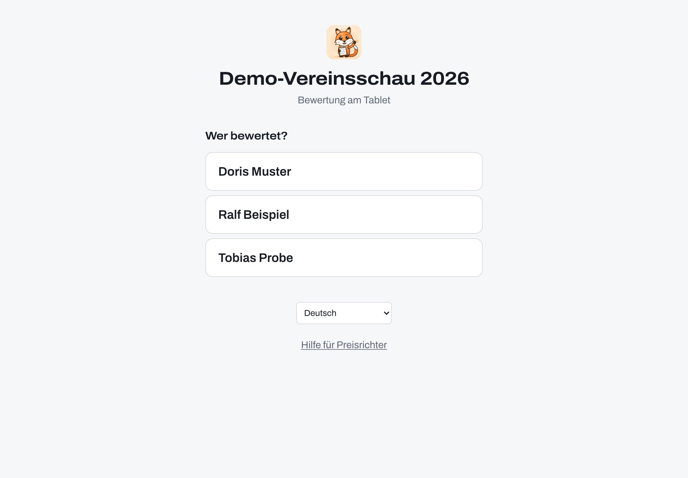
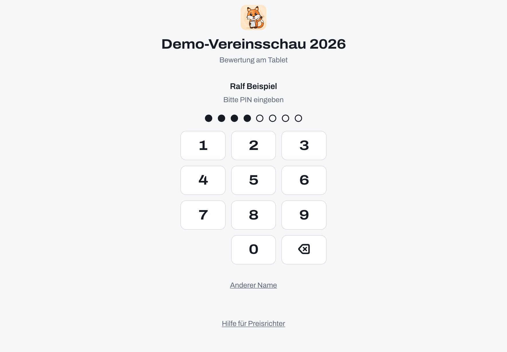
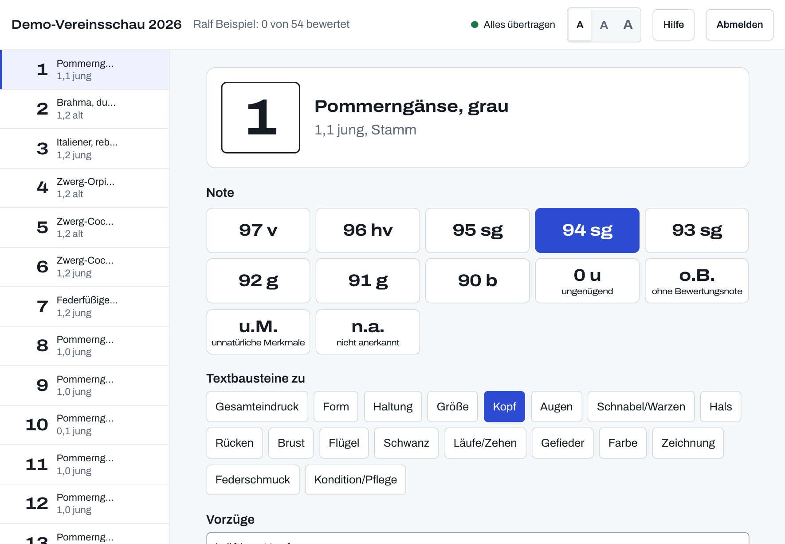
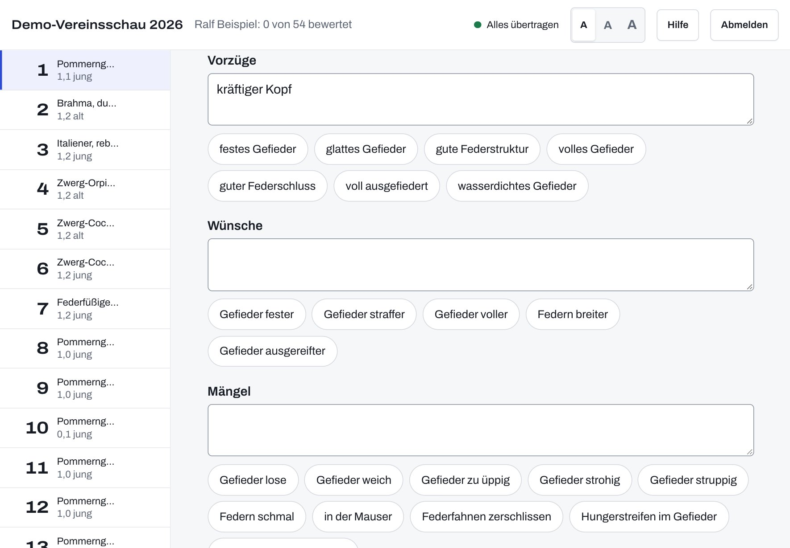
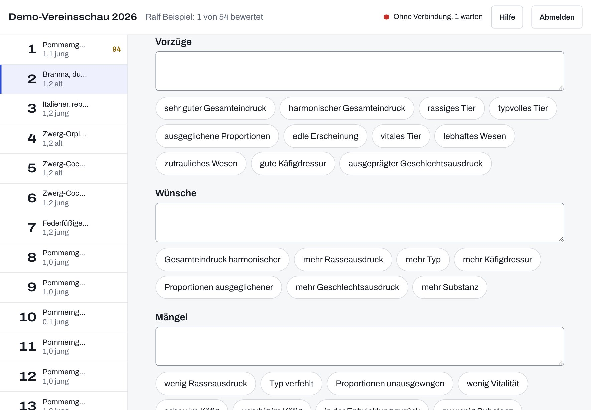

# Handbuch für Preisrichter

SchauFUCHS 1.12.1 · Stand 20. November 2026

Dieses Handbuch erklärt Schritt für Schritt, wie Sie auf der Schau Ihre Tiere am Tablet bewerten. Sie brauchen dafür keine Computerkenntnisse. Wörter in „Anführungszeichen“ stehen genau so auf dem Bildschirm.

## 1. Wofür das Tablet da ist

Das Tablet ersetzt die Bewertungskarte aus Papier. Sie tippen die Note an, ergänzen Vorzüge, Wünsche und Mängel und speichern. Die Bewertung geht danach von selbst an die Ausstellungsleitung. Dort entstehen daraus Katalog, Ergebnislisten und Bewertungskarten.

**Was Sie sehen:**

- nur die Tiere, die Ihnen zugeteilt sind,
- je Tier: Katalognummer, Rasse und Farbenschlag, Geschlecht und Alter (z. B. „1,0 jung“), bei Bedarf „Stamm“ oder „Voliere“, „Jugend“ und die Käfignummer, wenn sie von der Katalognummer abweicht,
- bei Tieren mit Punkten: die Preise, die Sie vergeben können.

**Was Sie nicht sehen:** Namen, Vereine oder Anschriften der Aussteller. Die Bewertung ist anonym. Das Tablet bekommt diese Angaben gar nicht erst.

**Sie selbst im Katalog:** Im gedruckten Katalog stehen Sie mit Ihrem Namen und Ihren Rassen bzw. Käfignummern, bei bewerteten Tieren als der Preisrichter, der tatsächlich bewertet hat. Ihre Anschrift steht dort nur, wenn Sie der Ausstellungsleitung Ihr Einverständnis gegeben haben; im Internet steht sie nie.

## 2. Vorbereitung

### Den Link bekommen

Die Ausstellungsleitung gibt Ihnen einen Link. Er sieht so aus:

`https://schau.ihr-verein.de/richter/<kurzadresse>`

Statt `<kurzadresse>` steht dort der Kurzname Ihrer Schau. Jede Schau hat ihren eigenen Link. Dazu bekommen Sie eine **PIN mit 8 Ziffern**. Die PIN ist nur für Sie. Geben Sie sie nicht weiter.

Der Link muss mit `https://` beginnen. Ohne HTTPS bleiben Ihre Bewertungen zwar im Gerät, aber ohne Netz lässt sich die Seite nicht neu öffnen; oben steht dann „Ohne HTTPS lässt sich die Seite ohne Netz nicht neu öffnen …“. Lassen Sie sich in diesem Fall von der Ausstellungsleitung die Adresse mit `https://` geben.

### Die Seite auf den Startbildschirm legen

So finden Sie die Seite schnell wieder, und sie funktioniert auch ohne Netz.

1. Öffnen Sie den Link im Browser des Tablets (auf dem iPad: Safari, auf anderen Tablets: Chrome).
2. Tippen Sie auf das Teilen-Zeichen (iPad) oder auf die drei Punkte oben rechts (Chrome).
3. Wählen Sie „Zum Home-Bildschirm“ bzw. „Zum Startbildschirm hinzufügen“ oder „App installieren“.
4. Auf dem Startbildschirm erscheint nun das Zeichen „Schau“. Öffnen Sie die Seite ab jetzt immer darüber.

Auch dieses Handbuch („Hilfe“) öffnet sich ohne Netz nur, wenn Sie die Seite vorher einmal mit Netz geöffnet haben.

> **Wichtig:** Arbeiten Sie **nicht** im privaten Modus (auch „Inkognito“ genannt). Dort löscht der Browser Ihre Bewertungen, sobald das Fenster geschlossen wird. Erscheint oben der hellgelbe Hinweis „Der Browser sichert die Bewertungen auf diesem Gerät nicht dauerhaft …“, legen Sie die Seite bitte wie oben beschrieben auf den Startbildschirm.

### Akku und Strom

- Laden Sie das Tablet am Abend vor der Schau voll.
- Nehmen Sie Ladekabel und, wenn vorhanden, eine Powerbank mit.
- Stellen Sie die automatische Bildschirmsperre auf eine längere Zeit, damit das Tablet nicht ständig dunkel wird.

## 3. Anmelden

Die Anmeldung ist nur möglich, solange die Schau in den Phasen „Einlieferung“, „Bewertung“ oder „Preise & Freigabe“ ist. Sonst steht dort: „Die Anmeldung am Tablet ist während Einlieferung, Bewertung und Preisvergabe möglich. Die Ausstellungsleitung öffnet sie in der Übersicht.“

1. Öffnen Sie die Seite. Oben steht der Name der Schau und „Bewertung am Tablet“.
2. Unter „Wer bewertet?“ tippen Sie auf Ihren Namen.
3. Es erscheint „Bitte PIN eingeben“ und ein Ziffernfeld mit 8 Punkten darüber.
4. Tippen Sie Ihre 8 Ziffern ein. Jeder Punkt füllt sich. Mit „⌫“ löschen Sie die letzte Ziffer.
5. Nach der achten Ziffer meldet Sie das Tablet von selbst an. Einen Knopf zum Bestätigen gibt es nicht.

Falschen Namen gewählt? Tippen Sie auf „Anderer Name“.

**Sprache:** Auf der Anmeldeseite stellen Sie die Sprache des Tablets ein (Deutsch, Deutsch (Schweiz), Englisch, Französisch, Niederländisch, Polnisch, Tschechisch). Das Tablet merkt sich die Wahl, unabhängig davon, wer sonst an diesem Gerät angemeldet ist. Rassen, Farbenschläge und Textbausteine bleiben deutsch, ebenso die gedruckte Bewertungskarte.

Ganz unten auf der Anmeldeseite führt der Link „Hilfe für Preisrichter“ zu diesem Handbuch. Es öffnet in einem eigenen Tab; mit „Schließen“ kommen Sie zurück.

### Wenn die PIN falsch ist

- Es erscheint „PIN stimmt nicht.“, die Punkte werden geleert, und Sie können es noch einmal versuchen.
- Nach mehreren Fehlversuchen müssen Sie warten. Dann erscheint zum Beispiel: „Zu viele Fehlversuche. Bitte 15 Minuten warten oder bei der Ausstellungsleitung eine neue PIN holen.“
- Die Ausstellungsleitung kann Ihnen jederzeit eine neue PIN geben oder eine Sperre aufheben.

### Abmelden und Wechsel auf einem Gerät

Teilen sich zwei Preisrichter ein Tablet, muss sich der erste abmelden, bevor der zweite sich anmeldet.

1. Tippen Sie oben rechts auf „Abmelden“.
2. Das Tablet zeigt wieder „Wer bewertet?“. Jetzt tippt der nächste Preisrichter seinen Namen an und gibt seine PIN ein.

> **Automatische Abmeldung:** Wird am Tablet länger nicht getippt (Vorgabe 120 Minuten, die Ausstellungsleitung kann es ändern), meldet es sich selbst ab. In der letzten Minute steht unten „Automatische Abmeldung in … s“; einmal tippen genügt. Solange Bewertungen noch nicht übertragen sind, meldet das Tablet nicht ab.

> **Wichtig:** Abmelden geht nur mit Verbindung und erst, wenn alle Ihre Bewertungen übertragen sind. Sonst erscheint „Noch … Bewertungen nicht übertragen. Bitte erst mit Verbindung übertragen, dann abmelden.“ Warten Sie, bis oben „Alles übertragen“ steht.

Sie bleiben angemeldet, auch wenn Sie die Seite schließen oder das Tablet ausschalten. Gibt die Ausstellungsleitung Ihnen eine neue PIN, erscheint „Die Anmeldung ist abgelaufen.“ Tippen Sie dann auf „Neu anmelden“.

War das Tablet zuletzt für eine andere Schau angemeldet, steht auf der Anmeldeseite „Dieses Gerät ist für eine andere Schau angemeldet. Die Anmeldung hier ersetzt sie.“ Mit der Anmeldung hier endet die Sitzung der anderen Schau auf diesem Gerät.

## 4. Bewerten Schritt für Schritt

### Der Bildschirm

- **Oben (Kopfzeile):** Name der Schau, Ihr Name und wie viele Tiere schon bewertet sind (z. B. „Müller: 12 von 40 bewertet“). Rechts ein farbiger Punkt mit dem Übertragungsstand (siehe Abschnitt 5) und die Knöpfe „Hilfe“ und „Abmelden“. „Hilfe“ öffnet dieses Handbuch in einem neuen Fenster; Ihre Eingaben auf der Karte bleiben dabei erhalten.
- **Links (am Handy: oben):** die Liste Ihrer Tiere mit Katalognummer, Rasse, Geschlecht und Alter. Rechts in der Zeile steht die Punktzahl, sobald das Tier bewertet ist. Ockerbraune Schrift heißt: noch nicht übertragen. Grüne Schrift heißt: übertragen. „fehlt“ heißt: Das Tier ist als fehlend gemeldet.
- **Rechts (am Handy: unten):** die Bewertungskarte des gewählten Tieres.

Beim Öffnen wählt das Tablet von selbst das erste Tier ohne Note.

### Ein Tier bewerten

1. **Tier wählen:** Tippen Sie in der Liste auf das Tier. Oben auf der Karte steht groß die Katalognummer. Vergleichen Sie sie mit dem Käfig.
2. **Note wählen:** Unter „Note“ tippen Sie auf einen Notenknopf. Der gewählte Knopf wird farbig.
3. **Texte ergänzen:** In die Felder „Vorzüge“, „Wünsche“ und „Mängel“ tippen Sie Textbausteine oder schreiben selbst (siehe unten).
4. **Speichern:** Tippen Sie auf „Speichern und nächstes Tier“. Das Tablet speichert die Bewertung und springt zum nächsten Tier ohne Note.

Der Knopf „Speichern und nächstes Tier“ lässt sich erst antippen, wenn eine Note gewählt ist.

### Die Notenknöpfe

Üblich ist diese Notenskala (die Ausstellungsleitung kann sie für eine Schau anpassen):

| Knopf | Bedeutung |
|---|---|
| 97 v | vorzüglich |
| 96 hv | hervorragend |
| 95 sg, 94 sg, 93 sg | sehr gut |
| 92 g, 91 g | gut |
| 90 b | befriedigend |

Dazu kommen vier **Sondernoten**. Unter dem Kürzel steht klein die Bedeutung, nach dem Antippen erscheint unter dem Speicherknopf ein kurzer Hinweis:

| Knopf | Bedeutung | Hinweis auf dem Tablet |
|---|---|---|
| 0 u | ungenügend | „0 Punkte: ohne Rassewert, Kreuzung oder Ausschlussfehler“ |
| o.B. | ohne Bewertungsnote | „z. B. krank, ungepflegt, Ringfehler, falsch besetzter Stamm“ |
| u.M. | unnatürliche Merkmale | „Manipulation; Obmann bestätigt und meldet weiter“ |
| n.a. | nicht anerkannt | „Rasse oder Farbenschlag nicht im Standard“ |

Ein Tier hat immer entweder Punkte oder eine Sondernote, nie beides. Bei „97 v“ und „u.M.“ erscheint „Diese Note muss der Obmann bestätigen.“ (siehe Abschnitt 6).

### Textbausteine

Textbausteine sind fertige kurze Sätze, die Sie mit einem Fingertipp einfügen.

1. Unter „Textbausteine zu“ wählen Sie zuerst ein **Merkmal**, zum Beispiel „Gesamteindruck“, „Form“, „Kopf“, „Kamm“, „Farbe“ oder „Zeichnung“. Das gewählte Merkmal ist farbig.
2. Unter den Feldern „Vorzüge“, „Wünsche“ und „Mängel“ erscheinen nun die passenden Bausteine als runde Knöpfe.
3. **Einmal antippen** fügt den Baustein in das Feld ein. Mehrere Bausteine werden mit Komma getrennt.
4. **Noch einmal antippen** nimmt denselben Baustein wieder heraus.
5. Wechseln Sie das Merkmal, um weitere Bausteine zu sehen. Was schon im Feld steht, bleibt stehen.

Das Tablet zeigt nur Bausteine, die zur **Geflügelart** des Tieres passen: bei Tauben nur Taubenbausteine, bei Hühnern nur Hühnerbausteine, dazu solche, die für alle Arten gelten. Hat die Ausstellungsleitung Bausteine für eine bestimmte **Rasse** angelegt, erscheinen diese nur bei Tieren dieser Rasse – und zwar zuerst. Bei jedem neuen Tier beginnt die Auswahl wieder beim ersten Merkmal. Gibt es für ein Tier nur ein einziges Merkmal, entfällt die Zeile „Textbausteine zu“, und die Bausteine stehen gleich unter den Feldern.

**Freitext:** Tippen Sie in ein Feld. Die Tastatur erscheint, und Sie können selbst schreiben oder Bausteine nachträglich ändern. Jedes Feld fasst höchstens 500 Zeichen. Kurz vor der Grenze zeigt das Tablet „… von 500 Zeichen“.

### Eine Note ändern oder zurücknehmen

- **Ändern:** Tier in der Liste antippen, neue Note wählen, Texte anpassen, „Speichern und nächstes Tier“. Die neue Bewertung ersetzt die alte.
- **Zurücknehmen:** Hat das Tier eine Note, steht neben dem Speicherknopf „Note zurücknehmen“. Es erscheint die Rückfrage „Note von Nr. … zurücknehmen?“ („Note und Texte werden gelöscht.“); nach „Zurücknehmen“ ist das Tier wieder unbewertet. Ist die Note schon übertragen, geht das nur mit Verbindung („Zurücknehmen geht nur mit Verbindung.“).
- Hat das Tier schon einen Preis, entfernen Sie zuerst den Preis. Das Tablet sagt das mit „Bitte zuerst den Preis entfernen.“
- Ist das Tier bereits **verkauft**, kann nur noch die Ausstellungsleitung die Note ändern.

Wechseln Sie zu einem anderen Tier, ohne zu speichern, fragt das Tablet in einem eigenen Fenster „Eingabe verwerfen?“: „Die Bewertung auf der Karte ist noch nicht gespeichert. Trotzdem zum anderen Tier wechseln und die Eingabe verwerfen?“ Tippen Sie auf „Abbrechen“, wenn Sie doch speichern möchten; „Verwerfen und wechseln“ verwirft die Eingabe.

Alle Rückfragen des Tablets erscheinen so als eigenes Fenster in der Seite, mit „Abbrechen“ und einem Knopf, der die Aktion nennt (z. B. „Zurücknehmen“, „Endgültig löschen“, „Abmelden“).

### Preise vergeben

Ist ein Tier mit **Punkten** bewertet und die Bewertung übertragen, erscheint unten auf der Karte der Abschnitt „Preise“. Jeder Knopf zeigt das Kürzel des Preises und wie viele davon noch frei sind (z. B. „(2 frei)“). Antippen vergibt den Preis, er zeigt dann „vergeben“. Noch einmal antippen nimmt ihn zurück. Preise vergeben geht nur mit Verbindung; ohne Netz steht dort „Preise vergeben geht nur mit Verbindung, weil das Kontingent geprüft wird.“

Das Tablet zeigt nur Preise, die zu diesem Tier passen:

- **Nur Preise aus dem Standgeld.** Gestiftete Preise (Ehrenpreise von Stiftern und Verbänden) vergibt die Ausstellungsleitung am PC, weil sie dabei die Stiftung und die Vorgabe des Stifters auswählt. Möchten Sie einem Tier einen gestifteten Preis geben, sagen Sie der Ausstellungsleitung die Katalognummer.
- **Nur passende Preisarten.** Gilt eine Preisart nur für die Jugend, nur für Senioren oder nur für eine Sparte, erscheint sie nur bei passenden Tieren. Auch ihr Kontingent zählt nur diese Tiere.

### Ein Tier fehlt

Fehlt ein Tier im Käfig, sagen Sie bitte der Ausstellungsleitung Bescheid. Sie trägt es als fehlend ein. Am Tablet steht dann in der Liste „fehlt“ und auf der Karte „Als fehlend gemeldet – keine Bewertung möglich. …“; die Notenknöpfe sind gesperrt. Einen eigenen Knopf „fehlt“ gibt es am Tablet nicht. Ist das Tier doch da, sagen Sie der Ausstellungsleitung Bescheid.

## 5. Ohne Netz arbeiten

In vielen Hallen ist das Netz schwach. Das ist kein Problem: Das Tablet speichert jede Bewertung zuerst bei sich und überträgt sie, sobald wieder Verbindung besteht. Es versucht das von selbst etwa alle 20 Sekunden. Sie müssen nichts tun.

Wenn Sie schon einmal angemeldet waren, öffnet sich die Seite auch ohne Netz mit Ihren Tieren.

### Die Anzeige oben rechts

| Punkt und Text | Bedeutung |
|---|---|
| hellgrün, „Alles übertragen“ | Alle Bewertungen sind bei der Ausstellungsleitung angekommen. |
| hellgelb (beige), „3 warten“ | 3 Bewertungen sind im Tablet gespeichert und noch nicht übertragen. |
| „Überträgt …“ | Das Tablet sendet gerade. |
| hellrot, „Ohne Verbindung, 3 warten“ | Kein Netz. Die Bewertungen sind sicher im Tablet und werden später gesendet. |
| „· 1 nicht übernommen“ | Eine Bewertung wurde abgelehnt. Bitte ansehen (siehe unten). |

### Gelbe Leiste „Nur Lesen“

Steht oben „Nur Lesen – Bewertungen bleiben auf dem Gerät und werden später gesendet.“, nimmt SchauFUCHS gerade keine Änderungen an (z. B. Wartung). Bewerten Sie einfach weiter: Die Bewertungen warten im Tablet und werden übertragen, sobald der Lesemodus endet.

### „nicht übernommen“

Manchmal nimmt SchauFUCHS eine Bewertung nicht an, zum Beispiel weil das Tier inzwischen als fehlend gemeldet wurde oder die Bewertung schon geschlossen ist. Dann erscheint oben ein roter Kasten „… Bewertung nicht übernommen.“ Darin steht je Tier die Katalognummer, Ihre Bewertung und der Grund in Fettschrift.

- „Erneut senden“ schickt die Bewertung noch einmal, etwa nachdem die Ausstellungsleitung den Fehler behoben hat.
- „Verwerfen“ löscht die Bewertung aus dem Tablet. Vorher fragt das Tablet nach („Bewertung von Nr. … löschen?“, Knopf „Endgültig löschen“). Geben Sie die Bewertung **vorher** der Ausstellungsleitung zum Nachtragen.

### Konflikt: „Anderswo geändert“

Hat die Ausstellungsleitung die Note eines Tieres am PC geändert, während Sie am Tablet etwas anderes eingegeben haben, entsteht ein Konflikt. Im roten Kasten steht dann „Anderswo geändert: prüfen, dann trotzdem senden oder verwerfen.“

Die Box zeigt beides:

- oben **Ihre Eingabe**,
- darunter „Jetzt gespeichert: …“, also den Stand, der gerade in SchauFUCHS steht.

Vergleichen Sie beide, am besten nach kurzer Rücksprache mit der Ausstellungsleitung.

- „Trotzdem senden“ ersetzt den gespeicherten Stand durch Ihre Eingabe.
- „Verwerfen“ löscht Ihre Eingabe. Der gespeicherte Stand bleibt.

Ähnlich auf der Bewertungskarte: Ändert sich eine Note anderswo, während Sie die Karte gerade bearbeiten, erscheint „Diese Bewertung wurde inzwischen anderswo geändert …“ mit den Knöpfen „Änderung übernehmen“ und „Meine Eingaben behalten“.

### Was Sie auf keinen Fall tun sollten

> **Wichtig:** Löschen Sie während der Schau **nicht** die Browserdaten, den Verlauf oder die „Website-Daten“ des Tablets. Arbeiten Sie **nicht** im privaten Modus. In beiden Fällen gehen Bewertungen verloren, die noch nicht übertragen sind.

- Melden Sie sich nicht ab, solange Bewertungen warten. Das Tablet lässt es auch nicht zu.
- Bleibt eine Meldung „Übertragung gescheitert: …“ länger stehen, sagen Sie der Ausstellungsleitung Bescheid. Die Bewertungen bleiben im Tablet.
- Steht oben „Noch … Bewertungen von [Name] nicht übertragen“, hat ein anderer Preisrichter auf diesem Gerät noch wartende Bewertungen. Er sollte sich kurz anmelden, wenn Netz da ist, dann werden sie gesendet.

### Nach der Schau: Daten auf dem Tablet

Melden Sie sich nach der Bewertung ab („Abmelden“, wenn alles übertragen ist). Dabei löscht das Tablet Ihre Tierliste. Wer das vergisst: Sobald die Ausstellungsleitung die Schau abgeschlossen hat, löscht das Tablet beim nächsten Öffnen mit Netz Tierlisten und Textbausteine dieser Schau von selbst und zeigt „Die Schau ist abgeschlossen. Tierlisten und Textbausteine dieser Schau wurden von diesem Gerät gelöscht.“

Stehen dann noch nicht übertragene Bewertungen im Gerät, bleiben sie sichtbar („Die Schau ist abgeschlossen – bitte der Ausstellungsleitung zeigen, dann löschen.“). Zeigen Sie sie der Ausstellungsleitung und löschen Sie sie danach mit „Endgültig von diesem Gerät löschen“.

> **Tipp:** Schalten Sie am Tablet eine Code-Sperre mit automatischer Sperre ein. Dann ist der Speicher des Geräts verschlüsselt, und niemand bewertet an einem liegengelassenen Tablet weiter.

## 6. Der Obmann

Der Obmann prüft besondere Noten ein zweites Mal. Bestätigen muss er:

- **„97 v“ (vorzüglich)**,
- die Sondernote **„u.M.“ (unnatürliche Merkmale)**.

Seine eigenen Noten bestätigt der Obmann nicht selbst. Sie erscheinen nicht in seiner Liste. Das übernimmt ein zweiter Obmann am Tablet; gibt es keinen, trägt die Ausstellungsleitung die Bestätigung eines anderen Preisrichters am PC ein.

### So bestätigen Sie als Obmann

1. Warten Bewertungen auf Sie, erscheint oben in der Kopfzeile der Knopf „Obmann: … bestätigen“ (z. B. „Obmann: 3 bestätigen“).
2. Tippen Sie darauf. Es öffnet sich die Ansicht „Bewertungen bestätigen („vorzüglich“, u.M.)“.
3. Jede Zeile zeigt Katalognummer, Rasse, Geschlecht, Alter, die Note und die Vorzüge.
4. Sehen Sie sich das Tier an. Stimmen Sie zu, tippen Sie auf „Bestätigen“. Es erscheint „Bestätigt.“
5. Mit „Zurück zum Bewerten“ kehren Sie zu Ihren eigenen Tieren zurück.

Bestätigen geht nur mit Verbindung. Ist alles erledigt, steht dort „Alles bestätigt – zurzeit wartet keine Bewertung auf den Obmann.“

Wird eine bestätigte Note später geändert, gilt die Bestätigung nicht mehr und das Tier erscheint wieder in der Liste. Erscheint „Die Note wurde inzwischen geändert – bitte neu laden und erneut prüfen.“, wurde die Note geändert, während Sie die Liste angesehen haben. Prüfen Sie den neuen Stand.

## 7. Häufige Fragen und Probleme

| Problem | Was tun |
|---|---|
| Mein Name steht nicht in der Liste. | Die Anmeldung ist noch nicht geöffnet, oder Sie sind nicht eingetragen. Bitte die Ausstellungsleitung fragen. |
| „PIN stimmt nicht.“ | Ziffern langsam neu eingeben. Bei Zweifel eine neue PIN bei der Ausstellungsleitung holen. |
| „Zu viele Fehlversuche …“ | Die angezeigte Zeit warten oder die Ausstellungsleitung um eine neue PIN bitten. |
| „Ihnen sind noch keine Tiere zugeteilt.“ | Die Ausstellungsleitung muss Ihnen Katalognummern zuteilen. Das Tablet holt die Tiere danach von selbst (etwa alle 20 Sekunden). |
| „Die Bewertung ist noch nicht geöffnet …“ | Die Ausstellungsleitung öffnet die Bewertung. Danach auf „Neu laden“ tippen. |
| „Die Ergebnisse sind freigegeben …“ oder „Die Bewertung ist abgeschlossen …“ | Die Bewertung ist beendet. Änderungen nur noch über die Ausstellungsleitung. |
| Der Punkt oben ist hellrot. | Kein Netz. Einfach weiterbewerten. Die Bewertungen werden später gesendet. |
| „Speichern und nächstes Tier“ lässt sich nicht antippen. | Erst eine Note wählen. |
| Ich sehe keine Textbausteine. | Anderes Merkmal unter „Textbausteine zu“ wählen. Gibt es keine passenden, Text selbst schreiben. |
| Ich habe die falsche Note gespeichert. | Tier antippen, richtige Note wählen, erneut speichern. |
| Der Abschnitt „Preise“ fehlt. | Preise gibt es nur für Tiere mit Punkten und erst, wenn die Bewertung übertragen ist. |
| Ein Preis fehlt bei einem Tier. | Gestiftete Preise vergibt die Ausstellungsleitung. Preisarten nur für Jugend, Senioren oder eine Sparte erscheinen nur bei passenden Tieren. |
| „Abmelden geht nur mit Verbindung.“ | Warten, bis Netz da ist und oben „Alles übertragen“ steht. |
| „Die Anmeldung ist abgelaufen.“ | Auf „Neu anmelden“ tippen und PIN eingeben. Wartende Bewertungen bleiben im Tablet. |
| Akku leer. | Tablet laden und wieder einschalten. Gespeicherte Bewertungen sind noch da. |

## 8. Kurzanleitung zum Ausschneiden

**Bewertung am Tablet – das Wichtigste**

1. Seite über das Zeichen „Schau“ auf dem Startbildschirm öffnen. Nie im privaten Modus.
2. Unter „Wer bewertet?“ den eigenen Namen antippen, 8-stellige PIN eingeben.
3. Tier in der Liste antippen. Katalognummer mit dem Käfig vergleichen.
4. Note antippen (z. B. „95 sg“) oder Sondernote („0 u“, „o.B.“, „u.M.“, „n.a.“).
5. Unter „Textbausteine zu“ ein Merkmal wählen. Bausteine antippen (nochmal antippen = entfernen) oder selbst schreiben.
6. „Speichern und nächstes Tier“.
7. Oben rechts: „Alles übertragen“ = fertig. „… warten“ oder „Ohne Verbindung“ = einfach weitermachen.
8. Roter Kasten „nicht übernommen“ = ansehen, mit der Ausstellungsleitung klären.
9. Obmann: Knopf „Obmann: … bestätigen“ → Tier prüfen → „Bestätigen“.
10. Zum Schluss „Abmelden“ – erst wenn „Alles übertragen“ dasteht.

**Nie:** Browserdaten löschen, privaten Modus nutzen, abmelden mit wartenden Bewertungen.
**Probleme?** Knopf „Hilfe“ oben rechts oder Ausstellungsleitung fragen.
