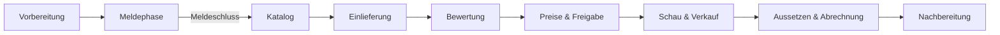
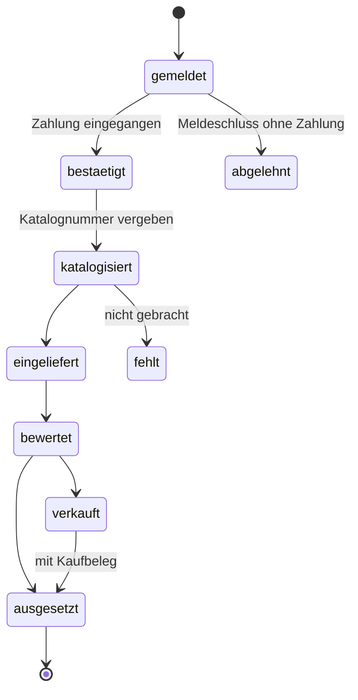
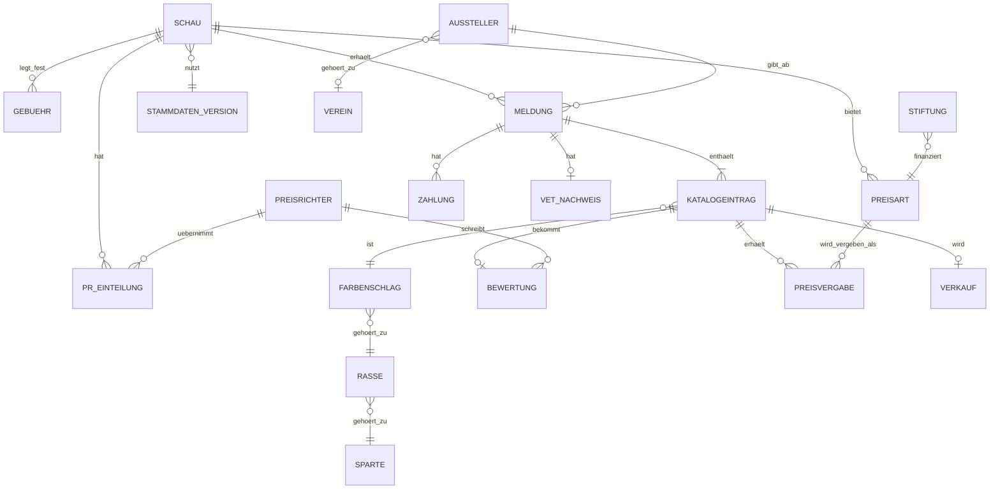

# Konzept: Schauverwaltung für Rassegeflügelausstellungen

Stand: 30.10.2026 · Status: Entwurf

---

## 1. Ziel

Eine Web-Anwendung, mit der ein Verein eine Rassegeflügelschau vollständig abwickelt: von der Meldung über Katalog und Bewertung bis zu Preisen, Tierverkauf und Abrechnung.

Was sie besser machen soll als die vorhandenen Windows-Programme:

- **Ein System für alle.** Aussteller melden online, die Ausstellungsleitung (AL) arbeitet am PC, Preisrichter bewerten am Tablet, Besucher sehen Ergebnisse. Alle arbeiten auf denselben Daten.
- **Funktioniert in der Halle ohne Netz.** Die Bewertung läuft offline weiter und gleicht später ab.
- **Einfach.** Jeder Bildschirm erledigt eine Aufgabe. Fachbegriffe bleiben so, wie Züchter sie kennen (1,0 / 0,1, B-Bogen, Ringkarte, E-Preis).
- **Regeln sind einstellbar, nicht einprogrammiert.** Standgeld, Preisschlüssel und Provision legt jede Schau selbst fest (AAB + Sonderbestimmungen).

Nicht Ziel: Vereinsverwaltung, Zuchtbuch, Bestandsmeldung an den BDRG.

---

## 2. Rollen

| Rolle | Macht was | Gerät |
|---|---|---|
| **Ausstellungsleitung (AL)** | Schau anlegen, Meldungen prüfen, Katalog erzeugen, Preise freigeben, abrechnen | PC |
| **Meldestelle / Helfer** | Papiermeldungen erfassen, Zahlungen abhaken, Einlieferung prüfen | PC, Tablet |
| **Aussteller** | Online melden, eigene Meldung und Ergebnisse ansehen | Handy, PC |
| **Preisrichter (PR)** | Zugeteilte Tiere bewerten, Preise aus seinem Kontingent vergeben | Tablet |
| **Obmann** | Note „vorzüglich“ bestätigen | Tablet |
| **Kasse / Verkauf** | Tierverkauf, Auszahlung | PC, Tablet |
| **Öffentlich** | Katalog und Ergebnisse ansehen (nach Freigabe) | Browser |

**Umsetzung (Abgleich 11.11.2026):** Benutzer haben eine Rolle **je Verein**, nicht je Schau: *Administrator* (Ausstellungsleitung) oder *Mitarbeiter* (Helfer für Meldestelle, Kasse, Halle). Ein Verein richtet im Jahr eine oder wenige Schauen aus, mit denselben Leuten – Rollen je Schau brächten Pflegeaufwand ohne Nutzen und mehr Fehlerquellen bei den Rechten. Preisrichter und Obmann gelten dagegen **je Schau** (eigener Eintrag mit PIN, kein Benutzerkonto). Noten und Preise am PC vergibt nur die Ausstellungsleitung; Helfer bestätigen Meldungen, Ablehnen und Stornieren bleibt bei der Ausstellungsleitung.

---

## 3. Ablauf

### 3.1 Phasen einer Schau

Die Schau hat genau eine aktuelle Phase. Die Phase bestimmt, was erlaubt ist (z. B. keine Online-Meldung nach Meldeschluss, keine Bewertungsänderung nach Freigabe ohne AL).

### 3.2 Was in jeder Phase passiert

**1. Vorbereitung** (AL)
- Schau anlegen: Name, Veranstalter, Ort, Termine (Meldeschluss, Einlieferung, Bewertung, Öffnung, Aussetzen), Hallenkapazität.
- Gebühren festlegen: Standgeld je Meldeart (Einzeltier, Stamm, Voliere, Bruteier), getrennt für Senioren und Jugend; Katalog; Kostenanteil je Aussteller; Verkaufsprovision (z. B. 15 %).
- Preisschlüssel festlegen (z. B. „auf 10 Tiere 1 E-Preis + 2 Z-Preise“, Beträge 11 € / 6 €).
- Stammdaten laden: Sparten, Rassen, Farbenschläge, Ausstellungsfolge (aktuelles Jahr).
- Preisrichter verpflichten.
- Bestimmungen hinterlegen (Text für Meldebogen und Online-Formular).

**2. Meldephase** (Aussteller, Meldestelle)
- Online: Aussteller füllt das Formular aus. Pflicht: Registriernummer (Viehverkehrsordnung), Zustimmung zu AAB, Sonderbestimmungen und Datenschutz.
- Papier/E-Mail: Meldestelle erfasst den Meldebogen. Die Eingabe folgt der Reihenfolge des Meldebogens (1,0 jung, 1,0 alt, 0,1 jung, 0,1 alt je Farbenschlag), damit man vom Blatt abtippen kann.
- Rasse und Farbenschlag werden nur aus der Stammliste gewählt (Suchfeld), nie frei getippt. Ausnahme: AOC-Klasse und Neuzüchtung, als solche markiert.
- Optional: Aussteller stiftet mit der Meldung einen Ehrenpreis (Betrag und Vorgabe).
- Das System berechnet den Betrag. Die Meldung ist erst **bestätigt**, wenn die Zahlung eingegangen ist (Meldestelle hakt ab).
- Aussteller bekommt eine Eingangsbestätigung per E-Mail mit Prüfliste.
- Kapazitätsanzeige: Wenn die Halle voll ist, schließt die Online-Meldung automatisch.

**3. Katalog** (AL, nach Meldeschluss)
- Unbezahlte Meldungen: Je Schau ist eingestellt, ob das Meldegeld vorab überwiesen oder bei der Einlieferung bezahlt wird. Bei Zahlung vorab lehnt die AL unbezahlte Meldungen ab (Filter „offen“), bei Zahlung bei der Einlieferung bestätigt sie sie; kassiert wird dann an der Einlieferung. Die Meldephase startet nur mit Gebühren und Meldeschluss (sonst Rückfrage).
- Katalognummern werden automatisch nach Ausstellungsfolge vergeben: Sparte → Rasse → Farbenschlag → 1,0 jung → 1,0 alt → 0,1 jung → 0,1 alt → Aussteller.
- Nachmeldungen nach Druck bekommen Unternummern (100a, 100b), damit nichts umnummeriert wird.
- Käfigzuordnung (im MVP: Käfignummer = Katalognummer).
- Preisrichter-Einteilung: Bereiche von Katalognummern oder Rassen je PR. Das System zeigt die Tierzahl je PR (Ziel: gleichmäßig verteilt).
- Ausgaben: B-Bogen und Ringkarten je Aussteller (PDF, per E-Mail), Bewertungslisten je PR, Bewertungskarten, Katalog-Entwurf.

**4. Einlieferung** (Helfer)
- Aussteller kommt an, Helfer sucht nach Name oder Katalognummer.
- Abhaken: Impfnachweis liegt vor (bei Enten/Gänsen: Untersuchung bzw. Sentinel-Bestätigung), Ringkarte abgegeben, Tiere eingesetzt.
- Fehlende Tiere werden als „nicht eingeliefert“ markiert. Sie zählen nicht für Preiskontingente.

**5. Bewertung** (Preisrichter, Obmann)
- PR meldet sich am Tablet an und sieht nur seine Tiere, in Käfigreihenfolge.
- Je Tier: Punkte wählen (die Note ergibt sich daraus), Vorzüge / Wünsche / Mängel als Text, mit Textbausteinen je Merkmal (Kamm, Rücken, Farbe …) und Geflügelart, auf Wunsch zusätzlich nur für eine Rasse (diese erscheinen zuerst).
- Bei „vorzüglich“ bekommt der Obmann eine Bestätigungsanfrage.
- Alles funktioniert offline. Ein Symbol zeigt, ob noch etwas zum Abgleich ansteht.
- Alternativ: Die Meldestelle tippt Papierkarten am PC ab (schnelle Tastatureingabe: Katalognummer, Punkte, Enter).

**6. Preise & Freigabe** (PR, AL)
- Das System berechnet je PR sein Preiskontingent aus der Zahl seiner ausgestellten Tiere (eingeliefert oder bewertet, nicht fehlend) (z. B. 47 Tiere → 4 E-Preise, 9 Z-Preise).
- PR vergibt Preise an seine Tiere. Das System prüft: Kontingent nicht überschritten, Mindestpunktzahl erreicht.
- Gestiftete Preise (Bänder, Ehrenpreise von Verbänden und Stiftern) werden nach Vorgabe des Stifters vergeben.
- AL prüft die Übersicht „Was fehlt noch?“ (unbewertete Tiere, offene Obmann-Bestätigungen, nicht verteilte Preise) und gibt die Ergebnisse frei.
- Danach: Katalog mit Ergebnissen als PDF, öffentliche Ergebnisliste.

**7. Schau & Verkauf** (Kasse)
- Käufer nennt Katalognummer. Das System zeigt Preis und ob das Tier noch verkäuflich ist.
- Pflicht: Name und Registriernummer des Käufers. Zahlung bar.
- Ausgabe eines Kaufbelegs. Das Tier wird im System als verkauft markiert und darf nur mit Beleg ausgesetzt werden.

**8. Aussetzen & Abrechnung** (Helfer, Kasse)
- Beim Aussetzen: Tiere abhaken, zweite Ringkarte einsammeln.
- Abrechnung je Aussteller: Preisgeld + Verkaufserlös − Provision. (Das Standgeld wurde schon bei der Meldung bezahlt.)
- Auszahlung bar an der Kasse (MVP) mit Quittung.

**9. Nachbereitung** (AL)
- Reklamationen bis zur Frist erfassen und bearbeiten. Jede Änderung an Bewertung oder Preisen ist protokolliert.
- Gesamtabrechnung der Schau (Einnahmen, Ausgaben, Preisgeld, Provision).
- Ergebnislisten für Verbände und Presse exportieren.
- Schau archivieren.

### 3.3 Lebenslauf eines Tiers (Katalogeintrag)

---

## 4. Datenmodell

### 4.1 Überblick

### 4.2 Tabellen

**Stammdaten** (je Jahr versioniert, aus Import)

| Tabelle | Wichtige Felder |
|---|---|
| `stammdaten_version` | jahr, quelle, importiert_am |
| `sparte` | name (Großgeflügel, Wassergeflügel, Hühner, Zwerghühner, Tauben, Ziergeflügel), reihenfolge |
| `rasse` | sparte, name, ist_zwerg, reihenfolge (Ausstellungsfolge) |
| `farbenschlag` | rasse, name, reihenfolge, aktiv |

Jede Schau verweist auf eine Stammdatenversion. So bleiben alte Schauen korrekt, wenn sich das Verzeichnis im nächsten Jahr ändert.

**Personen**

| Tabelle | Wichtige Felder |
|---|---|
| `verein` | name, kreisverband, landesverband |
| `aussteller` | vorname, nachname, anschrift, telefon, email, verein, registriernummer, geburtsdatum (für Jugend), ist_preisrichter |
| `preisrichter` | aussteller (falls auch Aussteller), anschrift, sparten/rassen der Zulassung, ist_obmann |
| `benutzer` | login, rolle (je Verein: admin oder mitarbeiter, siehe Abschnitt 2) |

**Schau und Regeln**

| Tabelle | Wichtige Felder |
|---|---|
| `schau` | name, veranstalter, ort, meldeschluss, einlieferung_von/bis, bewertung_am, oeffnung, aussetzen_ab, kapazitaet, phase, reklamationsfrist, bestimmungen_text, stammdaten_version |
| `gebuehr` | schau, art (einzeltier, stamm, voliere, bruteier, neuzuechtung, katalog, kostenanteil), jugend (ja/nein), betrag, befreit_fuer (z. B. Katalog entfällt für Jugend und amtierende PR) |
| `preisart` | schau, kuerzel (E, Z, Band, LVEB …), name, geldbetrag oder sachpreis, quelle (standgeld / stiftung), schluessel_pro_n_tiere, anzahl_pro_schluessel, anzahl_pro_preisrichter (z. B. „jeder PR 2 Bänder“), mindestpunkte |
| `stiftung` | schau, stifter, meldung (falls mit der Meldung gestiftet), preisart, anzahl, betrag, vorgabe (Text, z. B. „beste Zwerg-Wyandotte“), eingegangen_am (für Katalogaufnahme) |
| `schau.provision_prozent` | Feld an `schau` |

**Meldung und Tiere**

| Tabelle | Wichtige Felder |
|---|---|
| `meldung` | schau, aussteller, eingang (online / papier / email), eingegangen_am, ist_jugend, zustimmung_aab_dsgvo_am, status (offen, bestaetigt, abgelehnt), summe (berechnet) |
| `zahlung` | meldung, betrag, datum, art, erfasst_von |
| `katalogeintrag` | meldung, farbenschlag, art (einzeltier, stamm, voliere, bruteier), geschlecht (1,0 / 0,1; bei Stamm z. B. 1,2), alter (jung / alt), ist_aoc, ist_neuzuechtung, eigene_zucht, verkaufspreis, katalognummer, suffix (a, b …), kaefig, ringnummern, status |
| `vet_nachweis` | meldung, impfdatum, impfstoff, charge, tierarzt, untersuchung_wassergefluegel, geprueft_bei_einlieferung_von |

**Bewertung und Preise**

| Tabelle | Wichtige Felder |
|---|---|
| `pr_einteilung` | schau, preisrichter, von_katalognummer, bis_katalognummer (oder rassen) |
| `bewertung` | katalogeintrag, preisrichter, punkte, note (abgeleitet), vorzuege, wuensche, maengel, erfasst_auf (tablet / pc), obmann_bestaetigt_von, obmann_bestaetigt_am, version |
| `notenskala` | punkte → note (v, hv, sg, g, b, u/o.B.), je Stammdatenversion pflegbar |
| `textbaustein` | verein, kategorie (vorzug / wunsch / mangel), gruppe (Merkmal), art (Geflügelart oder „alle“), rasse (optional), text |
| `preisvergabe` | katalogeintrag, preisart, vergeben_von, stiftung (optional) |

**Verkauf und Geld**

| Tabelle | Wichtige Felder |
|---|---|
| `verkauf` | katalogeintrag, kaeufer_name, kaeufer_registriernummer, preis, provision, bezahlt_am, beleg_nr |
| `auszahlung` | aussteller, schau, preisgeld, verkaufserloes, provision, saldo, ausgezahlt_am, quittung_nr |

**Protokoll**

| Tabelle | Wichtige Felder |
|---|---|
| `aenderung` | tabelle, datensatz, feld, alt, neu, benutzer, zeitpunkt, grund |

Jede Änderung an Bewertung, Preisvergabe, Verkauf und Geld wird hier festgehalten. Das ist die Grundlage für Reklamationen.

### 4.3 Berechnete Werte (nicht gespeichert, immer neu berechnet)

- **Betrag einer Meldung** = Summe Standgeld je Katalogeintrag (Art × Jugend) + Kostenanteil + Katalog.
- **Preiskontingent je PR** = je Preisart: runden(ausgestellte Tiere des PR / schluessel_pro_n_tiere) – ausgestellt = eingeliefert oder bewertet, nicht fehlend; Rundung je Preisart „voll“ oder „angefangen“ × anzahl_pro_schluessel + anzahl_pro_preisrichter. Genaue Rundungsregel aus AAB prüfen.
- **Saldo je Aussteller** = Preisgeld + Verkaufspreis − Provision.

---

## 5. Regeln, die einstellbar sein müssen

| Regel | Beispiel | Wo eingestellt |
|---|---|---|
| Standgeld je Meldeart, Jugend/Senior | 11 € / 6,50 € Einzeltier | `gebuehr` |
| Preisschlüssel | auf 10 Tiere 1 E + 2 Z | `preisart` |
| Preisbeträge | E 11 €, Z 6 € | `preisart` |
| Mindestpunkte für einen Preis | z. B. ab 94 | `preisart.mindestpunkte` |
| Notenskala | 97 = v, 96 = hv, 95–93 = sg … | `notenskala` (gegen AAB prüfen) |
| Provision Tierverkauf | 15 % | `schau` |
| Kapazität | 1.200 Käfige | `schau` |
| Fristen | Meldeschluss, Reklamation | `schau` |

Im MVP reicht genau ein Regeltyp für Preise: „X Preise je N Tiere, ab Y Punkten“. Kompliziertere Regeln (Zuchtpreise auf Sparten, Meisterschaften) kommen später.

---

## 6. MVP-Umfang

**Zielbild:** Eine Vereinsschau mit 200 bis 1.500 Tieren lässt sich komplett damit durchführen. Einzeltiere und Stämme, eine Schau plus Jugend.

### Im MVP

| # | Funktion | Größe |
|---|---|---|
| 1 | Schau anlegen: Termine, Gebühren, Preisarten, Bestimmungstext | S |
| 2 | Stammdaten-Import aus CSV (Sparte, Rasse, Farbenschlag, Reihenfolge) | S |
| 3 | Aussteller und Meldung am PC erfassen (schnelle Tastatureingabe) | M |
| 4 | Online-Meldeformular für Aussteller mit Bestätigungs-E-Mail | M |
| 5 | Zahlungen abhaken, Meldeschluss, Ablehnung unbezahlter Meldungen | S |
| 6 | Katalognummern automatisch vergeben, Nachmeldungen mit Unternummer | M |
| 7 | Preisrichter-Einteilung mit Tierzahl-Anzeige | S |
| 8 | PDF-Ausgaben: B-Bogen, Ringkarten, PR-Bewertungslisten, Bewertungskarten (A4/A5, Laserdrucker), Katalog | L |
| 9 | Einlieferung abhaken inkl. Impfnachweis | S |
| 10 | Bewertung am Tablet, offline-fähig, mit Textbausteinen und Obmann-Bestätigung | L |
| 11 | Bewertung schnell am PC nachtragen (Papierkarten) | S |
| 12 | Preiskontingente berechnen, Preise vergeben und prüfen, „Was fehlt noch?“-Übersicht | M |
| 13 | Freigabe, öffentliche Ergebnisliste | S |
| 14 | Tierverkauf mit Beleg und Käufer-Registriernummer | S |
| 15 | Abrechnung je Aussteller (PDF), Gesamtabrechnung (CSV) | M |
| 16 | Änderungsprotokoll, Rollen und Anmeldung | M |

S = wenige Tage, M = ca. 1 Woche, L = 2 Wochen und mehr. Grobe Schätzung, noch nicht belastbar.

### Bewusst später

- SEPA-Dateien (Standgeld-Einzug, Preisgeld-Überweisung)
- Druck auf Endlospapier / Nadeldrucker und vorgedruckte BDRG-Karten
- Mehrere Teilschauen in einer Ausstellung (LV-Schau + Sonderschauen + Meisterschaften)
- Zuchtpreise, Meisterschaftswertungen, Leistungspreise
- Volieren mit Ausgestaltung, Ziergeflügel
- Grafischer Käfig- und Hallenplan
- Import aus Altprogrammen (KRLgef, Baier, Katalog.Net)
- Online-Bezahlung
- Kaninchen (ZDRK) und andere Sparten
- Mehrere Vereine auf einer Installation (SaaS mit Abrechnung)
- Mehrsprachigkeit

---

## 7. Bildschirme (MVP)

**AL / Meldestelle (PC)**
1. Übersicht der Schau: Phase, Zähler (Meldungen, Tiere, bezahlt, eingeliefert, bewertet), nächste Schritte
2. Einstellungen: Termine, Gebühren, Preise, Texte
3. Aussteller-Liste und Meldung erfassen
4. Zahlungen
5. Katalog: Nummern vergeben, Vorschau, Drucke
6. Preisrichter und Einteilung
7. Einlieferung (Suche, abhaken)
8. Bewertungen nachtragen
9. Preise: Kontingente, Vergabe, „Was fehlt noch?“
10. Verkauf
11. Abrechnung
12. Protokoll

**Preisrichter (Tablet)**
1. Meine Tiere (Liste in Käfigreihenfolge, Status je Tier)
2. Bewertungskarte (Punkte, Texte, Bausteine, weiter zum nächsten Tier)
3. Meine Preise (Kontingent und Vergabe)

**Aussteller (Handy)**
1. Meldeformular
2. Meine Meldung und Ergebnisse

**Öffentlich**
1. Katalog und Ergebnisse (nach Freigabe)

---

## 8. Technik

| Thema | Vorschlag | Warum |
|---|---|---|
| Sprache | TypeScript durchgehend | Ein Stack für Server, Web und Tablet |
| Server | Bun + tRPC | Bekannter Stack, typsichere API |
| Datenbank | PostgreSQL mit Drizzle | Verlässlich, gute Transaktionen für Geld und Nummernvergabe |
| Oberfläche | Web-App, als PWA installierbar | Läuft auf PC, Tablet, Handy ohne App-Store |
| Offline | Bewertungen lokal in IndexedDB, Warteschlange zum Abgleich | Halle ohne Netz |
| PDF | Typst-Vorlagen oder HTML → PDF | Millimetergenaue Karten und Kataloge |
| Betrieb | Eine Installation je Verein (Docker), später mandantenfähig | Einfach anzufangen |

**Offline-Abgleich:** Jedes Tier ist genau einem Preisrichter zugeteilt. Echte Konflikte sind deshalb selten. Regel: Die neueste Änderung gewinnt, die ältere landet im Protokoll. Nach der Freigabe nimmt der Server keine Bewertungsänderungen vom Tablet mehr an, nur noch von der AL mit Grund.

**Fallback für die Halle:** Ein Laptop der AL kann als lokaler Server im Hallen-WLAN laufen. Das klären wir im Pilot.

---

## 9. Offene Fragen und Risiken

| # | Frage | Warum wichtig | Wie klären |
|---|---|---|---|
| 1 | Dürfen wir das BDRG-Farbenschlagverzeichnis und die Ausstellungsfolge nutzen? In welchem Format gibt es sie? | Ohne diese Daten geht nichts | Anfrage am 30.10.2026 an den BDRG versendet (`anfrage-bdrg.md`), Antwort steht aus. Bis dahin Import per CSV |
| 2 | Genaue Notenskala und Rundung beim Preisschlüssel laut aktueller AAB | Preise müssen regelkonform sein | Skala geklärt. Rundung und Kontingentgrundlage sind je Schau einstellbar |
| 3 | Wird ein Stamm als Ganzes bewertet oder jedes Tier einzeln? | Bestimmt das Datenmodell der Bewertung | Geklärt: eine Note je Stamm/Voliere; Besatz nach BDRG-Beschluss 2022 |
| 4 | Wie vergeben Preisrichter heute praktisch die Preise (auf der Karte, auf einer Liste)? | Ablauf am Tablet | Gespräch mit Preisrichter |
| 5 | Müssen Bewertungskarten auf offizielle Vordrucke gedruckt werden? | Druckaufwand (siehe Schweizer Regel: nur offizielle Karten gültig) | AAB, BDRG |
| 6 | Was nervt Ausstellungsleiter an ihrem heutigen Programm am meisten? | Bestimmt, was wir zuerst gut machen | 2–3 Interviews |
| 7 | Datenschutz: Adresse und Telefon im öffentlichen Katalog, Registriernummer speichern | DSGVO | Einwilligungstext prüfen |

---

## 10. Meilensteine

1. **M1 – Grundlage:** Schau, Gebühren, Stammdaten-Import, Aussteller, Meldung am PC, Zahlungen
2. **M2 – Katalog:** Online-Meldung, Nummernvergabe, PR-Einteilung, alle PDF-Ausgaben
3. **M3 – Bewertung:** Tablet offline, PC-Nachtrag, Obmann
4. **M4 – Abschluss:** Preise, Freigabe, Ergebnisse, Verkauf, Abrechnung, Protokoll
5. **M5 – Pilot:** Eine echte Vereinsschau parallel zum alten Programm begleiten, Abweichungen vergleichen

Vor M1: Fragen 1 bis 3 aus Abschnitt 9 klären.
